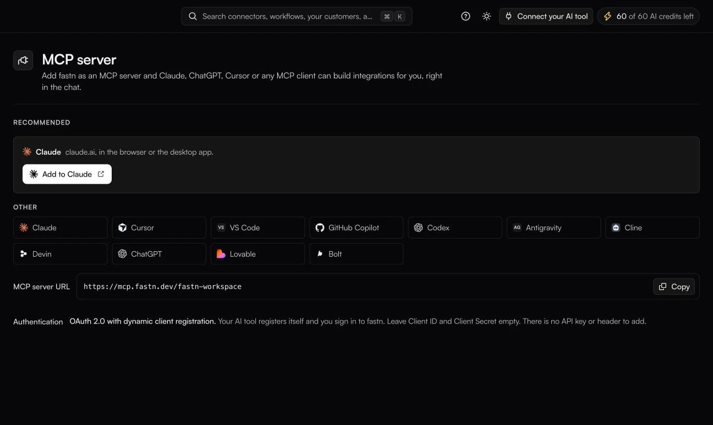

# Build from your AI tool

Once Fastn is connected to your AI tool through the [Fastn MCP server](mcp-gateway/README.md), you can ask for an integration in the chat. Whichever AI tool you use, it follows Fastn's integration-builder playbook, which Fastn serves to your AI tool and can update over time. A typical run follows these steps, with something for you to approve along the way. The exact steps come from the playbook, so they can differ from this table as Fastn updates it.

<figure><figcaption><strong>Embed → MCP server</strong>, also opened from <strong>Connect your AI tool</strong> in the top bar.</figcaption></figure>

| Step | What your AI tool does | What you do |
| --- | --- | --- |
| 1. Understand | Checks who you are and what's already in your workspace | Approve the read-only Fastn calls |
| 2. Plan | Picks the connectors and recommends a plan | Answer its business questions; the recommendation is pre-selected |
| 3. Map (only when data moves between apps) | Proposes field mappings and filters | Approve them on the review page it links to |
| 4. Test cases | Writes acceptance tests for the whole integration | Approve them on the review page; this is the go-ahead to build |
| 5. Build | Builds, tests, and publishes each workflow, sets its trigger, and can set up a widget | Confirm how often it runs, and any test that writes more than a couple of live records |
| 6. Verify | Runs the approved tests and checks real runs | Read its report: what's running, what passed, what's left |

If an account isn't connected yet, your AI tool stops and sends a connect link. Enter credentials there, never in the chat.

This is the same idea as the in-app [Fastn agent](agent/README.md), run from the AI tool you already use, and it uses no Fastn AI credits.

### Where the result lands in Fastn

| What | Where |
| --- | --- |
| The workflows | **Build → Integrations → Workflows** |
| Tests and their results | Open the workflow → **Test cases** |
| Every run | Open the workflow → **Executions** |
| What your customers see | **Embed → Widget** (style, embed, publish) |

### Test it

Test from your AI tool or from your widget, not from the workflow editor.

* **From your AI tool:** ask in the same chat, for example *"Run all the test cases for the invoice integration and tell me what passed."* It runs every approved test case and reports back.
* **From the widget:** connect a test account in your widget and let the integration run, the way your customers use it.

Each run then shows under the workflow's **Executions**.
