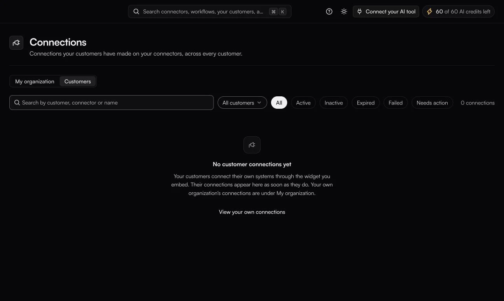

# Connections

**Operate → Connections** · `/connections`

A **connection** is one signed-in account on one connector: the stored, encrypted result of someone authorizing access once. Every later call reuses it, so nobody signs in again. Workflows act through connections.

A [connector](../connectors/README.md) is the definition of an app; a connection is a credential for it. One connector can have many connections: one for your organization and one for each customer who connects.

### How connections work

* **Who it belongs to.** A connection belongs either to your organization (made by someone on your team) or to one of your customers (made through your embedded widget). The two are shown in separate views on this page.
* **How it is addressed.** Every connection has a connection ID. It has the form `ucl:<workspace>:<customer or default>:<connectorId>:<identity>[:<account>]`: after `ucl:` come your workspace, the customer (`default` when the connection is your own organization's), the connector's ID, an identity for the credential, and optionally an account, separated by colons. Pass it to the API to act as that account.
* **Whether it still works.** Each connection has a status: `Active`, `Inactive`, `Expired` or `Failed`. The **Needs action** filter collects the ones that need someone to act. See [Statuses](statuses.md).
* **How it is kept alive.** For OAuth connections, fastn refreshes the access token before it runs out.
* **Fixing or ending one.** **Reconnect** signs in again to repair a broken connection. **Rename** changes its name. **Disconnect** stops all syncing and deletes the credential.

### My organization and Customers

The toggle at the top switches between two views.

<figure><figcaption>The <strong>Customers</strong> tab before any customer has connected an app.</figcaption></figure>

| View | Shows | Page subtitle |
| --- | --- | --- |
| **My organization** | Connections your team made. | *Connections your organization holds on its connectors. Workflows act through them.* |
| **Customers** | Connections your customers made through the widget, across every customer. | *Connections your customers have made on your connectors, across every customer.* |

The **Customers** view adds an **All customers** selector to show one customer's connections and a **Customer** column in the table, and its search box also matches customer names.

### Finding a connection

* **Search connections** matches the connector and connection name. In the Customers view the box reads **Search by customer, connector or name** and also matches customer names.
* The status chips **All**, **Active**, **Inactive**, **Expired**, **Failed** and **Needs action** show only connections in that state. **Needs action** collects connections that are not active, or are active but can no longer renew their token.
* The count on the right shows how many connections match, for example *5 connections*.

If connections exist but none match, the page reads *No connections match* · *Adjust the filter, or pick the other view.* When there are no connections at all, the **My organization** view reads *No connections yet* with a button to connect one, and the **Customers** view reads *No customer connections yet* and explains that customers connect their own apps through the widget you embed.

### The table

| Column | Meaning |
| --- | --- |
| **Connector** | The app, with the connection's name underneath (`Default` unless it was named). |
| **Customer** | Only in the **Customers** view: the customer the connection belongs to. |
| **Auth** | The auth type the connection was made with, as a display label: for example **OAuth 2.0**, **Bearer token**, **Custom**. See [Auth types](auth-types.md). |
| **Status** | `Active`, `Inactive`, `Expired` or `Failed`. See [Statuses](statuses.md). |
| **Created** | When the connection was made. |
| **⋯** | **Reconnect**, **Set as default** (on an active connection that is not already the default), **Rename** and **Disconnect**. |

Click a row to open its detail page. See [Inside a connection](inside-a-connection.md).

**New connection** (top right) connects a new app for your organization. See [Creating a connection](creating-a-connection.md).

### In this section

* [Statuses](statuses.md): what each status means and what to do about it.
* [Auth types](auth-types.md): the values in the Auth column.
* [Inside a connection](inside-a-connection.md): the detail page, Reconnect and Disconnect.
* [Creating a connection](creating-a-connection.md): New connection and the connect dialog.
