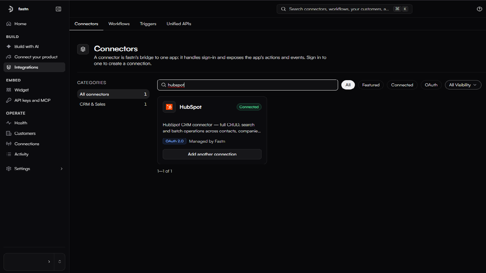
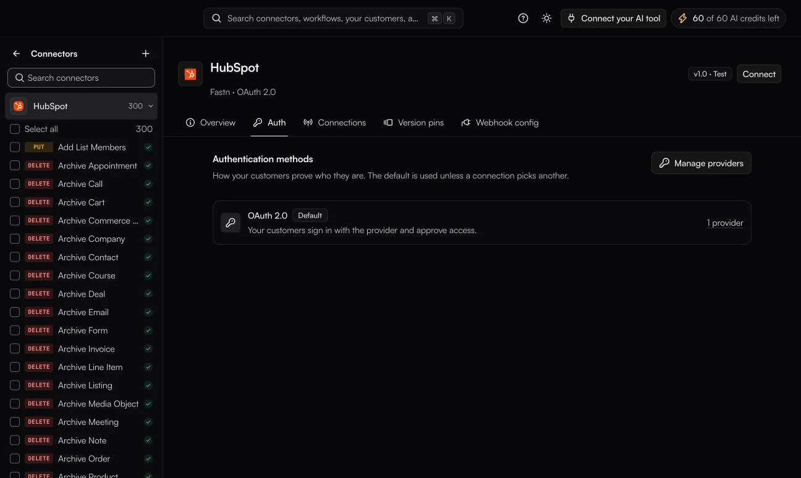

# Auth methods and providers

**Build → Integrations → Connectors** → open a connector → **Auth** · [Open in Fastn](https://app.fastn.dev/integrations)

Auth methods and providers decide how people sign in to an app through a connector. You set them once per connector, and every connection made on that connector uses them.

* **Auth method:** one way a customer can prove who they are to the app: sign in with OAuth, paste an API key, or enter a username and password. A connector can offer several, and one is the default.
* **Auth provider:** the OAuth app (a client ID and client secret registered with the vendor) that an OAuth method uses to send people to the vendor's consent screen.

For example, HubSpot offers one method, OAuth 2.0. When a customer connects HubSpot, the provider decides whose app name the HubSpot consent screen shows: Fastn's shared app, or your own.

### The Auth tab

> How your customers prove who they are. The default is used unless a connection picks another.

One row per method. Each row shows:

* the method's **name**, for example *OAuth 2.0* or *API Key (Bearer)*;
* **Default** on the default method;
* a plain-language description of what the customer does:
  * OAuth: *Your customers sign in with the provider and approve access.*
  * Keys and tokens: *Your customers paste a key they generate themselves.*
* for OAuth methods, how many providers it has, for example *1 provider*.

The method types, how each one works, the value each is stored as, and the fields each one asks for, are listed in [Create a connector → Authentication](creating-a-connector.md#authentication).

### Auth providers

The **Auth Providers** page lists the OAuth apps behind the connector's OAuth methods. Open it from the **Auth** tab with **Manage providers**, then select **+ Create Provider** to add a new one to the list.

| Column | Meaning |
| --- | --- |
| **Name** | The provider's name, for example *HubSpot OAuth*. |
| **Client ID** | The OAuth client ID registered with the vendor. The client secret is never shown. |
| **Preferred** | **Preferred app** marks a default provider. Your own app and the community app can both show it; the connect dialog shows which one it uses. |
| **Used By** | Which connections use this provider. |
| **Actions** | What you can do with it. *Community - read-only* means the provider belongs to Fastn's shared catalog and cannot be changed from your workspace. |

The **‹** arrow returns to the method list.

#### Use your own OAuth app

Every Fastn-managed OAuth connector ships with a **community app** (shown as "[Connector] OAuth"). It works without any setup but is read-only and shared across Fastn customers. A connector your workspace built has no community app, so it has no provider until you create one. Creating your own provider lets you:

* Show your own app name and logo on the service's consent screen when sign-in goes through your app (see Step 6).
* Control exactly which scopes are requested.
* Use your own API rate limits instead of shared ones.
* Rotate or revoke credentials without contacting Fastn.

**Before you start**

* **Who this is for:** an Owner, Admin, Developer, or Operator (a role that can create connectors). On a Fastn-managed connector, your workspace also needs custom OAuth apps allowed. This is on by default; if Fastn has turned it off for your workspace, you can view the providers but not add your own.
* **A developer app** (created in the connected service's developer portal) with OAuth enabled.
* **The app's Client ID and Client Secret.**
* **The scopes your integration needs**, for example `contacts:read`. They must match the scopes configured on the developer app.
* **The service's Authorization URL and Token URL**, from the service's OAuth documentation.
* **Fastn's redirect (callback) URL**, `https://oauth.live.fastn.ai`, registered in your developer app's OAuth settings. The service rejects sign-ins when it does not match.

**Step 1: Open the connector**

1. Go to **Build → Integrations → Connectors** · [Open in Fastn](https://app.fastn.dev/integrations).
2. Type the connector's name in the search box. The matching card appears, grouped under a category such as **CRM & Sales**.
3. Click the connector card. A green **Connected** badge means the connector has at least one active connection. It doesn't mean your own OAuth app is in use yet.

**You should see:** the connector's detail page, on its **Overview** tab.

<figure><figcaption>Find the connector under <strong>Integrations</strong> → <strong>Connectors</strong>.</figcaption></figure>

**Step 2: Open the Auth tab**

Authentication settings live on the connector's **Auth** tab, not on the connector list.

1. On the connector page, click the **Auth** tab. The other tabs are **Overview**, **Connections**, **Version pins**, and **Webhook config**.
2. Under **Authentication methods**, **OAuth 2.0** is marked **Default**. On a Fastn-managed connector it shows "1 provider" on the right: the community app.
3. Click **Manage providers** at the top right of the panel.

**You should see:** the **Auth Providers** page.

<figure><figcaption>The Auth tab lists each method; <strong>Manage providers</strong> is where your own OAuth app goes.</figcaption></figure>

**Step 3: Review existing providers**

The **Auth Providers** page lists every set of OAuth credentials for this connector, with columns for **Name**, **Client ID**, **Preferred**, **Used By**, and **Actions**.

* **[Connector] OAuth** is the community app. It carries the **Preferred app** badge and the label "Community - read-only", so you cannot edit or delete it.
* Your own providers appear below it once created, with **Edit** and **Delete** actions.

Click **+ Create Provider** at the top right to add your own.

**You should see:** the **New Auth Provider** dialog.

**Step 4: Enter your app's identity and scopes**

The **New Auth Provider** dialog opens. Fill in the top section first.

1. **Name**: a label your team recognizes, for example *My Company [Connector] App*.
2. **Description** (optional): a note such as "Production credentials".
3. **Client ID**: paste the Client ID from your developer app on the service you are connecting.
4. **Client Secret**: paste the Client Secret from the same app. Treat it like a password.
5. **Scopes**: type a scope in the format the service uses and press Enter (or click **Add**), for example `contacts:read`. Repeat for each scope.
   * Use **+ Detailed** to add a scope with a label and description.
   * Use **+ Group** to bundle related scopes together.

Scroll down in the dialog to continue. The **Create** button stays disabled until the required fields are filled.

**You should see:** **Name**, **Client ID**, **Client Secret** and your scopes filled in.

**Step 5: Set the endpoints and grant types**

Scroll to the lower half of the dialog. The gray placeholders in the fields are examples only; replace them with the endpoints published in the service's OAuth documentation.

| Field | What to enter |
| --- | --- |
| **Response Type** | `code` (pre-filled; leave as is for the standard authorization code flow) |
| **Authorization URL** | The service's OAuth authorize endpoint, for example `https://auth.example.com/oauth/authorize` |
| **Token URL** | The service's token endpoint, for example `https://auth.example.com/oauth/token` |
| **Grant Type** | **Authorization code (with grant_type)**, the default |
| **Token Grant Type** | **Refresh token (with grant_type)**, the default |
| **URL Variables** (optional) | Fill only if the service's URLs contain account-specific parts, such as a subdomain or region |

Confirm the URLs and grant types against the service's OAuth documentation before saving, since providers can change endpoints.

Click **Create** when every field is filled.

**You should see:** your provider in the list, under the community app.

**Step 6: Make your app preferred**

After you click **Create**, your provider appears in the list under the community app, for example "My Company Custom App". It is not your preferred app yet: only the community app has the **Preferred app** badge.

1. In your provider's row, click **Use this app** in the **Preferred** column. Your app gets the **Preferred app** badge. The community app keeps its own badge, so both rows show it.
2. Check the Client ID in the row matches the one in your developer app.
3. Open the **Connections** tab and create a test connection. The connect dialog shows the provider it uses; if it isn't your app, pick yours under **⋯** → **Change provider**. If it still shows the community app, contact Fastn.

**You should see:** your app's name on the service's consent screen.

To change credentials later, click **Edit** on your provider's row. **Delete** is available only when no active connection uses the provider.

**Security and troubleshooting**

| Symptom | Likely cause | Fix |
| --- | --- | --- |
| **Create** button is grayed out | A required field is empty | Fill **Name**, **Client ID**, and **Client Secret**, then retry |
| The service shows a redirect URI error | Fastn's callback URL is not registered in your developer app | Add the exact callback URL in the app's OAuth settings on the service. Some services, such as Airtable, expect it with a trailing slash (`https://oauth.live.fastn.ai/`). If the error persists with the URL registered exactly, contact Fastn |
| The service shows an invalid scope error | A scope in Fastn is not enabled on the developer app | Make the scope lists match in both places |
| Consent screen still shows the community app | Both apps show **Preferred app**, and the connect dialog picked the community app | For a test connection in the dashboard, pick your app under **⋯** → **Change provider**. Customers connecting in the widget can't choose, so if they keep getting the community app, contact Fastn |
| Sign-in fails after a secret change | Fastn still holds the old secret | Edit the provider and paste the new **Client Secret** |

### How the default method is chosen

* The connect dialog opens with the **default** method selected.
* If the connector offers more than one method, the dialog has an **Auth Method** selector, so the person connecting can choose another (for example Airtable offers *OAuth 2.0* and *Bearer Token*).
* The method chosen is saved on the connection. You see it in the **Auth** column on the [Connections](../connections/README.md) page.
