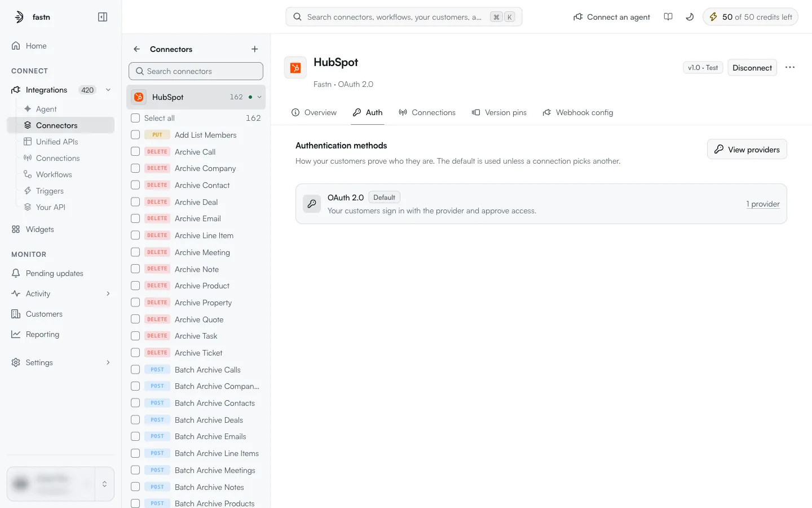
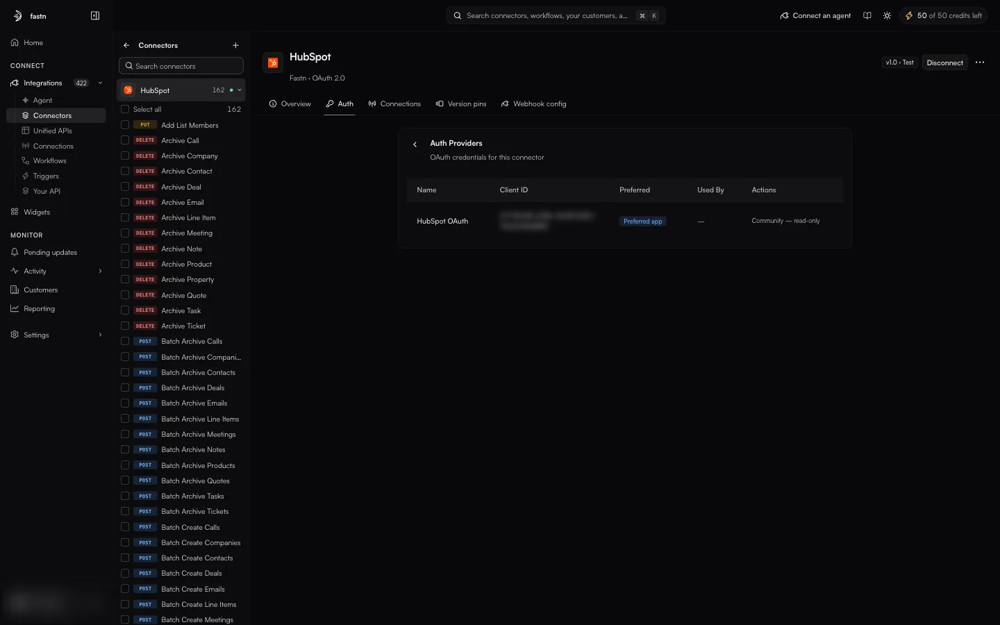
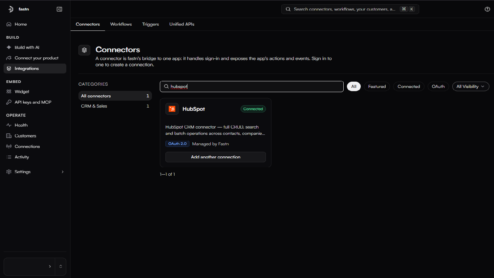
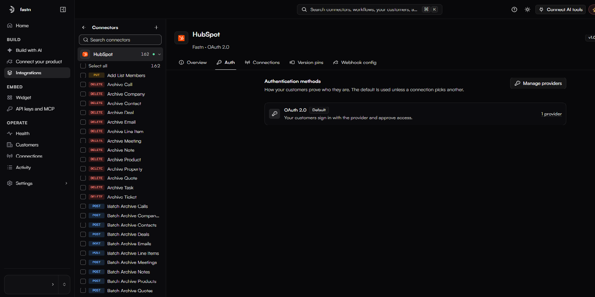
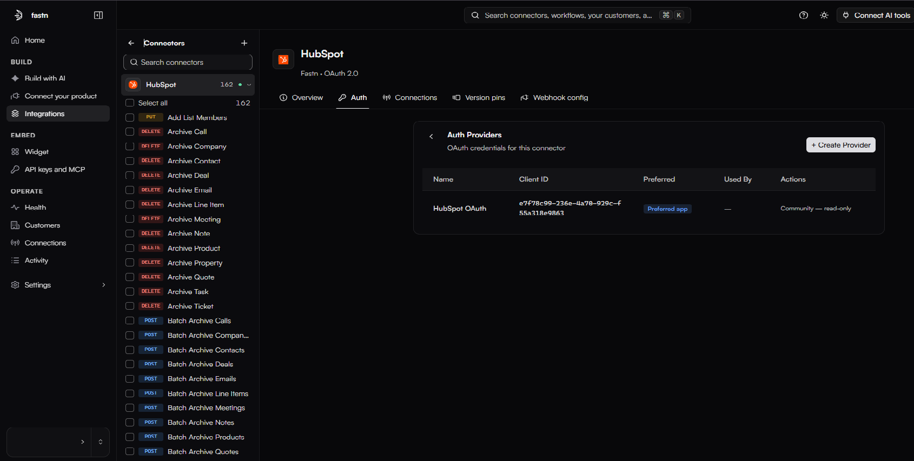
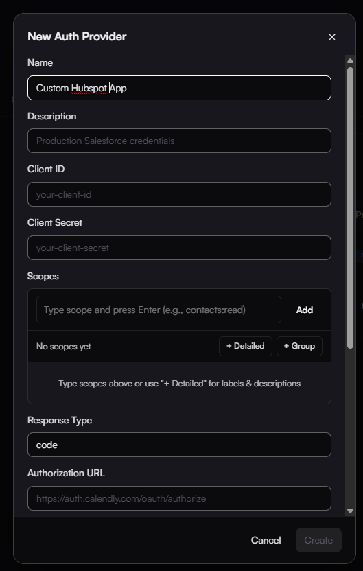
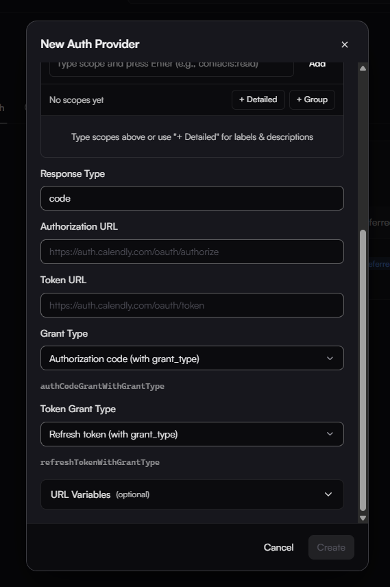
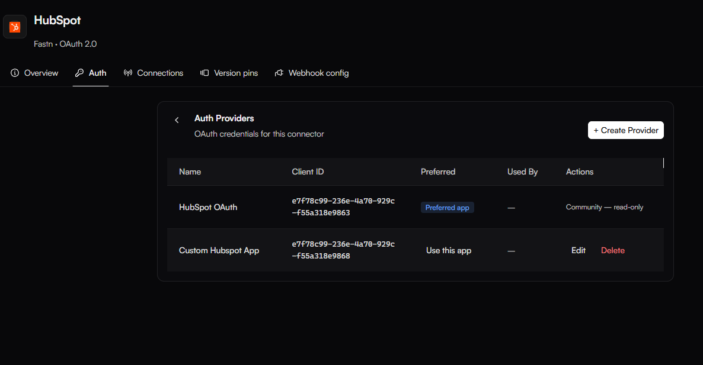

# Auth methods and providers

An **auth method** is one way a customer can prove who they are to the app: sign in with OAuth, paste an API key, enter a username and password. An **auth provider** is the OAuth app (a client ID and client secret registered with the vendor) that an OAuth method uses to send people to the vendor's consent screen.

### The Auth tab

<figure><figcaption>HubSpot offers one method, OAuth 2.0, backed by one provider.</figcaption></figure>

> How your customers prove who they are. The default is used unless a connection picks another.

One row per method. Each row shows:

* the method's **name**, for example *OAuth 2.0* or *API Key (Bearer)*;
* **Default** on the default method;
* a plain-language description of what the customer does:
  * OAuth: *Your customers sign in with the provider and approve access.*
  * Keys and tokens: *Your customers paste a key they generate themselves.*
* for OAuth methods, how many providers it has, for example *1 provider*.

The method types, and the fields each one asks for, are listed in [Creating a connector → Authentication](creating-a-connector.md#authentication). The value stored for each type (`OAUTH_2`, `API_KEY`, `BEARER`, `BASIC`, `DIGEST`, `INPUT`, `NO_AUTH`) is what the header line and the [Connections](../connections/README.md) page show.

### Auth providers

**View providers** lists the OAuth apps behind the connector's OAuth methods.

<figure><figcaption>A managed connector's provider is fastn's own OAuth app, so its row is read-only.</figcaption></figure>

| Column | Meaning |
| --- | --- |
| **Name** | The provider's name, for example *HubSpot OAuth*. |
| **Client ID** | The OAuth client ID registered with the vendor. The client secret is never shown. |
| **Preferred** | **Preferred app** marks the provider the connect dialog uses by default. |
| **Used By** | Which connections use this provider. |
| **Actions** | What you can do with it. *Community, read-only* means the provider belongs to fastn's shared catalogue and cannot be changed from your workspace. |

The **‹** arrow returns to the method list.

#### Using your own OAuth app

Every OAuth connector in fastn ships with a **community app** (shown as "[Connector] OAuth"). It works out of the box but is read-only and shared across fastn customers. An **auth provider** is a set of OAuth credentials that fastn uses when your customers sign in to a connector. Creating your own provider lets you:

* Show your own app name and logo on the service's consent screen.
* Control exactly which scopes are requested.
* Use your own API rate limits instead of shared ones.
* Rotate or revoke credentials without contacting fastn.

You need a role that can create connectors in your fastn workspace (Owner, Admin, Developer or Operator) to follow these steps.

**Before you begin**

Have these ready before you open fastn.

* A developer app (created in the connected service's developer portal) with OAuth enabled.
* The app's **Client ID** and **Client Secret**.
* The scopes your integration needs, for example `contacts:read`. They must match the scopes configured on the developer app.
* The service's **Authorization URL** and **Token URL** (from the service's OAuth documentation).
* fastn's redirect (callback) URL, `https://oauth.live.fastn.ai`, registered in your developer app's OAuth settings. The service rejects sign-ins when it does not match.
* One of the roles above in your fastn workspace.

**Step 1: Open the connector**

Start in **Integrations**, then open the connector you want to configure.

1. In the left sidebar, under **Build**, click **Integrations**.
2. Make sure the **Connectors** tab is selected at the top of the page.
3. Type the connector's name in the search box. The matching card appears, grouped under a category such as **CRM & Sales**.
4. Click the connector card. A green **Connected** badge means the connector is already available in your workspace; this does not mean your own credentials are in use yet.

<figure><figcaption>Find the connector under <strong>Integrations</strong> → <strong>Connectors</strong>.</figcaption></figure>

**Step 2: Open the Auth tab**

Authentication settings live on the connector's **Auth** tab, not on the connector list.

1. On the connector page, click the **Auth** tab. The other tabs are **Overview**, **Connections**, **Version pins** and **Webhook config**.
2. Under **Authentication methods**, you will see **OAuth 2.0** marked **Default**, with "1 provider" on the right. This is the community app.
3. Click **Manage providers** at the top right of the panel.

<figure><figcaption>The <strong>Auth</strong> tab, with <strong>Manage providers</strong> at the top right.</figcaption></figure>

**Step 3: Review existing providers**

The **Auth Providers** page lists every set of OAuth credentials for this connector, with columns for **Name**, **Client ID**, **Preferred**, **Used By** and **Actions**.

* **[Connector] OAuth** is the community app. It carries the **Preferred app** badge and the label "Community - read-only", so you cannot edit or delete it.
* Your own providers appear below it once created, with **Edit** and **Delete** actions.

Click **+ Create Provider** at the top right to add your own.

<figure><figcaption>The community app, before you add your own.</figcaption></figure>

**Step 4: Enter your app's identity and scopes**

The **New Auth Provider** dialog opens. Fill in the top section first.

1. **Name**: a label your team will recognize, for example *My Company [Connector] App*.
2. **Description** (optional): a note such as "Production credentials".
3. **Client ID**: paste the Client ID from your developer app on the service you are connecting.
4. **Client Secret**: paste the Client Secret from the same app. Treat it like a password.
5. **Scopes**: type a scope in the format the service uses and press Enter (or click **Add**), for example `contacts:read`. Repeat for each scope.
   * Use **+ Detailed** to add a scope with a label and description.
   * Use **+ Group** to bundle related scopes together.

Scroll down in the dialog to continue. The **Create** button stays disabled until the required fields are filled.

<figure><figcaption>The top half of <strong>New Auth Provider</strong>.</figcaption></figure>

**Step 5: Set the endpoints and grant types**

Scroll to the lower half of the dialog. The grey placeholders in the fields are examples only; replace them with the endpoints published in the service's OAuth documentation.

| Field | What to enter |
| --- | --- |
| **Response Type** | `code` (pre-filled; leave as is for the standard authorization code flow) |
| **Authorization URL** | The service's OAuth authorize endpoint, for example `https://auth.example.com/oauth/authorize` |
| **Token URL** | The service's token endpoint, for example `https://auth.example.com/oauth/token` |
| **Grant Type** | **Authorization code (with grant_type)**, the default |
| **Token Grant Type** | **Refresh token (with grant_type)**, the default |
| **URL Variables** (optional) | Fill only if the service's URLs contain account-specific parts, such as a subdomain or region |

Confirm the URLs and grant types against the service's OAuth documentation before saving, since providers can change endpoints.

Click **Create** when every field is filled.

<figure><figcaption>The lower half, with the endpoints and grant types.</figcaption></figure>

**Step 6: Switch to your app**

After you click **Create**, your provider appears in the list under the community app, for example "My Company Custom App". It is not active yet: the community app still holds the **Preferred app** badge.

1. In your provider's row, click **Use this app** in the **Preferred** column. The badge moves to your app.
2. Check the Client ID in the row matches the one in your developer app.
3. Open the **Connections** tab and create a test connection. The service's consent screen should show your app's name.

To change credentials later, click **Edit** on your provider's row. **Delete** is available only when no active connection uses the provider.

<figure><figcaption>Your provider, ready for <strong>Use this app</strong>.</figcaption></figure>

**Security and troubleshooting**

| Symptom | Likely cause | Fix |
| --- | --- | --- |
| **Create** button is greyed out | A required field is empty | Fill **Name**, **Client ID** and **Client Secret**, then retry |
| The service shows a redirect URI error | fastn's callback URL is not registered in your developer app | Add the exact callback URL in the app's OAuth settings on the service |
| The service shows an invalid scope error | A scope in fastn is not enabled on the developer app | Make the scope lists match in both places |
| Consent screen still shows the community app | Your provider is not the preferred app | Click **Use this app** on your provider's row |
| Sign-in fails after a secret change | fastn still holds the old secret | Edit the provider and paste the new **Client Secret** |

### How the default method is chosen

* The connect dialog opens with the **default** method selected.
* If the connector offers more than one method, the dialog has an **Auth Method** selector, so the person connecting can choose another (for example Airtable offers *OAuth 2.0* and *Bearer Token*).
* The method chosen is saved on the connection. You see it in the **Auth** column on the [Connections](../connections/README.md) page.
