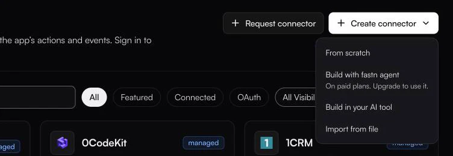

# Create a connector

**Build → Integrations → Connectors** → **Create connector** · [Open in Fastn](https://app.fastn.dev/integrations)

Create a connector when the app you need isn't in the [catalog](the-catalogue.md). The connector you create is private to your organization and owned by your workspace, so you can edit it, add actions to it and publish versions of it.

For a step-by-step walkthrough, see [Configure a connector](../../tutorials/saas-admin/configuring-a-connector.md). This page is the reference for every option.

### Before you start

* **Who this is for:** an Owner, Admin, Developer or Operator. Viewers cannot create connectors.
* **The app's API details:** its base URL, how it authenticates, and for OAuth, a client ID and secret from an OAuth app you registered with the vendor.
* **Check the [catalog](the-catalogue.md) first.** If Fastn already has the app, connect to it instead.

### Ways to create a connector

The **Create connector** menu, at the top right of the catalog, offers four ways:

* **From scratch:** opens the **Create a connector** dialog, described on the rest of this page.
* **Build in your AI tool:** shows how to connect your AI tool to the [Fastn MCP server](../mcp-gateway/README.md) and build the connector there. Works on every plan and uses no Fastn AI credits.
* **Build with fastn agent:** opens the [Fastn agent](../agent/README.md). On paid plans; on Launch the item reads *On paid plans. Upgrade to use it.*
* **Import from file:** opens a file picker that accepts one `.json` connector file. See [Import and export](importing-and-exporting.md#import).

**Build in your AI tool** and **Build with fastn agent** show only where your role can use them. If your role cannot create connectors, the catalog shows an **Import** button instead of the menu.

<figure><figcaption>The four ways to create a connector.</figcaption></figure>


You rarely need to build a connector by hand. Describe the app to your AI tool through the Fastn MCP server (**Create connector → Build in your AI tool**, every plan), or to the Fastn agent (**Create connector → Build with fastn agent**, on paid plans), and give it the vendor's API docs or an OpenAPI file. It creates the connector, its actions, and its auth method, then tests them.


### The Create a connector dialog

**Create connector → From scratch** opens the **Create a connector** dialog. It has three sections: **Identity**, **Connection**, and **Authentication**. You add actions after the connector exists. The dialog footer says so: *You can add operations after it is created.*

The **+** at the top of the connector rail on a detail page opens a separate create dialog. Its footer stays blank once you enter a name, and its **Protocol** list offers only `REST` and `MCP` for most users.

### Identity

| Field | Required | Notes |
| --- | --- | --- |
| **Name** | Yes | What people see on the card and in the widget. Placeholder: `Salesforce`. |
| **Slug** | Yes | The identifier used in API paths and in workflow code. *Derived from the name. Edit it to override.* Start with a lowercase letter and use lowercase letters, digits and hyphens, for example `acme-crm`. The form blocks capital letters, spaces and underscores before you submit, so a slug derived from a two-word name (such as `acmeCrm` from *Acme CRM*) has to be edited, for example to `acme-crm` or `acmecrm`. |
| **Description** | No | Shown on the card. The Fastn agent also reads it to decide what the connector is for, so describe what the app does and which parts of its API the connector covers. |

### Connection

| Field | Notes |
| --- | --- |
| **Protocol** | How Fastn talks to the app: `REST` (default), `MCP`, `FTP`, `Database`, or `REDIS`. The choice changes the rest of the dialog; see below. |
| **Visibility** | Always `Private`: *Only your organization can see it. Publishing to the customer catalog is done by a platform admin.* |
| **Domain** | Optional. The vendor's domain, for example `salesforce.com`. Used to find the connector's icon. |
| **Icon URL** | Optional. An image URL to use as the icon instead. |

What each protocol adds:

| Protocol | Extra fields in the dialog | Authentication section |
| --- | --- | --- |
| **REST** | None. | Shown. |
| **MCP** | **MCP Server URL**: the address of the MCP server the connector talks to. | Shown. |
| **FTP** | **Transfer Protocol**: `SFTP`, `FTP`, or `FTPS`. A **Connection Fields** list shows what users enter when they connect: **Host**, **Port**, **Username**, and either **Password** or **SSH Private Key (PEM)**. | Replaced by Connection Fields. |
| **Database** | **Connection Fields**: **Database Type** (`postgres`, `mysql`, `mssql`, `redshift`, or `mongodb`), **Host**, **Port**, **Database**, **Username**, **Password**, **SSL Mode** (`disable`, `prefer`, `require`, or `verify-full`), and for SQL Server: **SQL Server Sign-in** (`sql` for a SQL login, or `azure-ad-password` for a Microsoft Entra ID account), **Azure Tenant ID** (required with `azure-ad-password`), and **Azure Client ID** (optional). | Replaced by Connection Fields. |
| **REDIS** | **Connection Fields**: **Host**, **Port**, **Password**, **TLS** (default off), and **Database** (a number from 0 to 15, default 0). | Replaced by Connection Fields. |

For FTP, Database, and REDIS the dialog notes that the host, port, and credentials are entered when someone adds a connection, not here.

### Authentication

> How your customers authorize this connector. The first one is the default unless you say otherwise.

Each method is one block. **Add method** adds another block, so one connector can offer, for example, both OAuth and an API key. Each block has:

* a **type** selector;
* **Set as default**: the default method is the one the connect dialog opens with;
* **Authentication docs URL** (optional): *Shown on the connect page so users can find where to generate this credential.*;
* settings that depend on the type (below).

There are seven types:

| Type | Stored as | How it works | Example apps | Type-specific settings |
| --- | --- | --- | --- | --- |
| **No Auth** | `NO_AUTH` | No authentication. For public APIs. | Public data feeds | None. Requests go out without credentials. |
| **Basic Auth** | `BASIC` | Username and password, sent as Base64 in the `Authorization` header. | Legacy APIs, internal apps | A Configuration with `username` and `password`. |
| **Digest Auth** | `DIGEST` | Username and password, using HTTP digest authentication. | APIs that require digest auth | A Configuration with `username` and `password`. |
| **Bearer Token** | `BEARER` | A token, sent in the `Authorization` header as `Bearer {token}`. | Many modern APIs | A Configuration with `bearerToken` and a hidden `expires_in`. |
| **API Key** | `API_KEY` | A key, sent in a custom header such as `X-API-Key`. | Stripe, SendGrid, OpenAI | A Configuration with `apiKeyName` (the header name, default `Api-Token`, hidden from users), `apiKeyValue` (the key), and a hidden `expires_in`. |
| **OAuth 2.0** (default) | `OAUTH_2` | The user signs in on the app's own screen and approves access. Fastn refreshes the token. | Slack, Shopify, HubSpot, Xero, Google | **Use Dynamic Client Registration (DCR)** (RFC 7591), and **Additional OAuth Config**, a list of extra key/value settings sent with the OAuth flow. The OAuth app itself (client ID and secret) is added afterwards as an [auth provider](auth-methods.md#auth-providers). |
| **Custom** | `INPUT` | Fields you define, for example an account subdomain plus a token. | Internal tools, custom APIs | An empty Configuration. You define every field the user must enter. |

The **Stored as** value is the type saved with the auth method, for example in an exported bundle. The **Auth** column on the [Connections](../connections/README.md) page and the connector's header line show readable labels instead, such as *OAuth 2.0*, *API key*, or *Custom*.

#### The Configuration editor

The Configuration lists the fields a user fills in on the connect form. Switch between **Form** and **JSON** to edit it either way. In JSON, each field is a key with these properties:

| Property | Meaning |
| --- | --- |
| `description` | The label shown to the user. |
| `required` | `"true"` if the user must fill it in. |
| `type` | `password` masks the input. `number` expects a number. |
| `default` | A value used when the user enters nothing. |
| `hidden` | `"true"` hides the field from the user. Use it together with `default` for fixed values. |
| `disabled` | `"true"` makes the field read-only. |

This is the default Configuration for **API Key**:

```json
{
  "apiKeyName": {
    "description": "",
    "default": "Api-Token",
    "required": "false",
    "hidden": "true",
    "disabled": "true"
  },
  "apiKeyValue": {
    "description": "Api Key",
    "required": "true",
    "type": "password"
  },
  "expires_in": {
    "type": "number",
    "default": "100000",
    "hidden": "true",
    "disabled": "true"
  }
}
```

Change `apiKeyName`'s `default` to the header the vendor expects, for example `X-API-Key`.

### Save the connector

The footer reads *Give it a name to continue.* until **Name** is filled in. **Create connector** then creates the connector as a private connector owned by your workspace, with version `v1.0` in **Test**. Its card is badged `Custom`. Add actions from the connector's detail page; see [Edit, publish, and delete](editing-and-deleting.md#add-an-action).

### Request a connector

If you would rather Fastn built the connector, use **Request connector** on the catalog page.

| Field | Required | What to write |
| --- | --- | --- |
| **Which system?** | Yes | The app's name. |
| **Website or API docs** | Yes | *The docs if you have them, the product page otherwise. This is the difference between an estimate and a guess.* |
| **What does it need to do?** | Yes | *The workflow, not the endpoint.* For example: *When a deal closes in HubSpot, create the employee record in Workday and keep their department in sync.* This tells the team which actions you need, and sometimes shows that an existing connector already does it. |
| **Anything else?** | No | How it authenticates, sandbox credentials, a vendor contact, how many customers are waiting, a deadline. |

**Send request** submits it. *We may follow up by email. Nothing here commits us to a date.*
