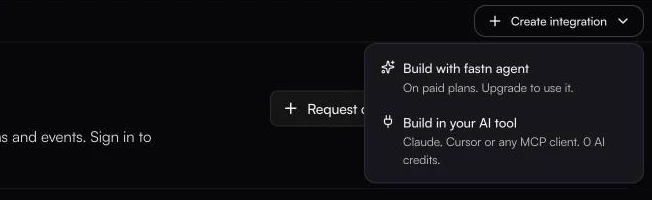

# Integrations

**Build → Integrations** ([open in app](https://app.fastn.dev/integrations)).

An integration is a connector, a connection, the trigger that starts it, and the workflow logic around them. The **Integrations** page in the dashboard has a tab for each building block, and a **Create integration** menu in its header: **Build with fastn agent** (*Describe it in plain words. Uses AI credits.*; on Launch it reads *On paid plans. Upgrade to use it.*) and **Build in your AI tool** (*Claude, Cursor or any MCP client. 0 AI credits.*).

<figure><figcaption>The <strong>Create integration</strong> menu on the Launch plan.</figcaption></figure>

| Building block | What it is | When you touch it |
| --- | --- | --- |
| [Connectors](connectors/README.md) | The apps your customers can connect, with their actions, auth methods, and webhooks | Finding an app, adding your own OAuth app, or creating a connector for an app that isn't in the catalog |
| [Unified APIs](unified-apis/README.md) | One endpoint per business object (contact, deal, ticket) across every app that holds it | When your product should work the same way whichever CRM or helpdesk a customer uses |
| [Workflows](workflows/README.md) | The code that moves and transforms data between apps | Reviewing what was built, changing logic, testing, and publishing |
| [Triggers](triggers/README.md) | What starts a workflow: a webhook, a schedule, or an app event | Deciding when an integration runs |

Most of the time you don't create these one by one. Describe the integration to [the Fastn agent](agent/README.md) or [your AI tool](building-from-your-ai-agent.md), and Fastn picks the connectors, writes the workflow, and sets the trigger. These pages are where you look at, adjust, and debug what was built.

The connections your customers create live under [Operate → Connections](connections/README.md).
