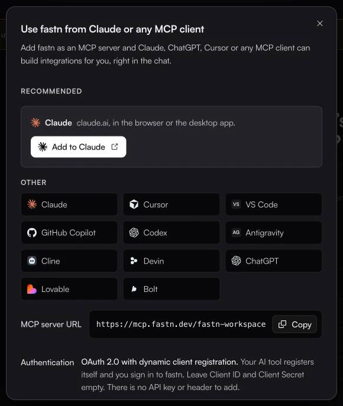

# fastn MCP server

Everything you build in fastn (connectors, actions, workflows) can be used from an AI client over the Model Context Protocol. The client sees your fastn workflows and the fastn platform tools, and reaches your connectors' actions through those platform tools, with the same customer scoping and the same permission model as everything else. Your AI tool can also build new integrations for you, right in the chat: see [Build from your AI tool](../building-from-your-ai-agent.md).


**Which MCP do I need?** To build and manage integrations from Claude, Cursor, or another AI tool, use the **fastn MCP server** (`https://mcp.fastn.dev/fastn-workspace`). To let your AI agent, or a customer's AI client, use a customer's connected apps, use **fastn Connect**, the MCP gateway. See [Architecture](../../getting-started/architecture.md#which-mcp-do-i-need).


fastn has two MCP addresses, for two different jobs:

<figure><figcaption><p>The MCP server builds integrations. The MCP gateway lets AI agents use them.</p></figcaption></figure>

| Address | What it is for | Who connects |
| --- | --- | --- |
| `https://mcp.fastn.dev/fastn-workspace` | **fastn MCP server** (this page): build and manage integrations from a chat | Your team, from Claude, Cursor, or another AI tool. Your customers get their own one-time URL from the widget, if you allow it: see [Customer MCP URL](../../embed/embedding/customer-mcp-url.md) |
| `https://mcp.fastn.dev/<your-org>` | **fastn Connect** (the MCP gateway): AI agents use each customer's connected apps as tools | Your AI agents |

### Open the connect dialog

Click **Connect your AI tool** in the top bar, or open **Embed → MCP server**. Both show the same picker: **Use fastn from Claude or any MCP client**. Both need the **Developer** role or above; below that, neither is shown.

<figure><figcaption><strong>Add to Claude</strong> is the one-click path. Every other client uses the same URL.</figcaption></figure>

Every client uses the same MCP server URL, shown at the bottom of the dialog with a **Copy** button:

```
https://mcp.fastn.dev/fastn-workspace
```

### How your AI tool connects

You add fastn as an MCP server at that URL. The client sends you to fastn to sign in, so no API key is needed. The **MCP server** page names the method: OAuth 2.0 with dynamic client registration, so leave any Client ID and Client Secret fields empty. If you belong to more than one fastn org, fastn also asks which workspace the client works in; with one org it connects straight away.

| Client | Where you add fastn |
| --- | --- |
| [Claude](claude.md) | **Settings** → **Connectors** → **Add custom connector**, or **Add to Claude** in fastn |
| [Claude Code](claude-code.md) | `claude mcp add --transport http fastn <URL>` |
| [ChatGPT](chatgpt.md) | **Plugins** → **Add** → **Add custom MCP server** |
| [Cursor](cursor.md) | **Add to Cursor** in fastn, or **Customize** → **MCPs** |
| [VS Code](vscode.md) | **Install in VS Code** in fastn, or `.vscode/mcp.json` |
| [GitHub Copilot](github-copilot.md) | VS Code, Visual Studio, JetBrains, Xcode, or Eclipse: the editor's `mcp.json` |
| [Codex](codex.md) | `codex mcp add fastn --url <URL>` |
| [Antigravity](antigravity.md) | `~/.gemini/config/mcp_config.json`, then **Customizations** → **Authenticate** |
| [Devin](devin.md) | **Customize** → **MCPs** → **New MCP** |
| [Cline](cline.md) | **MCP** → **Add Remote Server**, or `cline_mcp_settings.json` |
| [Lovable](lovable.md) | **Connectors** → **Add custom** → **MCP server** |
| [Bolt](bolt.md) | **Connectors (MCP)** → **Custom MCP server** |

#### Any other MCP client

Any client that speaks Streamable HTTP and OAuth can add fastn the same way: give it the URL above and sign in when it asks.

### Scope and permissions

A client that signs in acts as you. Its fastn tools run in the workspace you signed in to (or picked, if you belong to more than one org), with your own role in that org, so it can do what you can do in the dashboard and nothing more. Picking **The org selected in fastn** makes it follow whichever org you switch to in the dashboard; picking a named org pins it there.


An MCP client can change real things in your org, the same as you can. Review each tool call before you approve it, and sign the client out when you stop using it.


### Monitor activity

Activity from the MCP server lands in the same places as everything else: runs appear in **Operate → Logs → [Executions](../../operate/executions.md)**, with the calling identity in the **Triggered by** column.

An MCP client spends no fastn AI credits. The **By agent** breakdown in the credits popover in the top bar covers fastn's own agents, such as the fastn agent, not your AI tool.

### The A2A option

The widget's Embed tab lists **A2A** (agent-to-agent), alongside Iframe and SDK, marked *soon*. That is the customer-facing counterpart: your customer's own agent reaching the integrations you offer. See [Embed in your product](../../embed/embedding/README.md).

### In this section

* [Claude](claude.md)
* [Claude Code](claude-code.md)
* [ChatGPT](chatgpt.md)
* [Cursor](cursor.md)
* [VS Code](vscode.md)
* [GitHub Copilot](github-copilot.md)
* [Codex](codex.md)
* [Antigravity](antigravity.md)
* [Devin](devin.md)
* [Cline](cline.md)
* [Lovable](lovable.md)
* [Bolt](bolt.md)
