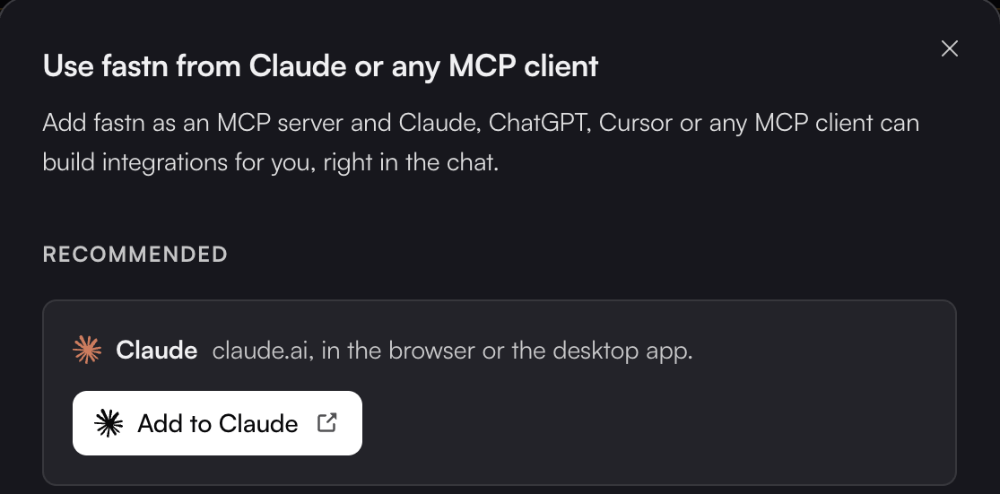

# MCP gateway

Everything you build in fastn (connectors, actions, workflows) can be used from an AI client over the Model Context Protocol. The client sees your connectors as tools it can call, with the same customer scoping and the same permission model as everything else. Your agent can also build new integrations for you, right in the chat: see [Building from your AI agent](../building-from-your-ai-agent.md).

### Connecting

Click **Connect AI tools** in the top bar, or open **Access** → **MCP server**. Both show the same picker: **Use fastn from Claude or any MCP client**.

<figure><figcaption><strong>Add to Claude</strong> is the one-click path. The tiles under <strong>Other</strong> give each client's own steps.</figcaption></figure>

Every client uses the same MCP server URL, shown at the bottom of the dialog with a **Copy** button:

```
https://mcp.fastn.dev/fastn-workspace
```

### How your agent connects

You add fastn as an MCP server at that URL and sign in. The client sends you to fastn, where you sign in and pick the workspace it works in, so no API key is needed.

| Client | Where you add fastn |
| --- | --- |
| [Claude](claude.md) | **Customize** → **Connectors** → **Add custom connector**, or **Add to Claude** in fastn |
| [Claude Code](claude-code.md) | `claude mcp add --transport http fastn <URL>` |
| [ChatGPT](chatgpt.md) | **Settings** → **Plugins** → **Add** → **Add custom MCP server** |
| [Cursor](cursor.md) | **Add to Cursor** in fastn, or **Customize** → **MCPs** |
| [VS Code](vscode.md) | **Install in VS Code** in fastn, or `.vscode/mcp.json` |
| [Codex](codex.md) | `codex mcp add fastn --url <URL>` |
| [Antigravity](antigravity.md) | `~/.gemini/config/mcp_config.json`, then **Customizations** → **Authenticate** |
| [Devin](devin.md) | **Customize** → **MCPs** → **New MCP** |
| [Cline](cline.md) | **MCP** → **Add Remote Server** |
| [Lovable](lovable.md) | **Connectors** → **Add custom** → **MCP server** |
| [Bolt](bolt.md) | **Connectors (MCP)** → **Custom MCP server** |

#### Any other MCP client

Any client that speaks Streamable HTTP and OAuth can add fastn the same way: give it the URL above and sign in when it asks. Gemini CLI works only with a Gemini API key or a Google Cloud project now that personal Google sign-in for it has been retired, and fastn no longer lists it.

### Scoping

A client that signs in acts as you. Its fastn tools run in the workspace you picked when you signed in, with your own role in that org, so it can do what you can do in the dashboard and nothing more. Picking **The org selected in fastn** makes it follow whichever org you switch to in the dashboard; picking a named org pins it there.


An MCP client can change real things in your org, the same as you can. Approve tool calls you don't expect to see, and sign the client out when you stop using it.


### Watching it

Gateway activity lands in the same places as everything else: runs appear in [Executions](../../operate/executions.md), with the calling identity in the **Triggered by** column.

Agent usage against your AI credit allowance is broken down **By agent** in the credits popover in the top bar.

### The A2A option

The widget's Embed tab lists **A2A** (agent-to-agent), alongside Iframe and SDK, marked *soon*. That is the customer-facing counterpart: your customer's own agent reaching the integrations you offer. See [Embedding the widget](../../embed/embedding/README.md).

### In this section

* [Claude](claude.md)
* [Claude Code](claude-code.md)
* [ChatGPT](chatgpt.md)
* [Cursor](cursor.md)
* [VS Code](vscode.md)
* [Codex](codex.md)
* [Antigravity](antigravity.md)
* [Devin](devin.md)
* [Cline](cline.md)
* [Lovable](lovable.md)
* [Bolt](bolt.md)
