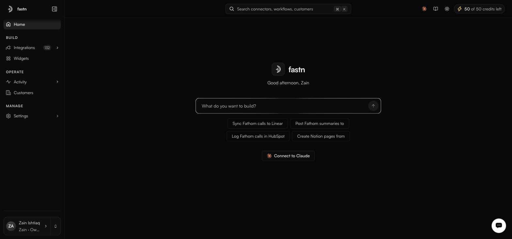
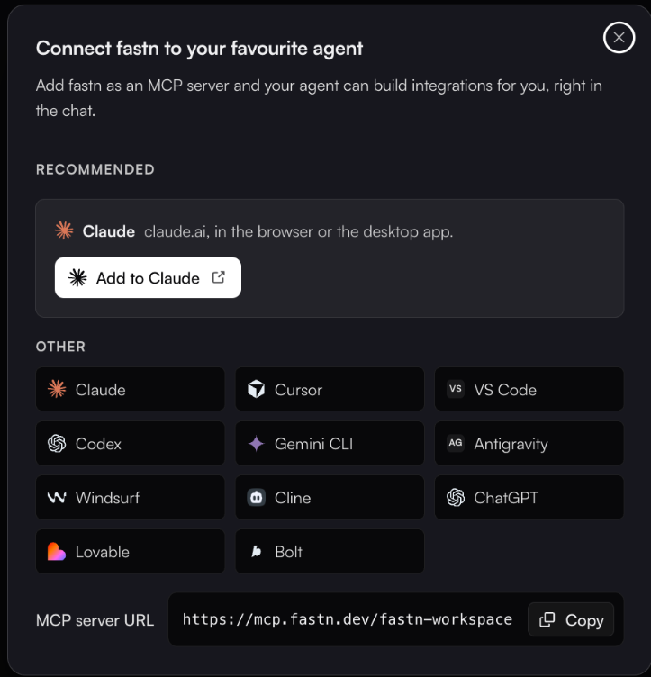

# MCP gateway

**Connect an agent**: in the top bar, and **Connect fastn to your favourite agent** under the prompt box on Home

Everything you build in fastn (connectors, actions, workflows), can be exposed to an AI client over the Model Context Protocol. The client sees your connectors as tools it can call, with the same customer scoping and the same permission model as everything else. Your agent can also build new integrations for you, right in the chat: see [Building from your AI agent](../building-from-your-ai-agent.md).

<figure><figcaption>Connect to Claude sits under the build prompt on Home, below the suggestion chips.</figcaption></figure>


**Looking for a gateway for your whole team's tools?** This page is about reaching your fastn integrations from an agent. To give Claude, ChatGPT or Cursor governed access to Slack, GitHub, Google and thousands of other apps, each person signing in as themselves, see [Fastn Connect](../../connect/README.md).


### Connecting

Either opens the same dialog: _Add fastn as an MCP server and your agent can build integrations for you, right in the chat._

<figure><figcaption><strong>Add to Claude</strong> is the one-click path; every other client takes the same URL.</figcaption></figure>

**Claude** is the recommended client, with **Add to Claude** opening Claude's custom-connector dialog with the name and URL already filled in. Picking any client from **Other** — Cursor, VS Code, Codex, Gemini CLI, Antigravity, Windsurf, Cline, ChatGPT, Lovable, Bolt — swaps in that client's own instructions, including by-hand steps, a Claude Code command and a whole-org option for Claude.

The dialog's own note on the one-click link is worth repeating: it opens Claude with the connector filled in, you review it and authorise fastn yourself, and *Claude never adds a connector from a link on its own.*

The **MCP server URL** sits at the bottom with a **Copy** button.

```
https://mcp.fastn.dev/fastn-workspace
```

For Claude Code, the dialog also gives you a command to run:

```
claude mcp add --transport http fastn https://mcp.fastn.dev/fastn-workspace
```

### How your agent connects

Every agent connects the same way: you add fastn as an MCP server at that URL and authorise it. The agent sends you to fastn to sign in, pick a workspace and choose which apps and tools it may use, so no API key is needed.

| Agent | Where you add fastn | Plan needed |
| --- | --- | --- |
| [Claude](claude.md) | **Customize** → **Connectors** → **Add custom connector** | Any plan with custom connectors |
| [ChatGPT](chatgpt.md) | **Settings** → **Apps & Connectors**, with Developer mode on | Plus, Pro, Business, Enterprise or Edu |
| [Lovable](lovable.md) | **Connectors** → **Chat connectors** → **New MCP server** | Check your Lovable plan |
| [Bolt](bolt.md) | **Connectors (MCP)** → add a custom MCP server | Check your Bolt plan |

For a client that can't sign in through fastn, point it at the same URL and authenticate with an API key from [Settings → API keys](../../manage/api-keys.md) instead:

```
Authorization: Bearer fsk_live_<your-key>
```

Test keys work too, with `X-fastn-Test-Mode: true`, and carry the same warning as everywhere else:

> Neither mode is a sandbox. A Test key reaches the same live connections as a Live key and causes the same real writes.

### Scoping

The gateway inherits the platform's access model rather than inventing a second one:

* **Customer scope**: a connection belongs to one customer, so a tool call runs against that customer's credential and cannot reach another's. Which customers a key may reach is set on the key itself, under *Customers it can reach*.
* **Permissions**: an API key carries a permission preset (`Full access`, `Developer`, `Operator`, `Viewer`, `End user` or `Custom`) and a per-resource matrix. That caps what the gateway can do with it.
* **Action scope**: on a [connector's](../connectors/README.md) detail page, the middle pane lists every action with a **Select all** control. Narrowing that selection is what makes *read-only Jira for one customer, nothing beyond that* a configuration rather than a promise.


An MCP client acts with whatever you authorised it to reach, or whatever the key it holds can do. When you use a key, mint one specifically for the client, give it the narrowest permission preset that works, and name it after the client: the Name field's own helper text is *Shown in the audit log beside everything this key does.*


### Watching it

Gateway activity lands in the same places as everything else: runs appear in [Executions](../../operate/executions.md), with the calling identity in the **Triggered by** column, and calls made with an API key are attributable to that key in the [audit log](../../manage/audit-log.md), which is readable by Owners and Admins.

Agent usage against your AI credit allowance is broken down **By agent** in the credits popover in the top bar.

### The A2A option

The widget's Embed tab lists **A2A** (agent-to-agent), alongside Iframe and SDK, marked *soon*. That is the customer-facing counterpart: your customer's own agent reaching the integrations you offer. See [Embedding the widget](../../embed/embedding/README.md).

### In this section

* [Claude](claude.md)
* [ChatGPT](chatgpt.md)
* [Lovable](lovable.md)
* [Bolt](bolt.md)
