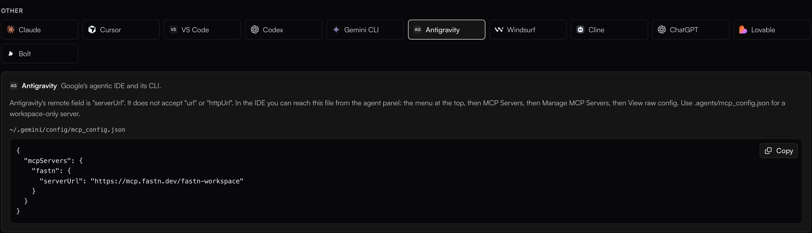
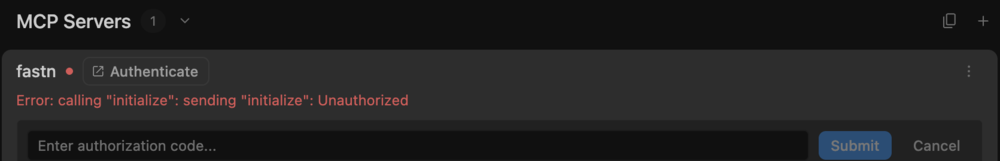
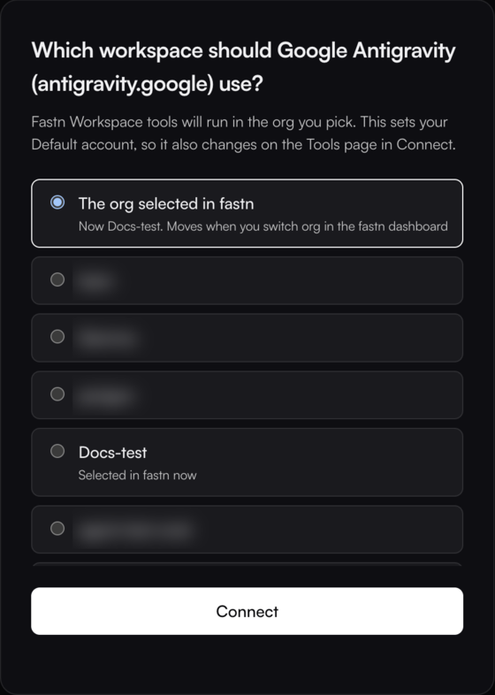
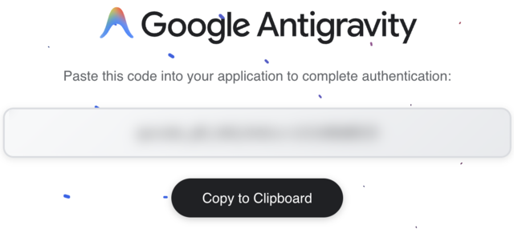
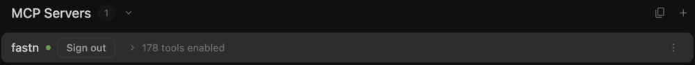
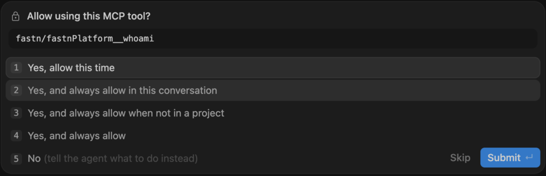

# Antigravity

Google Antigravity has no install button for custom MCP servers: its **Add MCP** button only opens Google's MCP store. Add fastn to Antigravity's MCP config file instead, then sign in from **Customizations**. The Antigravity app, the Antigravity IDE and the Antigravity CLI all read the same file.

## Add fastn



#### Add fastn to the config file

Open `~/.gemini/config/mcp_config.json` in any editor (create it if it does not exist) and add fastn under `mcpServers`. Keep any servers already in the file.

```json
{
  "mcpServers": {
    "fastn": {
      "serverUrl": "https://mcp.fastn.dev/fastn-workspace"
    }
  }
}
```

The key must be `serverUrl`. Antigravity does not read `url` or `httpUrl`, and a server written with them silently loads no tools.

<figure><figcaption>The Antigravity tab under <strong>Connect AI tools</strong> in fastn has the same snippet with a Copy button.</figcaption></figure>

In the Antigravity IDE you can open the same file from the agent panel: the **…** menu at the top, then **MCP Servers** → **Manage MCP Servers** → **View raw config**. For one workspace only, use `.agents/mcp_config.json` in that folder.



#### Load it and click Authenticate

In Antigravity, open **Customizations** in the sidebar (in the IDE: **Antigravity User Settings** → **Customizations**). Under **MCP Servers**, click refresh if fastn is not listed yet.

fastn shows a red dot and an *Unauthorized* error until you sign in. Click **Authenticate**.

<figure><figcaption>The <em>Unauthorized</em> error is expected before you sign in.</figcaption></figure>



#### Pick the workspace

fastn opens in your browser. Sign in if asked, pick the workspace Antigravity works in and click **Connect**.

<figure><figcaption><strong>The org selected in fastn</strong> follows whichever org you have open in the fastn dashboard; picking a named org pins Antigravity to it.</figcaption></figure>



#### Paste the code back into Antigravity

Google shows *Paste this code into your application to complete authentication*. Click **Copy to Clipboard**, go back to Antigravity, paste the code into **Enter authorization code…** and click **Submit**.

<figure><figcaption>The code works once and expires quickly. Paste it straight away.</figcaption></figure>

fastn's dot turns green and the row shows its tools.

<figure><figcaption>fastn is connected. <strong>Sign out</strong> on this row disconnects it.</figcaption></figure>



## Use it

Start a **New Conversation** and ask for the outcome in one sentence. To check the connection first, ask *Who am I in fastn?*

The first time the agent calls a fastn tool, Antigravity asks **Allow using this MCP tool?** Pick **Yes, allow this time**, or one of the always-allow options, and click **Submit**.

<figure><figcaption>The prompt names the server and the tool.</figcaption></figure>

From here Antigravity works through the same steps as every agent: see [Building from your AI agent](../building-from-your-ai-agent.md).

## Antigravity CLI

The CLI reads the same `~/.gemini/config/mcp_config.json`. Run `agy`, then type `/mcp` to check fastn is listed.

## Troubleshooting

* **fastn never appears in Customizations.** Check the file uses `serverUrl` and is valid JSON, then click refresh under **MCP Servers**.
* **The code is rejected.** Codes are single use. Click **Authenticate** again and paste the new code.
* **Antigravity works on the wrong org.** Click **Sign out** on the fastn row, then **Authenticate** and pick the workspace again.
