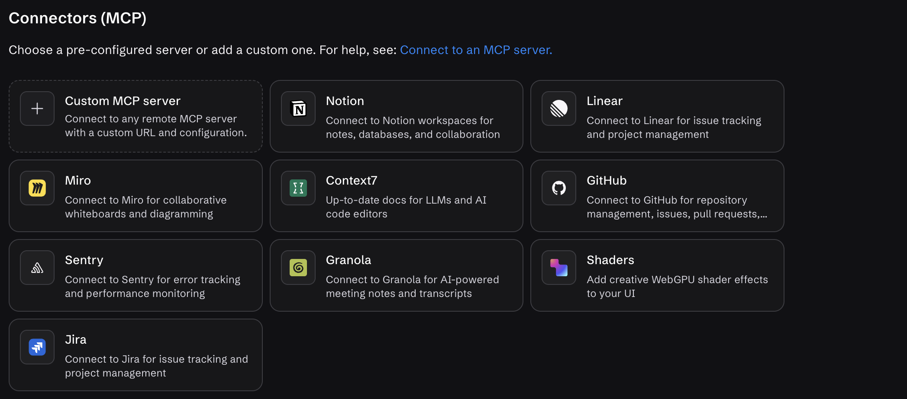
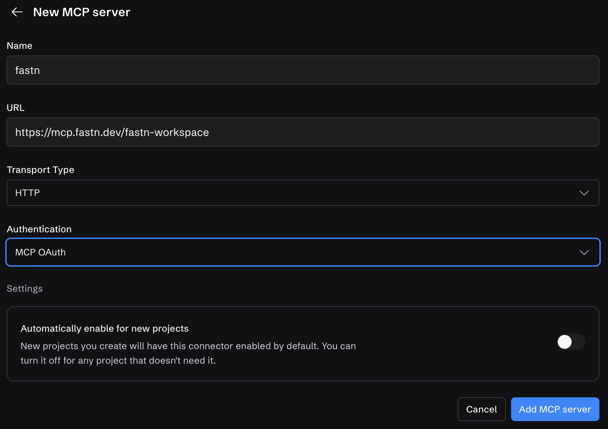
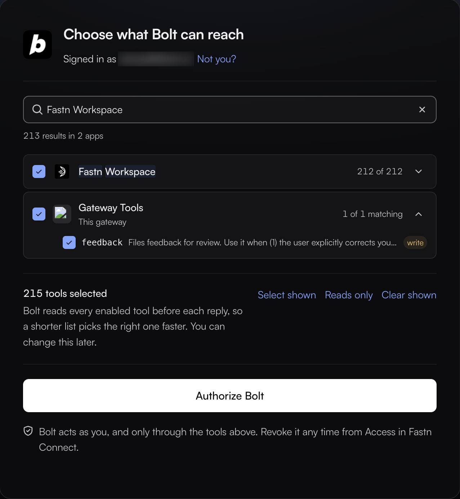
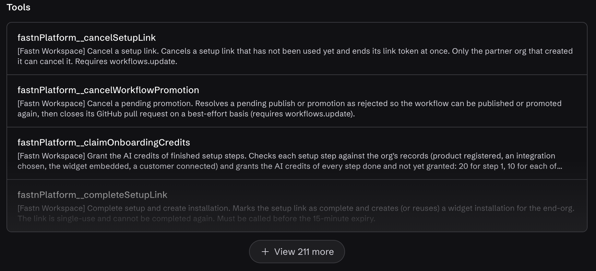
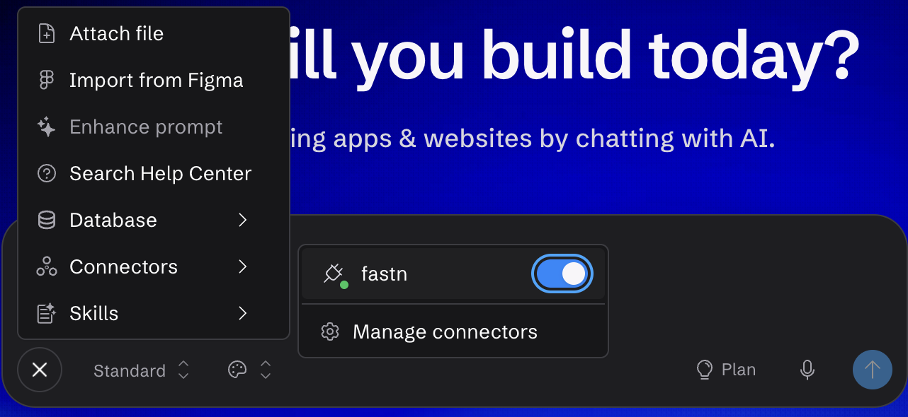
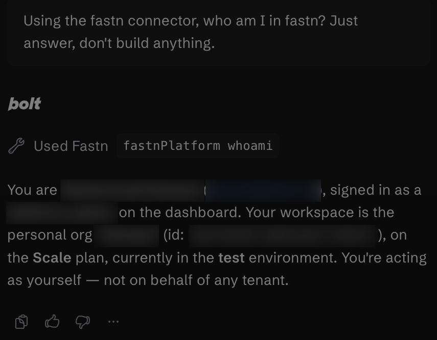

# Bolt

In bolt.new, fastn is a custom MCP connector. Sign in once, turn fastn on for a project, then ask for the integration in Bolt's chat.

## Add fastn



#### Open Connectors (MCP)

In bolt.new, click **+** in the chat box, then **Connectors** → **Manage connectors**. On the **Connectors (MCP)** page, click **Custom MCP server**.

<figure><figcaption><strong>Custom MCP server</strong> is the first card.</figcaption></figure>



#### Enter fastn's URL

Enter **Name** `fastn` and **URL** `https://mcp.fastn.dev/fastn-workspace`, leave **Transport Type** on **HTTP**, set **Authentication** to **MCP OAuth** and click **Add MCP server**.

<figure><figcaption>Turn on <strong>Automatically enable for new projects</strong> to skip step 4 in new projects.</figcaption></figure>



#### Choose Fastn Workspace and authorize

fastn opens in a new tab. Sign in if asked. On **Choose what Bolt can reach**, search for **Fastn Workspace**, tick it and click **Authorize Bolt**.

<figure><figcaption>Tick <strong>Fastn Workspace</strong>. If you leave it unticked, Bolt gets no fastn tools.</figcaption></figure>

Bolt shows a different screen from other clients here: it doesn't tell fastn which URL it is connecting to, so fastn asks which apps it may reach rather than which workspace to use. Bolt then lists fastn as **Connected** with its tools.

<figure><figcaption>Every tool is on by default. To turn some off, open the <strong>…</strong> menu and choose <strong>Edit</strong>.</figcaption></figure>



#### Turn fastn on for the project

In the chat box, click **+** → **Connectors** and switch **fastn** on.

<figure><figcaption>Bolt turns connectors on per project.</figcaption></figure>



## Use it

Ask for the outcome in one sentence. To check the connection first, ask *Using the fastn connector, who am I in fastn? Just answer, don't build anything.*

<figure><figcaption>Bolt shows which fastn tool it used above the answer.</figcaption></figure>

From here Bolt works through the same steps as every agent: see [Building from your AI agent](../building-from-your-ai-agent.md).

## Troubleshooting

* **Bolt lists only connection, skill and feedback.** **Fastn Workspace** wasn't ticked when you authorized. Remove fastn under **Connectors (MCP)**, add it again and tick **Fastn Workspace**.
* **Bolt doesn't use fastn.** Check fastn is switched on under **+** → **Connectors** in this project, then name it in your message, for example *Using the fastn connector, …*.
* **fastn shows Checking or needs sign-in.** Open fastn under **Connectors (MCP)** and connect it again.
