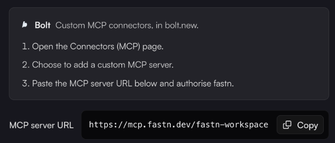

# Bolt

In bolt.new, fastn is a custom MCP connector.


fastn hasn't yet checked these steps inside Bolt itself. They follow the Bolt tab of fastn's **Connect an agent** dialog, which has the current wording if a menu in Bolt has moved.


1. In bolt.new, open the **Connectors (MCP)** page.
2. Choose to add a custom MCP server.
3. Paste `https://mcp.fastn.dev/fastn-workspace` and authorise fastn.
4. In a new chat, ask for the outcome and approve each fastn tool call when Bolt asks.

<figure><figcaption>The Bolt steps in fastn's <strong>Connect an agent</strong> dialog.</figcaption></figure>

What happens after you ask is the same for every agent: see [Building from your AI agent](../building-from-your-ai-agent.md).
