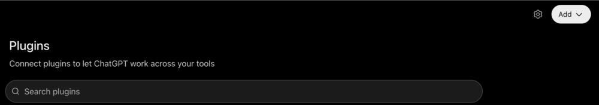
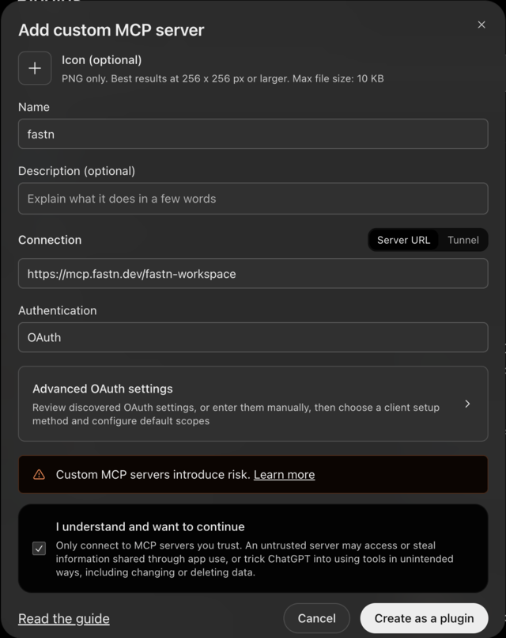
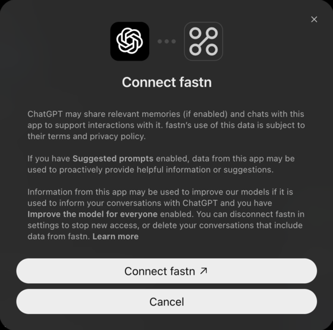
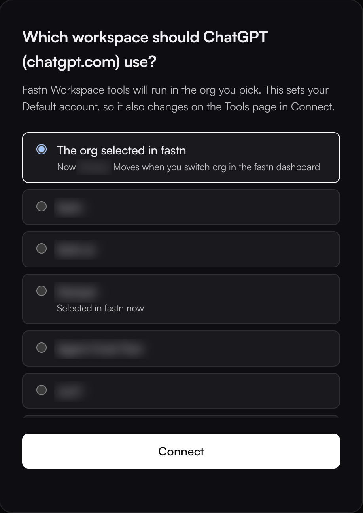
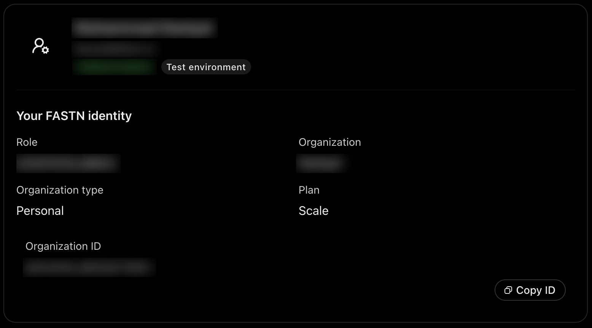

# ChatGPT

ChatGPT adds Fastn as a custom MCP server from its **Plugins** page. Sign in once, then ask for the integration in a chat.


**Before you start:** custom MCP servers work in ChatGPT on the web, not in the mobile apps. You don't need to turn on **Developer mode**.

* **Business:** only workspace admins and owners can add a custom MCP server. An admin can give others the **Create plugins with MCPs** permission.
* **Enterprise and Edu:** admins and owners can add one, and admins can let selected members do it too.
* **Pro:** a custom MCP server gets read and fetch access only, so Fastn's tools that change things aren't available.


## Add Fastn



#### Open Plugins

In ChatGPT on the web, click **Plugins** in the sidebar. At the top right, click the plus button (**Add**) and choose **Add custom MCP server**.

<figure><figcaption>The <strong>Add</strong> button is at the top right of the Plugins page.</figcaption></figure>



#### Enter Fastn's URL

Enter **Name** `fastn`. Under **Connection**, keep **Server URL** and enter `https://mcp.fastn.dev/fastn-workspace`. Leave **Authentication** on **OAuth** and leave the client ID and secret empty: Fastn uses dynamic client registration, so ChatGPT registers itself. Tick **I understand and want to continue** and click **Create as a plugin**.

<figure><figcaption>Leave <strong>Advanced OAuth settings</strong> alone. ChatGPT finds Fastn's sign-in by itself.</figcaption></figure>



#### Connect and pick the workspace

ChatGPT shows **Connect Fastn**. Click **Connect Fastn**.

<figure><figcaption>ChatGPT asks once per account.</figcaption></figure>

Fastn opens in your browser. Sign in if asked. If you belong to more than one Fastn org, pick the workspace ChatGPT works in, then click **Connect**.

<figure><figcaption><strong>The org selected in Fastn</strong> follows whichever org you have open in the Fastn dashboard; picking a named org pins ChatGPT to it.</figcaption></figure>

ChatGPT lists Fastn under your plugins on the **Plugins** page with your account connected. If it shows Fastn as not installed, open it and install it before you use it.



## Use it

Start a new chat, type `@` in the prompt box and select **fastn**. Then ask for the outcome in one sentence. To check the connection first, ask *Using the Fastn plugin, who am I in Fastn?* ChatGPT asks you to confirm any Fastn tool that changes something.

<figure><figcaption>ChatGPT answers from the Fastn workspace you picked.</figcaption></figure>

From here ChatGPT works through the same steps as every AI tool: see [Build from your AI tool](../building-from-your-ai-agent.md).

## Troubleshooting

* **`token_endpoint_auth_method "private_key_jwt" is not supported`.** ChatGPT sign-in failed this way on Fastn before the fix for it reached your Fastn. Click **Connect Fastn** again.
* **ChatGPT doesn't use Fastn.** Type `@`, select **fastn**, and name it in your message, for example *Using the Fastn plugin, …*.
* **There's no Add custom MCP server option.** On Business, Enterprise, and Edu, ask a workspace admin for permission to create plugins with MCPs, or ask them to add Fastn for you.
* **ChatGPT works on the wrong org.** Open Fastn under **Plugins**, remove your connected account, connect again, and pick the workspace.
