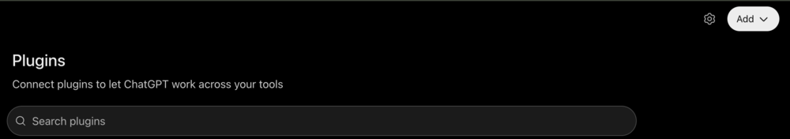
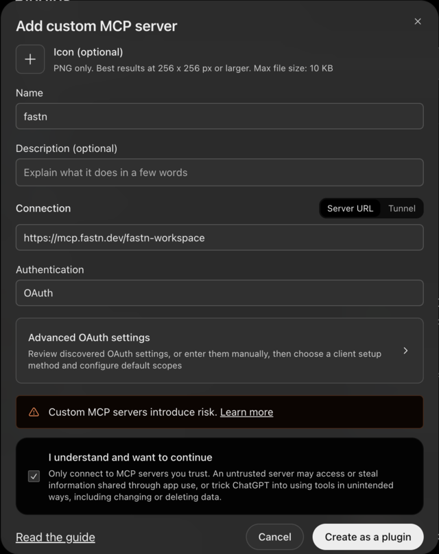
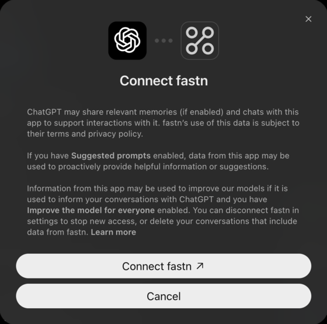
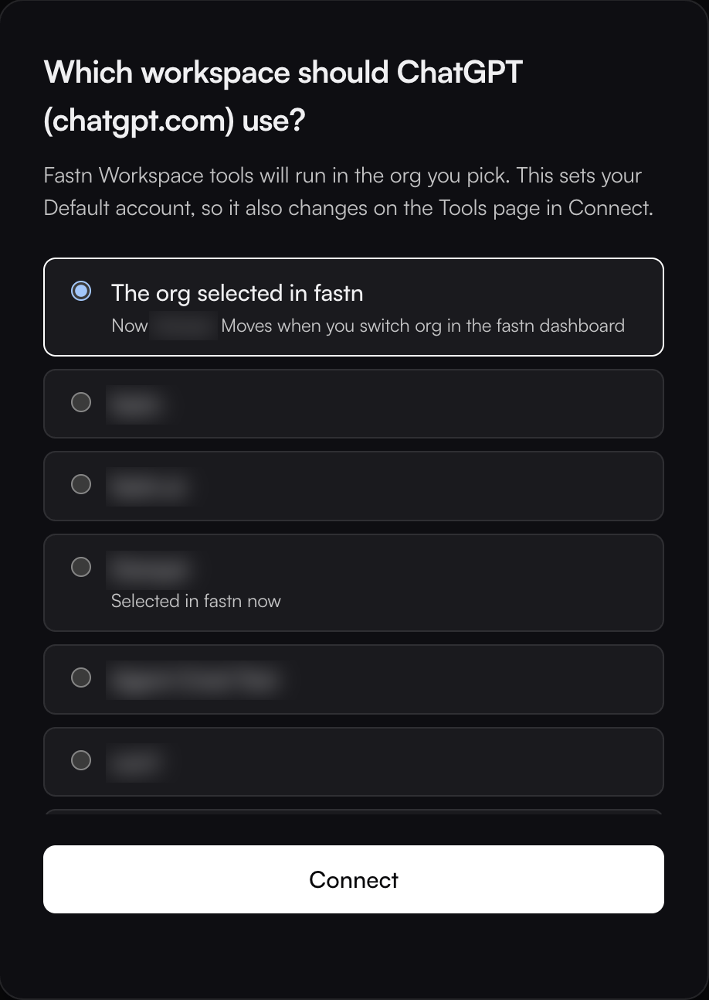
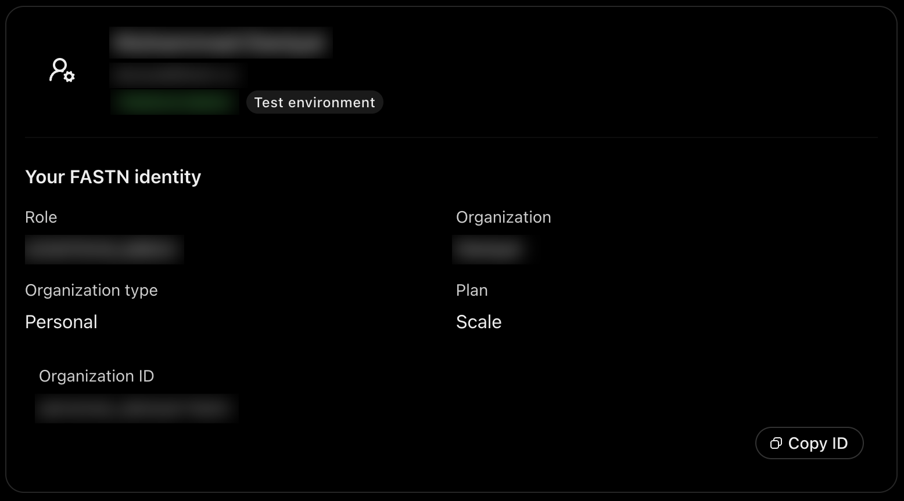

# ChatGPT

ChatGPT adds fastn as a custom MCP server from its **Plugins** page. Sign in once, then ask for the integration in a chat.

## Add fastn



#### Open Plugins

In ChatGPT, click **Plugins** in the sidebar. At the top right, click **Add** and choose **Add custom MCP server**.

<figure><figcaption>The <strong>Add</strong> button is at the top right of the Plugins page.</figcaption></figure>



#### Enter fastn's URL

Enter **Name** `fastn`. Under **Connection**, keep **Server URL** and enter `https://mcp.fastn.dev/fastn-workspace`. Leave **Authentication** on **OAuth**, tick **I understand and want to continue** and click **Create as a plugin**.

<figure><figcaption>Leave <strong>Advanced OAuth settings</strong> alone. ChatGPT finds fastn's sign-in by itself.</figcaption></figure>



#### Connect and pick the workspace

ChatGPT shows **Connect fastn**. Click **Connect fastn**.

<figure><figcaption>ChatGPT asks once per account.</figcaption></figure>

fastn opens in your browser. Sign in if asked, pick the workspace ChatGPT works in and click **Connect**.

<figure><figcaption><strong>The org selected in fastn</strong> follows whichever org you have open in the fastn dashboard; picking a named org pins ChatGPT to it.</figcaption></figure>

ChatGPT lists fastn under **Plugins** with your account connected.



## Use it

Start a new chat and ask for the outcome in one sentence. To check the connection first, ask *Using the fastn plugin, who am I in fastn?*

<figure><figcaption>ChatGPT answers from the fastn workspace you picked.</figcaption></figure>

From here ChatGPT works through the same steps as every agent: see [Building from your AI agent](../building-from-your-ai-agent.md).

## Troubleshooting

* **`token_endpoint_auth_method "private_key_jwt" is not supported`.** ChatGPT sign-in failed this way on fastn before the fix for it reached your fastn. Click **Connect fastn** again.
* **ChatGPT doesn't use fastn.** Name it in your message, for example *Using the fastn plugin, …*.
* **ChatGPT works on the wrong org.** Open fastn under **Plugins**, remove your connected account, connect again and pick the workspace.
