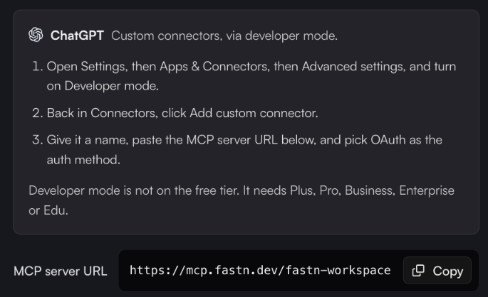

# ChatGPT

ChatGPT reaches fastn through a custom connector, which needs Developer mode. Developer mode is not on the free tier: you need Plus, Pro, Business, Enterprise or Edu.


fastn hasn't yet checked these steps inside ChatGPT itself. They follow the ChatGPT tab of fastn's **Connect an agent** dialog, which has the current wording if a menu in ChatGPT has moved.



**Want ChatGPT to use your team's apps (Slack, GitHub, Google and more) rather than build integrations?** That is Fastn Connect, which uses your organisation's own URL. See [ChatGPT in Fastn Connect](../../connect/clients/chatgpt.md).


1. In ChatGPT, open **Settings** → **Apps & Connectors** → **Advanced settings**, and turn on **Developer mode**.
2. Back in **Connectors**, click **Add custom connector**.
3. Name it `fastn`, paste `https://mcp.fastn.dev/fastn-workspace`, and pick **OAuth** as the auth method.
4. Sign in to fastn and authorise it.
5. In a new chat, ask for the outcome, for example: *"Using fastn, save invoice emails from Gmail to a Google Sheet. Test it, then add it to my widget."* Approve each fastn tool call when ChatGPT asks.

<figure><figcaption>The ChatGPT steps in fastn's <strong>Connect an agent</strong> dialog.</figcaption></figure>

What happens after you ask is the same for every agent: see [Building from your AI agent](../building-from-your-ai-agent.md).
