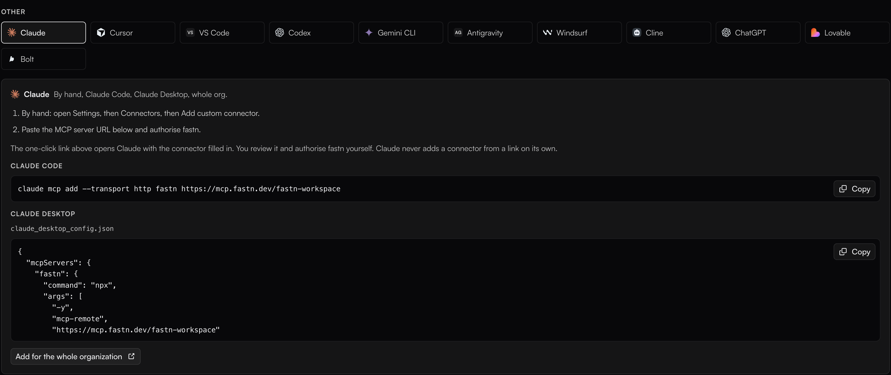
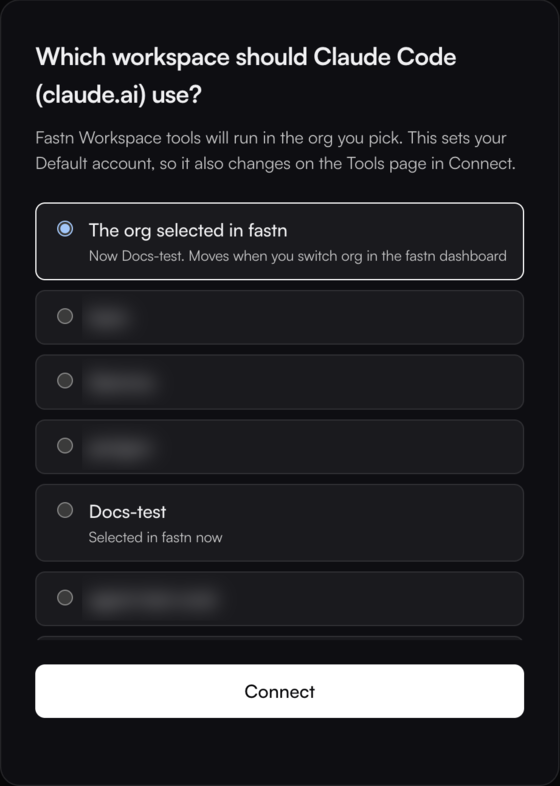

# Claude Code

Claude Code adds Fastn as a remote MCP server with one command. Sign in once, then ask for the integration in a Claude Code session.

<figure><figcaption>The command is on the second <strong>Claude</strong> tile under <strong>Other</strong> on the Fastn <strong>MCP server</strong> page.</figcaption></figure>

## Add Fastn



#### Run the command

```
claude mcp add --transport http fastn https://mcp.fastn.dev/fastn-workspace
```

Claude Code prints *Added HTTP MCP server Fastn with URL: https://mcp.fastn.dev/fastn-workspace to local config*. By default the server is added for the current project only. Add `--scope user` to use Fastn in every project.



#### Sign in

```
claude mcp login fastn
```

Or, inside a Claude Code session, type `/mcp`, pick **fastn**, and choose **Authenticate**.

Fastn opens in your browser. Sign in if asked. If you belong to more than one Fastn org, pick the workspace Claude Code works in and click **Connect**.

<figure><figcaption><strong>The org selected in Fastn</strong> follows whichever org you have open in the Fastn dashboard; picking a named org pins Claude Code to it.</figcaption></figure>

The terminal prints *Authenticated with "fastn". Its tools are now available in Claude Code.*



#### Check it

```
claude mcp list
```

```
fastn: https://mcp.fastn.dev/fastn-workspace (HTTP) - ✔ Connected
```



## Use it

Start `claude` and ask for the outcome in one sentence. To check the connection first, ask *Use Fastn to tell me which org I'm in.* Claude Code asks before it runs a Fastn tool; approve it, and it answers with the org you picked when signing in.

From here Claude Code works through the same steps as every AI tool: see [Build from your AI tool](../building-from-your-ai-agent.md).

## Claude Desktop config file

The Claude desktop app normally uses the connector you add in claude.ai: see [Claude](claude.md). If you manage it through `claude_desktop_config.json` instead, that file only starts local servers, so bridge to Fastn with `mcp-remote`:

```json
{
  "mcpServers": {
    "fastn": {
      "command": "npx",
      "args": ["-y", "mcp-remote", "https://mcp.fastn.dev/fastn-workspace"]
    }
  }
}
```

A `"url"` entry in that file is ignored, and no Fastn tools appear.

## Troubleshooting

* **`fastn ... ! Needs authentication` in `claude mcp list`.** Run `claude mcp login fastn`.
* **The browser shows `{"error":"redirect_uri mismatch"}`.** Claude Code sign-in failed this way on Fastn before 27 October 2026. Run `claude mcp login fastn` again.
* **Claude Code works on the wrong org.** Run `claude mcp logout fastn`, then `claude mcp login fastn`, and pick the workspace again.
