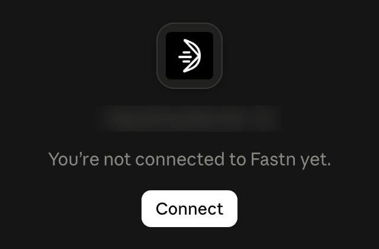
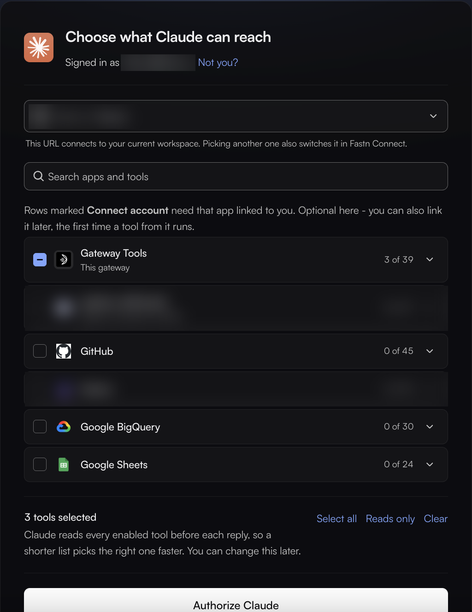
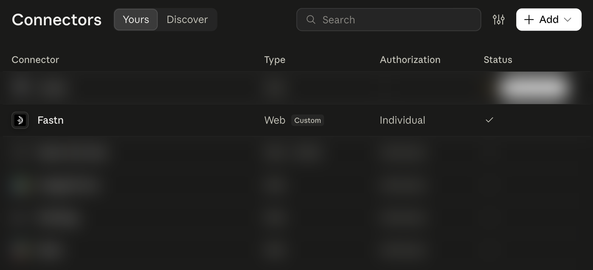
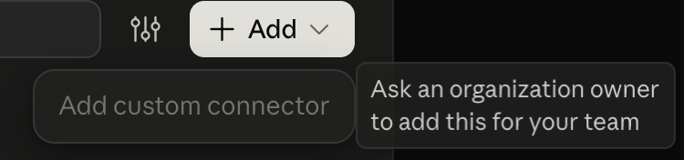
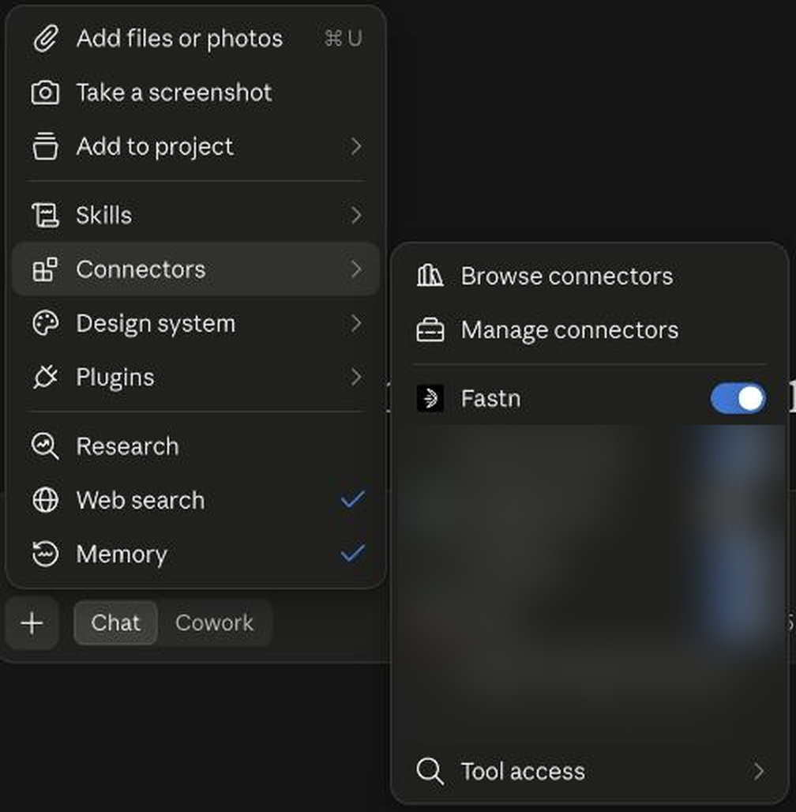
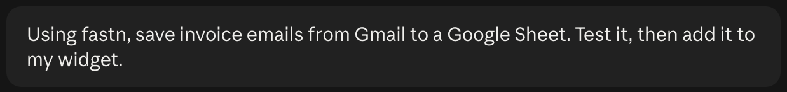
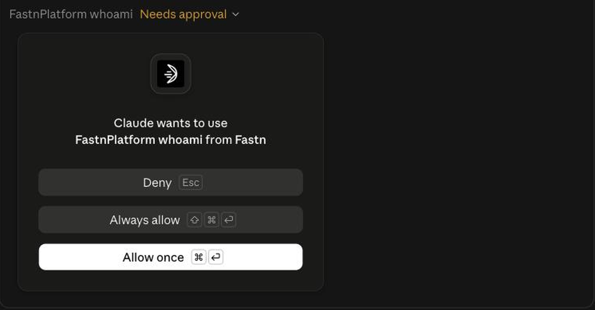
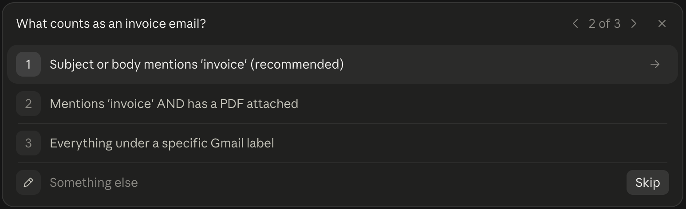
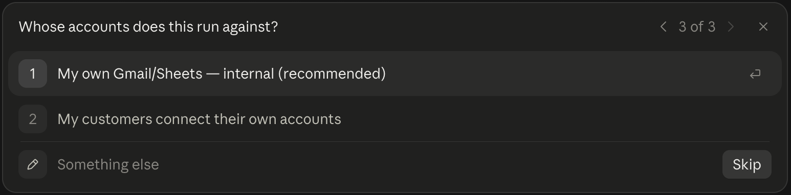

# Claude

Add fastn once, switch it on in a chat, then ask for the integration in one sentence.

### Add fastn

1. In fastn, open **Connect an agent** and click **Add to Claude**. Claude opens the **Add custom connector** form with the name and URL already filled in.
2. Or add it by hand: in Claude, open **Customize** → **Connectors**, click **Add** → **Add custom connector**, enter **Name** `fastn` and **MCP server URL** `https://mcp.fastn.dev/fastn-workspace`, then click **Continue**.
3. Open the fastn connector. Claude shows *You're not connected to Fastn yet*. Click **Connect**.

<figure><figcaption>The fastn connector in Claude before you connect it.</figcaption></figure>

4. fastn opens **Choose what Claude can reach**. Pick your workspace, then choose which apps and tools Claude may use: **Select all**, **Reads only**, or tick them one by one. Click **Authorize Claude**.

<figure><figcaption>Apps marked <strong>Connect account</strong> can be linked later, the first time Claude uses one of their tools. Fewer tools selected means Claude picks the right one faster; you can change the list later.</figcaption></figure>

5. fastn now shows in your connector list as **Web · Custom · Individual**.

<figure><figcaption>fastn in Claude's connector list (<strong>Customize</strong> → <strong>Connectors</strong>).</figcaption></figure>

On a Claude Team or Enterprise plan, only an organisation owner can add a custom connector. Members see the note below and connect their own account once the owner has added fastn.

<figure><figcaption>What a Team or Enterprise member sees in place of <strong>Add custom connector</strong>.</figcaption></figure>

Admins can click **Add for the whole organisation** in the same fastn dialog instead.

If you belong to more than one Claude workspace (for example Personal and a Team), add fastn in the workspace you chat in. A connector only shows in the workspace it was added to.

### Use it in a chat

1. In a new chat, click **+** → **Connectors** and switch **fastn** on.

<figure><figcaption>Switch fastn on for the chat.</figcaption></figure>

2. Ask for the outcome in one sentence.

<figure><figcaption>The prompt used for the screenshots on this page.</figcaption></figure>

Name the systems, what starts it and what moves. [Writing a good first message](../agent/README.md#writing-a-good-first-message) has examples.

3. Each time Claude wants to use a fastn tool, it asks: **Allow once**, **Always allow** or **Deny**. It starts with read-only checks of your workspace.

<figure><figcaption>The first call is a read-only check of who you are.</figcaption></figure>

4. Claude then asks only the business questions it can't answer itself. Its recommended answer is already selected.

<figure><figcaption>A business question, with the recommended answer first.</figcaption></figure>

<figure><figcaption>Whose accounts the integration runs against: yours, or your customers' connected accounts.</figcaption></figure>

From here Claude works through the same steps as every agent: see [Building from your AI agent](../building-from-your-ai-agent.md).

### Claude Code and Claude Desktop

* Claude Code: `claude mcp add --transport http fastn https://mcp.fastn.dev/fastn-workspace`
* Claude Desktop config file: add `fastn` under `mcpServers` with `npx -y mcp-remote https://mcp.fastn.dev/fastn-workspace`.


This page is for your own team. Your customers reach their integrations from Claude a different way: see [Connecting Claude and other AI clients](../../tutorials/end-user/connecting-claude.md).

