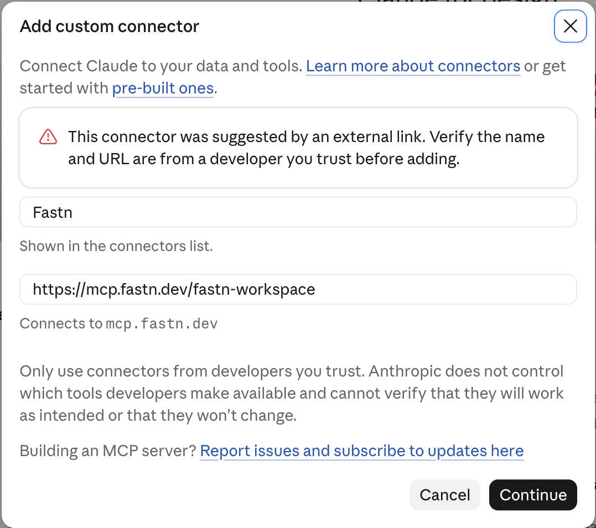
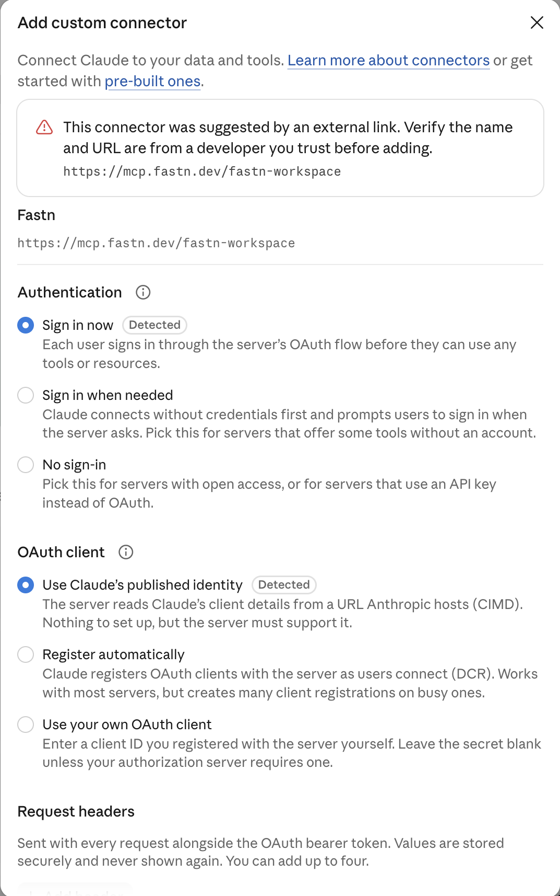
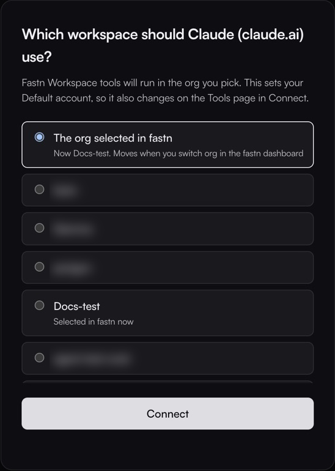
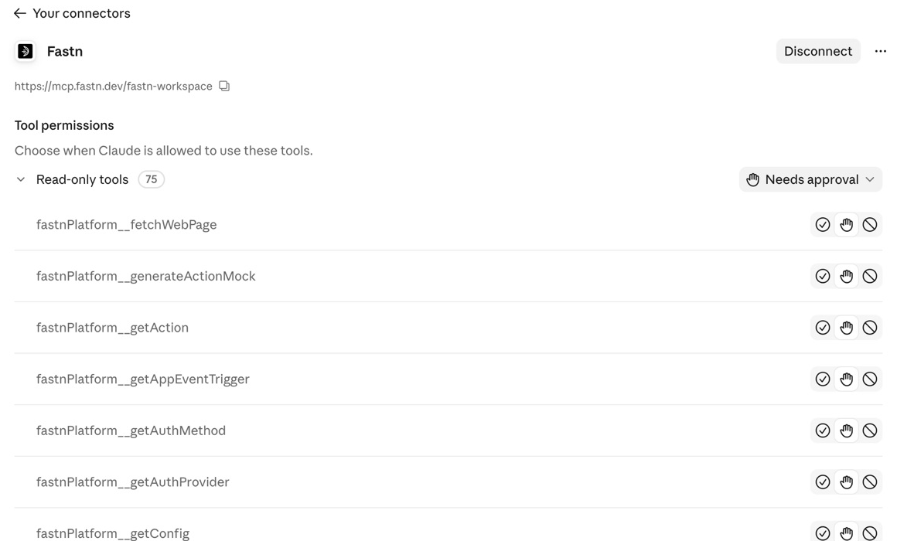
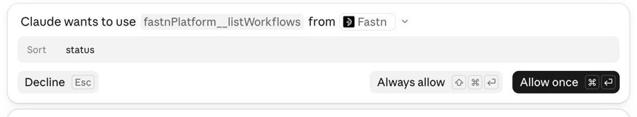

# Claude

Add fastn to Claude once, sign in, then ask for the integration in a chat. This works in claude.ai in the browser and in the Claude desktop app, which share the same connectors.


**Before you start:** on a Claude Team or Enterprise plan, only an organization owner can add a custom connector. Members connect their own account once the owner has added fastn. See [Team and Enterprise plans](#team-and-enterprise-plans).


## Add fastn



#### Open Add to Claude from fastn

In fastn, click **Connect AI tools** in the top bar (or open **Access** → **MCP server**) and click **Add to Claude**. Claude opens the **Add custom connector** form with the name and URL already filled in.

<figure><figcaption>Claude warns that the connector came from a link. Check the URL is <code>https://mcp.fastn.dev/fastn-workspace</code>, then click <strong>Continue</strong>.</figcaption></figure>

To add it by hand instead: in Claude, open **Customize** → **Connectors**, click **Add** → **Add custom connector**, and enter the name `Fastn` and the URL `https://mcp.fastn.dev/fastn-workspace`.



#### Keep the detected sign-in settings

Claude checks the server and preselects how to sign in. Leave **Sign in now** and **Use Claude's published identity** selected (both marked **Detected**), and click **Add**. You do not need request headers or your own OAuth client.

<figure><figcaption>Both defaults are right for fastn.</figcaption></figure>



#### Connect

Claude opens the new connector and shows *You're not connected to Fastn yet*. Click **Connect**.

<figure><figcaption>The connector is added but not signed in yet.</figcaption></figure>



#### Pick the workspace

fastn opens in a new tab. Sign in if you are not already, then pick the workspace Claude works in. **The org selected in fastn** follows whichever org you have open in the fastn dashboard; picking a named org pins Claude to it. Click **Connect**.

<figure><figcaption>The list shows every org you belong to. You can change the choice later on the Tools page in Connect.</figcaption></figure>



#### Check the tools

Back in Claude, a *Connected to Fastn* notice appears and the connector lists fastn's tools under **Tool permissions**. Choose for each group whether Claude may use the tools without asking, needs your approval, or may not use them.

<figure><figcaption>Every fastn tool starts on <strong>Needs approval</strong>.</figcaption></figure>



## Use it in a chat

1. In a new chat, click **+** → **Connectors** and make sure **Fastn** is switched on.

<figure><figcaption>Switch fastn on for the chat.</figcaption></figure>

2. Ask for the outcome in one sentence. To check the connection first, ask *What can fastn do for me?* or *List my workflows*.

<figure><figcaption>Name the systems, what starts it and what moves.</figcaption></figure>

[Writing a good first message](../agent/README.md#writing-a-good-first-message) has more examples.

3. Each time Claude wants to use a fastn tool, it asks first: **Decline**, **Always allow** or **Allow once**.

<figure><figcaption>The prompt names the tool and the connector it comes from.</figcaption></figure>

4. Claude then asks only the business questions it can't answer itself, with its recommended answer already selected.

<figure><figcaption>A business question, with the recommended answer first.</figcaption></figure>

From here Claude works through the same steps as every agent: see [Building from your AI agent](../building-from-your-ai-agent.md).

## Team and Enterprise plans

Only an organization owner can add a custom connector. Members see the note below in place of **Add custom connector**, and connect their own account once the owner has added fastn.

<figure><figcaption>What a Team or Enterprise member sees.</figcaption></figure>

Owners can use **Add for the whole organization** on the Claude tab of fastn's MCP page instead of **Add to Claude**.

If you belong to more than one Claude workspace (for example Personal and a Team), add fastn in the one you chat in. A connector only shows in the workspace it was added to.

## Troubleshooting

* *A connector with this URL already exists in your organization.* Someone in your Claude organization already added fastn. Open **Customize** → **Connectors** and connect that one instead of adding another.
* **Fastn works on the wrong org.** Open the connector, click **Disconnect**, then **Connect** again and pick the workspace. If you chose **The org selected in fastn**, switch org in the fastn dashboard instead.
* **Claude Code or the Claude desktop config file.** These are set up separately: see [Claude Code](claude-code.md).


This page is for your own team. Your customers reach their integrations from Claude a different way: see [Connecting Claude and other AI clients](../../tutorials/end-user/connecting-claude.md).

