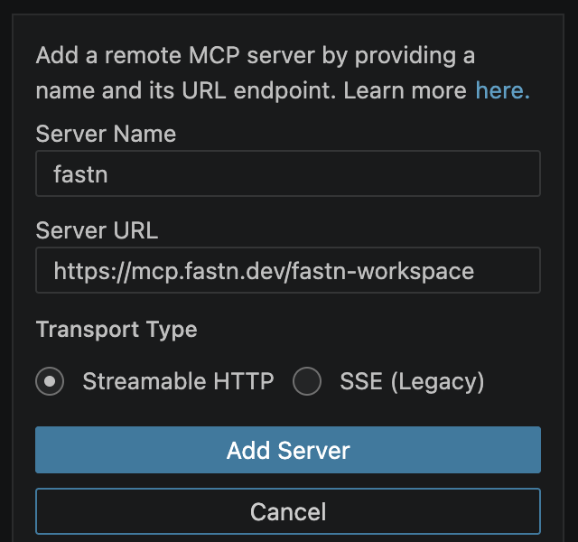
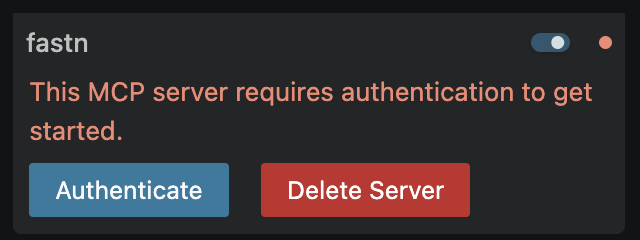
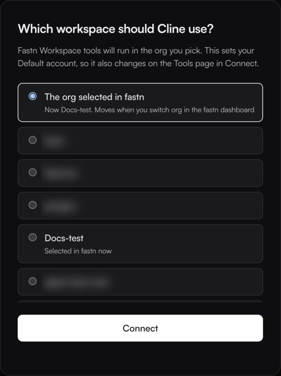
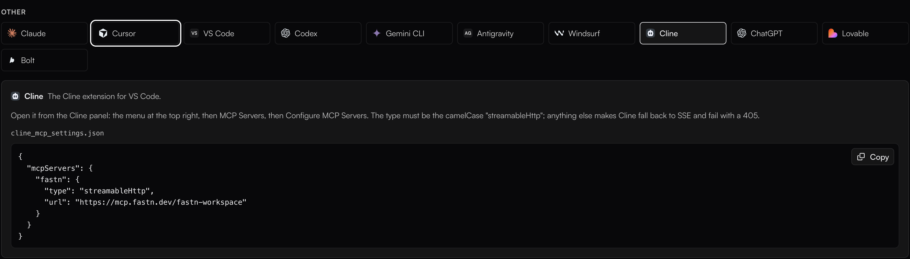

# Cline

Cline adds fastn from its **MCP** settings as a remote server. Sign in once, then ask for the integration in a Cline task.


**Before you start:** set Cline up with a model first (Cline's own sign-in, or your API key). fastn exposes more than 128 tools, so pick a model that accepts that many; see [Troubleshooting](#troubleshooting).


## Add fastn



#### Open Add Remote Server

In the Cline panel, click the MCP icon at the top. On the **MCP** tab under **Installed**, click **Add Remote Server**.



#### Enter fastn's URL

Enter **Server Name** `fastn` and **Server URL** `https://mcp.fastn.dev/fastn-workspace`, leave **Transport Type** on **Streamable HTTP**, and click **Add Server**.

<figure><figcaption>Keep <strong>Streamable HTTP</strong>. fastn does not serve the legacy SSE transport.</figcaption></figure>



#### Authenticate

fastn shows *This MCP server requires authentication to get started.* Click **Authenticate**.

<figure><figcaption>Cline signs in with OAuth, so no token is needed.</figcaption></figure>

fastn opens in your browser. Sign in if asked, pick the workspace Cline works in and click **Connect**.

<figure><figcaption><strong>The org selected in fastn</strong> follows whichever org you have open in the fastn dashboard; picking a named org pins Cline to it.</figcaption></figure>

The browser shows *Authentication Successful* and closes itself. Back in VS Code, fastn's dot turns green in Cline's list.



## Use it

Start a new Cline task and ask for the outcome in one sentence. To check the connection first, ask *Who am I in fastn?* Cline asks before it runs a fastn tool; approve it, and it answers with the org you picked when signing in.

From here Cline works through the same steps as every agent: see [Building from your AI agent](../building-from-your-ai-agent.md).

## Add it by hand

Click **Edit Configuration** in Cline's **MCP** tab and add fastn under `mcpServers`. The `type` must be `streamableHttp`, written exactly so:

```json
{
  "mcpServers": {
    "fastn": {
      "url": "https://mcp.fastn.dev/fastn-workspace",
      "type": "streamableHttp"
    }
  }
}
```

Then click **Authenticate** on fastn's row, as in step 3.

<figure><figcaption>The Cline tab under <strong>Connect AI tools</strong> in fastn has the same snippet.</figcaption></figure>

## Troubleshooting

* **`Invalid value for 'tools': maximum number of items is 128`.** The model Cline is using accepts at most 128 tools, and fastn exposes more. Pick a different model in Cline's settings; the error comes from the model provider, not from fastn.
* **fastn fails with a 405 error.** The `type` is wrong. Use `streamableHttp` (camelCase), not `sse` or `streamable-http`.
* **Cline works on the wrong org.** Delete fastn from Cline's **MCP** list, add it again and pick the workspace when you authenticate.
