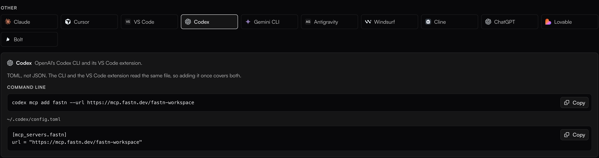
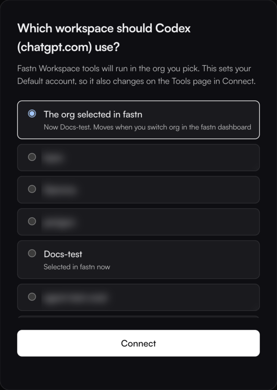

# Codex

Codex reads its MCP servers from `~/.codex/config.toml`. The Codex CLI and the Codex IDE extension share that file, so adding fastn once covers both.

<figure><figcaption>The Codex tab under <strong>Connect AI tools</strong> in fastn has the command and the file.</figcaption></figure>

## Add fastn



#### Run the command

```
codex mcp add fastn --url https://mcp.fastn.dev/fastn-workspace
```

Codex detects that fastn uses OAuth and starts the sign-in straight away. It prints *Authorize `fastn` by opening this URL in your browser* and opens the page.



#### Sign in to fastn

In the browser, sign in to fastn if asked, pick the workspace Codex works in and click **Connect**. When the terminal prints *Successfully logged in.*, you are done.

<figure><figcaption><strong>The org selected in fastn</strong> follows whichever org you have open in the fastn dashboard; picking a named org pins Codex to it.</figcaption></figure>

If the browser does not open, copy the URL Codex printed. To sign in again later, run `codex mcp login fastn`.



#### Check it

```
codex mcp list
```

fastn is listed with **Status** `enabled` and **Auth** `OAuth`:

```
Name   Url                                    Bearer Token Env Var  Status   Auth
fastn  https://mcp.fastn.dev/fastn-workspace  -                     enabled  OAuth
```



The command writes this entry to `~/.codex/config.toml`. You can also add it by hand and then run `codex mcp login fastn`:

```
[mcp_servers.fastn]
url = "https://mcp.fastn.dev/fastn-workspace"
```

## Use it

Ask Codex to use fastn by name the first time. For example:

```
codex "Use the fastn MCP server: call its whoami tool and tell me the org name."
```

Codex calls `fastnPlatform__whoami` and answers with the name of the org you picked when signing in. From there, ask for the integration in one sentence. See [Building from your AI agent](../building-from-your-ai-agent.md) for what happens next.

## Troubleshooting

* **Codex answers from the wrong org.** Run `codex mcp logout fastn`, then `codex mcp login fastn`, and pick the workspace again.
* **fastn's tools are missing in the IDE extension.** The extension reads the same `~/.codex/config.toml`. Restart the extension after adding fastn.
