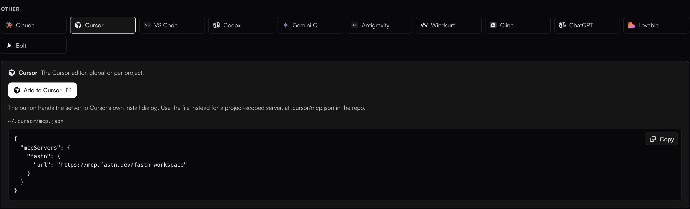
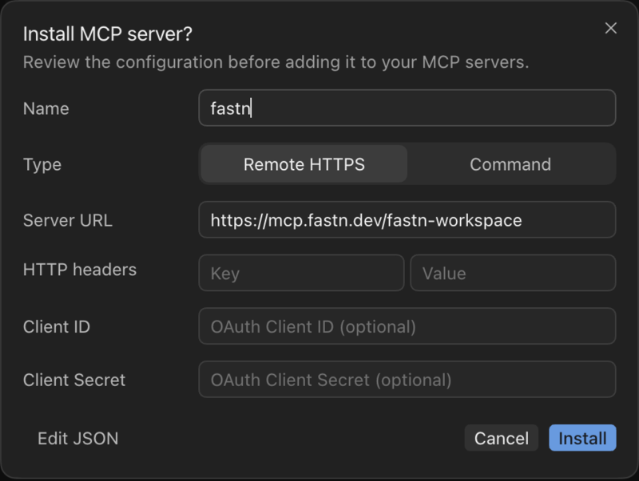
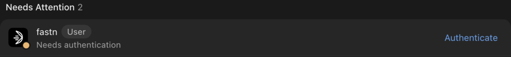
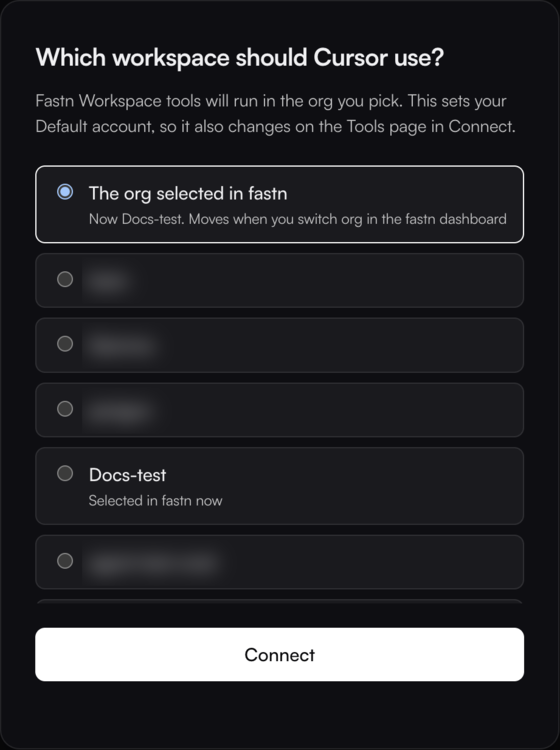
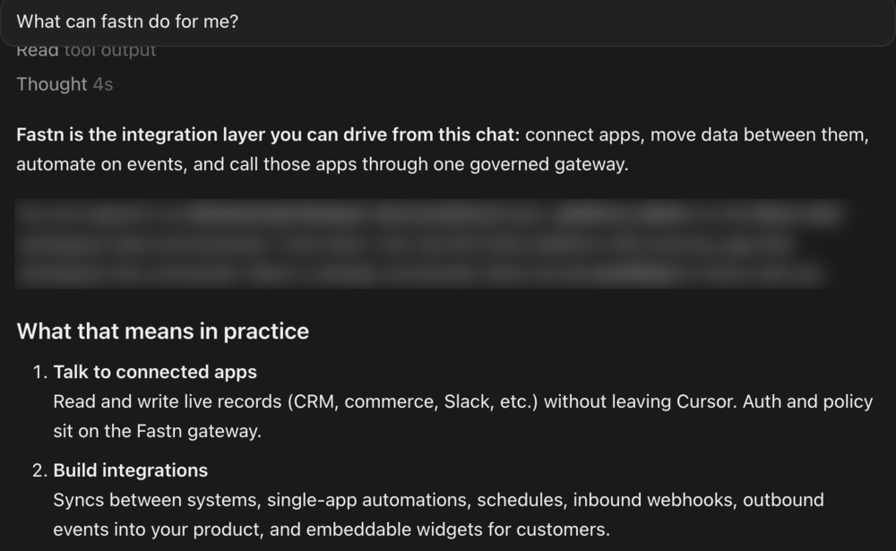

# Cursor

Add fastn to Cursor from the fastn dashboard, sign in once, then ask Cursor's agent for the integration.


**Before you start:** sign in to Cursor. Its agent needs a Cursor account before it can use MCP servers.


## Add fastn



#### Click Add to Cursor

In fastn, click **Connect AI tools** in the top bar (or open **Access** → **MCP server**), pick the **Cursor** tile and click **Add to Cursor**. When your browser asks to open Cursor, allow it.

<figure><figcaption>The Cursor tab also has the config file, if you prefer to add it by hand.</figcaption></figure>



#### Install the server

Cursor opens **Install MCP server?** with the name `fastn`, the type **Remote HTTPS** and the server URL `https://mcp.fastn.dev/fastn-workspace` filled in. Leave the headers and OAuth client fields empty and click **Install**.

<figure><figcaption>fastn signs you in with OAuth, so no header or client ID is needed.</figcaption></figure>



#### Authenticate

Cursor lists fastn under **Needs Attention** with *Needs authentication*. Click **Authenticate**.

<figure><figcaption>Find this list again under <strong>Customize</strong> → <strong>MCPs</strong>.</figcaption></figure>



#### Pick the workspace

fastn opens in your browser. Sign in if asked, pick the workspace Cursor works in and click **Connect**.

<figure><figcaption><strong>The org selected in fastn</strong> follows whichever org you have open in the fastn dashboard; picking a named org pins Cursor to it.</figcaption></figure>

The browser shows *Authorization complete!* Click **Return to Cursor**. fastn moves to **Connected** in Cursor's list.

<figure><figcaption>You can close this tab.</figcaption></figure>



## Use it

Start a new chat with Cursor's agent and ask for the outcome in one sentence. To check the connection first, ask *What can fastn do for me?* Cursor asks before it runs a fastn tool; approve it.

<figure><figcaption>Cursor answers from the fastn workspace you picked.</figcaption></figure>

From here Cursor works through the same steps as every agent: see [Building from your AI agent](../building-from-your-ai-agent.md).

## Add it by hand

Add fastn to `~/.cursor/mcp.json` for every project, or to `.cursor/mcp.json` in a repository for that project only:

```json
{
  "mcpServers": {
    "fastn": {
      "url": "https://mcp.fastn.dev/fastn-workspace"
    }
  }
}
```

Cursor then lists fastn under **Customize** → **MCPs** with **Authenticate**. Continue from step 3.

## Troubleshooting

* **fastn shows Connected but 0 tools enabled.** The tool list is still loading. Wait a few seconds or reopen **Customize** → **MCPs**.
* **The agent does not use fastn.** Check fastn is under **Connected** in **Customize** → **MCPs**, then name fastn in your message, for example *Using fastn, …*.
* **Cursor works on the wrong org.** Remove fastn from **Customize** → **MCPs**, add it again and pick the workspace when you authenticate.
