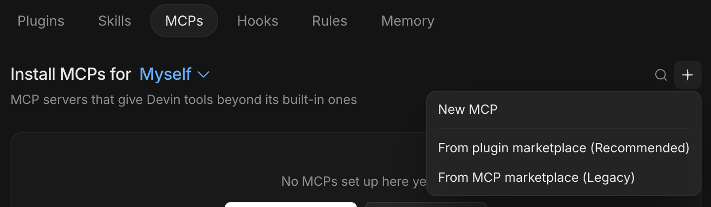
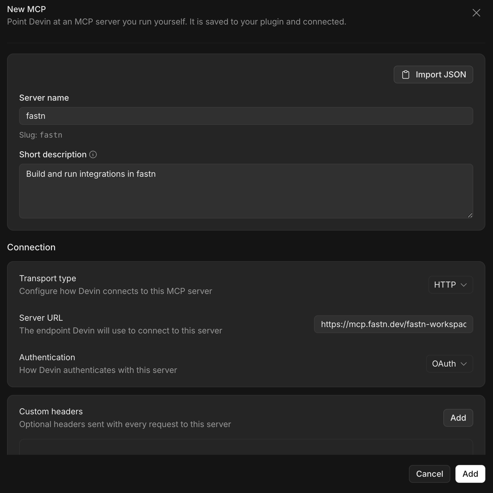
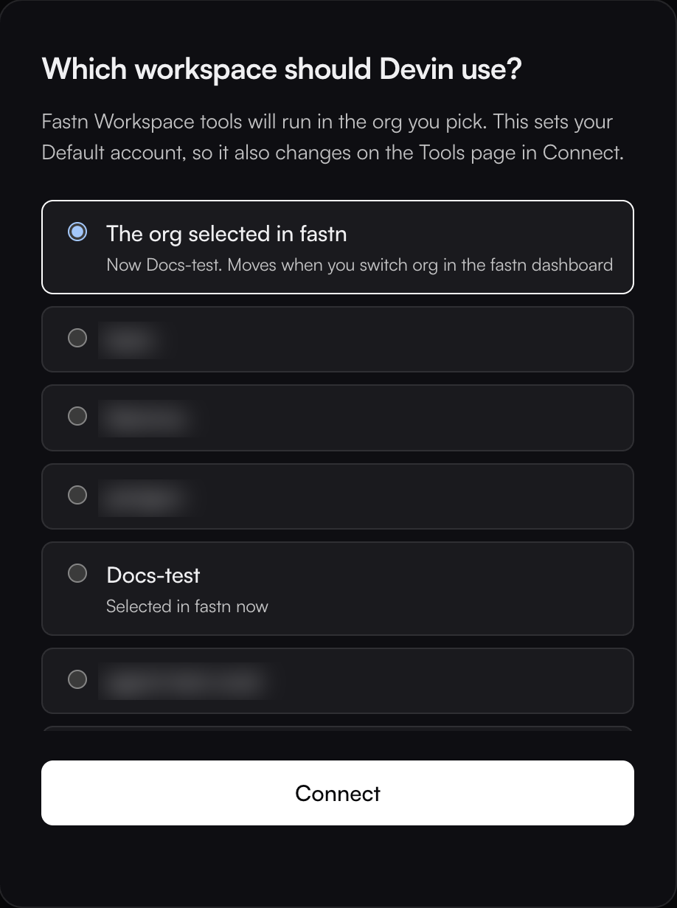
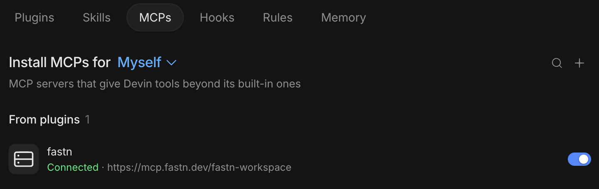

# Devin

Devin Desktop, formerly Windsurf, adds fastn from **Customize** as a custom MCP server. Sign in once, then ask for the integration in a Devin session.


**Before you start:** sign in to Devin Desktop. Running a session uses Devin credits, so you need credits or a paid plan to use fastn's tools.


## Add fastn



#### Open New MCP

In Devin Desktop, click **Customize** in the sidebar and open the **MCPs** tab. Click **+** and choose **New MCP**.

<figure><figcaption>Leave <strong>Install MCPs for</strong> on <strong>Myself</strong>.</figcaption></figure>



#### Enter fastn's URL

Enter **Server name** `fastn` and a short description. Under **Connection**, set **Transport type** to **HTTP**, **Server URL** to `https://mcp.fastn.dev/fastn-workspace` and **Authentication** to **OAuth**, then click **Add**.

<figure><figcaption>fastn signs you in with OAuth, so no header is needed.</figcaption></figure>

Devin shows **Enable MCP integration**. Tick **I understand and want to proceed** and click **Add**. fastn appears in the list with *Needs connection*.



#### Connect and pick the workspace

Click **Connect MCP** on fastn's row, then **Open** when Devin asks to open the external website. fastn opens in your browser. Sign in if asked, pick the workspace Devin works in and click **Connect**.

<figure><figcaption><strong>The org selected in fastn</strong> follows whichever org you have open in the fastn dashboard; picking a named org pins Devin to it.</figcaption></figure>

The browser returns to Devin Desktop, which shows *MCP account linked successfully* and fastn as **Connected**.

<figure><figcaption>The toggle turns fastn off without removing it.</figcaption></figure>



## Use it

Start a **New session** and ask for the outcome in one sentence. To check the connection first, ask *Who am I in fastn?*

From here Devin works through the same steps as every agent: see [Building from your AI agent](../building-from-your-ai-agent.md).

## Devin CLI

The `devin` CLI adds fastn with one command and signs in from the terminal:

```
devin mcp add -s user fastn https://mcp.fastn.dev/fastn-workspace
devin mcp login fastn
```

## Troubleshooting

* **fastn stays on Needs connection.** Click **Connect MCP** again and finish the sign-in in the browser. If the row doesn't change, switch to another tab under **Customize** and back.
* **You ran out of free credits.** Devin needs credits to run a session, including one that only calls fastn. This message comes from Devin, not fastn.
* **Devin works on the wrong org.** Remove fastn under **Customize** → **MCPs**, add it again and pick the workspace when you sign in.
