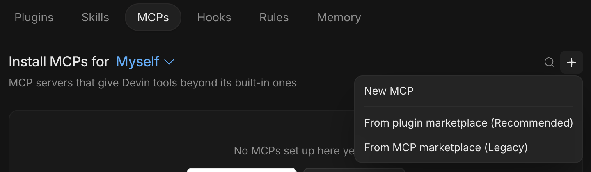
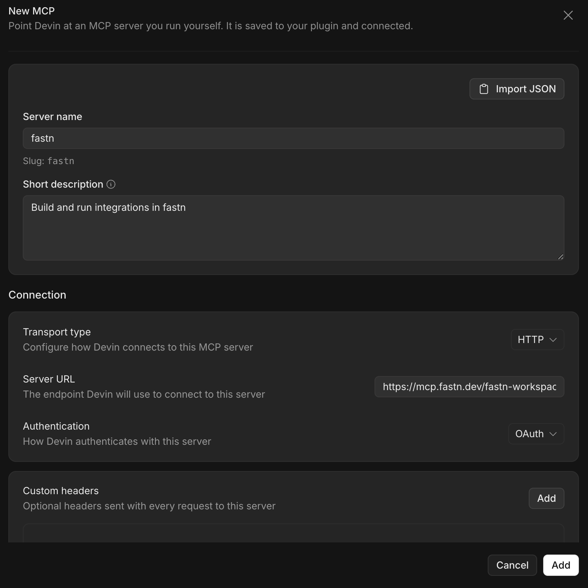
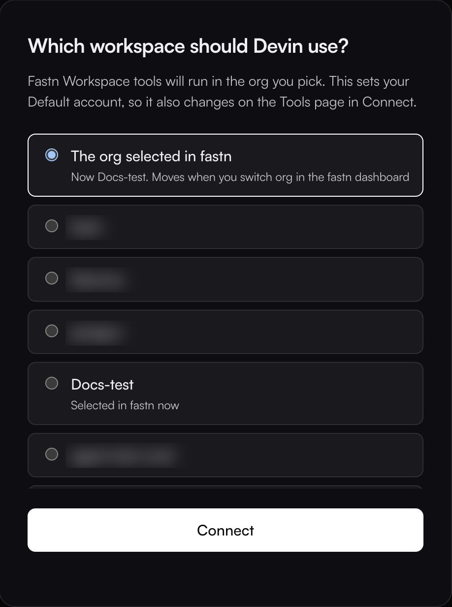
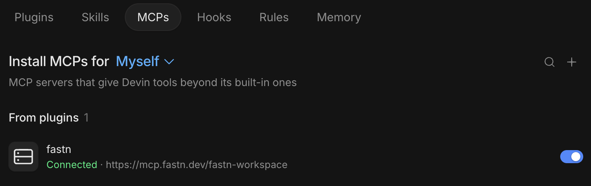

# Devin

Devin Desktop, formerly Windsurf, adds Fastn from **Customize** as a custom MCP server. Sign in once, then ask for the integration in a Devin session.


**Before you start:** sign in to Devin Desktop. Running a session uses Devin credits, so you need credits or a paid plan to use Fastn's tools.


## Add Fastn



#### Open New MCP

In Devin Desktop, click **Customize** in the sidebar and open the **MCPs** tab. Click **+** and choose **New MCP**.

<figure><figcaption>Leave <strong>Install MCPs for</strong> on <strong>Myself</strong>.</figcaption></figure>



#### Enter Fastn's URL

Enter **Server name** `fastn` and a short description. Under **Connection**, set **Transport type** to **HTTP**, **Server URL** to `https://mcp.fastn.dev/fastn-workspace`, and **Authentication** to **OAuth**, then click **Add**.

<figure><figcaption>Fastn signs you in with OAuth, so no header is needed.</figcaption></figure>

Devin shows **Enable MCP integration**. Tick **I understand and want to proceed** and click **Add**. Fastn appears in the list with *Needs connection*.



#### Connect and pick the workspace

Click **Connect MCP** on Fastn's row, then **Open** when Devin asks to open the external website. Fastn opens in your browser. Sign in if asked. If you belong to more than one Fastn org, pick the workspace Devin works in and click **Connect**.

<figure><figcaption><strong>The org selected in Fastn</strong> follows whichever org you have open in the Fastn dashboard; picking a named org pins Devin to it.</figcaption></figure>

The browser returns to Devin Desktop, which shows *MCP account linked successfully* and Fastn as **Connected**.

<figure><figcaption>The toggle turns Fastn off without removing it.</figcaption></figure>



## Use it

Start a **New session** and ask for the outcome in one sentence. To check the connection first, ask *Who am I in Fastn?*

From here Devin works through the same steps as every AI tool: see [Build from your AI tool](../building-from-your-ai-agent.md).

## Devin CLI

The `devin` CLI adds Fastn with one command and signs in from the terminal:

```
devin mcp add -s user fastn https://mcp.fastn.dev/fastn-workspace
devin mcp login fastn
```

## Troubleshooting

* **Fastn stays on Needs connection.** Click **Connect MCP** again and finish the sign-in in the browser. If the row doesn't change, switch to another tab under **Customize** and back.
* **You ran out of free credits.** Devin needs credits to run a session, including one that only calls Fastn. This message comes from Devin, not Fastn.
* **Devin works on the wrong org.** Remove Fastn under **Customize** → **MCPs**, add it again, and pick the workspace when you sign in.
