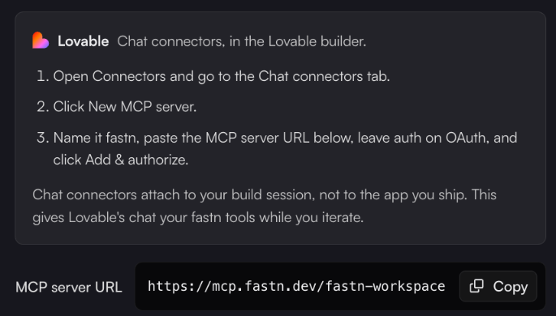

# Lovable

In Lovable, fastn is a chat connector. It gives Lovable's chat your fastn tools while you build. It attaches to your build session, not to the product you ship.


fastn hasn't yet checked these steps inside Lovable itself. They follow the Lovable tab of fastn's **Connect an agent** dialog, which has the current wording if a menu in Lovable has moved.


1. In Lovable, open **Connectors** and go to the **Chat connectors** tab.
2. Click **New MCP server**.
3. Name it `fastn`, paste `https://mcp.fastn.dev/fastn-workspace`, leave auth on **OAuth**, and click **Add & authorize**.
4. In the builder chat, ask for the integration your product needs, for example: *"Using fastn, sync new signups from our app to HubSpot contacts."* Approve each fastn tool call when asked.

<figure><figcaption>The Lovable steps in fastn's <strong>Connect an agent</strong> dialog.</figcaption></figure>

What happens after you ask is the same for every agent: see [Building from your AI agent](../building-from-your-ai-agent.md).
