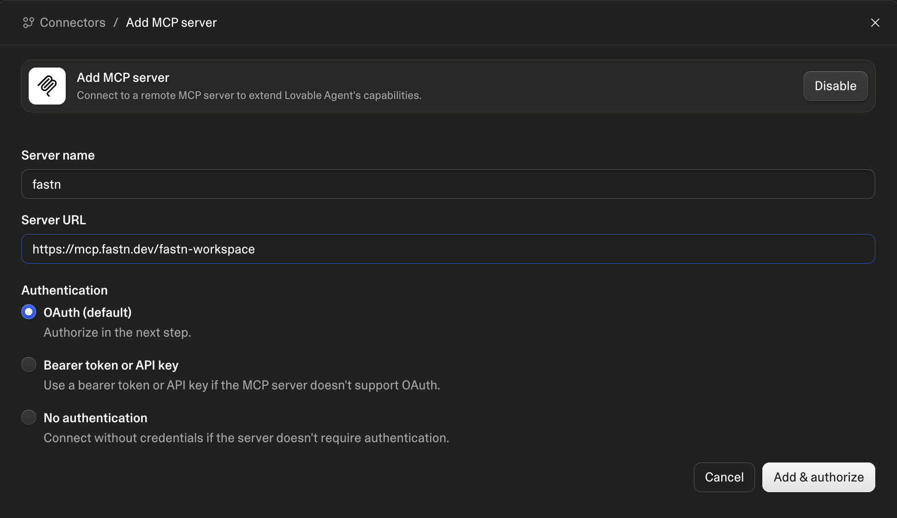
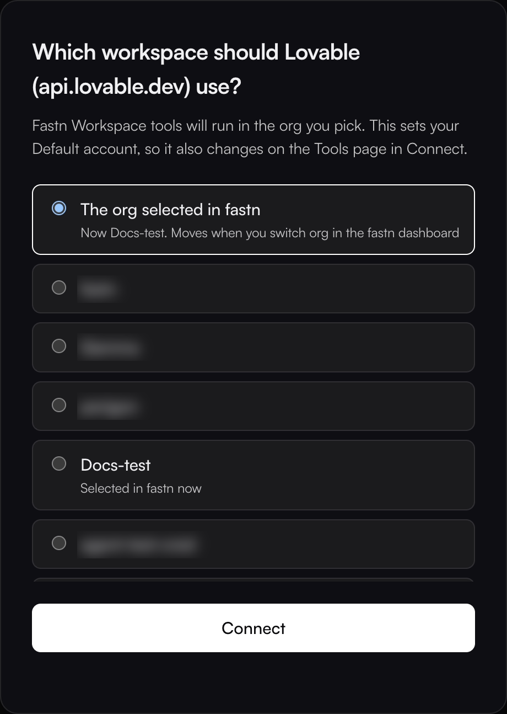
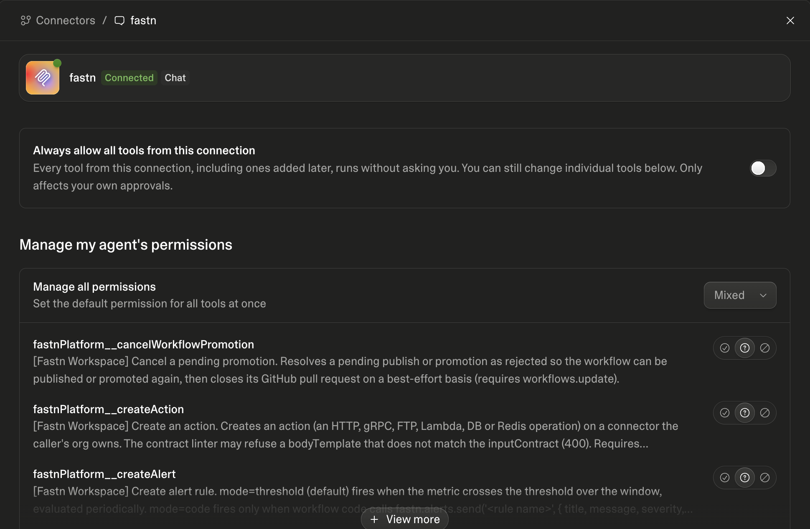
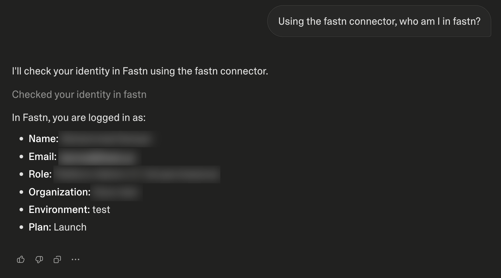

# Lovable

In Lovable, Fastn is a chat connector. It gives Lovable's chat your Fastn tools while you build. It attaches to you and your chats, not to the app you publish.


**Before you start:** custom MCP servers work on every Lovable plan. On Business and Enterprise, a workspace admin can turn them off; if **MCP server** is grayed out, ask your admin. The connection is yours alone: each teammate adds Fastn for themselves.


## Add Fastn



#### Add a custom MCP server

In Lovable, open **Connectors** in the sidebar. Click **Add custom** at the top right and choose **MCP server**.



#### Enter Fastn's URL

Enter **Server name** `fastn` and **Server URL** `https://mcp.fastn.dev/fastn-workspace`. If your workspace shows a **Connection** list, keep **Direct connection**. Leave **Authentication** on **OAuth (default)**, with no client ID or secret, and click **Add & authorize**.

<figure><figcaption>Keep <strong>OAuth</strong>. Fastn signs you in, so no token is needed.</figcaption></figure>



#### Pick the workspace

Fastn opens in a popup. Sign in if asked. If you belong to more than one Fastn org, pick the workspace Lovable works in and click **Connect**.

<figure><figcaption><strong>The org selected in Fastn</strong> follows whichever org you have open in the Fastn dashboard; picking a named org pins Lovable to it.</figcaption></figure>

The popup closes and Lovable shows *MCP server added successfully*, with Fastn marked **Connected** and its tools listed.

<figure><figcaption>Set per-tool approvals here, or turn on <strong>Always allow all tools from this connection</strong>.</figcaption></figure>



## Use it

Start a chat or open a project and ask for the outcome in one sentence. To check the connection first, ask *Using the Fastn connector, who am I in Fastn?* Lovable answers with the org you picked when signing in.

<figure><figcaption>Read-only Fastn tools run straight away. Lovable asks before any tool that changes something.</figcaption></figure>

From here Lovable works through the same steps as every AI tool: see [Build from your AI tool](../building-from-your-ai-agent.md).

## Troubleshooting

* **Nothing happens after Add & authorize.** Your browser blocked the sign-in popup. Allow popups for lovable.dev and click **Add & authorize** again.
* **Lovable doesn't use Fastn.** Name it in your message, for example *Using the Fastn connector, …*.
* **Lovable works on the wrong org.** Open Fastn under **Connectors**, click **Disconnect Fastn**, add it again, and pick the workspace when you sign in.
