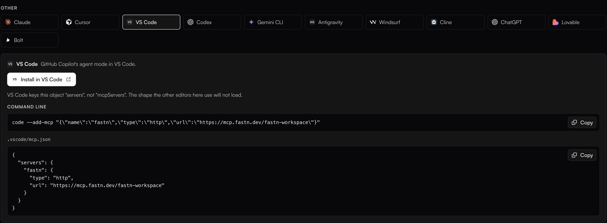
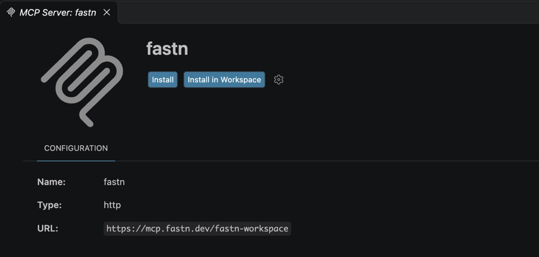
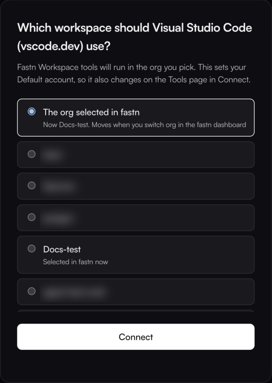
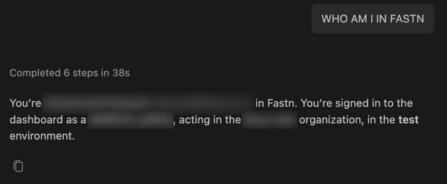

# VS Code

VS Code runs fastn as an MCP server for GitHub Copilot's **Agent** mode. Add it once from fastn, sign in, then ask Copilot for the integration in the Chat panel.


**Before you start:** you need VS Code with GitHub Copilot signed in. MCP servers are only used in Copilot's **Agent** mode, not in Ask or Edit.


## Add fastn



#### Click Install in VS Code

In fastn, click **Connect AI tools** in the top bar (or open **Access** → **MCP server**), pick the **VS Code** tile and click **Install in VS Code**. When your browser asks to open Visual Studio Code, allow it.

<figure><figcaption>The VS Code tab also has a command and a file, if you prefer those.</figcaption></figure>



#### Install the server

VS Code opens an **MCP Server: fastn** page with the URL `https://mcp.fastn.dev/fastn-workspace`. Click **Install** to add fastn for all your projects, or **Install in Workspace** to add it to the open folder only.

<figure><figcaption><strong>Install</strong> writes fastn to your user <code>mcp.json</code>; <strong>Install in Workspace</strong> writes <code>.vscode/mcp.json</code> in the folder.</figcaption></figure>



#### Start it and sign in

Installing does not start the server. Press **Cmd+Shift+P** (**Ctrl+Shift+P** on Windows and Linux), run **MCP: List Servers**, pick **fastn** and choose **Start Server**.

The first time, VS Code asks to let fastn authenticate. Click **Allow**. fastn opens in your browser: sign in, pick the workspace VS Code works in, and click **Connect**.

<figure><figcaption><strong>The org selected in fastn</strong> follows whichever org you have open in the fastn dashboard; picking a named org pins VS Code to it.</figcaption></figure>

The browser then hands you back to VS Code.

<figure><figcaption>You can close this tab.</figcaption></figure>

If you signed in to fastn from VS Code before, the server starts without asking. **MCP: List Servers** then shows fastn as **Running**.



## Use it

1. Open the Chat panel and set the mode to **Agent**.
2. Click the tools icon in the chat box and check that **fastn** is ticked.
3. Ask for the outcome in one sentence. To check the connection first, ask *Who am I in fastn?*
4. Copilot asks before it runs a fastn tool. Click **Allow** (or **Continue**).

<figure><figcaption>Copilot answers with the fastn org you picked when signing in.</figcaption></figure>

From here Copilot works through the same steps as every agent: see [Building from your AI agent](../building-from-your-ai-agent.md).

## Add it by hand

Instead of the button, run this from a terminal:

```
code --add-mcp "{\"name\":\"fastn\",\"type\":\"http\",\"url\":\"https://mcp.fastn.dev/fastn-workspace\"}"
```

Or add fastn to `.vscode/mcp.json` in a project. VS Code's key is `servers`, not `mcpServers`:

```json
{
  "servers": {
    "fastn": {
      "type": "http",
      "url": "https://mcp.fastn.dev/fastn-workspace"
    }
  }
}
```

## Troubleshooting

* **fastn is installed but Copilot never uses it.** Check the chat is in **Agent** mode and that fastn is ticked under the tools icon. Then run **MCP: List Servers** and make sure fastn is **Running**.
* **The list shows servers you did not add, or asks you to pick an MCP server "for this session".** That is a GitHub Copilot CLI session, which reads its own config (`~/.copilot/mcp-config.json`). Start a local chat instead.
* **Copilot works on the wrong org.** Run **MCP: List Servers** → **fastn** → **Stop Server**, sign out of fastn from the **Accounts** menu (bottom left), then start the server again and pick the workspace.
