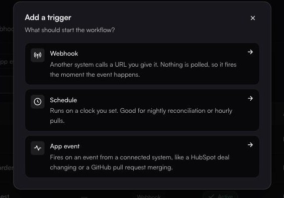

# Triggers

**Build → Integrations → Triggers** · [Open in Fastn](https://app.fastn.dev/integrations?tab=triggers)

A **trigger** starts a [workflow](../workflows/README.md) on its own. A workflow without a trigger runs only when something calls it. For example, a schedule trigger can run a reconciliation workflow every night, and a webhook trigger can run an order workflow the moment your store sends an order.

You create triggers separately from workflows, then point each one at the workflows it should run. This section covers creating and configuring triggers. To call a webhook trigger from your backend and to watch triggers fire, see [Operate → Triggers](../../operate/triggers/README.md).

### Trigger types

Select **Add trigger** and the **Add a trigger** dialog asks *What should start the workflow?* It offers three types:

* **Webhook:** *Another system calls a URL you give it. Nothing is polled, so it fires the moment the event happens.* Use it when the sender can push and you want the run straight away. [Learn more](webhooks.md)
* **Schedule:** *Runs on a clock you set. Good for nightly reconciliation or hourly pulls.* Use it for anything time-based. [Learn more](schedulers.md)
* **App event:** *Fires on an event from a connected system, like a HubSpot deal changing or a GitHub pull request merging.* Use it when the app's connector supports events. [Learn more](app-events.md)

<figure><figcaption>The Add a trigger dialog</figcaption></figure>


**One concept, several labels.** The dialog calls it **Schedule**, the sub-tab **Schedulers**, the browser title *Scheduled triggers*, and a trigger's own Type field **Scheduler**. They are all the same thing. These pages say *schedule trigger* throughout, and the list you want is the **Schedulers** tab.


### Build a trigger with AI

You can ask your AI tool through the [Fastn MCP server](../mcp-gateway/README.md) (recommended), or the [Fastn agent](../agent/README.md), to create a trigger as part of building a workflow. Webhook, schedule and app event triggers are all actions it can take, so you can ask in plain words, for example "run this whenever my store sends an order webhook".

What the AI tool sets up is the link between the trigger and the workflow. You still come to the Triggers screen to read a webhook URL it created, copy it as cURL while you debug, or disable or delete the trigger. Build a trigger by hand when you want to control its routes, delivery attempts and authentication up front.

### Routes

Every trigger sends each fire through one or more **routes**. A route says which workflow runs, and which version of it. Each trigger needs at least one route, and you add more with **Add route**. Each route has:

* **Workflow:** Required. The workflow this route runs.
* **Environment:** Optional. The default, **test (latest published)**, runs the workflow's newest published version, so publishing a new version changes what this route runs without any deploy. Any other option is one of your organization's named [environments](../../manage/environments.md), such as `live`, and runs the version deployed there. If nothing is deployed there, the fire fails.
* **Headers:** Optional key/value pairs sent to the workflow with each run.

Publishing reaches every route left on the default straight away. See the warning in [Test and release](../workflows/lifecycle.md).

A trigger with several routes fans out: every route receives every payload. For example, one webhook trigger with a route to `process-new-orders` and a route to `update-inventory` runs both workflows for each call. If a workflow should act only on some events, have it check the payload (for example `ctx.input.event_type`) and return early for the others.

Schedule triggers add a **Payload** field to each route. See [Schedule triggers](schedulers.md).

### Find a trigger

The Triggers screen has three sub-tabs: **Webhooks**, **Schedulers** (`?trigger=scheduler`) and **App events** (`?trigger=app`). Each tab has:

* **Search:** A search bar.
* **Status filter:** `All statuses`, `Active` or `Disabled`.
* **Count:** The number of triggers, in the tab label.
* **Pages:** A footer such as `Page 1 of 4 · 30 total`, with Previous and Next. A trigger you just created may be on a later page rather than missing, so check the count before you decide it failed.

Every table also has a select-all checkbox in its first column.

Triggers used to sit under Settings and under Activity. Both of those paths now redirect to **Integrations**, which is the one place triggers are created and listed. Its tabs are **Connectors**, **Workflows**, **Triggers** and **Unified APIs**.

### Inspect a trigger

Select a row to open the trigger's detail panel. It shows most of the trigger's state:

* **Details:** On a schedule trigger, this includes **Next run**, **Last run**, **Consecutive Failures** and **Re-enable Cooldown** (and **Delay**, when one is set).
* **Retry policy:** Shown only when the trigger has delivery retries set.
* **Status History (N):** Schedule triggers only. The only place a change of status is explained.
* **Routes (N):** Where each fire goes.
* **Failed deliveries (N):** Deliveries that ran out of attempts, each with its route, status, attempts and error, and with **Replay** and **Delete**.

The panel's footer holds **Close**, **Trigger Now** (schedule triggers only) and **Edit**. Read the panel, not the row menu, to find out *why* a trigger is in its current state.

### Manage triggers

* **Edit:** Select **Edit** in the detail panel or the row menu to change a trigger's configuration, routes or schedule.
* **Disable:** Stops the trigger firing and keeps its configuration. Disable a trigger while you fix its workflow, rather than deleting it.
* **Delete:** From the row menu. Deleting a trigger stops the webhook or schedule, and unsubscribes from app events.

#### When Fastn disables a trigger for you

You are not the only one who can disable a trigger. Fastn disables a schedule trigger that keeps failing, which is why the Schedulers list has a **Failures** column. It counts consecutive failures, and it resets when a run succeeds.


**By default, Fastn disables a schedule trigger after 5 consecutive failed runs.** The notification Fastn sends says so in its own words: the trigger failed that many times in a row, "which is the limit of 5". Keep that number in mind when you design a workflow's own retries.


When Fastn disables a trigger:

* **Status:** It becomes `Disabled`, and the row's status cell adds **(auto)**. Hover it to read the reason. A trigger you disabled by hand shows no **(auto)** marker.
* **Cooldown:** A **Re-enable Cooldown** applies, shown in the detail panel (30 minutes unless it was set otherwise). Once it passes, Fastn re-enables the trigger. The cooldown can be from 1 to 1440 minutes. The exception is a trigger disabled because its workflow was deleted or was never published: a cooldown doesn't fix that, so it stays disabled until someone re-enables it by hand, even though the panel still shows the stored cooldown.
* **Status History:** The reason and the time are recorded in **Status History** on the detail panel, which shows the last 20 status changes.

So if a nightly job stops without warning, open its row, read Status History and check the Failures count. Don't assume someone on your team turned it off.

### In this section

* [Set up triggers](../../tutorials/saas-admin/setting-up-triggers.md): create a trigger and route it to a workflow, step by step.
* [Webhook triggers](webhooks.md): every webhook option, including authentication and delivery attempts.
* [Schedule triggers](schedulers.md): schedule modes, timezone and advanced options.
* [App event triggers](app-events.md): connector events and the subscription status.
