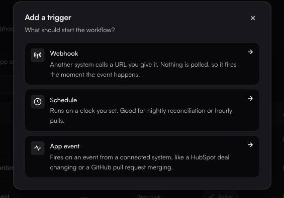

# Triggers

**Integrations → Triggers** · `/integrations?tab=triggers`

A workflow with no trigger only runs when something calls it. A trigger is what makes it run on its own.

The page splits into three sub-tabs (**Webhooks**, **Schedulers** (`?trigger=scheduler`) and **App events** (`?trigger=app`)), with a status select offering `All statuses`, `Active` and `Disabled`.

Each list paginates, with a footer reading `Page 1 of 4 · 30 total` and Previous/Next controls. **A trigger you just created may be on a later page rather than missing**: check the count before you conclude it failed. Every table also carries a leading select-all checkbox.


**One concept, several labels.** The dialog calls it **Schedule**, the sub-tab **Schedulers**, the browser title *Scheduled triggers*, and a trigger's own Type field **Scheduler**. They are all the same thing. These pages say *schedule trigger* throughout, and the list you want is the **Schedulers** tab.


### Choosing a type

<figure><figcaption>Each option carries its own one-line description, reproduced nowhere below, so read them here.</figcaption></figure>

| Type          | Reach for it when                                            |
| ------------- | -------------------------------------------------------------- |
| **Webhook**   | The sender can push, and you want it immediate.               |
| **Schedule**  | Nightly reconciliation, hourly pulls, anything time-based.    |
| **App event** | A HubSpot deal moves, a GitHub PR merges, and the connector supports events. |

### Inspecting a trigger

Clicking any row opens a side panel, which is where most of a trigger's life is visible. It carries:

* **Details**. On a schedule trigger this includes **Next run**, **Last run**, **Consecutive Failures** and **Re-enable Cooldown** (and **Delay**, when one is set).
* **Retry policy**, shown only when the trigger has delivery retries configured.
* **Status History (N)**, on schedule triggers only.
* **Routes (N)**: where each fire goes.
* **Failed deliveries (N)**: deliveries that ran out of attempts, each with **Replay** and **Delete**.

Its footer holds **Close**, **Trigger Now** (schedule triggers only) and **Edit**.

The panel (not the row menu) is where you read *why* a trigger is in the state it is. Status History is the only place a change of status is explained.

### Managing triggers

The status select separates active from disabled. Disabling a trigger stops it firing without losing its configuration: the right move while you fix a workflow, and better than deleting it.

#### When fastn disables a trigger for you

**Disabling is not only something you do.** A schedule trigger that keeps failing is disabled by the platform, which is why the Schedulers list has a **Failures** column at all. It counts consecutive failures, and it resets when a run succeeds.

When the platform disables one:

* The trigger's status becomes `Disabled`, and the row's status cell adds **(auto)**; hover it to read the reason. A trigger you disabled by hand shows no **(auto)** marker.
* A **Re-enable Cooldown** applies, shown in the scheduler detail panel (30 minutes unless it was set otherwise). Once the cooldown passes, fastn re-enables the trigger automatically. The cooldown can be set from 1 to 1440 minutes. The exception is a trigger disabled because its workflow was deleted or was never published: a cooldown does not fix that, so it stays disabled until someone re-enables it by hand, even though the panel still shows the stored cooldown.
* The reason and the moment are recorded in **Status History** on the detail panel, which shows the last 20 status changes.

So if a nightly job silently stops, open the row, read Status History, and look at the Failures count: do not assume someone on your team turned it off.


**By default a schedule trigger is auto-disabled after 5 consecutive failed runs.** The notification fastn sends says so in its own words: the trigger failed that many times in a row, "which is the limit of 5". Keep that number in mind when you design a workflow's own retries.


### In this section

* [Webhook triggers](webhooks.md)
* [Schedule triggers](schedulers.md)
* [App event triggers](app-events.md)
