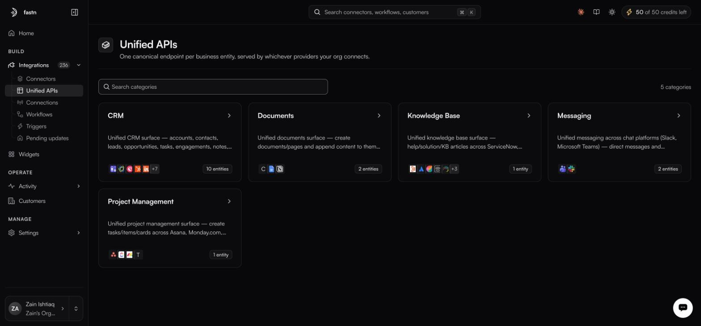

# Unified APIs

**Integrations → Unified APIs** · `/integrations?tab=unified`

<figure><figcaption>The icons on each card are the providers currently serving that category.</figcaption></figure>

Three of your customers use three different CRMs. Without a unified API, your code branches three ways for what is conceptually one operation: create a contact. With one, you call a single endpoint and fastn routes to whichever provider that customer authorized.

> One call that reaches every app of the same kind you have connected: every CRM, every store.

### Categories and entities

A **category** is a domain. An **entity** is a business object inside it. Each entity is backed by one or more **providers**. The list shows a count chip (for example `N categories`) and a **Search categories** box. A search that matches nothing reads `No categories match` / *Try another search.*

The catalog is live data: which categories, entities and providers you see depends on what fastn has published and mapped at the time. As an illustration, the catalog has included categories such as **CRM**, **Documents**, **Knowledge Base**, **Messaging** and **Project Management**, with entries like these:

| Category      | Example entities                                   | Example providers (slugs)                |
| ------------- | -------------------------------------------------- | ---------------------------------------- |
| **CRM**       | `Account`, `Contact`, `Lead`, `Note`, `Opportunity` | `hubspot`, `salesforce`, `zohoCrm`       |
| **Documents** | `Document`, `Document Content`                     | `googleDocs`, `notion`                   |
| **Messaging** | `Channel Message`, `Direct Message`                | `microsoftTeams`, `slack`                |

The provider slugs are what you use in the API; the cards show display names. Open a category in the product to see its current entities and providers.

### In this section

* [Setup and Usage](setup-and-usage.md)
* [Inside a category](inside-a-category.md)
* [Unified vs direct](unified-vs-direct.md)
