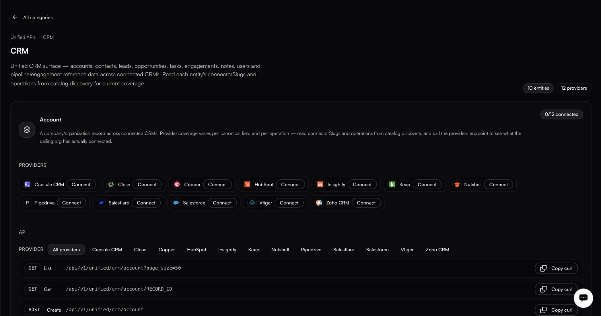

# Inside a category

<figure><figcaption>Nothing is connected here yet, and the endpoints are listed anyway. They exist per entity, not per provider.</figcaption></figure>

Opening a category swaps the pane for a detail view with an **All categories** back button, the breadcrumb **Unified APIs / \<Category>** and two chips, *N entities* and *N providers*. Opening a category also sets `?surface=<slug>` in the URL, so a category view is linkable, survives a reload, and browser Back returns you to the category list.

Each entity gets its own block showing:

* **Connection state**: `<connected>/<total> connected`, how many of the backing providers this customer has authorized.
* **Providers**: one row per provider, with a **Connect** button, or **Connected** and a `⋯` menu. The menu offers **Add another connection**; **Use \<name> by default** (only when the provider has two or more connections, one item per non-default connection); and **Disconnect** (or **Disconnect \<name>**, one per connection, when there are several). Viewers, who cannot connect accounts, see **Not connected** instead of a **Connect** button.
* **API**: the endpoints, filtered by an **All providers** selector. Each row shows the HTTP method, the operation name and the path, with a **Copy curl** button.

Endpoints follow a consistent shape. The operations are **List**, **Get**, **Search**, **Create**, **Update** and **Delete**:

```http
GET    /v1/unified/crm/account?page_size=50     # List
GET    /v1/unified/crm/account/RECORD_ID        # Get
POST   /v1/unified/crm/account/search           # Search (filters go in the body)
POST   /v1/unified/crm/account                  # Create
PATCH  /v1/unified/crm/account/RECORD_ID        # Update (send only the fields to change)
DELETE /v1/unified/crm/account/RECORD_ID        # Delete
```

Not every entity supports every operation; a row only appears for the operations at least one provider serves. When only some of the providers serve an operation, the row says **Only \<provider names>** so it does not overstate coverage. Some entities may support only a subset, for example Create alone.
