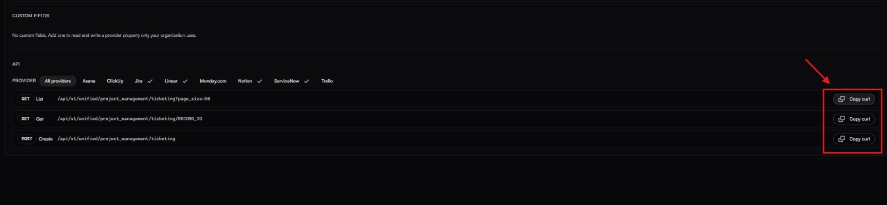

# How to Set Up and Use fastn's Unified API

## 1. Log in to fastn

Go to [app.fastn.dev](https://app.fastn.dev/) and log in to your fastn account.

## 2. Open Unified APIs

From the dashboard, go to **Integrations** and open the **Unified APIs** tab.

## 3. Select a Unified API

Choose the Unified API you want to use. For this guide, we'll use **Project Management** as an example.

Click **Project Management** to view the available endpoints and their request details.

## 4. Copy the API Request

Find the endpoint you want to use in the **API** section. Each row is labeled by its HTTP method and operation (for example **POST Create**, **GET List**, **GET Get**, **POST Search**, **PATCH Update**, **DELETE Delete**), followed by its path. To create a ticket, use the **Create** row of the ticket entity.

Click **Copy curl** on that row. Use the copied request as the starting point for your integration.

<figure><figcaption></figcaption></figure>

The copied request has this shape. The entity slug and body fields below are illustrative; the real ones come from the catalog and the providers mapped to that entity, so always start from the request the dashboard copies for you:

```bash
curl -X POST '<api-base>/v1/unified/<category>/<entity>' \
  -H 'Authorization: Bearer YOUR_FASTN_API_KEY' \
  -H 'Content-Type: application/json' \
  -d '{
    "title": "...",
    "description": "...",
    "due_date": "...",
    "assignee_id": "...",
    "project_id": "...",
    "status": "...",
    "priority": "...",
    "tags": []
  }'
```

Replace the placeholder values with the appropriate values for your request. The fields required and supported depend on the endpoint and the connected project management application.

## 5. Generate Your fastn API Key

To authenticate your requests, you'll need a **fastn API key**.

Follow the [fastn API Keys documentation](../../manage/api-keys.md) to create one.

Replace `YOUR_FASTN_API_KEY` in the cURL request with your actual key.

Keep this key secure. Do not expose it in frontend code or public repositories.

## 6. Make Requests Using Your Customers' Connections

If your SaaS application needs to execute Unified API requests on behalf of your customers, include the `x-org-id` header in the request.

Your **API key authenticates your SaaS application with fastn**, while the `x-org-id` header identifies your customer whose connections should be used for the request. This works only with API-key authentication, using a key that can act for more than one customer (not a key pinned to a single customer).

Add the following header:

```bash
-H 'x-org-id: YOUR_CUSTOMER_ORG_ID'
```

Use the **same organization ID discussed in the** [**fastn embedding guide**](../../embed/embedding/README.md). This is the organization ID you already use when setting up the embedded fastn experience.

Make sure the customer has connected and authorized the relevant application in fastn before sending requests that rely on that connection.

## 7. You're Ready to Make API Requests

Once you have your fastn API key and have configured the appropriate `x-org-id` header, you can start making requests through fastn's Unified API.

You can follow the same process for other Unified APIs and endpoints, using the cURL request provided in the fastn dashboard as your starting point.
