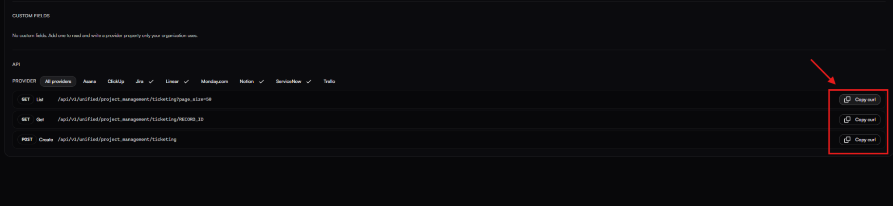

# Set up and use a unified API

**Build → Integrations → Unified APIs** · [Open in Fastn](https://app.fastn.dev/integrations?tab=unified)

At the end, your backend sends a working unified API request for one of your customers, built from the request the dashboard copies for you.

### Before you start

* A Fastn account. Sign in at [app.fastn.dev](https://app.fastn.dev/).
* Access to **Embed → API keys**, to create a key.
* To run requests for a customer: that customer has connected and authorized the relevant app in Fastn, for example through your [widget](../../embed/embedding/README.md).

### Steps

1. **Open a category.** Go to **Build → Integrations → Unified APIs** ([Open in Fastn](https://app.fastn.dev/integrations?tab=unified)) and select the category you want. This guide uses **Project Management**.

   **You should see:** the category's entities, each with its providers and an **API** section that lists its endpoints and their request details.
2. **Copy the request.** In the **API** section, find the endpoint you want. Each row is labeled by its HTTP method and operation (for example **POST Create**, **GET List**, **GET Get**, **POST Search**, **PATCH Update** or **DELETE Delete**), followed by its path. To create a ticket, use the **Create** row of the ticket entity. Select **Copy curl** on that row.

   <figure><figcaption><p>The Copy curl buttons in a category's API section.</p></figcaption></figure>

   **You should see:** a request with this shape on your clipboard. The entity slug and body fields below are illustrative. The real ones come from the catalog and the providers mapped to that entity, so always start from the request the dashboard copies for you.

   ```bash
   curl -X POST '<api-base>/v1/unified/<category>/<entity>' \
     -H 'Authorization: Bearer YOUR_FASTN_API_KEY' \
     -H 'Content-Type: application/json' \
     -d '{
       "title": "...",
       "description": "...",
       "due_date": "...",
       "assignee_id": "...",
       "project_id": "...",
       "status": "...",
       "priority": "...",
       "tags": []
     }'
   ```

   Replace the placeholder values with your own. Which fields are required and supported depends on the endpoint and on the app the customer connected.
3. **Add your Fastn API key.** Go to **Embed → API keys** ([Open in Fastn](https://app.fastn.dev/api-keys)) and create a key. See [API keys](../../manage/api-keys.md). Replace `YOUR_FASTN_API_KEY` in the request with it.

   
   Keep this key secret. Do not put it in frontend code or a public repository.
   

   **You should see:** the request's `Authorization` header carrying your key, which starts `fsk_live_` or `fsk_test_`.
4. **Name the customer.** To run the request with one customer's connections, add the `x-org-id` header:

   ```bash
   -H 'x-org-id: YOUR_CUSTOMER_ORG_ID'
   ```

   Your API key authenticates your product with Fastn, and `x-org-id` names the customer whose connections the request uses. Use the same customer ID you send as `x-org-id` when you [embed the widget](../../embed/embedding/README.md). This works only with API key authentication, using a key that can act for more than one customer (not a key pinned to a single customer). For every rule and error, see [Scoping a call to a customer](../../reference/api.md#scoping-a-call-to-a-customer).

   **You should see:** the request carrying both `Authorization` and `x-org-id`.
5. **Send the request.** Run it from your backend.

   **You should see:** the result of the operation from the app that customer connected. To call other categories and endpoints, repeat these steps, starting from the request the dashboard copies for you.

### What's next

* [Inside a category](inside-a-category.md): every endpoint, operation and provider option on a category's page.
* [Choose between unified and direct](unified-vs-direct.md): when to call a connector directly instead.
