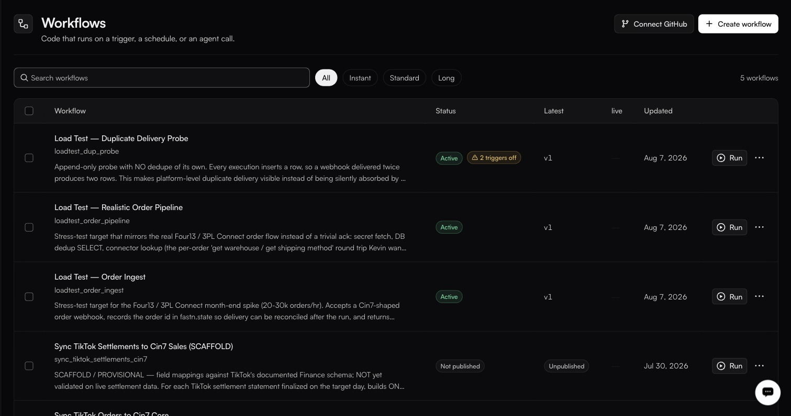

# Workflows

**Integrations → Workflows** · `/integrations?tab=workflows`

<figure><figcaption>Connect GitHub and Create workflow sit top-right; the pills filter by execution tier. An environment cell showing a dash means nothing is deployed there.</figcaption></figure>

A workflow is JavaScript. One file, `<slug>.js`, exporting one function:

```javascript
export default async function (ctx) {
  // ctx.input, ctx.headers; connectors via fastn.connector.<slug>.<action>()
}
```

There is no node palette and no drag-and-drop step builder. Everything else on this screen configures, describes, tests or deploys that function.

### The list

| Column         | Notes                                                                          |
| -------------- | -------------------------------------------------------------------------------- |
| checkbox       | Selects rows.                                                                   |
| **Workflow**   | Name, slug and description.                                                     |
| **Status**     | One of `Live`, `Published`, `Paused`, `In review` or `Unpublished` (see below). |
| **Latest**     | The newest published version, for example `v2`. This is what the test environment runs. A dash means there is no published version yet (tooltip: *No published version yet.*). |
| one column per environment | Headed by the environment's slug, and shown only when your organization has environments. Each cell shows the version deployed there, for example `v2`, or `v1 · 1 behind` when newer published versions have not been deployed to it. A dash means nothing is deployed there. |
| **Updated**    | Last change.                                                                    |
| actions        | An **Executions** link to the workflow's runs, **Run** to execute on demand, and a `⋯` menu with **Edit** (or **View** for an inherited workflow) and **Delete**. |

What each status means:

| Status | Meaning |
| ------ | ------- |
| `Live` | A published version is deployed to the default (live) environment. |
| `Published` | Published; the test environment runs it, but it is not deployed to live yet. |
| `Paused` | Published, but disabled: calls are refused until it is enabled again. |
| `In review` | A publish is waiting on a GitHub pull request; the version is created when the PR merges. |
| `Unpublished` | Never published. |

Two tooltips explain why a call fails, and the first is the string you will search for:

> Never published. Every call returns WORKFLOW\_NOT\_PUBLISHED until a snapshot is published. Draft edits alone do not make a workflow runnable.

> Nothing deployed to \<environment>. A call naming this environment fails until a version is deployed to it.

**Search workflows** filters by name; pills split the list by execution tier: **All**, **Instant**, **Standard**, **Long**.

Two buttons sit top-right: **Connect GitHub**, which connects your organization to a GitHub repository, and **Create workflow**, which gives you an empty one.

### In this section

* [The editor](the-editor.md)
* [The tabs](the-tabs.md)
* [Lifecycle](lifecycle.md)
