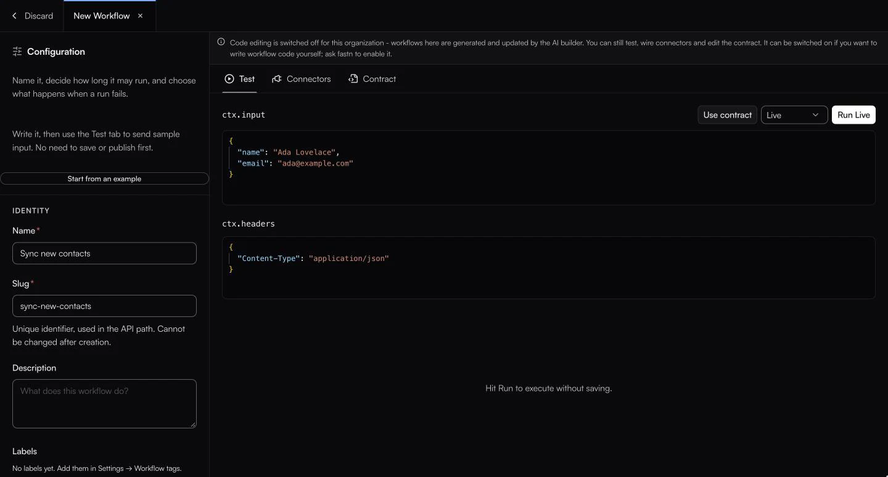

# The workflow editor

**Build → Integrations → Workflows** → **Create workflow**, or **Edit** in a workflow's `⋯` menu · [Open in Fastn](https://app.fastn.dev/integrations?tab=workflows)

The workflow editor is where you configure, test, publish and deploy a workflow. It opens as a drawer over the Workflows list.

### Layout

* **Configuration (left):** the workflow's name, execution tier, timeout, retries, and the **Publish & Deploy** actions. See [Configuration panel](#configuration-panel).
* **Code (middle):** the workflow's `<slug>.js` file. Shown only when code editing is on for your organization. See [Write a workflow in code](../../tutorials/saas-admin/configuring-a-workflow-in-code.md).
* **Tool tabs (right):** tabs to test the workflow, check its connectors and contract, read its diagram, and see its runs. [Learn more](the-tabs.md)

The top bar holds **Discard**, the workflow name, **Close tab**, **Save workflow** and **Publish**. If you close the editor with unsaved edits, it asks first: *Discard unsaved changes?*, with **Keep editing** and **Discard changes**.

<figure><figcaption>A new workflow. In an organization with code editing off, only the Test, Connectors and Contract tabs show.</figcaption></figure>

### When code editing is off

Code editing is off by default. Fastn turns it on for your organization if you ask. While it is off:

* The editor has no code column, and a banner says that workflows are generated and updated by the AI builder.
* To change what a workflow does, you ask your AI tool through the [Fastn MCP server](../mcp-gateway/README.md), or the [Fastn agent](../agent/README.md).
* Everything else works the same: you still configure, test, wire connectors, edit the contract, publish and deploy.

### A typical pass through the editor

1. **Configure it.** Name the workflow and pick its execution tier in the [Configuration panel](#configuration-panel). Choose the slug carefully: you can't change it later.
2. **Test it.** Run it with a sample input on the [Test](the-tabs.md#test) tab.
3. **Check what it calls.** Confirm the apps and actions it uses on the [Connectors](the-tabs.md#connectors) tab, and its input and output shape on the [Contract](the-tabs.md#contract) tab.
4. **Check its test cases.** Review the saved test suite on the [Test cases](the-tabs.md#test-cases) tab.
5. **Publish and deploy it.** Use **Publish & Deploy** in the Configuration panel. See [Test and release](lifecycle.md).

### Configuration panel

#### Identity

| Field           | Notes                                                                             |
| --------------- | ----------------------------------------------------------------------------------- |
| **Name**        | Required. Empty saves are refused with *Name is required.*                         |
| **Slug**        | Required when you create the workflow, and **cannot be changed afterwards**.        |
| **Description** | What the workflow does. The Fastn agent or your AI tool writes one, and you can edit it. |

#### Execution

| Field                 | Notes                                                                                     |
| --------------------- | ------------------------------------------------------------------------------------------- |
| **Execution tier**    | `Instant` (the default), `Standard` or `Long`. Sets how long a run can take and whether the caller waits for the result. See [Execution tiers](README.md#execution-tiers). |
| **Execution timeout** | A slider constrained to the tier: 1s to 25s for Instant (2 min if Fastn has raised your organization's limit), 5s to 15min for Standard, 30s to 36h for Long. Defaults are 25s, 2.0m, and 15.0m respectively. |
| **Status**            | A toggle, on by default, and shown only on workflows that already exist. Off stops new runs without deleting anything. |

#### When a run fails

* **Retry policy:** Off by default, so a failed run is not retried. When it is on, Fastn retries temporary failures, and timeouts too when **Escalate on timeout** is off. Code errors, data errors and out-of-memory failures are never retried. Turning it on shows four fields:

| Field                    | Range | Default |
| ------------------------ | ----- | ------- |
| **Max attempts**         | 2-10  | 3       |
| **Initial interval (ms)** | - | 5000    |
| **Backoff coefficient**  | - | 2       |
| **Max interval (ms)**    | - | 60000   |

* **Escalate on timeout:** Off by default, and hidden on the Long tier. When a run times out, Fastn runs it again one tier up (Instant to Standard, or Standard to Long) with that tier's full time limit, if your plan allows it. An escalated Instant run returns an execution id to poll instead of the result.

#### Publish & Deploy

Shown on existing workflows only. See [Test and release](lifecycle.md) for what each action does.

* **Publish snapshot:** saves the current code and configuration as a new version.
* **Deploy to environment:** puts a published version into an environment.

Underneath, a **Latest: vN** line shows the newest published version, followed by one row per environment with the version running there.
