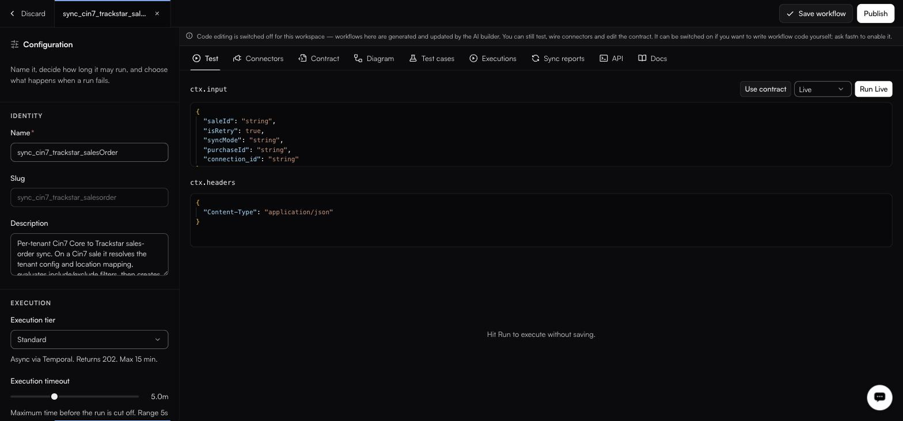
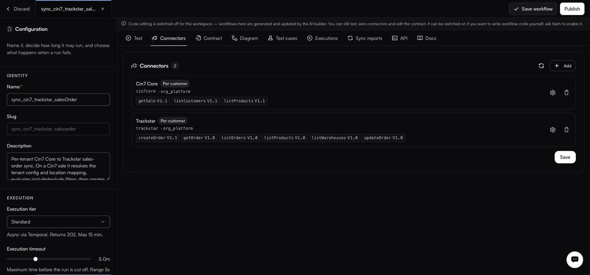
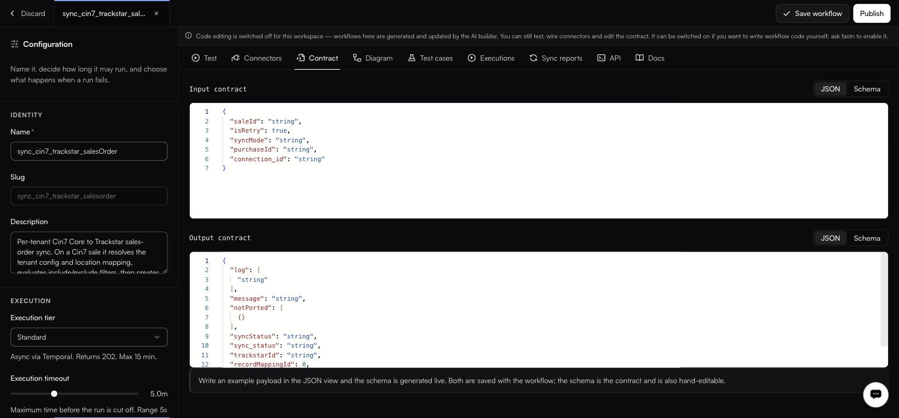
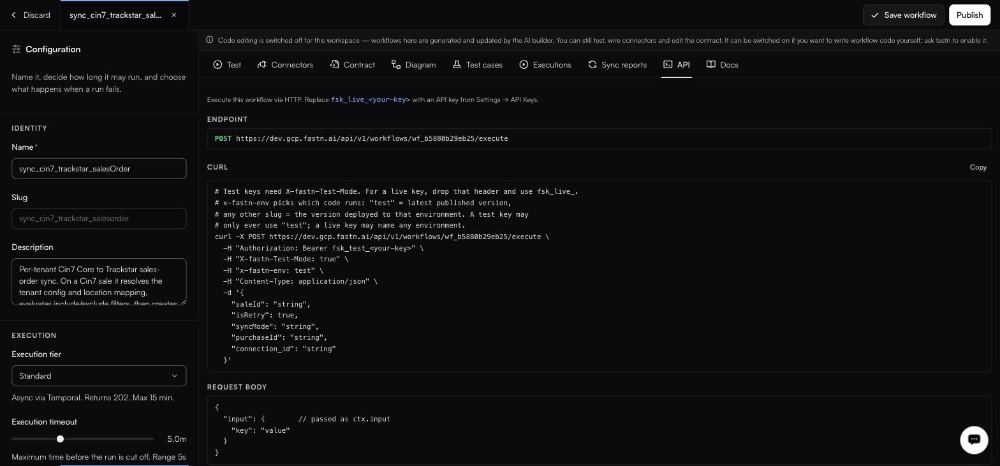

# The tabs

A new workflow shows three tabs: **Test**, **Connectors** and **Contract**. Once it is saved, the rest appear: **Diagram**, **Compare** (when there is code to compare), **Test cases**, **Executions**, **Sync reports** and **API**. If there is not room for all of them, the overflow collapses into a **More** menu.

#### Test

<figure><figcaption>Until you run it, the result pane just reads Hit Run to execute without saving.</figcaption></figure>

Two JSON editors, `ctx.input` and `ctx.headers`. **Use contract** fills the input from the declared contract. The mode select beside the run button chooses what the run actually calls:

| Mode             | What runs                            |
| ---------------- | -------------------------------------- |
| **Live**         | Real calls to the connected systems.  |
| **Partial Mock** | Live where the connector has an active connection, a stored mock stub where it does not. |
| **Fully Mock**   | Stubs only.                           |

The run button follows the mode: **Run Live**, **Run Partial Mock** or **Run Fully Mock**.

#### Connectors

<figure><figcaption>Every action chip carries its pinned version, such as getSale V1.1.</figcaption></figure>

This list is **auto-extracted from the `fastn.connector.<slug>.<action>(…)` calls in your code every time you save**. It is a readout of the code, not a separate configuration. **Add** exists for anything you need to wire manually. Each row shows a **Per customer** badge where it applies, plus the connector slug, the owning org, the action and its version.


Pinned action versions are what stop an upstream change breaking you silently. When fastn proposes a newer action, it arrives through [Pending updates](../connector-updates.md) for you to accept.


#### Contract

<figure><figcaption>Both editors sit on JSON here; the Schema view holds the generated contract.</figcaption></figure>

**Input contract** and **Output contract**, each viewable as **JSON** or **Schema**. Write an example payload in the JSON view and the schema is generated live. The schema is the contract, and is also hand-editable.

#### Diagram

Three sub-tabs.

**Flow**: a read-only React Flow rendering, generated from your code. Node kinds are `TRIGGER`, `READ`, `PROCESS`, `WRITE`, `DECISION` and `DONE`; the controls are Zoom In, Zoom Out and Fit View. You cannot edit the graph. Edit the code and the graph follows.

**Sequence**: the same logic as an ordered list of phases.

**Docs**: generated documentation, with an **End user** / **Technical** toggle, an **Out of date** badge when the code has moved on, and **Regenerate** / **Generate**.

The end-user document has nine sections: *What this integration does*, *Before you start*, *Connected apps*, *How it works*, *Field mapping*, *Smart features*, *When it runs*, *Troubleshooting*, *Related links*.


Generating or regenerating these docs consumes AI credits from your organization's allowance.


#### Test cases

Two tabs sit here, and the difference between them is the part worth understanding: **Test Cases** is the specification, **Validation** is the result of running it.

**Who writes them.** Build with AI generates a suite while it builds the workflow, grouped into `happy-path`, `pagination`, `fields`, `edge-cases` and `error-handling`. It asks you to approve that suite before attaching it, rather than attaching it silently. After that the list is yours to maintain: each group has an add control, and every case can be edited or deleted.

A case is three fields and a mode:

| Field | Notes |
| ----- | ------- |
| **Group** | Free text, with existing groups suggested. Left blank it becomes `Ungrouped`. |
| **Scenario** | What is being exercised. |
| **Pass criteria** | What has to be true for the case to pass. Required. |
| **Mode** | `MOCK` (the default) or `LIVE`. This is the badge on the row. |

**Who runs them.** The workflow validator agent does, not you and not the Run button. Until it has run, the **Validation** tab reads *Not validated yet. The workflow validator agent will populate this tab after it runs against the test cases.* Once it has, that tab carries the status, the mode it ran in, when it ran, and a result for each case against the total.

The pass, fail and untested counters in the **Test Cases** header reflect that last validation run. **Untested** means the validator has not reached that case, not that the case failed.


**`LIVE` and `MOCK` are set per case, and `MOCK` is the default.** A `MOCK` case is served from stored mock stubs and never reaches the third-party API; a `LIVE` case makes real calls. A suite that is entirely `MOCK` proves your logic, not your connections, so promote the few cases that actually matter to `LIVE` before you trust a green run.


None of this is the [Test](#test) tab above. **Test** runs one payload you type, once, right now. **Test cases** are a saved suite the validator agent runs against the whole workflow.

#### Executions

This workflow's run history, filtered by status pills: **All**, **200**, **201**, **400**, **404**, **422**, **500**. The organization-wide view is [Activity → Executions](../../operate/executions.md).

#### Sync reports

> A report appears the first time a workflow runs fastn.diff.compare.

See [Sync reports](../../operate/sync-reports.md).

#### API

<figure><figcaption>Generated from the deployment you are actually calling, copy the curl from here rather than from docs.</figcaption></figure>

How to call this workflow over HTTP, with a copyable curl:

```http
POST https://api.fastn.dev/api/v1/workflows/<wfId>/execute
```

Two headers steer it (`X-fastn-Test-Mode` and `x-fastn-env`) and you authenticate with an API key in the `fsk_live_…` format. Covered in full in the [HTTP API reference](../../reference/api.md).

#### Where the runtime reference lives

There is no separate runtime reference tab (the **Docs** view under **Diagram** documents this workflow, not the runtime). What `ctx` and `fastn.*` expose inside the function shows up in the code editor's autocomplete, and is documented in full in [Workflow runtime API](../../reference/workflow-runtime.md). In short:

| Surface                 | For                                                              |
| ----------------------- | ------------------------------------------------------------------ |
| `ctx.input`             | The request body, shaped by the input contract.                   |
| `ctx.headers`           | The request headers.                                              |
| `fastn.envConfig`       | Per-environment values. See [Configs](../../manage/configs.md).      |
| `fastn.unified`         | The [unified API](../unified-apis/README.md) surface.                        |
| `fastn.connector`       | A connector call: `fastn.connector.<slug>.<action>()`.             |
| `fastn.db`              | Your organization's Postgres schema. See [Database](../../manage/database.md). |
| `fastn.state`           | Key/value state, with scopes `ORG` (the default) and `INVOCATION`. |
| `fastn.secrets`         | Encrypted values. See [Secrets](../../manage/secrets.md).            |

Calls made for a specific customer are addressed with headers: `x-end-org-id`, `x-end-org-ref`, `x-installation-id`, `x-fastn-connections`, `x-fastn-installation-config`.


Use `fastn.connector` (singular) in your code. The Connectors tab's extractor recognizes the plural `fastn.connectors.<slug>.<action>()` too, but the runtime does not provide it, so a plural call fails when the workflow runs.

