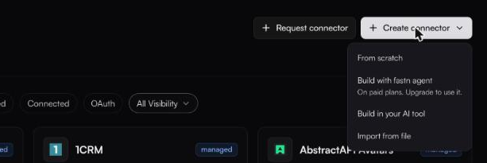
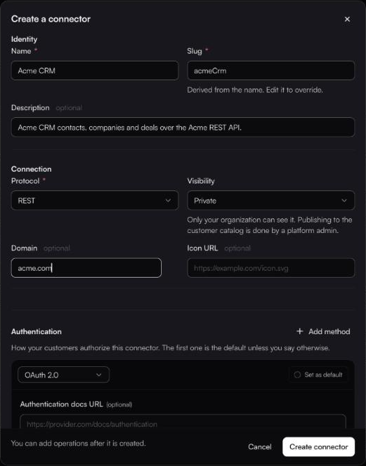
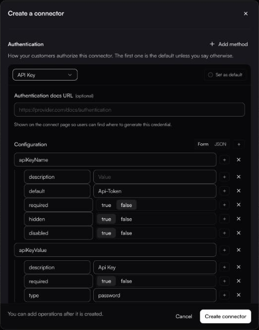

# Create a connector

Create a connector when the app you need isn't in the [catalog](README.md). The connector belongs to your organization: only your organization can see it, and you can add actions to it and publish new versions of it.

This page walks through creating one by hand. For every field and option, see the [Create a connector reference](../build/connectors/creating-a-connector.md).


**Quicker: let AI build it.** In **Create connector**, choose **Build in your AI tool** (every plan) or **Build with fastn agent** (paid plans). Give it the app's API docs or an OpenAPI file, and it creates the connector, its actions and its auth method, then tests them.


## Before you start

* You need the Owner, Admin, Developer or Operator role in Fastn.
* Have the app's API details ready: its base URL, how it authenticates (for example an API key or OAuth 2.0), and the endpoints you want to call.
* For OAuth 2.0, register an OAuth app with the vendor first and keep its client ID and client secret. Use `https://oauth.live.fastn.ai` as the redirect URL.

## Steps

1. Go to **Build → Integrations → Connectors**, select **Create connector** at the top right, then select **From scratch**.

   <figure><figcaption>
The Create connector menu.
</figcaption></figure>

2. Under **Identity**, enter the connector's **Name**. Fastn fills in the **Slug** from the name; edit it if you want a different one. Add a **Description** of what the app does and which parts of its API the connector covers.
3. Under **Connection**, keep **Protocol** as `REST` for a web API. Choose `MCP`, `FTP`, `Database` or `REDIS` for those kinds of systems. Optionally enter the app's **Domain**, which Fastn uses to find its icon.

   <figure><figcaption>
Identity and Connection, filled in for an example app, Acme CRM.
</figcaption></figure>

4. Under **Authentication**, choose how your customers sign in to the app, for example **API Key**, **Bearer Token**, **Basic Auth** or **OAuth 2.0**. Then adjust the **Configuration**, which lists the fields your customers fill in when they connect. For an API key, set the `default` of `apiKeyName` to the header the app expects, such as `X-API-Key`.

   <figure><figcaption>
An API key method and its Configuration.
</figcaption></figure>

   To offer more than one sign-in method, select **Add method**. Optionally, enter an **Authentication docs URL**, which is shown on the connect form so customers can find where to get their credential.
5. Select **Create connector**. The connector opens with version `v1.0` in **Test**, and its card shows the `Custom` badge.
6. Add an action for each API call: select **+** next to the connector's name in the left rail, name the action, choose the method and enter the URL (or paste a `curl` command), then select **Create Action**. See [Add an action](../build/connectors/editing-and-deleting.md#add-an-action).
7. For OAuth 2.0, add your OAuth app on the connector's **Auth** tab: select **Manage providers**, then **+ Create Provider**, and enter the client ID, client secret and scopes. See [Auth methods and providers](../build/connectors/auth-methods.md).
8. Connect an account and test: select **Connect** on the connector and fill in the form (see [Connect an app](../build/connectors/connect-an-app.md)). Then open an action, select **Run**, choose your connection and select **Run Action**. See [Run an action](../build/connectors/action-detail.md#run-an-action).
9. When the actions work, publish the version so your customers get it: open **Overview**, scroll to **Versions**, select **Publish to live** on the version, then **Publish**. See [Publish a version](../build/connectors/editing-and-deleting.md#publish-a-version).

## If you'd rather not build it

Select **Request connector** on the Connectors page and describe the app and what it needs to do. Fastn's team builds it for you. See [Request a connector](../build/connectors/creating-a-connector.md#request-a-connector).
