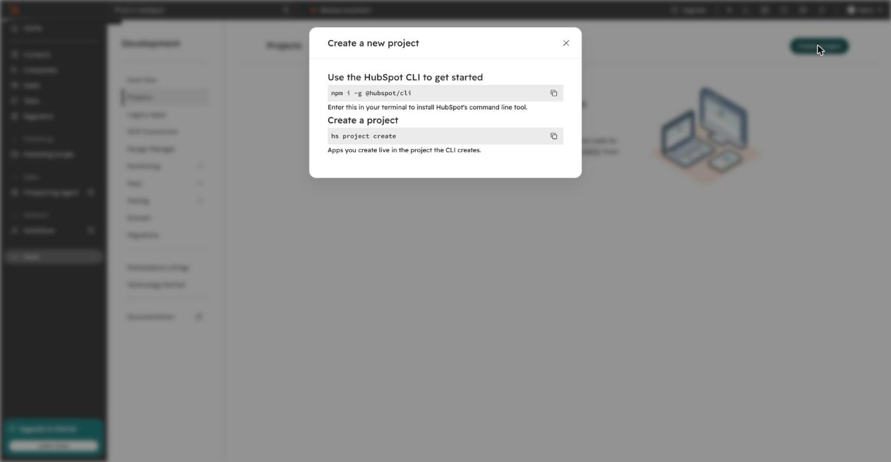
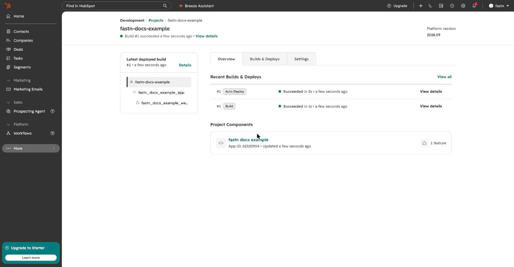
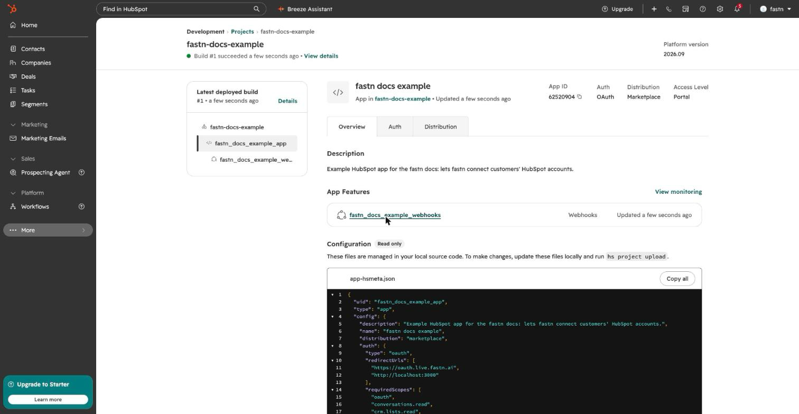
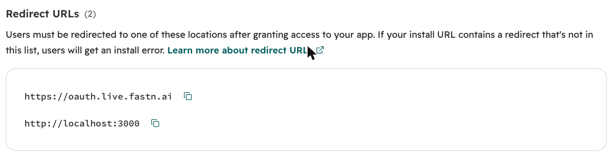
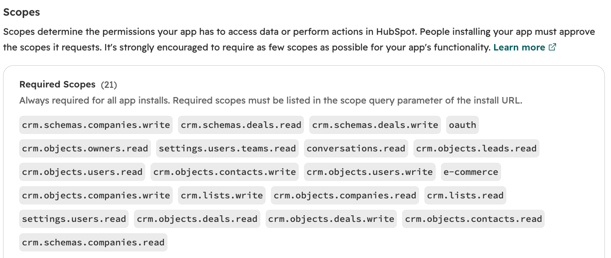
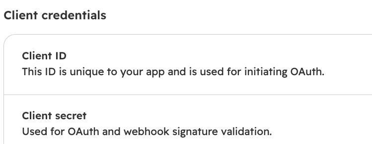
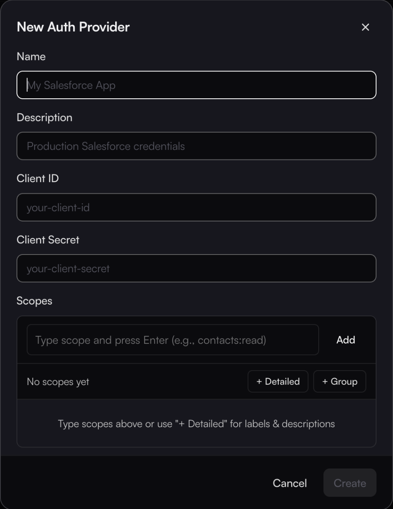

# HubSpot

| | |
| --- | --- |
| **Category** | [CRM and sales](README.md) |
| **Website** | [hubspot.com](https://hubspot.com) |
| **Authentication** | OAuth 2.0 |
| **Slug** | `hubspot` |

## Setup guide
This guide shows how to create your own HubSpot app for OAuth and add it to fastn, so your customers connect HubSpot through your app instead of fastn's shared one.

For HubSpot's own setup steps, see [Create a new app](https://developers.hubspot.com/docs/apps/developer-platform/build-apps/create-an-app) in the HubSpot documentation.

### Before you start
- You need the Owner, Admin or Developer role in fastn.
- You need a HubSpot account where you can open **Development**, such as a free developer account.
- You need Node.js, to install the HubSpot CLI.
- Have the fastn redirect URL ready: `https://oauth.live.fastn.ai`.

### Create your HubSpot app
1. In HubSpot, go to **Development** → **Projects** and click **Create project**. HubSpot creates apps through its command-line tool, and the dialog shows the two commands to run.

<figure><figcaption>
HubSpot shows the CLI commands for creating a project.
</figcaption></figure>

2. In a terminal, install the CLI with `npm i -g @hubspot/cli`, sign in with `hs account auth`, then run `hs project create` and choose an app that uses OAuth.
3. In the app's configuration file (`app-hsmeta.json`), set the redirect URL to `https://oauth.live.fastn.ai` and list the scopes your integration needs under `requiredScopes`.
4. Run `hs project upload`. HubSpot builds and deploys the project.

<figure><figcaption>
The deployed project and its app.
</figcaption></figure>

5. Open the app from the project. Its overview shows the configuration you uploaded.

<figure><figcaption>
The app's overview and configuration.
</figcaption></figure>

6. Open the app's **Auth** tab and check that `https://oauth.live.fastn.ai` is listed under **Redirect URLs**.

<figure><figcaption>
fastn's redirect URL on the app.
</figcaption></figure>

7. On the same tab, check the **Required Scopes**. These are the scopes fastn's HubSpot connector uses:

<figure><figcaption>
The app's required scopes.
</figcaption></figure>

8. Under **Client credentials**, copy the **Client ID** and **Client secret**.

<figure><figcaption>
Client ID and Client secret, under Client credentials on the Auth tab.
</figcaption></figure>

### Add your app to fastn
1. In fastn, go to Build → Integrations → Connectors and open HubSpot.
2. Open the **Auth** tab and click **Manage providers**.

<figure><figcaption>
Open the connector's Auth tab, then Manage providers.
</figcaption></figure>

3. Click **+ Create Provider**.
4. In the New Auth Provider form, enter a **Name** and an optional **Description**.
5. Paste the Client ID and Client secret, and enter the same scopes you set on the HubSpot app.

<figure><figcaption>
The New Auth Provider form: paste your app's Client ID and Client Secret.
</figcaption></figure>

6. Create the provider, then choose **Use this app** so it becomes the Preferred app.
7. In your widget, set the HubSpot connector's **Auth provider** setting to your app instead of "Use platform default".

Customers who skip this setup connect through fastn's shared HubSpot app.

## Actions

<table><thead><tr><th width="240">Action</th><th width="260">Slug</th><th>What it does</th></tr></thead><tbody><tr><td>Add List Members</td><td><code>addListMembers</code></td><td>Add records to a MANUAL list. Pass 'recordIds' as an array of record ID strings.</td></tr><tr><td>Archive Appointment</td><td><code>archiveAppointment</code></td><td>Archive (soft-delete) an appointment by record ID. Requires the crm.objects.appointments.write scope.</td></tr><tr><td>Archive Call</td><td><code>archiveCall</code></td><td>Archive (soft-delete) a call by record ID.</td></tr><tr><td>Archive Cart</td><td><code>archiveCart</code></td><td>Archive (soft-delete) a cart by record ID. Requires the crm.objects.carts.write scope.</td></tr><tr><td>Archive Commerce Payment</td><td><code>archiveCommercePayment</code></td><td>Archive a commerce payment record by ID (only payments recorded via the API or manually). Requires the crm.objects.commercepayments.write scope.</td></tr><tr><td>Archive Company</td><td><code>archiveCompany</code></td><td>Archive (soft-delete) a company by record ID.</td></tr><tr><td>Archive Contact</td><td><code>archiveContact</code></td><td>Archive (soft-delete) a contact by record ID.</td></tr><tr><td>Archive Course</td><td><code>archiveCourse</code></td><td>Archive (soft-delete) a course by record ID. Requires the crm.objects.courses.write scope.</td></tr><tr><td>Archive Deal</td><td><code>archiveDeal</code></td><td>Archive (soft-delete) a deal by record ID.</td></tr><tr><td>Archive Email</td><td><code>archiveEmail</code></td><td>Archive (soft-delete) an email engagement by record ID.</td></tr></tbody></table>

View 290 more actions

<table><thead><tr><th width="240">Action</th><th width="260">Slug</th><th>What it does</th></tr></thead><tbody><tr><td>Archive Form</td><td><code>archiveForm</code></td><td>Archive a marketing form by ID. Requires the forms scope.</td></tr><tr><td>Archive Invoice</td><td><code>archiveInvoice</code></td><td>Archive (delete) an invoice by record ID. HubSpot only allows this for draft invoices, and for open invoices when enabled in account settings. Requires the crm.objects.invoices.write scope.</td></tr><tr><td>Archive Line Item</td><td><code>archiveLineItem</code></td><td>Archive (soft-delete) a line item by record ID.</td></tr><tr><td>Archive Listing</td><td><code>archiveListing</code></td><td>Archive (soft-delete) a listing by record ID. Requires the crm.objects.listings.write scope.</td></tr><tr><td>Archive Media Object</td><td><code>archiveMediaObject</code></td><td>Media Bridge: archive (delete) a media object by id. Requires media_bridge.write.</td></tr><tr><td>Archive Meeting</td><td><code>archiveMeeting</code></td><td>Archive (soft-delete) a meeting by record ID.</td></tr><tr><td>Archive Note</td><td><code>archiveNote</code></td><td>Archive (soft-delete) a note by record ID.</td></tr><tr><td>Archive Order</td><td><code>archiveOrder</code></td><td>Archive (soft-delete) an order by record ID. Requires the crm.objects.orders.write scope.</td></tr><tr><td>Archive Product</td><td><code>archiveProduct</code></td><td>Archive (soft-delete) a product by record ID.</td></tr><tr><td>Archive Project</td><td><code>archiveProject</code></td><td>Archive (soft-delete) a project by record ID. Requires the crm.objects.projects.write scope.</td></tr><tr><td>Archive Property</td><td><code>archiveProperty</code></td><td>Archive (delete) a custom property by name.</td></tr><tr><td>Archive Quote</td><td><code>archiveQuote</code></td><td>Archive (soft-delete) a quote by record ID.</td></tr><tr><td>Archive Service</td><td><code>archiveService</code></td><td>Archive (soft-delete) a service by record ID. Requires the crm.objects.services.write scope.</td></tr><tr><td>Archive Subscription</td><td><code>archiveSubscription</code></td><td>Archive (soft-delete) a commerce subscription record by ID. Requires the crm.objects.subscriptions.write scope.</td></tr><tr><td>Archive Task</td><td><code>archiveTask</code></td><td>Archive (soft-delete) a task by record ID.</td></tr><tr><td>Archive Ticket</td><td><code>archiveTicket</code></td><td>Archive (soft-delete) a ticket by record ID.</td></tr><tr><td>Batch Archive Calls</td><td><code>batchArchiveCalls</code></td><td>Archive multiple calls. Pass 'inputs' = array of {id}.</td></tr><tr><td>Batch Archive Companies</td><td><code>batchArchiveCompanies</code></td><td>Archive multiple companies. Pass 'inputs' = array of {id}.</td></tr><tr><td>Batch Archive Contacts</td><td><code>batchArchiveContacts</code></td><td>Archive multiple contacts in one request. Pass 'inputs' as an array of {id} objects.</td></tr><tr><td>Batch Archive Deals</td><td><code>batchArchiveDeals</code></td><td>Archive multiple deals. Pass 'inputs' = array of {id}.</td></tr><tr><td>Batch Archive Emails</td><td><code>batchArchiveEmails</code></td><td>Archive multiple email engagements. Pass 'inputs' = array of {id}.</td></tr><tr><td>Batch Archive Line Items</td><td><code>batchArchiveLineItems</code></td><td>Archive multiple line items. Pass 'inputs' = array of {id}.</td></tr><tr><td>Batch Archive Meetings</td><td><code>batchArchiveMeetings</code></td><td>Archive multiple meetings. Pass 'inputs' = array of {id}.</td></tr><tr><td>Batch Archive Notes</td><td><code>batchArchiveNotes</code></td><td>Archive multiple notes. Pass 'inputs' = array of {id}.</td></tr><tr><td>Batch Archive Products</td><td><code>batchArchiveProducts</code></td><td>Archive multiple products. Pass 'inputs' = array of {id}.</td></tr><tr><td>Batch Archive Quotes</td><td><code>batchArchiveQuotes</code></td><td>Archive multiple quotes. Pass 'inputs' = array of {id}.</td></tr><tr><td>Batch Archive Tasks</td><td><code>batchArchiveTasks</code></td><td>Archive multiple tasks. Pass 'inputs' = array of {id}.</td></tr><tr><td>Batch Archive Tickets</td><td><code>batchArchiveTickets</code></td><td>Archive multiple tickets. Pass 'inputs' = array of {id}.</td></tr><tr><td>Batch Create Calls</td><td><code>batchCreateCalls</code></td><td>Create multiple calls. Pass 'inputs' = array of {properties:{...}} (each needs hs_timestamp).</td></tr><tr><td>Batch Create Companies</td><td><code>batchCreateCompanies</code></td><td>Create multiple companies. Pass 'inputs' = array of {properties:{...}}.</td></tr><tr><td>Batch Create Contacts</td><td><code>batchCreateContacts</code></td><td>Create multiple contacts in one request. Pass 'inputs' as an array of objects each containing a 'properties' map.</td></tr><tr><td>Batch Create Deals</td><td><code>batchCreateDeals</code></td><td>Create multiple deals. Pass 'inputs' = array of {properties:{...}}.</td></tr><tr><td>Batch Create Emails</td><td><code>batchCreateEmails</code></td><td>Create multiple email engagements. Pass 'inputs' = array of {properties:{...}} (each needs hs_timestamp).</td></tr><tr><td>Batch Create Line Items</td><td><code>batchCreateLineItems</code></td><td>Create multiple line items. Pass 'inputs' = array of {properties:{...}}.</td></tr><tr><td>Batch Create Meetings</td><td><code>batchCreateMeetings</code></td><td>Create multiple meetings. Pass 'inputs' = array of {properties:{...}} (each needs hs_timestamp).</td></tr><tr><td>Batch Create Notes</td><td><code>batchCreateNotes</code></td><td>Create multiple notes. Pass 'inputs' = array of {properties:{...}} (each needs hs_timestamp).</td></tr><tr><td>Batch Create Products</td><td><code>batchCreateProducts</code></td><td>Create multiple products. Pass 'inputs' = array of {properties:{...}}.</td></tr><tr><td>Batch Create Quotes</td><td><code>batchCreateQuotes</code></td><td>Create multiple quotes. Pass 'inputs' = array of {properties:{...}}.</td></tr><tr><td>Batch Create Tasks</td><td><code>batchCreateTasks</code></td><td>Create multiple tasks. Pass 'inputs' = array of {properties:{...}} (each needs hs_timestamp).</td></tr><tr><td>Batch Create Tickets</td><td><code>batchCreateTickets</code></td><td>Create multiple tickets. Pass 'inputs' = array of {properties:{...}}.</td></tr><tr><td>Batch Read Calls</td><td><code>batchReadCalls</code></td><td>Read multiple calls by ID. Pass 'inputs' = array of {id} and 'properties' = array ([] for defaults).</td></tr><tr><td>Batch Read Companies</td><td><code>batchReadCompanies</code></td><td>Read multiple companies by ID. Pass 'inputs' = array of {id} and 'properties' = array of names ([] for defaults).</td></tr><tr><td>Batch Read Contacts</td><td><code>batchReadContacts</code></td><td>Read multiple contacts by ID in one request. Pass 'inputs' as an array of {id} objects, and optionally a 'properties' array and 'idProperty'.</td></tr><tr><td>Batch Read Deals</td><td><code>batchReadDeals</code></td><td>Read multiple deals by ID. Pass 'inputs' = array of {id} and 'properties' = array ([] for defaults).</td></tr><tr><td>Batch Read Emails</td><td><code>batchReadEmails</code></td><td>Read multiple email engagements by ID. Pass 'inputs' = array of {id} and 'properties' = array ([] for defaults).</td></tr><tr><td>Batch Read Line Items</td><td><code>batchReadLineItems</code></td><td>Read multiple line items by ID. Pass 'inputs' = array of {id} and 'properties' = array ([] for defaults).</td></tr><tr><td>Batch Read Meetings</td><td><code>batchReadMeetings</code></td><td>Read multiple meetings by ID. Pass 'inputs' = array of {id} and 'properties' = array ([] for defaults).</td></tr><tr><td>Batch Read Notes</td><td><code>batchReadNotes</code></td><td>Read multiple notes by ID. Pass 'inputs' = array of {id} and 'properties' = array ([] for defaults).</td></tr><tr><td>Batch Read Products</td><td><code>batchReadProducts</code></td><td>Read multiple products by ID. Pass 'inputs' = array of {id} and 'properties' = array ([] for defaults).</td></tr><tr><td>Batch Read Quotes</td><td><code>batchReadQuotes</code></td><td>Read multiple quotes by ID. Pass 'inputs' = array of {id} and 'properties' = array ([] for defaults).</td></tr><tr><td>Batch Read Tasks</td><td><code>batchReadTasks</code></td><td>Read multiple tasks by ID. Pass 'inputs' = array of {id} and 'properties' = array ([] for defaults).</td></tr><tr><td>Batch Read Tickets</td><td><code>batchReadTickets</code></td><td>Read multiple tickets by ID. Pass 'inputs' = array of {id} and 'properties' = array ([] for defaults).</td></tr><tr><td>Batch Update Calls</td><td><code>batchUpdateCalls</code></td><td>Update multiple calls. Pass 'inputs' = array of {id, properties}.</td></tr><tr><td>Batch Update Companies</td><td><code>batchUpdateCompanies</code></td><td>Update multiple companies. Pass 'inputs' = array of {id, properties}.</td></tr><tr><td>Batch Update Contacts</td><td><code>batchUpdateContacts</code></td><td>Update multiple contacts in one request. Pass 'inputs' as an array of {id, properties} objects.</td></tr><tr><td>Batch Update Deals</td><td><code>batchUpdateDeals</code></td><td>Update multiple deals. Pass 'inputs' = array of {id, properties}.</td></tr><tr><td>Batch Update Emails</td><td><code>batchUpdateEmails</code></td><td>Update multiple email engagements. Pass 'inputs' = array of {id, properties}.</td></tr><tr><td>Batch Update Line Items</td><td><code>batchUpdateLineItems</code></td><td>Update multiple line items. Pass 'inputs' = array of {id, properties}.</td></tr><tr><td>Batch Update Meetings</td><td><code>batchUpdateMeetings</code></td><td>Update multiple meetings. Pass 'inputs' = array of {id, properties}.</td></tr><tr><td>Batch Update Notes</td><td><code>batchUpdateNotes</code></td><td>Update multiple notes. Pass 'inputs' = array of {id, properties}.</td></tr><tr><td>Batch Update Products</td><td><code>batchUpdateProducts</code></td><td>Update multiple products. Pass 'inputs' = array of {id, properties}.</td></tr><tr><td>Batch Update Quotes</td><td><code>batchUpdateQuotes</code></td><td>Update multiple quotes. Pass 'inputs' = array of {id, properties}.</td></tr><tr><td>Batch Update Tasks</td><td><code>batchUpdateTasks</code></td><td>Update multiple tasks. Pass 'inputs' = array of {id, properties}.</td></tr><tr><td>Batch Update Tickets</td><td><code>batchUpdateTickets</code></td><td>Update multiple tickets. Pass 'inputs' = array of {id, properties}.</td></tr><tr><td>Batch Upsert Companies</td><td><code>batchUpsertCompanies</code></td><td>Create or update multiple companies keyed by a unique property (e.g. domain). Pass 'inputs' = array of {idProperty, id, properties}.</td></tr><tr><td>Batch Upsert Contacts</td><td><code>batchUpsertContacts</code></td><td>Create or update multiple contacts keyed by a unique property (e.g. email). Pass 'inputs' as an array of {idProperty, id, properties} objects.</td></tr><tr><td>Batch Upsert Deals</td><td><code>batchUpsertDeals</code></td><td>Create or update multiple deals keyed by a unique property. Pass 'inputs' = array of {idProperty, id, properties}.</td></tr><tr><td>Batch Upsert Line Items</td><td><code>batchUpsertLineItems</code></td><td>Create or update multiple line items keyed by a unique property. Pass 'inputs' = array of {idProperty, id, properties}.</td></tr><tr><td>Batch Upsert Products</td><td><code>batchUpsertProducts</code></td><td>Create or update multiple products keyed by a unique property. Pass 'inputs' = array of {idProperty, id, properties}.</td></tr><tr><td>Batch Upsert Tickets</td><td><code>batchUpsertTickets</code></td><td>Create or update multiple tickets keyed by a unique property. Pass 'inputs' = array of {idProperty, id, properties}.</td></tr><tr><td>Create Appointment</td><td><code>createAppointment</code></td><td>Create an appointment. Pass a 'properties' object of HubSpot appointment properties. Requires the crm.objects.appointments.write scope.</td></tr><tr><td>Create Association</td><td><code>createAssociation</code></td><td>Associate two records with specific association type(s). Pass 'types' as an array of {associationCategory, associationTypeId} objects.</td></tr><tr><td>Create Call</td><td><code>createCall</code></td><td>Log a call engagement. Pass a 'properties' object. 'hs_timestamp' (call time) is required.</td></tr><tr><td>Create Call Transcript</td><td><code>createCallTranscript</code></td><td>Attach a third-party transcript to a HubSpot call engagement (calling extensions transcripts API). Pass the call's engagementId and an array of utterances. Returns the transcript id. Requires crm.extensions_calling_transcripts.write.</td></tr><tr><td>Create Cart</td><td><code>createCart</code></td><td>Create a cart. Pass a 'properties' object of HubSpot cart properties. Requires the crm.objects.carts.write scope.</td></tr><tr><td>Create Commerce Payment</td><td><code>createCommercePayment</code></td><td>Record a commerce payment (for payments taken outside HubSpot). HubSpot requires hs_initiated_date. This records data only; it does not charge anyone. Requires the crm.objects.commercepayments.write scope.</td></tr><tr><td>Create Company</td><td><code>createCompany</code></td><td>Create a company. Pass a 'properties' object; 'name' and 'domain' are the most common identifiers.</td></tr><tr><td>Create Contact</td><td><code>createContact</code></td><td>Create a new contact. Pass a 'properties' object of HubSpot contact properties. 'email' is the recommended unique identifier.</td></tr><tr><td>Create Course</td><td><code>createCourse</code></td><td>Create a course. Pass a 'properties' object of HubSpot course properties. Requires the crm.objects.courses.write scope.</td></tr><tr><td>Create Deal</td><td><code>createDeal</code></td><td>Create a deal. Pass a 'properties' object. 'dealname' is required; 'pipeline' and 'dealstage' determine the stage.</td></tr><tr><td>Create Default Association</td><td><code>createDefaultAssociation</code></td><td>Associate two records using the default (HubSpot-defined) association type. No body required.</td></tr><tr><td>Create Email</td><td><code>createEmail</code></td><td>Log an email engagement. Pass a 'properties' object. 'hs_timestamp' is required.</td></tr><tr><td>Create Form</td><td><code>createForm</code></td><td>Create a HubSpot marketing form. Requires the forms scope.</td></tr><tr><td>Create Goal Target</td><td><code>createGoalTarget</code></td><td>Create a goal target (e.g. a revenue quota for a user over a period). Pass a 'properties' object of HubSpot goal properties. Requires the crm.objects.goals.write scope.</td></tr><tr><td>Create Invoice</td><td><code>createInvoice</code></td><td>Create a draft invoice. Pass a 'properties' object of HubSpot invoice properties (hs_currency is required by HubSpot). Associate a contact or company before moving the invoice out of draft. Requires the crm.objects.invoices.write scope.</td></tr><tr><td>Create Lead</td><td><code>createLead</code></td><td>Create a HubSpot Lead (object type 0-136). Pass properties (hs_lead_name, hs_pipeline, hs_pipeline_stage) and optionally associations to a contact (associationTypeId 578 = Primary).</td></tr><tr><td>Create Line Item</td><td><code>createLineItem</code></td><td>Create a line item. Pass a 'properties' object. Provide 'hs_product_id' to base it on a product, or 'name' + 'price' for a custom item. 'quantity' defaults to 1.</td></tr><tr><td>Create List</td><td><code>createList</code></td><td>Create a list. Requires name, objectTypeId (e.g. '0-1' for contacts) and processingType.</td></tr><tr><td>Create Listing</td><td><code>createListing</code></td><td>Create a listing. Pass a 'properties' object of HubSpot listing properties. Requires the crm.objects.listings.write scope.</td></tr><tr><td>Create Marketing Event</td><td><code>createMarketingEvent</code></td><td>Create a marketing event (e.g. a webinar from an external events tool). Requires the crm.objects.marketing_events.write scope.</td></tr><tr><td>Create Media Object</td><td><code>createMediaObject</code></td><td>Media Bridge: create a media object (video, audio, etc.) in HubSpot. objectType is the media type's objectTypeId from Get Media Type Definition. VIDEO/AUDIO need hs_title and hs_oembed_url; IMAGE also needs hs_file_url. Requires media_bridge.write.</td></tr><tr><td>Create Meeting</td><td><code>createMeeting</code></td><td>Create a meeting engagement. Pass a 'properties' object. 'hs_timestamp' is required.</td></tr><tr><td>Create Note</td><td><code>createNote</code></td><td>Create a note engagement. Pass a 'properties' object. 'hs_timestamp' (creation time) and 'hs_note_body' are required.</td></tr><tr><td>Create Note With Association</td><td><code>createNoteWithAssociation</code></td><td>Create a note and associate it to a CRM record (contact=202, deal=214, company=190) in one call.</td></tr><tr><td>Create Order</td><td><code>createOrder</code></td><td>Create an order. Pass a 'properties' object of HubSpot order properties. Requires the crm.objects.orders.write scope.</td></tr><tr><td>Create Order Pipeline</td><td><code>createOrderPipeline</code></td><td>Create an order pipeline with its stages. Requires the crm.pipelines.orders.write scope.</td></tr><tr><td>Create Pipeline</td><td><code>createPipeline</code></td><td>Create a pipeline with stages for an object type (e.g. 'services', 'projects', 'deals', 'tickets'). Requires write access to that object type.</td></tr><tr><td>Create Pipeline Stage</td><td><code>createPipelineStage</code></td><td>Add a stage to an existing pipeline (deals, tickets, services, etc.). For deals pass metadata {probability: '1.0'} for a won stage or {probability: '0.0'} for lost; for tickets pass metadata {ticketState: 'OPEN'|'CLOSED'}. Returns the new stage with its id.</td></tr><tr><td>Create Product</td><td><code>createProduct</code></td><td>Create a product in the product library. Pass a 'properties' object. 'name' is required.</td></tr><tr><td>Create Project</td><td><code>createProject</code></td><td>Create a project. Pass a 'properties' object of HubSpot project properties; HubSpot requires hs_pipeline_stage, so the account needs a projects pipeline (use List Pipelines with objectType 'projects' to find stage IDs). Requires the crm.objects.projects.write scope.</td></tr><tr><td>Create Property</td><td><code>createProperty</code></td><td>Create a custom property on an object type. Requires name, label, type, fieldType and groupName.</td></tr><tr><td>Create Property Group</td><td><code>createPropertyGroup</code></td><td>Create a property group on an object type. Requires name and label.</td></tr><tr><td>Create Quote</td><td><code>createQuote</code></td><td>Create a sales quote. Pass a 'properties' object. 'hs_title' and 'hs_expiration_date' are required. A full quote usually also needs associations to a deal, line items and a quote template.</td></tr><tr><td>Create Service</td><td><code>createService</code></td><td>Create a service record. Pass a 'properties' object of HubSpot service properties; HubSpot requires hs_pipeline_stage, so the account needs a services pipeline (use List Pipelines with objectType 'services' to find stage IDs). Requires the crm.objects.services.write scope.</td></tr><tr><td>Create Subscription</td><td><code>createSubscription</code></td><td>Create a commerce subscription record. Pass a 'properties' object of HubSpot subscription properties. This records a subscription; it does not charge anyone. Requires the crm.objects.subscriptions.write scope.</td></tr><tr><td>Create Task</td><td><code>createTask</code></td><td>Create a task engagement. Pass a 'properties' object. 'hs_timestamp' (due date) is required.</td></tr><tr><td>Create Team</td><td><code>createTeam</code></td><td>Create a user team and optionally assign users to it. Requires the settings.users.teams.write scope.</td></tr><tr><td>Create Ticket</td><td><code>createTicket</code></td><td>Create a support ticket. Pass a 'properties' object. 'subject' is required; 'hs_pipeline' and 'hs_pipeline_stage' set the status.</td></tr><tr><td>Create User</td><td><code>createUser</code></td><td>Create (invite) a new account user (Settings Users API). Requires settings.users.write scope AND an available user seat — on this portal it Does not assign a paid seat. sendWelcomeEmail true sends the HubSpot invite email.</td></tr><tr><td>Delete Association</td><td><code>deleteAssociation</code></td><td>Remove all associations between two records.</td></tr><tr><td>Delete Call Transcript</td><td><code>deleteCallTranscript</code></td><td>Delete a third-party call transcript by id. Requires crm.extensions_calling_transcripts.write.</td></tr><tr><td>Delete File</td><td><code>deleteFile</code></td><td>Delete a file from HubSpot Files by id. Requires the files scope.</td></tr><tr><td>Delete List</td><td><code>deleteList</code></td><td>Delete a list by ID.</td></tr><tr><td>Delete Marketing Event</td><td><code>deleteMarketingEvent</code></td><td>Delete a marketing event by its HubSpot object ID. Requires the crm.objects.marketing_events.write scope.</td></tr><tr><td>Delete Order Pipeline</td><td><code>deleteOrderPipeline</code></td><td>Delete an order pipeline by ID. Requires the crm.pipelines.orders.write scope.</td></tr><tr><td>Delete Pipeline</td><td><code>deletePipeline</code></td><td>Delete a pipeline of an object type by ID. Requires write access to that object type.</td></tr><tr><td>Delete Team</td><td><code>deleteTeam</code></td><td>Delete a user team by ID. Users stay in the account. Requires the settings.users.teams.write scope.</td></tr><tr><td>Delete User</td><td><code>deleteUser</code></td><td>Remove an account user by ID (Settings Users API). Irreversible via API; CRM records owned by the user are NOT auto-reassigned. Requires settings.users.write scope.</td></tr><tr><td>Get Account Details</td><td><code>getAccountDetails</code></td><td>Get the connected HubSpot account's details: portal id, account type, time zone, company currency and data hosting location. No extra scope beyond oauth.</td></tr><tr><td>Get Analytics Report</td><td><code>getAnalyticsReport</code></td><td>Get a legacy analytics report broken down by a category (e.g. totals, sources, geolocation) over a time period. Requires the business-intelligence scope.</td></tr><tr><td>Get Appointment</td><td><code>getAppointment</code></td><td>Retrieve a single appointment by its record ID. Requires the crm.objects.appointments.read scope.</td></tr><tr><td>Get Audit Logs</td><td><code>getAuditLogs</code></td><td>Retrieve account audit log entries (who changed what in settings and content). Requires the account-info.security.read scope; audit logs need an Enterprise account.</td></tr><tr><td>Get Call</td><td><code>getCall</code></td><td>Retrieve a single call by record ID.</td></tr><tr><td>Get Call Transcript</td><td><code>getCallTranscript</code></td><td>Read a call transcript by id: engagementId, transcriptSource, utterances. Requires crm.extensions_calling_transcripts.read.</td></tr><tr><td>Get Cart</td><td><code>getCart</code></td><td>Retrieve a single cart by its record ID. Requires the crm.objects.carts.read scope.</td></tr><tr><td>Get Commerce Payment</td><td><code>getCommercePayment</code></td><td>Retrieve a single commerce payment record by ID. Requires the crm.objects.commercepayments.read scope.</td></tr><tr><td>Get Company</td><td><code>getCompany</code></td><td>Retrieve a single company by record ID.</td></tr><tr><td>Get Company Currency</td><td><code>getCompanyCurrency</code></td><td>Get the account's company (default) currency. Requires the settings.currencies.read scope.</td></tr><tr><td>Get Contact</td><td><code>getContact</code></td><td>Retrieve a single contact by its record ID (or by a custom unique property via idProperty).</td></tr><tr><td>Get Contact Subscriptions</td><td><code>getContactSubscriptions</code></td><td>Get an email address's subscription status for every subscription type. Requires the communication_preferences.read scope.</td></tr><tr><td>Get Course</td><td><code>getCourse</code></td><td>Retrieve a single course by its record ID. Requires the crm.objects.courses.read scope.</td></tr><tr><td>Get CRM User</td><td><code>getCrmUser</code></td><td>Retrieve a single CRM user record by record ID. Requires the crm.objects.users.read scope.</td></tr><tr><td>Get Deal</td><td><code>getDeal</code></td><td>Retrieve a single deal by record ID.</td></tr><tr><td>Get Domain</td><td><code>getDomain</code></td><td>Get one connected domain by ID. Requires the cms.domains.read scope.</td></tr><tr><td>Get Email</td><td><code>getEmail</code></td><td>Retrieve a single email engagement by record ID.</td></tr><tr><td>Get Export Status</td><td><code>getExportStatus</code></td><td>Check the status of an export task. When status is COMPLETE the result contains a temporary download URL. Requires the crm.export scope.</td></tr><tr><td>Get Feedback Submission</td><td><code>getFeedbackSubmission</code></td><td>Retrieve a single feedback survey submission by record ID. Requires the crm.objects.feedback_submissions.read scope.</td></tr><tr><td>Get File</td><td><code>getFile</code></td><td>Get a HubSpot Files file's metadata (name, size, type, url, folder) by id. Requires the files scope.</td></tr><tr><td>Get Form</td><td><code>getForm</code></td><td>Get a marketing form definition by ID. Requires the forms scope.</td></tr><tr><td>Get Form Uploaded File</td><td><code>getFormUploadedFile</code></td><td>Get a signed download for a file uploaded through a form submission. Take fileId, sign, conversionId and filename from the file URL stored in the submission. Requires the forms-uploaded-files scope.</td></tr><tr><td>Get Goal Target</td><td><code>getGoalTarget</code></td><td>Retrieve a single goal target by record ID. Requires the crm.objects.goals.read scope.</td></tr><tr><td>Get Import</td><td><code>getImport</code></td><td>Get the state and counts of one CRM import by ID. Requires the crm.import scope.</td></tr><tr><td>Get Import Errors</td><td><code>getImportErrors</code></td><td>List the row-level errors of a CRM import. Requires the crm.import scope.</td></tr><tr><td>Get Invoice</td><td><code>getInvoice</code></td><td>Retrieve a single invoice by its record ID. Requires the crm.objects.invoices.read scope.</td></tr><tr><td>Get Lead</td><td><code>getLead</code></td><td>Retrieve a single lead by its record ID. Requires the crm.objects.leads.read scope.</td></tr><tr><td>Get Line Item</td><td><code>getLineItem</code></td><td>Retrieve a single line item by record ID.</td></tr><tr><td>Get List</td><td><code>getList</code></td><td>Retrieve a list by its ID.</td></tr><tr><td>Get List Memberships</td><td><code>getListMemberships</code></td><td>Retrieve the record IDs that are members of a list.</td></tr><tr><td>Get Listing</td><td><code>getListing</code></td><td>Retrieve a single listing by its record ID. Requires the crm.objects.listings.read scope.</td></tr><tr><td>Get Login Activity</td><td><code>getLoginActivity</code></td><td>Retrieve user login history for the account (account activity API). Requires the account-info.security.read scope.</td></tr><tr><td>Get Marketing Event</td><td><code>getMarketingEvent</code></td><td>Get one marketing event by its HubSpot object ID. Requires the crm.objects.marketing_events.read scope.</td></tr><tr><td>Get Media Object</td><td><code>getMediaObject</code></td><td>Media Bridge: read one media object by id. Pass 'properties' (comma-separated) to choose fields, e.g. hs_title,hs_oembed_url. Requires media_bridge.read.</td></tr><tr><td>Get Meeting</td><td><code>getMeeting</code></td><td>Retrieve a single meeting by record ID.</td></tr><tr><td>Get Note</td><td><code>getNote</code></td><td>Retrieve a single note by record ID.</td></tr><tr><td>Get Order</td><td><code>getOrder</code></td><td>Retrieve a single order by its record ID. Requires the crm.objects.orders.read scope.</td></tr><tr><td>Get Owner</td><td><code>getOwner</code></td><td>Retrieve a single owner by ID.</td></tr><tr><td>Get Partner Client</td><td><code>getPartnerClient</code></td><td>Retrieve a single partner client by record ID. Requires the crm.objects.partner-clients.read scope.</td></tr><tr><td>Get Partner Service</td><td><code>getPartnerService</code></td><td>Retrieve a single partner service by record ID. Requires the crm.objects.partner-services.read scope.</td></tr><tr><td>Get Pipeline</td><td><code>getPipeline</code></td><td>Retrieve a single pipeline by object type and pipeline ID.</td></tr><tr><td>Get Pipeline Stage</td><td><code>getPipelineStage</code></td><td>Retrieve a single pipeline stage by ID.</td></tr><tr><td>Get Product</td><td><code>getProduct</code></td><td>Retrieve a single product by record ID.</td></tr><tr><td>Get Project</td><td><code>getProject</code></td><td>Retrieve a single project by its record ID. Requires the crm.objects.projects.read scope.</td></tr><tr><td>Get Property</td><td><code>getProperty</code></td><td>Retrieve a single property definition by object type and property name.</td></tr><tr><td>Get Quote</td><td><code>getQuote</code></td><td>Retrieve a single quote by record ID.</td></tr><tr><td>Get Security Activity</td><td><code>getSecurityActivity</code></td><td>Retrieve security-related account activity (e.g. password and 2FA changes). Requires the account-info.security.read scope.</td></tr><tr><td>Get Service</td><td><code>getService</code></td><td>Retrieve a single service by its record ID. Requires the crm.objects.services.read scope.</td></tr><tr><td>Get Subscription</td><td><code>getSubscription</code></td><td>Retrieve a single commerce subscription by its record ID. Requires the crm.objects.subscriptions.read scope.</td></tr><tr><td>Get Task</td><td><code>getTask</code></td><td>Retrieve a single task by record ID.</td></tr><tr><td>Get Thread</td><td><code>getThread</code></td><td>Get one conversation thread by ID. Requires the conversations.read scope.</td></tr><tr><td>Get Ticket</td><td><code>getTicket</code></td><td>Retrieve a single ticket by record ID.</td></tr><tr><td>Get User</td><td><code>getUser</code></td><td>Get a single account user by user ID, or by email when idProperty=EMAIL (Settings Users API). Requires settings.users.read scope.</td></tr><tr><td>Get User Token</td><td><code>getUserToken</code></td><td>Introspect the current OAuth access token Returns the authenticated user's email, user_id, hub_id, hub_domain, granted scopes and token expiry — the 'who am I' call for the active connection. No input needed; the connection's token and the OAuth app's client id/secret are injected automatically.</td></tr><tr><td>List Appointments</td><td><code>listAppointments</code></td><td>Retrieve a page of appointments. Supports pagination (limit/after), property selection, and including associations. Requires the crm.objects.appointments.read scope.</td></tr><tr><td>List Association Labels</td><td><code>listAssociationLabels</code></td><td>List the available association types/labels between two object types (use to find valid associationTypeId values).</td></tr><tr><td>List Associations</td><td><code>listAssociations</code></td><td>List the records of one object type associated with a given record.</td></tr><tr><td>List Calls</td><td><code>listCalls</code></td><td>Retrieve a page of call engagements.</td></tr><tr><td>List Carts</td><td><code>listCarts</code></td><td>Retrieve a page of carts. Supports pagination (limit/after), property selection, and including associations. Requires the crm.objects.carts.read scope.</td></tr><tr><td>List Commerce Payments</td><td><code>listCommercePayments</code></td><td>Retrieve a page of commerce payment records. Supports pagination, property selection and associations. Requires the crm.objects.commercepayments.read scope.</td></tr><tr><td>List Companies</td><td><code>listCompanies</code></td><td>Retrieve a page of companies with pagination, property selection and associations.</td></tr><tr><td>List Contacts</td><td><code>listContacts</code></td><td>Retrieve a page of contacts. Supports pagination (limit/after), property selection, and including associations.</td></tr><tr><td>List Courses</td><td><code>listCourses</code></td><td>Retrieve a page of courses. Supports pagination (limit/after), property selection, and including associations. Requires the crm.objects.courses.read scope.</td></tr><tr><td>List CRM Users</td><td><code>listCrmUsers</code></td><td>Retrieve a page of CRM user records (the users object, with working hours, timezone and job title), not account seat settings. Requires the crm.objects.users.read scope.</td></tr><tr><td>List Deals</td><td><code>listDeals</code></td><td>Retrieve a page of deals with pagination, property selection and associations.</td></tr><tr><td>List Domains</td><td><code>listDomains</code></td><td>List the domains connected to the HubSpot account. Requires the cms.domains.read scope.</td></tr><tr><td>List Emails</td><td><code>listEmails</code></td><td>Retrieve a page of email engagements (logged emails).</td></tr><tr><td>List Feedback Submissions</td><td><code>listFeedbackSubmissions</code></td><td>Retrieve a page of feedback survey submissions (NPS, CSAT, CES). Read-only. Supports pagination, property selection and associations. Requires the crm.objects.feedback_submissions.read scope.</td></tr><tr><td>List Forms</td><td><code>listForms</code></td><td>List marketing forms. Requires the forms scope.</td></tr><tr><td>List Goal Targets</td><td><code>listGoalTargets</code></td><td>Retrieve a page of goal targets (sales goals and quotas). Supports pagination and property selection. Requires the crm.objects.goals.read scope.</td></tr><tr><td>List Imports</td><td><code>listImports</code></td><td>List recent CRM imports with their state. Requires the crm.import scope.</td></tr><tr><td>List Inboxes</td><td><code>listInboxes</code></td><td>List conversations inboxes (and help desk). Requires the conversations.read scope.</td></tr><tr><td>List Invoices</td><td><code>listInvoices</code></td><td>Retrieve a page of invoices. Supports pagination (limit/after), property selection, and including associations. Requires the crm.objects.invoices.read scope.</td></tr><tr><td>List Leads</td><td><code>listLeads</code></td><td>Retrieve a page of leads. Supports pagination (limit/after), property selection, and including associations. Requires the crm.objects.leads.read scope.</td></tr><tr><td>List Line Items</td><td><code>listLineItems</code></td><td>Retrieve a page of line items (products attached to deals/quotes).</td></tr><tr><td>List Listings</td><td><code>listListings</code></td><td>Retrieve a page of listings (property listings object). Supports pagination (limit/after), property selection, and including associations. Requires the crm.objects.listings.read scope.</td></tr><tr><td>List Marketing Events</td><td><code>listMarketingEvents</code></td><td>List marketing events (webinars, conferences) synced into HubSpot. Requires the crm.objects.marketing_events.read scope.</td></tr><tr><td>List Media Objects</td><td><code>listMediaObjects</code></td><td>Media Bridge: list media objects of one media type. Requires media_bridge.read.</td></tr><tr><td>List Meetings</td><td><code>listMeetings</code></td><td>Retrieve a page of meeting engagements.</td></tr><tr><td>List Notes</td><td><code>listNotes</code></td><td>Retrieve a page of note engagements.</td></tr><tr><td>List Orders</td><td><code>listOrders</code></td><td>Retrieve a page of orders. Supports pagination (limit/after), property selection, and including associations. Requires the crm.objects.orders.read scope.</td></tr><tr><td>List Owners</td><td><code>listOwners</code></td><td>List CRM owners (HubSpot users who can own records). Filter by email, paginate with limit/after.</td></tr><tr><td>List Partner Clients</td><td><code>listPartnerClients</code></td><td>Retrieve a page of partner clients (HubSpot Solutions Partner accounts only). Supports pagination and property selection. Requires the crm.objects.partner-clients.read scope.</td></tr><tr><td>List Partner Services</td><td><code>listPartnerServices</code></td><td>Retrieve a page of partner services (HubSpot Solutions Partner accounts only). Supports pagination and property selection. Requires the crm.objects.partner-services.read scope.</td></tr><tr><td>List Pipeline Stages</td><td><code>listPipelineStages</code></td><td>List all stages for a pipeline.</td></tr><tr><td>List Pipelines</td><td><code>listPipelines</code></td><td>List all pipelines for an object type (e.g. 'deals' or 'tickets').</td></tr><tr><td>List Products</td><td><code>listProducts</code></td><td>Retrieve a page of products from the product library.</td></tr><tr><td>List Projects</td><td><code>listProjects</code></td><td>Retrieve a page of projects. Supports pagination (limit/after), property selection, and including associations. Requires the crm.objects.projects.read scope.</td></tr><tr><td>List Properties</td><td><code>listProperties</code></td><td>List all property definitions for an object type (e.g. 'contacts', 'companies', 'deals', 'tickets').</td></tr><tr><td>List Property Groups</td><td><code>listPropertyGroups</code></td><td>List the property groups of an object type Returns results[] with name, label, displayOrder, archived. Requires the object's crm.schemas.*.read scope (or crm.objects.*.read for objects without schema scopes). Use it to check whether a group exists before creating it.</td></tr><tr><td>List Quotes</td><td><code>listQuotes</code></td><td>Retrieve a page of sales quotes.</td></tr><tr><td>List Roles</td><td><code>listRoles</code></td><td>List the account's user roles (Settings Users API). Use the returned role IDs as roleId in updateUser. Requires settings.users.read scope.</td></tr><tr><td>List Services</td><td><code>listServices</code></td><td>Retrieve a page of services. Supports pagination (limit/after), property selection, and including associations. Requires the crm.objects.services.read scope.</td></tr><tr><td>List Subscription Types</td><td><code>listSubscriptionTypes</code></td><td>List the account's email subscription types (definitions). Requires the communication_preferences.read scope.</td></tr><tr><td>List Subscriptions</td><td><code>listSubscriptions</code></td><td>Retrieve a page of commerce subscriptions. Supports pagination (limit/after), property selection, and including associations. Requires the crm.objects.subscriptions.read scope.</td></tr><tr><td>List Tasks</td><td><code>listTasks</code></td><td>Retrieve a page of task engagements.</td></tr><tr><td>List Tax Rates</td><td><code>listTaxRates</code></td><td>List the tax rates configured in the account's tax rate library. Requires the tax_rates.read scope.</td></tr><tr><td>List Teams</td><td><code>listTeams</code></td><td>List the account's teams (Settings Users API). Use the returned team IDs as primaryTeamId/secondaryTeamIds in updateUser. Requires settings.users.teams.read scope.</td></tr><tr><td>List Thread Messages</td><td><code>listThreadMessages</code></td><td>List the messages in a conversation thread. Requires the conversations.read scope.</td></tr><tr><td>List Threads</td><td><code>listThreads</code></td><td>List conversation threads, optionally filtered by inbox, contact or status. Requires the conversations.read scope.</td></tr><tr><td>List Tickets</td><td><code>listTickets</code></td><td>Retrieve a page of support tickets with pagination, property selection and associations.</td></tr><tr><td>List Users</td><td><code>listUsers</code></td><td>List account users (Settings Users API). Returns active portal users with id, email, role and team info. Paginate with limit/after. Requires settings.users.read scope. Note: owners (getOwner/listOwners) are CRM owner records; this returns actual account users.</td></tr><tr><td>Record Marketing Event Participation</td><td><code>recordEventParticipation</code></td><td>Record that contacts registered for, attended or cancelled a marketing event (by HubSpot event object ID). Pass the state and an array of contact ids. Requires the crm.objects.marketing_events.write scope.</td></tr><tr><td>Remove List Members</td><td><code>removeListMembers</code></td><td>Remove records from a MANUAL list. Pass 'recordIds' as an array of record ID strings.</td></tr><tr><td>Search Appointments</td><td><code>searchAppointments</code></td><td>Search appointments using filter groups, a full-text query, sorting and pagination. Every input is optional; omitted inputs are not sent. Requires the crm.objects.appointments.read scope.</td></tr><tr><td>Search Calls</td><td><code>searchCalls</code></td><td>Search call engagements in the HubSpot CRM using filter groups, a full-text query, sorting and pagination. Every input is optional; omitted inputs are not sent.</td></tr><tr><td>Search Carts</td><td><code>searchCarts</code></td><td>Search carts using filter groups, a full-text query, sorting and pagination. Every input is optional; omitted inputs are not sent. Requires the crm.objects.carts.read scope.</td></tr><tr><td>Search Commerce Payments</td><td><code>searchCommercePayments</code></td><td>Search commerce payment records using filter groups, sorting and pagination. Every input is optional. Requires the crm.objects.commercepayments.read scope.</td></tr><tr><td>Search Companies</td><td><code>searchCompanies</code></td><td>Search companies in the HubSpot CRM using filter groups, a full-text query, sorting and pagination. Every input is optional; omitted inputs are not sent.</td></tr><tr><td>Search Contacts</td><td><code>searchContacts</code></td><td>Search contacts in the HubSpot CRM using filter groups, a full-text query, sorting and pagination. Every input is optional; omitted inputs are not sent.</td></tr><tr><td>Search Courses</td><td><code>searchCourses</code></td><td>Search courses using filter groups, a full-text query, sorting and pagination. Every input is optional; omitted inputs are not sent. Requires the crm.objects.courses.read scope.</td></tr><tr><td>Search CRM Users</td><td><code>searchCrmUsers</code></td><td>Search CRM user records using filter groups, a full-text query, sorting and pagination. Every input is optional. Requires the crm.objects.users.read scope.</td></tr><tr><td>Search Deals</td><td><code>searchDeals</code></td><td>Search deals in the HubSpot CRM using filter groups, a full-text query, sorting and pagination. Every input is optional; omitted inputs are not sent.</td></tr><tr><td>Search Emails</td><td><code>searchEmails</code></td><td>Search logged email engagements in the HubSpot CRM using filter groups, a full-text query, sorting and pagination. Requires an email read scope on the connected app. Every input is optional; omitted inputs are not sent.</td></tr><tr><td>Search Feedback Submissions</td><td><code>searchFeedbackSubmissions</code></td><td>Search feedback survey submissions using filter groups, sorting and pagination. Every input is optional. Requires the crm.objects.feedback_submissions.read scope.</td></tr><tr><td>Search Goal Targets</td><td><code>searchGoalTargets</code></td><td>Search goal targets using filter groups, sorting and pagination. Every input is optional. Requires the crm.objects.goals.read scope.</td></tr><tr><td>Search Invoices</td><td><code>searchInvoices</code></td><td>Search invoices using filter groups, a full-text query, sorting and pagination. Every input is optional; omitted inputs are not sent. Requires the crm.objects.invoices.read scope.</td></tr><tr><td>Search Leads</td><td><code>searchLeads</code></td><td>Search leads using filter groups, a full-text query, sorting and pagination. Every input is optional; omitted inputs are not sent. Requires the crm.objects.leads.read scope.</td></tr><tr><td>Search Line Items</td><td><code>searchLineItems</code></td><td>Search line items in the HubSpot CRM using filter groups, a full-text query, sorting and pagination. Every input is optional; omitted inputs are not sent.</td></tr><tr><td>Search Listings</td><td><code>searchListings</code></td><td>Search listings using filter groups, a full-text query, sorting and pagination. Every input is optional; omitted inputs are not sent. Requires the crm.objects.listings.read scope.</td></tr><tr><td>Search Lists</td><td><code>searchLists</code></td><td>Search HubSpot lists by name, with optional processing-type filtering and pagination. Every input is optional; omitted inputs are not sent.</td></tr><tr><td>Search Meetings</td><td><code>searchMeetings</code></td><td>Search meeting engagements in the HubSpot CRM using filter groups, a full-text query, sorting and pagination. Every input is optional; omitted inputs are not sent.</td></tr><tr><td>Search Notes</td><td><code>searchNotes</code></td><td>Search note engagements in the HubSpot CRM using filter groups, a full-text query, sorting and pagination. Every input is optional; omitted inputs are not sent.</td></tr><tr><td>Search Orders</td><td><code>searchOrders</code></td><td>Search orders using filter groups, a full-text query, sorting and pagination. Every input is optional; omitted inputs are not sent. Requires the crm.objects.orders.read scope.</td></tr><tr><td>Search Partner Clients</td><td><code>searchPartnerClients</code></td><td>Search partner clients using filter groups, a full-text query, sorting and pagination. Every input is optional. Requires the crm.objects.partner-clients.read scope.</td></tr><tr><td>Search Partner Services</td><td><code>searchPartnerServices</code></td><td>Search partner services using filter groups, a full-text query, sorting and pagination. Every input is optional. Requires the crm.objects.partner-services.read scope.</td></tr><tr><td>Search Products</td><td><code>searchProducts</code></td><td>Search products in the HubSpot product library using filter groups, a full-text query, sorting and pagination. Every input is optional; omitted inputs are not sent.</td></tr><tr><td>Search Projects</td><td><code>searchProjects</code></td><td>Search projects using filter groups, a full-text query, sorting and pagination. Every input is optional; omitted inputs are not sent. Requires the crm.objects.projects.read scope.</td></tr><tr><td>Search Quotes</td><td><code>searchQuotes</code></td><td>Search quotes in the HubSpot CRM using filter groups, a full-text query, sorting and pagination. Requires a quotes read scope on the connected app. Every input is optional; omitted inputs are not sent.</td></tr><tr><td>Search Services</td><td><code>searchServices</code></td><td>Search services using filter groups, a full-text query, sorting and pagination. Every input is optional; omitted inputs are not sent. Requires the crm.objects.services.read scope.</td></tr><tr><td>Search Subscriptions</td><td><code>searchSubscriptions</code></td><td>Search commerce subscriptions using filter groups, a full-text query, sorting and pagination. Every input is optional; omitted inputs are not sent. Requires the crm.objects.subscriptions.read scope.</td></tr><tr><td>Search Tasks</td><td><code>searchTasks</code></td><td>Search task engagements in the HubSpot CRM using filter groups, a full-text query, sorting and pagination. Every input is optional; omitted inputs are not sent.</td></tr><tr><td>Search Tickets</td><td><code>searchTickets</code></td><td>Search tickets in the HubSpot CRM using filter groups, a full-text query, sorting and pagination. Every input is optional; omitted inputs are not sent.</td></tr><tr><td>Send Thread Message</td><td><code>sendThreadMessage</code></td><td>Send a reply or internal comment on a conversation thread. A MESSAGE is delivered to the customer; a COMMENT stays internal. Requires the conversations.write scope.</td></tr><tr><td>Start Export</td><td><code>startExport</code></td><td>Start an asynchronous export of CRM records to CSV or XLSX. Returns a task ID; poll Get Export Status for the download URL. Requires the crm.export scope.</td></tr><tr><td>Subscribe Contact</td><td><code>subscribeContact</code></td><td>Subscribe an email address to a subscription type. HubSpot will not resubscribe someone who opted out. Requires the communication_preferences.write scope.</td></tr><tr><td>Unsubscribe Contact</td><td><code>unsubscribeContact</code></td><td>Unsubscribe an email address from a subscription type. This cannot be undone through the API. Requires the communication_preferences.write scope.</td></tr><tr><td>Update Appointment</td><td><code>updateAppointment</code></td><td>Update an appointment by record ID. Partial update: only the properties sent change. Requires the crm.objects.appointments.write scope.</td></tr><tr><td>Update Call</td><td><code>updateCall</code></td><td>Update a call by record ID. Pass a 'properties' object with fields to change.</td></tr><tr><td>Update Cart</td><td><code>updateCart</code></td><td>Update a cart by record ID. Partial update: only the properties sent change. Requires the crm.objects.carts.write scope.</td></tr><tr><td>Update Commerce Payment</td><td><code>updateCommercePayment</code></td><td>Update a commerce payment record by ID. Partial update. Payments processed by HubSpot Payments or Stripe cannot be edited. Requires the crm.objects.commercepayments.write scope.</td></tr><tr><td>Update Company</td><td><code>updateCompany</code></td><td>Update a company by record ID. Pass a 'properties' object with fields to change.</td></tr><tr><td>Update Company Currency</td><td><code>updateCompanyCurrency</code></td><td>Change the account's company (default) currency. This affects how amounts display across the account. Requires the settings.currencies.write scope (not available on every HubSpot plan).</td></tr><tr><td>Update Contact</td><td><code>updateContact</code></td><td>Update an existing contact by record ID. Pass a 'properties' object with the fields to change.</td></tr><tr><td>Update Course</td><td><code>updateCourse</code></td><td>Update a course by record ID. Partial update: only the properties sent change. Requires the crm.objects.courses.write scope.</td></tr><tr><td>Update CRM User</td><td><code>updateCrmUser</code></td><td>Update a CRM user record by record ID, e.g. working hours, timezone, extra phone or job title. Partial update: only the properties sent change. Requires the crm.objects.users.write scope.</td></tr><tr><td>Update Deal</td><td><code>updateDeal</code></td><td>Update a deal by record ID. Pass a 'properties' object with fields to change.</td></tr><tr><td>Update Email</td><td><code>updateEmail</code></td><td>Update an email engagement by record ID. Pass a 'properties' object with fields to change.</td></tr><tr><td>Update Invoice</td><td><code>updateInvoice</code></td><td>Update an invoice by record ID. Partial update: only the properties sent change. Set hs_invoice_status to move it between draft, open, paid and voided. Requires the crm.objects.invoices.write scope.</td></tr><tr><td>Update Lead</td><td><code>updateLead</code></td><td>Update a HubSpot Lead (object type 0-136), e.g. move it to another pipeline stage by setting hs_pipeline_stage.</td></tr><tr><td>Update Line Item</td><td><code>updateLineItem</code></td><td>Update a line item by record ID. Pass a 'properties' object with fields to change.</td></tr><tr><td>Update Listing</td><td><code>updateListing</code></td><td>Update a listing by record ID. Partial update: only the properties sent change. Requires the crm.objects.listings.write scope.</td></tr><tr><td>Update Marketing Event</td><td><code>updateMarketingEvent</code></td><td>Update a marketing event by its HubSpot object ID. Partial update. Requires the crm.objects.marketing_events.write scope.</td></tr><tr><td>Update Meeting</td><td><code>updateMeeting</code></td><td>Update a meeting by record ID. Pass a 'properties' object with fields to change.</td></tr><tr><td>Update Note</td><td><code>updateNote</code></td><td>Update a note by record ID. Pass a 'properties' object with fields to change.</td></tr><tr><td>Update Order</td><td><code>updateOrder</code></td><td>Update an order by record ID. Partial update: only the properties sent change. Requires the crm.objects.orders.write scope.</td></tr><tr><td>Update Order Pipeline</td><td><code>updateOrderPipeline</code></td><td>Rename or reorder an order pipeline. Partial update. Requires the crm.pipelines.orders.write scope.</td></tr><tr><td>Update Partner Client</td><td><code>updatePartnerClient</code></td><td>Update a partner client by record ID. Partial update: only the properties sent change. HubSpot does not allow creating or deleting partner clients. Requires the crm.objects.partner-clients.write scope.</td></tr><tr><td>Update Partner Service</td><td><code>updatePartnerService</code></td><td>Update a partner service by record ID. Partial update: only the properties sent change. HubSpot does not allow creating or deleting partner services. Requires the crm.objects.partner-services.write scope.</td></tr><tr><td>Update Product</td><td><code>updateProduct</code></td><td>Update a product by record ID. Pass a 'properties' object with fields to change.</td></tr><tr><td>Update Project</td><td><code>updateProject</code></td><td>Update a project by record ID. Partial update: only the properties sent change. Requires the crm.objects.projects.write scope.</td></tr><tr><td>Update Property</td><td><code>updateProperty</code></td><td>Update a property definition's label (and optionally other settings) by name.</td></tr><tr><td>Update Quote</td><td><code>updateQuote</code></td><td>Update a quote by record ID. Pass a 'properties' object with fields to change.</td></tr><tr><td>Update Service</td><td><code>updateService</code></td><td>Update a service by record ID. Partial update: only the properties sent change. Requires the crm.objects.services.write scope.</td></tr><tr><td>Update Subscription</td><td><code>updateSubscription</code></td><td>Update a commerce subscription by record ID. Partial update: only the properties sent change. Requires the crm.objects.subscriptions.write scope.</td></tr><tr><td>Update Task</td><td><code>updateTask</code></td><td>Update a task by record ID. Pass a 'properties' object with fields to change.</td></tr><tr><td>Update Team</td><td><code>updateTeam</code></td><td>Rename a user team or change its members. Requires the settings.users.teams.write scope.</td></tr><tr><td>Update Thread</td><td><code>updateThread</code></td><td>Open or close a conversation thread. Requires the conversations.write scope.</td></tr><tr><td>Update Ticket</td><td><code>updateTicket</code></td><td>Update a ticket by record ID. Pass a 'properties' object with fields to change.</td></tr><tr><td>Update User</td><td><code>updateUser</code></td><td>Update an account user by ID (Settings Users API). PUT replaces mutable fields — sends firstName/lastName. Role/team assignment (roleId, primaryTeamId, secondaryTeamIds) is NOT included: this portal tier has no roles access (listRoles → "Account doesn't have access to roles") and empty roleId is rejected (ROLE_ID_NOT_NUMERIC). Requires settings.users.write scope.</td></tr><tr><td>Upload Text File</td><td><code>uploadTextFile</code></td><td>Upload a text file (e.g. a.txt or.csv transcript) to HubSpot Files as multipart/form-data. Pass the file name, its text content, a folder path and access (PRIVATE by default). Returns the file id and URL to use as a note attachment (hs_attachment_ids). Requires the files scope.</td></tr><tr><td>uploadFile</td><td><code>uploadFile</code></td><td></td></tr></tbody></table>

## Events

Start a workflow when one of these happens, with an [app event trigger](../../build/triggers/README.md).

<table><thead><tr><th width="240">Event</th><th width="260">Id</th><th>When it fires</th></tr></thead><tbody><tr><td>Company Association Changed</td><td><code>company.associationChange</code></td><td>An association to/from a company was added or removed. HubSpot delivers events as an array of notification objects.</td></tr><tr><td>Company Created</td><td><code>company.creation</code></td><td>A company was created. HubSpot delivers events as an array of notification objects.</td></tr><tr><td>Company Deleted</td><td><code>company.deletion</code></td><td>A company was deleted. HubSpot delivers events as an array of notification objects.</td></tr><tr><td>Company Property Changed</td><td><code>company.propertyChange</code></td><td>A specified property changed on a company. HubSpot delivers events as an array of notification objects.</td></tr><tr><td>Contact Association Changed</td><td><code>contact.associationChange</code></td><td>An association to/from a contact was added or removed. HubSpot delivers events as an array of notification objects.</td></tr><tr><td>Contact Created</td><td><code>contact.creation</code></td><td>A contact was created. HubSpot delivers events as an array of notification objects.</td></tr><tr><td>Contact Deleted</td><td><code>contact.deletion</code></td><td>A contact was deleted. HubSpot delivers events as an array of notification objects.</td></tr><tr><td>Contact Merged</td><td><code>contact.merge</code></td><td>A contact was merged with another contact. HubSpot delivers events as an array of notification objects.</td></tr><tr><td>Contact Property Changed</td><td><code>contact.propertyChange</code></td><td>A specified property changed on a contact. HubSpot delivers events as an array of notification objects.</td></tr><tr><td>Contact Restored</td><td><code>contact.restore</code></td><td>A previously deleted contact was restored. HubSpot delivers events as an array of notification objects.</td></tr></tbody></table>

View 18 more events

<table><thead><tr><th width="240">Event</th><th width="260">Id</th><th>When it fires</th></tr></thead><tbody><tr><td>Conversation Created</td><td><code>conversation.creation</code></td><td>A new conversation thread was started. HubSpot delivers events as an array of notification objects.</td></tr><tr><td>Conversation Deleted</td><td><code>conversation.deletion</code></td><td>A conversation thread was deleted. HubSpot delivers events as an array of notification objects.</td></tr><tr><td>Conversation New Message</td><td><code>conversation.newMessage</code></td><td>A new message was received on a conversation thread. HubSpot delivers events as an array of notification objects.</td></tr><tr><td>Conversation Property Changed</td><td><code>conversation.propertyChange</code></td><td>A property changed on a conversation thread. HubSpot delivers events as an array of notification objects.</td></tr><tr><td>Deal Association Changed</td><td><code>deal.associationChange</code></td><td>An association to/from a deal was added or removed. HubSpot delivers events as an array of notification objects.</td></tr><tr><td>Deal Created</td><td><code>deal.creation</code></td><td>A deal was created. HubSpot delivers events as an array of notification objects.</td></tr><tr><td>Deal Deleted</td><td><code>deal.deletion</code></td><td>A deal was deleted. HubSpot delivers events as an array of notification objects.</td></tr><tr><td>Deal Property Changed</td><td><code>deal.propertyChange</code></td><td>A specified property changed on a deal. HubSpot delivers events as an array of notification objects.</td></tr><tr><td>Line Item Created</td><td><code>line_item.creation</code></td><td>A line item was created. HubSpot delivers events as an array of notification objects.</td></tr><tr><td>Line Item Deleted</td><td><code>line_item.deletion</code></td><td>A line item was deleted. HubSpot delivers events as an array of notification objects.</td></tr><tr><td>Line Item Property Changed</td><td><code>line_item.propertyChange</code></td><td>A specified property changed on a line item. HubSpot delivers events as an array of notification objects.</td></tr><tr><td>Product Created</td><td><code>product.creation</code></td><td>A product was created. HubSpot delivers events as an array of notification objects.</td></tr><tr><td>Product Deleted</td><td><code>product.deletion</code></td><td>A product was deleted. HubSpot delivers events as an array of notification objects.</td></tr><tr><td>Product Property Changed</td><td><code>product.propertyChange</code></td><td>A specified property changed on a product. HubSpot delivers events as an array of notification objects.</td></tr><tr><td>Ticket Association Changed</td><td><code>ticket.associationChange</code></td><td>An association to/from a ticket was added or removed. HubSpot delivers events as an array of notification objects.</td></tr><tr><td>Ticket Created</td><td><code>ticket.creation</code></td><td>A ticket was created. HubSpot delivers events as an array of notification objects.</td></tr><tr><td>Ticket Deleted</td><td><code>ticket.deletion</code></td><td>A ticket was deleted. HubSpot delivers events as an array of notification objects.</td></tr><tr><td>Ticket Property Changed</td><td><code>ticket.propertyChange</code></td><td>A specified property changed on a ticket. HubSpot delivers events as an array of notification objects.</td></tr></tbody></table>

