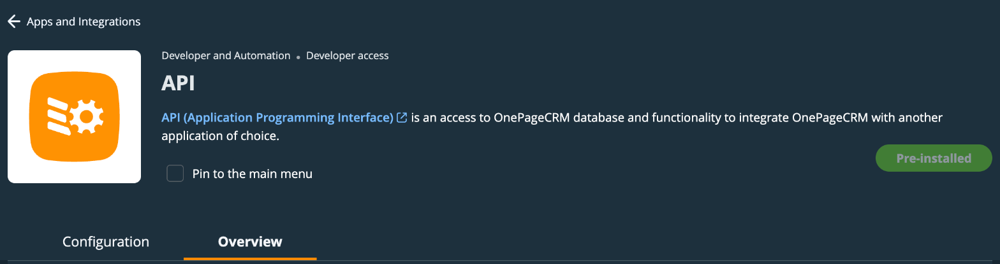
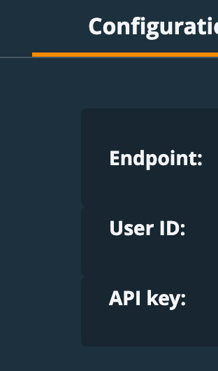

# OnePageCRM

| | |
| --- | --- |
| **Category** | [CRM and sales](README.md) |
| **Website** | [onepagecrm.com](https://onepagecrm.com) |
| **Authentication** | Username and password |
| **Slug** | `onepagecrm` |

## Setup guide
This guide shows you where to find the OnePageCRM user ID and API key that fastn uses to connect to a OnePageCRM account, and how to start workflows from OnePageCRM events.

### Before you start
- You need the Owner, Admin or Developer role in fastn.
- You need a OnePageCRM account you can sign in to. The user ID and API key belong to that user, so fastn acts as that user.
- To set up events, you need to be an administrator of the OnePageCRM account.

### Get your OnePageCRM credentials
1. Sign in to OnePageCRM.
2. Open the **API** app from **Apps and Integrations** (you can also go straight to `https://app.onepagecrm.com/app/api`). It is listed under **Developer and Automation** and comes pre-installed.

<figure><figcaption>
The API app in OnePageCRM's Apps and Integrations
</figcaption></figure>

3. Open the **Configuration** tab. It shows the **Endpoint**, **User ID** and **API key**.

<figure><figcaption>
The Configuration tab with the Endpoint, User ID and API key fields
</figcaption></figure>

4. Copy the **User ID**. In fastn, enter it in the **username** field.
5. Copy the **API key** from the same tab. In fastn, enter it in the **password** field. If you need a new key, click **Generate new API key**.

Keep the API key private. Anyone who has it can call the OnePageCRM API as you.

### Connect in fastn
Your customers enter these values when they connect OnePageCRM in your widget, or you enter them under **Build → Integrations → Connectors → OnePageCRM**. After the connection is saved, you can call OnePageCRM actions in workflow code as `fastn.connector.onepagecrm.<actionSlug>()`.

### Events
fastn supports OnePageCRM events for contacts, companies, deals, actions, notes, calls and meetings. To start a workflow when one of these happens, add an App event trigger under **Build → Integrations → Triggers → Add trigger → App events**. See [App events](../../build/triggers/app-events.md).

OnePageCRM sends events through its **Webhooks** app, which an account administrator turns on from the **Apps** page. Contact fastn support to set up events for OnePageCRM.

## Actions

<table><thead><tr><th width="240">Action</th><th width="260">Slug</th><th>What it does</th></tr></thead><tbody><tr><td>Add Call Attachment</td><td><code>addCallAttachment</code></td><td>Attaches a file to an existing call. Upload the file to S3 first using Get Attachment Upload Form, or pass an external Dropbox, Google Drive or Evernote link.</td></tr><tr><td>Add Deal Attachment</td><td><code>addDealAttachment</code></td><td>Attaches a file to an existing deal. Upload the file to S3 first using Get Attachment Upload Form, or pass an external Dropbox, Google Drive or Evernote link.</td></tr><tr><td>Add Meeting Attachment</td><td><code>addMeetingAttachment</code></td><td>Attaches a file to an existing meeting. Upload the file to S3 first using Get Attachment Upload Form, or pass an external Dropbox, Google Drive or Evernote link.</td></tr><tr><td>Add Note Attachment</td><td><code>addNoteAttachment</code></td><td>Attaches a file to an existing note. Upload the file to S3 first using Get Attachment Upload Form, or pass an external Dropbox, Google Drive or Evernote link.</td></tr><tr><td>Assign Contact Tag</td><td><code>assignContactTag</code></td><td>Adds a tag to a contact. Tag names match the account's existing tags case-insensitively.</td></tr><tr><td>Change Contact Owner</td><td><code>changeContactOwner</code></td><td>Sets a contact's owner to another user on the account.</td></tr><tr><td>Change Contact Status</td><td><code>changeContactStatus</code></td><td>Sets a contact's status to one of the account's configured statuses.</td></tr><tr><td>Close Contact Sales Cycle</td><td><code>closeContactSalesCycle</code></td><td>Closes the sales cycle for a contact when you are no longer actively selling to them, with an optional closing comment. Fails if the user has any open actions on the contact.</td></tr><tr><td>Create Action</td><td><code>createAction</code></td><td>Creates a next action on a contact. contact_id and text are required (text max 140 characters). status sets the action type: asap, date, date_time, waiting or queued (default date); assignee_id defaults to the calling user.</td></tr><tr><td>Create Attachment</td><td><code>createAttachment</code></td><td>Creates an attachment on a deal, note, call or meeting. Upload the file to S3 first using Get Attachment Upload Form, or pass an external Dropbox, Google Drive or Evernote link.</td></tr></tbody></table>

View 156 more actions

<table><thead><tr><th width="240">Action</th><th width="260">Slug</th><th>What it does</th></tr></thead><tbody><tr><td>Create Call</td><td><code>createCall</code></td><td>Logs a phone call against a contact. contact_id is required; record the outcome with call_result (from the account's configured call results), plus the number dialled and an optional recording link.</td></tr><tr><td>Create Company Field</td><td><code>createCompanyField</code></td><td>Creates a custom field for companies. Admin only. Choices are required for select_box and multiple_choice fields.</td></tr><tr><td>Create Contact</td><td><code>createContact</code></td><td>Creates a contact. Provide last_name or company_name — one of the two is required. owner_id defaults to the calling user and status_id to lead. company_name links the contact to an existing company (matched case-insensitively) or creates one; company_id is ignored on create.</td></tr><tr><td>Create Contact Action</td><td><code>createContactAction</code></td><td>Creates a next action on a contact. text is required (max 140 characters). status sets the action type: asap, date, date_time, waiting or queued (default date); assignee_id defaults to the calling user.</td></tr><tr><td>Create Contact Call</td><td><code>createContactCall</code></td><td>Logs a phone call against a contact. Record the outcome with call_result (from the account's configured call results), plus the number dialled and an optional recording link.</td></tr><tr><td>Create Contact Deal</td><td><code>createContactDeal</code></td><td>Creates a deal on a contact. name is required (max 60 characters). status is pending, won or lost (default pending); stage applies to pending deals only. amount is the per-month value; for recurring deals the total is amount multiplied by months.</td></tr><tr><td>Create Contact Meeting</td><td><code>createContactMeeting</code></td><td>Logs a meeting against a contact. place is free-form text (max 100 characters); meeting_time_int records when it happened.</td></tr><tr><td>Create Contact Note</td><td><code>createContactNote</code></td><td>Logs a note against a contact. text carries the note body; link a deal with linked_deal_id. Logging a note updates the contact's last activity date.</td></tr><tr><td>Create Contact Photo</td><td><code>createContactPhoto</code></td><td>Adds a photo to an existing contact from a Base64-encoded image. Images are cropped to a centered square and resized to 200x200 pixels.</td></tr><tr><td>Create Contact Relationship</td><td><code>createContactRelationship</code></td><td>Links a contact to another contact. related_contacts must hold exactly two entries (one of them this contact), each with the variant_id for its end. A contact can hold at most one relationship with any other contact.</td></tr><tr><td>Create Custom Field</td><td><code>createCustomField</code></td><td>Creates a contact custom field. Admin only. Choices are required for select_box and multiple_choice fields.</td></tr><tr><td>Create Deal</td><td><code>createDeal</code></td><td>Creates a deal on a contact. contact_id and name are required (name up to 60 characters). status defaults to pending; stage is a per-pipeline integer and applies to pending deals only. amount is the per-month value; for recurring deals the total is amount multiplied by months.</td></tr><tr><td>Create Deal Field</td><td><code>createDealField</code></td><td>Creates a custom field for deals. Admin only. Choices are required for select_box and multiple_choice fields.</td></tr><tr><td>Create Lead Source</td><td><code>createLeadSource</code></td><td>Creates a lead source. text is required and limited to 40 characters; the id is server-generated. Admin only. The list is kept in alphabetical order.</td></tr><tr><td>Create Meeting</td><td><code>createMeeting</code></td><td>Logs a meeting against a contact. contact_id is required; place is free-form text (max 100 characters) and meeting_time_int records when it happened.</td></tr><tr><td>Create Note</td><td><code>createNote</code></td><td>Logs a note against a contact. contact_id is required; text carries the note body; link a deal with linked_deal_id. Logging a note updates the contact's last activity date.</td></tr><tr><td>Create Predefined Action</td><td><code>createPredefinedAction</code></td><td>Creates a predefined action template. text (max 140 characters) and days are required; text can embed placeholders like [first name] that are substituted when the action is applied to a contact.</td></tr><tr><td>Create Predefined Action Group</td><td><code>createPredefinedActionGroup</code></td><td>Creates a predefined action group. text is required and action_ids must list at least two existing, currently ungrouped predefined actions.</td></tr><tr><td>Create Predefined Item</td><td><code>createPredefinedItem</code></td><td>Creates a predefined item (product or service template for deal line items). name is required and must be unique on the account; description, cost and price are optional.</td></tr><tr><td>Create Predefined Item Group</td><td><code>createPredefinedItemGroup</code></td><td>Creates a predefined item group that bundles existing predefined items. name is required and must be unique on the account. The group's cost and price are derived from its members.</td></tr><tr><td>Create Relationship Type</td><td><code>createRelationshipType</code></td><td>Creates a relationship type from a variants list: one variant name makes a symmetrical type, two make a directional one. An account is limited to 50 types and variant names to 35 characters.</td></tr><tr><td>Create Status</td><td><code>createStatus</code></td><td>Creates a contact status. text (max 20 characters) and color are required, description (max 33) is optional. Admin only. The system id is server-assigned.</td></tr><tr><td>Delete Action</td><td><code>deleteAction</code></td><td>Deletes a next action. Repeat the same request with undo=true to restore it.</td></tr><tr><td>Delete Attachment</td><td><code>deleteAttachment</code></td><td>Deletes an attachment from the note, call, meeting or deal it was uploaded to.</td></tr><tr><td>Delete Call</td><td><code>deleteCall</code></td><td>Deletes a logged call permanently (no undo via the API). Its attachments are removed with it.</td></tr><tr><td>Delete Company Field</td><td><code>deleteCompanyField</code></td><td>Deletes a company custom field. Admin only.</td></tr><tr><td>Delete Company Logo</td><td><code>deleteCompanyLogo</code></td><td>Deletes a company's logo. On success the company's photo_url is null.</td></tr><tr><td>Delete Contact</td><td><code>deleteContact</code></td><td>Deletes a contact. Only users with the delete_contacts permission can delete contacts. Repeat the same request with undo=true to restore the most recent deletion for that ID — the restore window depends on the account plan, from 1 day up to 60 days.</td></tr><tr><td>Delete Contact Photo</td><td><code>deleteContactPhoto</code></td><td>Removes a contact's photo and returns the updated contact, whose photo_url is then empty.</td></tr><tr><td>Delete Contact Relationship</td><td><code>deleteContactRelationship</code></td><td>Deletes a relationship between two contacts. Repeat the same request with undo=true to restore it.</td></tr><tr><td>Delete Contacts</td><td><code>deleteContacts</code></td><td>Deletes multiple contacts by ID in one request. Only users with the delete_contacts permission can delete contacts.</td></tr><tr><td>Delete Custom Field</td><td><code>deleteCustomField</code></td><td>Deletes a contact custom field. Admin only.</td></tr><tr><td>Delete Deal</td><td><code>deleteDeal</code></td><td>Deletes a deal. Only users with the delete_deals permission can delete deals.</td></tr><tr><td>Delete Deal Field</td><td><code>deleteDealField</code></td><td>Deletes a deal custom field. Admin only.</td></tr><tr><td>Delete Lead Source</td><td><code>deleteLeadSource</code></td><td>Deletes a lead source. Admin only. Contacts referencing it have their lead_source cleared. The last remaining lead source cannot be deleted.</td></tr><tr><td>Delete Meeting</td><td><code>deleteMeeting</code></td><td>Deletes a logged meeting permanently (no undo via the API). Its attachments are removed with it.</td></tr><tr><td>Delete Note</td><td><code>deleteNote</code></td><td>Deletes a note permanently (no undo via the API). Its attachments are removed with it.</td></tr><tr><td>Delete Predefined Action</td><td><code>deletePredefinedAction</code></td><td>Deletes a predefined action template. Actions already created from it on contacts are untouched. If this leaves its group with fewer than two members, the group is dissolved automatically.</td></tr><tr><td>Delete Predefined Action Group</td><td><code>deletePredefinedActionGroup</code></td><td>Deletes a predefined action group. The action templates it contained are kept and become ungrouped.</td></tr><tr><td>Delete Predefined Item</td><td><code>deletePredefinedItem</code></td><td>Deletes a predefined item. Line items already added to deals keep their own copy of the name, cost and price.</td></tr><tr><td>Delete Predefined Item Group</td><td><code>deletePredefinedItemGroup</code></td><td>Deletes a predefined item group. The predefined items it bundled are not deleted — only the grouping is removed.</td></tr><tr><td>Delete Relationship Type</td><td><code>deleteRelationshipType</code></td><td>Deletes a relationship type and every relationship using it, including soft-deleted ones. This cascade is permanent, so check usage before calling it.</td></tr><tr><td>Delete Status</td><td><code>deleteStatus</code></td><td>Deletes a contact status. Admin only. Contacts and companies using it fall back to the lead status. The built-in lead status cannot be deleted.</td></tr><tr><td>Delete Webhook</td><td><code>deleteWebhook</code></td><td>Deletes a webhook subscription. OnePageCRM stops posting events to its target URL.</td></tr><tr><td>Disable Company Status Sync</td><td><code>removeCompanySyncedStatus</code></td><td>Turns off status sync for a company. Contacts keep their current statuses.</td></tr><tr><td>Enable Company Status Sync</td><td><code>setCompanySyncedStatus</code></td><td>Turns on status sync so all contacts in a company share the same status. An initial status_id is required; statuses stay in sync until sync is disabled.</td></tr><tr><td>Force Close Contact Sales Cycle</td><td><code>forceCloseContactSalesCycle</code></td><td>Closes the sales cycle for a contact after first deleting any actions assigned to the contact, with an optional closing comment.</td></tr><tr><td>Get Account Bootstrap</td><td><code>getBootstrap</code></td><td>Returns global account configuration such as lead sources, deal stages, pipelines, custom fields and filters, plus user-specific settings such as date format and time zone.</td></tr><tr><td>Get Action</td><td><code>getAction</code></td><td>Returns one next action, including its status, due date and computed weight (higher means more urgent).</td></tr><tr><td>Get Action Stream</td><td><code>getActionStream</code></td><td>Returns the API user's Action Stream: contacts prioritized by their next action. Supports the same contact filters as List Contacts.</td></tr><tr><td>Get Attachment Upload Form</td><td><code>getAttachmentUploadForm</code></td><td>Returns a pre-authorized S3 upload form for attaching a file to a contact's deal, note, call or meeting. POST the file to the returned URL with every returned field; build key as {contact_id}/{timestamp}/{filename}.</td></tr><tr><td>Get Call</td><td><code>getCall</code></td><td>Returns one logged call — its text, author, result, call time, phone number, the contact it belongs to, and any attachments.</td></tr><tr><td>Get Company</td><td><code>getCompany</code></td><td>Returns one company with its shared details and roll-ups such as contact count and won and pending deal totals.</td></tr><tr><td>Get Company Field</td><td><code>getCompanyField</code></td><td>Returns one company custom field by ID, including its type and, for select_box and multiple_choice fields, the available choices.</td></tr><tr><td>Get Contact</td><td><code>getContact</code></td><td>Returns one contact — names, company link, status, tags, communication lists (phones, emails, urls, addresses) and custom fields.</td></tr><tr><td>Get Contact Relationship</td><td><code>getContactRelationship</code></td><td>Returns one relationship for a contact, naming both parties and the variant label at each end. The path contact must be one of the two parties.</td></tr><tr><td>Get Custom Field</td><td><code>getCustomField</code></td><td>Returns one contact custom field by ID, including its type and, for select_box and multiple_choice fields, the available choices. Anniversary fields also carry reminder_days.</td></tr><tr><td>Get Deal</td><td><code>getDeal</code></td><td>Returns one deal, including its stage, financial fields and any deal items, optionally with stage history.</td></tr><tr><td>Get Deal Field</td><td><code>getDealField</code></td><td>Returns one deal custom field by ID, including its type and, for select_box and multiple_choice fields, the available choices.</td></tr><tr><td>Get Filter</td><td><code>getFilter</code></td><td>Returns all details of a saved filter, along with the contacts that match its criteria.</td></tr><tr><td>Get Lead Source</td><td><code>getLeadSource</code></td><td>Returns one lead source with its contact counts. The path id is the source's system id — the value contacts carry in their lead_source field. Built-in sources use short slugs like advertisement; ones you create get an ObjectId-style id.</td></tr><tr><td>Get Meeting</td><td><code>getMeeting</code></td><td>Returns one meeting — its text, author, meeting time, place, the contact it belongs to, and any attachments.</td></tr><tr><td>Get Note</td><td><code>getNote</code></td><td>Returns one note — its text, author, date, the contact it belongs to, any attachments, and the linked deal if there is one.</td></tr><tr><td>Get Notification</td><td><code>getNotification</code></td><td>Returns one of the API user's notifications by ID. The type field identifies what it is about and read shows whether it has been seen.</td></tr><tr><td>Get Pipeline</td><td><code>getPipeline</code></td><td>Returns one pipeline with its ordered stages. Each stage has a numeric position and a label; a pipeline holds between one and nine stages.</td></tr><tr><td>Get Predefined Action</td><td><code>getPredefinedAction</code></td><td>Returns one predefined action template, including its text, days offset and the action_group_id of the group it belongs to.</td></tr><tr><td>Get Predefined Action Group</td><td><code>getPredefinedActionGroup</code></td><td>Returns one predefined action group, including action_ids — the templates that currently belong to it.</td></tr><tr><td>Get Predefined Item</td><td><code>getPredefinedItem</code></td><td>Returns one predefined item — a reusable product or service with its name, description, cost and price.</td></tr><tr><td>Get Predefined Item Group</td><td><code>getPredefinedItemGroup</code></td><td>Returns one predefined item group with the items it bundles. Its cost and price are the totals of its member items.</td></tr><tr><td>Get Relationship Type</td><td><code>getRelationshipType</code></td><td>Returns one relationship type with its variants. A single variant means the type is symmetrical; two variants mean each end gets a different label.</td></tr><tr><td>Get Status</td><td><code>getStatus</code></td><td>Returns one contact status with its counts. The path id is the status's own ObjectId, not the short system id in the status field.</td></tr><tr><td>Get Team Stream</td><td><code>getTeamStream</code></td><td>Returns the action stream for the entire account in a single list, or for a specific user when user_id is provided. Supports the same contact filters as List Contacts.</td></tr><tr><td>Get User</td><td><code>getUser</code></td><td>Returns one user on your account by ID, including their name, email, photo, role and account rights. bcc_email and google_contacts_email are only included when the ID is your own.</td></tr><tr><td>Get Webhook</td><td><code>getWebhook</code></td><td>Returns one webhook subscription with its name, target URL and secret key.</td></tr><tr><td>Link Company Contact</td><td><code>linkCompanyContact</code></td><td>Links a contact from another company to a company. A contact cannot be linked to the company it already works at, and a company can have at most 100 linked contacts.</td></tr><tr><td>List Actions</td><td><code>listActions</code></td><td>Returns next actions in Action Stream order: ASAP first, then dated actions by due date (overdue first), then waiting-for, then queued actions without a date, then completed. Filter by assignee, contact, company, status and date range.</td></tr><tr><td>List Call Results</td><td><code>listCallResults</code></td><td>Returns the call results configured for the account, with usage counts for the API user and the team.</td></tr><tr><td>List Calls</td><td><code>listCalls</code></td><td>Returns calls logged against your contacts, including the result of each, optionally filtered by contact or company and by date range.</td></tr><tr><td>List Companies</td><td><code>listCompanies</code></td><td>Returns the account's companies sorted by name, filterable by name, phone or first letter.</td></tr><tr><td>List Company Actions</td><td><code>listCompanyActions</code></td><td>Returns next actions across the contacts that belong to a company, with the same paging, sorting and date filters as List Actions.</td></tr><tr><td>List Company Calls</td><td><code>listCompanyCalls</code></td><td>Returns calls logged against the contacts that belong to a company, most recently updated first, with the same paging and date filters as List Calls.</td></tr><tr><td>List Company Deals</td><td><code>listCompanyDeals</code></td><td>Returns deals across the contacts that belong to a company, with the same paging, sorting and filters as List Deals.</td></tr><tr><td>List Company Fields</td><td><code>listCompanyFields</code></td><td>Returns the custom fields defined for companies on your account — id, name, type, position and, for select_box and multiple_choice fields, their choices.</td></tr><tr><td>List Company Linked Contacts</td><td><code>listCompanyLinkedContacts</code></td><td>Returns contacts from other companies that have been linked to a company. Each entry lists which of the company's own contacts it is linked with.</td></tr><tr><td>List Company Meetings</td><td><code>listCompanyMeetings</code></td><td>Returns meetings logged against the contacts that belong to a company, most recently updated first, with the same paging and date filters as List Meetings.</td></tr><tr><td>List Company Notes</td><td><code>listCompanyNotes</code></td><td>Returns notes logged against the contacts that belong to a company, most recently updated first, with the same paging and date filters as List Notes.</td></tr><tr><td>List Company Pinned Attachments</td><td><code>listCompanyPinnedAttachments</code></td><td>Returns attachments pinned to any contact in a company, most recently pinned first.</td></tr><tr><td>List Contact Actions</td><td><code>listContactActions</code></td><td>Returns the next actions on a contact, with the same paging, sorting and date filters as List Actions.</td></tr><tr><td>List Contact Calls</td><td><code>listContactCalls</code></td><td>Returns the calls logged against a contact, most recently updated first, with the same paging and date filters as List Calls.</td></tr><tr><td>List Contact Deals</td><td><code>listContactDeals</code></td><td>Returns the deals on a contact, with the same paging, sorting and filters as List Deals.</td></tr><tr><td>List Contact Meetings</td><td><code>listContactMeetings</code></td><td>Returns the meetings logged against a contact, most recently updated first, with the same paging and date filters as List Meetings.</td></tr><tr><td>List Contact Notes</td><td><code>listContactNotes</code></td><td>Returns the notes logged against a contact, most recently updated first, with the same paging and date filters as List Notes.</td></tr><tr><td>List Contact Pinned Attachments</td><td><code>listContactPinnedAttachments</code></td><td>Returns attachments pinned to a contact, most recently pinned first.</td></tr><tr><td>List Contact Relationships</td><td><code>listContactRelationships</code></td><td>Returns the relationships a contact is part of. Each is a single record naming both contacts with the variant label for each end. Filter by relationship type, other contact, variant or search text.</td></tr><tr><td>List Contacts</td><td><code>listContacts</code></td><td>Returns the contacts you can access, sorted by name. Filter by search text, company, email, phone, tag, status, lead source, owner, starred, actions, pending deals, saved filter and date range. has_actions and has_actions_for_me are mutually exclusive, as are lead_source and lead_source_id.</td></tr><tr><td>List Contacts Beyond 10000</td><td><code>listContactsCascade</code></td><td>Returns contacts owned by the API user in alphabetical batches of 100, allowing iteration past the 10,000-contact paging limit. Use the last contact ID with List Contacts Beyond 10000 After ID for the next batch.</td></tr><tr><td>List Contacts Beyond 10000 After ID</td><td><code>listContactsCascadeAfter</code></td><td>Returns the next batch of up to 100 contacts after the given contact ID, allowing iteration past the 10,000-contact paging limit.</td></tr><tr><td>List Contacts By Filter</td><td><code>listContactsByFilter</code></td><td>Returns the contacts matching a saved filter, alongside the filter definition. Results come back in Action Stream order, 25 per page.</td></tr><tr><td>List Countries</td><td><code>listCountries</code></td><td>Returns the read-only list of all countries supported by OnePageCRM, sorted by ISO-3166 country code.</td></tr><tr><td>List Custom Fields</td><td><code>listCustomFields</code></td><td>Returns the custom fields defined for contacts on your account — id, name, type, position and, for select_box and multiple_choice fields, their choices.</td></tr><tr><td>List Deal Fields</td><td><code>listDealFields</code></td><td>Returns the custom fields defined for deals on your account — id, name, type, position and, for select_box and multiple_choice fields, their choices.</td></tr><tr><td>List Deals</td><td><code>listDeals</code></td><td>Returns the account's deals, filterable by name, status, stage, pipeline, owner, contact, company, tag and date range. Each deal belongs to one primary contact and moves through a pipeline as pending, then won or lost.</td></tr><tr><td>List Filters</td><td><code>listFilters</code></td><td>Returns the account's saved contact filters, each with its name and the conditions that define it. To get matching contacts, use List Contacts By Filter.</td></tr><tr><td>List Lead Sources</td><td><code>listLeadSources</code></td><td>Returns the account's lead sources with per-user and total contact counts, in alphabetical order. Each id is the source's system id — the value contacts reference in their lead_source field.</td></tr><tr><td>List Meetings</td><td><code>listMeetings</code></td><td>Returns meetings logged against your contacts, optionally filtered by contact or company and by date range.</td></tr><tr><td>List Notes</td><td><code>listNotes</code></td><td>Returns notes logged against your contacts, optionally filtered by contact or company and by date range. A note can also be linked to a deal.</td></tr><tr><td>List Notifications</td><td><code>listNotifications</code></td><td>Returns the API user's in-app notifications (excluding emails and links), such as assigned actions, notes, calls and meetings.</td></tr><tr><td>List Pipelines</td><td><code>listPipelines</code></td><td>Returns the account's deal pipelines, each with its ordered stages. default marks the API user's default pipeline.</td></tr><tr><td>List Predefined Action Groups</td><td><code>listPredefinedActionGroups</code></td><td>Returns the account's predefined action groups. A group bundles two or more predefined action templates so they can all be applied to a contact at once.</td></tr><tr><td>List Predefined Actions</td><td><code>listPredefinedActions</code></td><td>Returns the account's predefined actions — reusable next-action templates, each with the text to apply and a days offset used to calculate the due date. Grouped actions carry their action_group_id.</td></tr><tr><td>List Predefined Item Groups</td><td><code>listPredefinedItemGroups</code></td><td>Returns the account's predefined item groups. A group bundles predefined items under one name; its cost and price are the sums of its members.</td></tr><tr><td>List Predefined Items</td><td><code>listPredefinedItems</code></td><td>Returns the account's predefined items — reusable products or services with a name, description, cost and price that can be added to deals as line items.</td></tr><tr><td>List Relationship Types</td><td><code>listRelationshipTypes</code></td><td>Returns the relationship types defined on your account, each with its variants — the labels used for the two ends of a relationship. One variant means symmetrical (Partner/Partner); two mean directional (Manager/Reports to).</td></tr><tr><td>List Statuses</td><td><code>listStatuses</code></td><td>Returns the account's contact statuses with per-user and total counts, in their configured order. The status field carries the system id (lead, custom1 and so on) that contacts reference.</td></tr><tr><td>List Users</td><td><code>listUsers</code></td><td>Returns every user on your account — name, email, photo, role and account rights. Your own record also includes bcc_email and google_contacts_email. The full team is returned, unpaginated.</td></tr><tr><td>List Webhooks</td><td><code>listWebhooks</code></td><td>Returns the account's webhook subscriptions configured in the Webhooks app — each target URL, name and secret key.</td></tr><tr><td>Mark Action As Done</td><td><code>markActionAsDone</code></td><td>Marks a next action as complete.</td></tr><tr><td>Mark All Notifications As Read</td><td><code>markAllNotificationsAsRead</code></td><td>Marks all of the API user's notifications as read.</td></tr><tr><td>Mark Notification As Read</td><td><code>markNotificationAsRead</code></td><td>Marks one of the API user's notifications as read.</td></tr><tr><td>Pin Attachment</td><td><code>pinAttachment</code></td><td>Pins an attachment so it surfaces on the profile of the contact it belongs to, rather than only on its note, call, meeting or deal.</td></tr><tr><td>Promote Action</td><td><code>promoteAction</code></td><td>Promotes a queued action to be the API user's next action on its contact. Use only when no next action is assigned; otherwise use Swap Action.</td></tr><tr><td>Regenerate API Key</td><td><code>changeAuthKey</code></td><td>Invalidates the current API key and returns a new one. Warning: this logs the user out of all applications, including mobile apps, and breaks any connection still using the old key.</td></tr><tr><td>Reopen Contact Sales Cycle</td><td><code>reopenContactSalesCycle</code></td><td>Reopens a closed sales cycle for a contact, for the calling user.</td></tr><tr><td>Revert Action Promotion</td><td><code>revertActionPromotion</code></td><td>Retained for backwards compatibility: returns the action unmodified. Promotions can no longer be reverted through the API.</td></tr><tr><td>Save Contact To Google Contacts</td><td><code>saveContactToGoogleContacts</code></td><td>Saves a OnePageCRM contact to the user's Google Contacts. OnePageCRM must first be authorized for Google Contacts in the app's Google Contacts integration page.</td></tr><tr><td>Split Contact</td><td><code>splitContact</code></td><td>Removes a contact from its current company and optionally moves it to a new company. Warning: splitting the last contact from a company deletes that company and its data.</td></tr><tr><td>Star Contact</td><td><code>starContact</code></td><td>Stars a contact for the calling user. Starring is per user and does not change how teammates see the contact.</td></tr><tr><td>Swap Action</td><td><code>swapAction</code></td><td>Resolves a date conflict by swapping a dated queued action (queued_with_date) with the current next action (date, date_time or waiting). Both must belong to the API user and the queued action's date must be earlier.</td></tr><tr><td>Unassign Action</td><td><code>unassignAction</code></td><td>Unassigns a next action from its currently assigned user.</td></tr><tr><td>Unassign Contact Tag</td><td><code>unassignContactTag</code></td><td>Removes a tag from a contact.</td></tr><tr><td>Undo Action Completion</td><td><code>undoActionCompletion</code></td><td>Reverts a completed next action to its previous state.</td></tr><tr><td>Unlink Action</td><td><code>unlinkAction</code></td><td>Detaches a next action from the external calendar event it mirrors, making it an ordinary editable action. Nothing is sent to the external provider.</td></tr><tr><td>Unlink Company Contact</td><td><code>unlinkCompanyContact</code></td><td>Unlinks a linked contact from a company.</td></tr><tr><td>Unpin Attachment</td><td><code>unpinAttachment</code></td><td>Unpins an attachment so it no longer surfaces on its contact's profile. The file itself is not deleted.</td></tr><tr><td>Unstar Contact</td><td><code>unstarContact</code></td><td>Removes the calling user's star from a contact.</td></tr><tr><td>Update Action</td><td><code>updateAction</code></td><td>Updates a next action's text, status, due date or assignee, or marks it done. An action cannot be moved to another contact.</td></tr><tr><td>Update Attachment</td><td><code>updateAttachment</code></td><td>Sets or changes an attachment's custom file name. Once set, the custom file name cannot be cleared.</td></tr><tr><td>Update Call</td><td><code>updateCall</code></td><td>Updates a logged call's text, result, time, phone number or recording link. The author stays the original author.</td></tr><tr><td>Update Company</td><td><code>updateCompany</code></td><td>Updates a company's name, description, website, phone, address or company field values. When updating a company field, send its id or name together with the value.</td></tr><tr><td>Update Company Field</td><td><code>updateCompanyField</code></td><td>Updates a company custom field's name, type, position or choices. Admin only.</td></tr><tr><td>Update Company Logo</td><td><code>updateCompanyLogo</code></td><td>Replaces a company's logo with the given Base64-encoded image. The previous logo is removed first.</td></tr><tr><td>Update Contact</td><td><code>updateContact</code></td><td>Updates a contact. Without partial=true the whole record is replaced: omitted writable fields are cleared (tags and communication lists emptied, status reset to lead). Pass partial=true to change only the fields you send; arrays still replace rather than merge.</td></tr><tr><td>Update Contact Photo</td><td><code>updateContactPhoto</code></td><td>Replaces a contact's photo with a Base64-encoded image. The existing photo is removed. Images are cropped to a centered square and resized to 200x200 pixels.</td></tr><tr><td>Update Contact Relationship</td><td><code>updateContactRelationship</code></td><td>Replaces a relationship: send relationship_type_id and both related_contacts entries in full. The type can change and one contact can be swapped, but the path contact must remain a party.</td></tr><tr><td>Update Custom Field</td><td><code>updateCustomField</code></td><td>Updates a contact custom field's name, type, position or choices. Admin only.</td></tr><tr><td>Update Deal</td><td><code>updateDeal</code></td><td>Updates a deal. A deal cannot be moved to another contact. expected_close_date applies to pending deals; close_date is set when the deal becomes won or lost.</td></tr><tr><td>Update Deal Field</td><td><code>updateDealField</code></td><td>Updates a deal custom field's name, type, position or choices. Admin only.</td></tr><tr><td>Update Lead Source</td><td><code>updateLeadSource</code></td><td>Updates a lead source's text (max 40 characters). Admin only. text is required unless partial=true is passed. The list is re-sorted alphabetically afterwards.</td></tr><tr><td>Update Meeting</td><td><code>updateMeeting</code></td><td>Updates a logged meeting's text, place or time. The author stays the original author.</td></tr><tr><td>Update Note</td><td><code>updateNote</code></td><td>Updates a note's text, date or linked deal. The author stays the original author.</td></tr><tr><td>Update Predefined Action</td><td><code>updatePredefinedAction</code></td><td>Updates a predefined action template's text (max 140 characters) or days offset. Group membership is managed through predefined action groups.</td></tr><tr><td>Update Predefined Action Group</td><td><code>updatePredefinedActionGroup</code></td><td>Updates a predefined action group. action_ids is required and replaces the group's membership outright; actions dropped from the list are ungrouped, not deleted. Actions already in another group are rejected.</td></tr><tr><td>Update Predefined Item</td><td><code>updatePredefinedItem</code></td><td>Updates a predefined item. Pass partial=true to leave omitted fields untouched; without it, an omitted description, cost or price is reset to its default.</td></tr><tr><td>Update Relationship Type</td><td><code>updateRelationshipType</code></td><td>Renames a relationship type's variants: send the full set of existing variant IDs with new names. Variants cannot be added or removed.</td></tr><tr><td>Update Status</td><td><code>updateStatus</code></td><td>Updates a contact status. Admin only. text and color are required unless partial=true is passed, and description is cleared if omitted on a non-partial update.</td></tr><tr><td>Update User</td><td><code>updateUser</code></td><td>Updates a user's first name, last name, company name, or regenerates their BCC email address. Each team member can edit their own details; admins can update anyone's. bcc_email can only be regenerated for yourself.</td></tr></tbody></table>

## Events

Start a workflow when one of these happens, with an [app event trigger](../../build/triggers/README.md).

<table><thead><tr><th width="240">Event</th><th width="260">Id</th><th>When it fires</th></tr></thead><tbody><tr><td>Action Event</td><td><code>action</code></td><td>A next action was created, updated, deleted, completed or uncompleted. Check the reason field for the change.</td></tr><tr><td>Call Event</td><td><code>call</code></td><td>A call was created, updated or deleted. Check the reason field for the change.</td></tr><tr><td>Company Event</td><td><code>company</code></td><td>A company was created, updated or deleted. Check the reason field for the change.</td></tr><tr><td>Contact Event</td><td><code>contact</code></td><td>A contact was created, updated, deleted, undeleted or restored. Check the reason field for the change.</td></tr><tr><td>Deal Event</td><td><code>deal</code></td><td>A deal was created, updated, deleted, won, lost, set to pending or had its expected close date changed. Check the reason field for the change.</td></tr><tr><td>Meeting Event</td><td><code>meeting</code></td><td>A meeting was created, updated or deleted. Check the reason field for the change.</td></tr><tr><td>Note Event</td><td><code>note</code></td><td>A note was created, updated or deleted. Check the reason field for the change.</td></tr></tbody></table>
