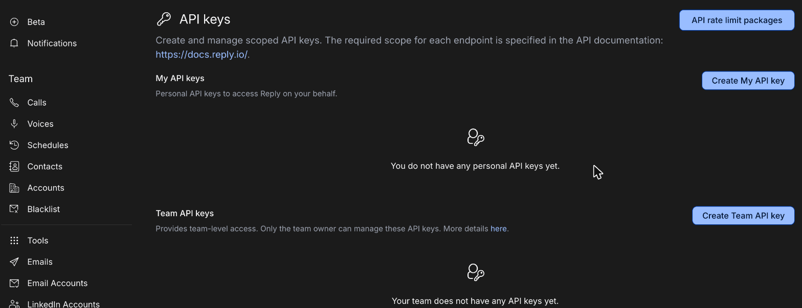
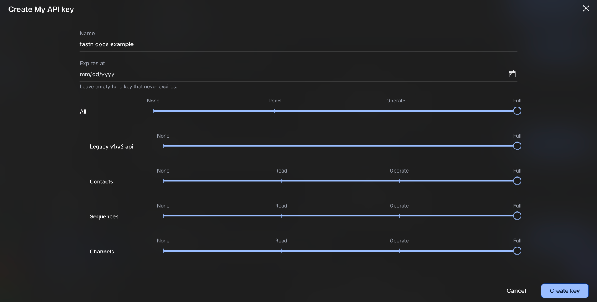

# Reply.io

| | |
| --- | --- |
| **Category** | [CRM and sales](README.md) |
| **Website** | [reply.io](https://reply.io) |
| **Authentication** | API key |
| **Slug** | `replyio` |

## Setup guide
This guide shows you where to find the Reply.io API key that Fastn needs to connect a Reply.io account.

### Before you start
- You need the Owner, Admin or Developer role in Fastn.
- You need a Reply.io account you can sign in to at run.reply.io.

### Get your Reply.io credentials
Fastn asks for one value, **apiKey**: your Reply.io API key. The same key works for Reply's current and legacy API endpoints.

1. Sign in to Reply.io at run.reply.io.
2. Open **Settings** and select **API keys** in the menu. Your personal keys are listed under **My API keys**.

<figure><figcaption>
The API keys page in Reply.io settings
</figcaption></figure>

3. Click **Create My API key**. Enter a **Name**, and optionally an **Expires at** date (leave it empty for a key that never expires).
4. Set the access level for each area: **Legacy v1/v2 api**, **Contacts**, **Sequences** and **Channels**. Moving the **All** slider to **Full** sets every area at once. The key can only do what you allow here.

<figure><figcaption>
The Create My API key window with its name, expiry and access levels
</figcaption></figure>

5. Click **Create key**, copy the key, and paste it into the **apiKey** field when you connect.

Use a key from **My API keys** here. Reply.io's team and organization keys need extra headers that name the user to act as, which this connection does not send.

### Connect in Fastn
Your customers enter the API key when they connect Reply.io in your widget, or you enter it under Build → Integrations → Connectors → Reply.io.

## Actions

<table><thead><tr><th width="240">Action</th><th width="260">Slug</th><th>What it does</th></tr></thead><tbody><tr><td>Add Contact Note</td><td><code>addContactNote</code></td><td>Append a note to a contact.</td></tr><tr><td>Add Contacts To List</td><td><code>addContactsToList</code></td><td>Add contacts to a contact list.</td></tr><tr><td>Add Contacts To Sequence</td><td><code>addContactsToSequence</code></td><td>Add existing contacts to a sequence (bulk). Optionally set start step, timing, and whether to remove them from other sequences.</td></tr><tr><td>Archive Sequence</td><td><code>archiveSequence</code></td><td>Archive a sequence by id.</td></tr><tr><td>Batch Complete Tasks</td><td><code>batchCompleteTasks</code></td><td>Complete multiple tasks by id.</td></tr><tr><td>Bulk Delete Contacts</td><td><code>bulkDeleteContacts</code></td><td>Delete multiple contacts by id.</td></tr><tr><td>Change Contacts Owner</td><td><code>changeContactsOwner</code></td><td>Reassign the owner of one or more contacts to a user; optionally reassign their tasks.</td></tr><tr><td>Change Sequence Owner</td><td><code>updateSequenceOwner</code></td><td>Change the owner of a sequence.</td></tr><tr><td>Clone Email Template</td><td><code>cloneEmailTemplate</code></td><td>Clone an existing email template.</td></tr><tr><td>Complete Task</td><td><code>completeTask</code></td><td>Mark a single task as completed, optionally recording a call resolution and finishing the contact in its sequence. Reply rejects a body-less request, so finishProspectInSequence must always be supplied.</td></tr></tbody></table>

View 98 more actions

<table><thead><tr><th width="240">Action</th><th width="260">Slug</th><th>What it does</th></tr></thead><tbody><tr><td>Create Contact</td><td><code>createContact</code></td><td>Create a contact in Reply. Company name, company size and industry live on the linked account, not the contact - pass accountId to link one. Free-text notes are added with the Add Contact Note action, not here.</td></tr><tr><td>Create Contact List</td><td><code>createContactList</code></td><td>Create a new contact list.</td></tr><tr><td>Create Custom Field</td><td><code>createCustomField</code></td><td>Create a custom contact field. 'title' is the field name/label (required). fieldType is text or number. 'metadata' is optional extra config. Set orgWide to make it available org-wide.</td></tr><tr><td>Create Email Template</td><td><code>createEmailTemplate</code></td><td>Create an email template. name, body, and folderType (personal/team) are required.</td></tr><tr><td>Create Email Template Folder</td><td><code>createEmailTemplateFolder</code></td><td>Create an email template folder (personal or team).</td></tr><tr><td>Create Holiday Calendar</td><td><code>createHolidayCalendar</code></td><td>Create a holiday calendar. holidays is an array of {startDate,endDate,name} (dates are YYYY-MM-DD).</td></tr><tr><td>Create Schedule</td><td><code>createSchedule</code></td><td>Create a sending schedule. mainTimings define active weekdays and time ranges (hour/minute). timezoneId is a Windows time zone name such as 'Eastern Standard Time' (see List Schedules), not an IANA id.</td></tr><tr><td>Create Sequence</td><td><code>createSequence</code></td><td>Create a sequence in Reply. At least one step is required at creation time. The sequence is created in the 'new' state and does not send anything until it is started.</td></tr><tr><td>Create Sequence Step</td><td><code>createSequenceStep</code></td><td>Add a step to a sequence. 'type', 'delayInMinutes' are always required. Email/SMS steps also require 'executionMode' and 'variants'/'message'. For email steps pass variants (each with subject/message).</td></tr><tr><td>Create Sequence Step Variant</td><td><code>createSequenceStepVariant</code></td><td>Add a message variant to a sequence step.</td></tr><tr><td>Create Task</td><td><code>createTask</code></td><td>Create a manual task (toDo, call, or meeting). startAt and dueTo are ISO date-times. For LinkedIn tasks set linkedInTaskType. 'template' carries the message subject/body.</td></tr><tr><td>Create Webhook</td><td><code>createWebhook</code></td><td>Create a webhook subscription. eventType must be one of the values from List Webhook Events (e.g. contact_reply_recorded, email_replied, email_opened). url is your receiving endpoint. scope: personal/team/organization.</td></tr><tr><td>Delete Contact</td><td><code>deleteContact</code></td><td>Delete a contact by id.</td></tr><tr><td>Delete Contact List</td><td><code>deleteContactList</code></td><td>Delete a contact list by id.</td></tr><tr><td>Delete Custom Field</td><td><code>deleteCustomField</code></td><td>Delete a custom field by id.</td></tr><tr><td>Delete Email Template</td><td><code>deleteEmailTemplate</code></td><td>Delete an email template by id. KNOWN UPSTREAM DEFECT (verified 2026-09-01): Reply.io The endpoint matches Reply.io's documented; do not treat the 204 as proof of deletion.</td></tr><tr><td>Delete Email Template Folder</td><td><code>deleteEmailTemplateFolder</code></td><td>Delete an email template folder. Templates inside the folder are kept and become unfiled.</td></tr><tr><td>Delete Holiday Calendar</td><td><code>deleteHolidayCalendar</code></td><td>Delete a holiday calendar by id.</td></tr><tr><td>Delete Schedule</td><td><code>deleteSchedule</code></td><td>Delete a schedule by id.</td></tr><tr><td>Delete Sequence</td><td><code>deleteSequence</code></td><td>Delete a sequence by id.</td></tr><tr><td>Delete Sequence Step</td><td><code>deleteSequenceStep</code></td><td>Delete a sequence step by id. Verified working on a multi-step sequence (204, step gone from List Sequence Steps). Reply.io refuses to delete the LAST remaining step: a single-step sequence There is only one step in sequence' - delete the sequence itself instead. Optional 'mode' controls handling of contacts sitting on that step.</td></tr><tr><td>Delete Task</td><td><code>deleteTask</code></td><td>Delete a task by id.</td></tr><tr><td>Delete Webhook</td><td><code>deleteWebhook</code></td><td>Delete a webhook subscription by id.</td></tr><tr><td>Disable Webhook</td><td><code>disableWebhook</code></td><td>Disable a webhook subscription.</td></tr><tr><td>Enable Webhook</td><td><code>enableWebhook</code></td><td>Enable a webhook subscription.</td></tr><tr><td>Filter Contacts</td><td><code>filterContacts</code></td><td>Search/filter contacts using structured rules, list, sequence, or a free-text term.</td></tr><tr><td>Filter Email Accounts</td><td><code>filterEmailAccounts</code></td><td>Filter email accounts by connection status, type, email, domains, owners, or tags.</td></tr><tr><td>Filter Tasks</td><td><code>filterTasks</code></td><td>Filter tasks by date range, type, status, sequence, contact, or assignee.</td></tr><tr><td>Get All Sequences Stats</td><td><code>getAllSequencesStats</code></td><td>Get aggregate stats for all sequences within a date range (email + LinkedIn overviews per sequence).</td></tr><tr><td>Get Calls Report Overview</td><td><code>getCallsReportOverview</code></td><td>Get aggregate calls reporting for a date range.</td></tr><tr><td>Get Contact</td><td><code>getContact</code></td><td>Get a single contact by its numeric id.</td></tr><tr><td>Get Contact Activities</td><td><code>getContactActivities</code></td><td>Get the activity/timeline events for a contact.</td></tr><tr><td>Get Contact List</td><td><code>getContactList</code></td><td>Get a contact list by id.</td></tr><tr><td>Get Contact Lists For Contact</td><td><code>getContactContactLists</code></td><td>List the contact lists a given contact belongs to. KNOWN UPSTREAM DEFECT (verified 2026-09-01): Reply.io The endpoint matches Reply.io's documented Use Filter Contacts with listId as a reliable substitute.</td></tr><tr><td>Get Contact Sequences</td><td><code>getContactSequences</code></td><td>List the sequences a contact currently belongs to with per-sequence status.</td></tr><tr><td>Get Contact Statuses</td><td><code>getContactStatuses</code></td><td>Get a contact's status flags (opted-out, call status, meeting status) and per-sequence status.</td></tr><tr><td>Get Current User</td><td><code>getCurrentUser</code></td><td>Return the current authenticated Reply user (userId and username). Use to verify credentials and obtain your userId for owner-assignment actions.</td></tr><tr><td>Get Custom Field</td><td><code>getCustomField</code></td><td>Get a custom field by id.</td></tr><tr><td>Get Email Report Overview</td><td><code>getEmailReportOverview</code></td><td>Get aggregate email reporting for a date range. filters requires a date range (from/to) or a dateRangePreset.</td></tr><tr><td>Get Email Template</td><td><code>getEmailTemplate</code></td><td>Get an email template by id.</td></tr><tr><td>Get Email Template Variables</td><td><code>getEmailTemplateVariables</code></td><td>Get available template variables (prospect, team, advanced).</td></tr><tr><td>Get Holiday Calendar</td><td><code>getHolidayCalendar</code></td><td>Get a holiday calendar (with its holidays) by id.</td></tr><tr><td>Get LinkedIn Report Overview</td><td><code>getLinkedInReportOverview</code></td><td>Get aggregate LinkedIn reporting for a date range.</td></tr><tr><td>Get Schedule</td><td><code>getSchedule</code></td><td>Get a schedule by id.</td></tr><tr><td>Get Sequence</td><td><code>getSequence</code></td><td>Get a sequence by id including settings, accounts, and status.</td></tr><tr><td>Get Sequence Stats</td><td><code>getSequenceStats</code></td><td>Get stats for a single sequence within a date range.</td></tr><tr><td>Get Sequence Step</td><td><code>getSequenceStep</code></td><td>Get a single sequence step by id.</td></tr><tr><td>Get Settings</td><td><code>getSettings</code></td><td>Get the account settings (profile, email safety/sending limits, defaults).</td></tr><tr><td>Get Task</td><td><code>getTask</code></td><td>Get a task by id. Optionally include the message content.</td></tr><tr><td>Get Tasks Report Overview</td><td><code>getTasksReportOverview</code></td><td>Get aggregate task reporting for a date range.</td></tr><tr><td>Get Webhook</td><td><code>getWebhook</code></td><td>Get a webhook subscription by id.</td></tr><tr><td>Get Webhook Logs</td><td><code>getWebhookLogs</code></td><td>Get delivery logs for a webhook subscription.</td></tr><tr><td>Import Contacts</td><td><code>importContacts</code></td><td>Bulk import/upsert contacts asynchronously. Returns per-item results plus added/updated/skipped/failed counts (runs as a background job).</td></tr><tr><td>List Campaigns (v1)</td><td><code>listCampaignsV1</code></td><td>Legacy v1 API: list all campaigns (the v1 equivalent of sequences) with basic status counts. The only v1 endpoint in this connector and metered on a separate, much tighter quota than v3 - this account is exhausted and every call Prefer List Sequences plus Get Sequence Stats, which are on the v3 quota. Candidate for retirement.</td></tr><tr><td>List Contact Lists</td><td><code>listContactLists</code></td><td>List contact lists with pagination and optional name search.</td></tr><tr><td>List Contacts</td><td><code>listContacts</code></td><td>List contacts with pagination. Optionally filter by exact email or LinkedIn URL.</td></tr><tr><td>List Custom Fields</td><td><code>listCustomFields</code></td><td>List all custom contact fields.</td></tr><tr><td>List Email Account Tags</td><td><code>listEmailAccountTags</code></td><td>List all email-account tags.</td></tr><tr><td>List Email Accounts</td><td><code>listEmailAccounts</code></td><td>List connected email sending accounts.</td></tr><tr><td>List Email Template Folders</td><td><code>listEmailTemplateFolders</code></td><td>List email template folders.</td></tr><tr><td>List Email Templates</td><td><code>listEmailTemplates</code></td><td>List email templates with pagination and optional filters.</td></tr><tr><td>List Holiday Calendars</td><td><code>listHolidayCalendars</code></td><td>List all holiday calendars.</td></tr><tr><td>List LinkedIn Accounts</td><td><code>listLinkedInAccounts</code></td><td>List connected LinkedIn accounts.</td></tr><tr><td>List Schedule Holiday Calendars</td><td><code>listScheduleHolidayCalendars</code></td><td>List holiday calendars linked to a schedule.</td></tr><tr><td>List Schedules</td><td><code>listSchedules</code></td><td>List sending schedules.</td></tr><tr><td>List Sequence Contacts</td><td><code>listSequenceContacts</code></td><td>List contacts in a sequence with their in-sequence status.</td></tr><tr><td>List Sequence Contacts State</td><td><code>listSequenceContactsState</code></td><td>List contacts in a sequence with extended per-step state.</td></tr><tr><td>List Sequence Step Variants</td><td><code>listSequenceStepVariants</code></td><td>List message variants of a sequence step.</td></tr><tr><td>List Sequence Steps</td><td><code>listSequenceSteps</code></td><td>List all steps of a sequence.</td></tr><tr><td>List Sequences</td><td><code>listSequences</code></td><td>List sequences with pagination and optional filters (status, owner, folder, archived, name).</td></tr><tr><td>List Tasks</td><td><code>listTasks</code></td><td>List manual tasks with pagination.</td></tr><tr><td>List Webhook Events</td><td><code>listWebhookEvents</code></td><td>List the supported webhook event type strings.</td></tr><tr><td>List Webhooks</td><td><code>listWebhooks</code></td><td>List webhook subscriptions.</td></tr><tr><td>Mark Contacts Bounced</td><td><code>markContactsBounced</code></td><td>Mark contacts as bounced, or clear the bounced flag. Contacts that are not in a sequence are skipped.</td></tr><tr><td>Mark Contacts Replied</td><td><code>markContactsReplied</code></td><td>Mark or unmark contacts as replied across every sequence they are in. PARTIAL SUCCESS API: HTTP 200 does not mean every contact was processed. The response is a map keyed by contactId containing ONLY the contacts that FAILED (e.g. {"760754079":{"error":"invalidInput","errorDetails":"Skipped: NotInSequence"}}); a contactId absent from the map succeeded. An empty object means all succeeded. Callers must inspect the map.</td></tr><tr><td>Move Contacts To List</td><td><code>moveContactsToList</code></td><td>Move contacts into a contact list (removing them from their current list).</td></tr><tr><td>Pause Sequence</td><td><code>pauseSequence</code></td><td>Pause a RUNNING sequence by id. The sequence must have been started at least once; pausing a sequence in status 'new' (never started)forbidden 'You do not have permission to pause sequence' - a misleading message for what is a state precondition, not a permissions problem.</td></tr><tr><td>Reassign Task</td><td><code>assignTask</code></td><td>Reassign a task to another user.</td></tr><tr><td>Remove Contact From Sequence</td><td><code>removeContactFromSequence</code></td><td>Remove a single contact from a sequence.</td></tr><tr><td>Render Email Template</td><td><code>renderEmailTemplate</code></td><td>Render an email template for a specific contact (resolves variables). Returns subject/body and any variable errors.</td></tr><tr><td>Set Default Schedule</td><td><code>setDefaultSchedule</code></td><td>Set a schedule as the account default.</td></tr><tr><td>Set Sequence Contact Status</td><td><code>setSequenceContactStatus</code></td><td>Set the in-sequence status (pause/resume/finish) for contacts in a sequence.</td></tr><tr><td>Set Sequence Contacts Replied</td><td><code>setSequenceContactsReplied</code></td><td>Mark or unmark contacts as replied within a specific sequence.</td></tr><tr><td>Share Contact List</td><td><code>shareContactList</code></td><td>Share a contact list with the team.</td></tr><tr><td>Start Sequence</td><td><code>startSequence</code></td><td>Start/activate a sequence by id. Requires the sequence to have at least one step and a connected sending account.</td></tr><tr><td>Test Webhook</td><td><code>testWebhook</code></td><td>Send a test payload to a webhook subscription's URL.</td></tr><tr><td>Unshare Contact List</td><td><code>unshareContactList</code></td><td>Stop sharing a contact list with the team.</td></tr><tr><td>Update Contact</td><td><code>updateContact</code></td><td>Partially update a contact in Reply. Company name, company size and industry cannot be set here - they come from the linked account, so pass accountId instead. Free-text notes are added with the Add Contact Note action.</td></tr><tr><td>Update Contact List</td><td><code>updateContactList</code></td><td>Rename a contact list.</td></tr><tr><td>Update Custom Field</td><td><code>updateCustomField</code></td><td>Update a custom field's name (title), type, or metadata.</td></tr><tr><td>Update Email Template</td><td><code>updateEmailTemplate</code></td><td>Update an email template's name, subject, or body.</td></tr><tr><td>Update Email Template Folder</td><td><code>updateEmailTemplateFolder</code></td><td>Rename an email template folder.</td></tr><tr><td>Update Holiday Calendar</td><td><code>updateHolidayCalendar</code></td><td>Update a holiday calendar and its holidays.</td></tr><tr><td>Update Schedule</td><td><code>updateSchedule</code></td><td>Update a sending schedule.</td></tr><tr><td>Update Sequence</td><td><code>updateSequence</code></td><td>Partially update a sequence (name, schedule, settings, accounts).</td></tr><tr><td>Update Sequence Step</td><td><code>updateSequenceStep</code></td><td>Update a sequence step. Same body shape as create.</td></tr><tr><td>Update Task</td><td><code>updateTask</code></td><td>Replace an OPEN task in full (status 'new'). Reply.io only allows updating open tasks: a completed, failed or otherwise closed task taskType, startAt, dueTo and the template body must be sent every time - omitted fields are cleared, not preserved.</td></tr><tr><td>Update Webhook</td><td><code>updateWebhook</code></td><td>Update a webhook subscription (eventType, url, scope, payloadConfig).</td></tr></tbody></table>

## Events

Reply.io has no events, so it can't start a workflow by itself. Use its actions in a workflow that another [trigger](../../build/triggers/README.md) starts, such as a schedule or a webhook.
