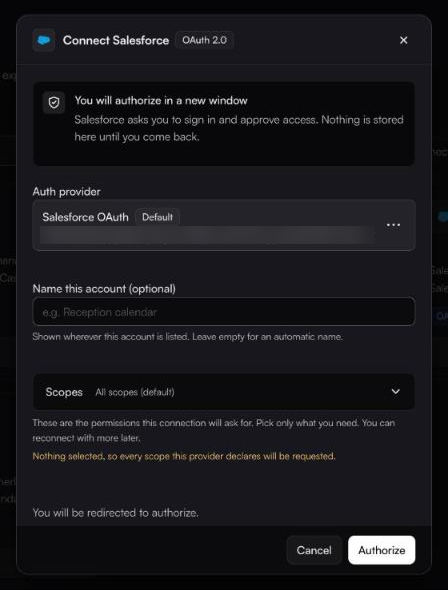

# Salesforce

| | |
| --- | --- |
| **Category** | [CRM and sales](README.md) |
| **Website** | [salesforce.com](https://salesforce.com) |
| **Authentication** | OAuth 2.0 |
| **Slug** | `salesforce` |

## Setup guide
This guide shows how to create your own Salesforce external client app for OAuth and add it to Fastn, so your customers sign in to Salesforce through your app.

For Salesforce's own setup steps, see [Create an External Client App in Your Org](https://developer.salesforce.com/docs/platform/sfdx-dev/guide/sfdx-dev-auth-eca.html) in the Salesforce documentation.

### Before you start
- You need the Owner, Admin or Developer role in Fastn.
- You need a Salesforce org where you can open Setup and create apps, such as a Developer Edition org or an org where you are a Salesforce administrator.
- Have the Fastn redirect URL ready: `https://oauth.live.fastn.ai`.

### Create your Salesforce app
1. In Salesforce, open **Setup**. In the **Quick Find** box, enter `external client`, then select **External Client App Manager**.
2. Click **New External Client App** and fill in the basic information, such as the app name and a contact email.
3. In the **API (Enable OAuth Settings)** section, select **Enable OAuth**.
4. In **Callback URL**, enter `https://oauth.live.fastn.ai` exactly, with no trailing slash.
5. Under **OAuth Scopes**, add these scopes to **Selected OAuth Scopes**:
   - Manage user data via APIs (`api`)
   - Full access (`full`)
   - Perform requests at any time (`refresh_token`, `offline_access`)
6. Save the app.
7. Open the app's **Settings** tab, expand **OAuth Settings**, and click **Consumer Key and Secret**. Salesforce emails you a verification code; enter it to see the values.
8. Copy the **Consumer Key** (your client ID) and the **Consumer Secret** (your client secret).

### Add your app to Fastn
1. In Fastn, go to Build → Integrations → Connectors and open Salesforce.
2. Open the **Auth** tab and click **Manage providers**.

<figure><figcaption>
Open the connector's Auth tab, then Manage providers.
</figcaption></figure>

3. Click **+ Create Provider**.
4. In the New Auth Provider form, enter a **Name** and an optional **Description**.
5. Paste the Consumer Key into **Client ID** and the Consumer Secret into **Client Secret**.
6. In **Scopes**, enter `api`, `full`, `refresh_token` and `offline_access`.

<figure><figcaption>
The New Auth Provider form: paste your app's Client ID and Client Secret.
</figcaption></figure>

7. Create the provider, then choose **Use this app** so it becomes the Preferred app.
8. In your widget, set the Salesforce connector's **Auth provider** setting to your app instead of "Use platform default".

Customers who skip this setup sign in through Fastn's shared Salesforce app.

### Events
Fastn can start a workflow when Salesforce records change, for example when an account, contact, lead, opportunity or case is created, updated or deleted. To use one of these events, add an App event trigger under Build → Integrations → Triggers → Add trigger → App events and pick the Salesforce event. See [App events](../../build/triggers/app-events.md). Contact Fastn support to set up events for Salesforce.

### Connect in Fastn

Your customers connect Salesforce from your widget. To connect an account yourself:

1. Go to **Build → Integrations → Connectors** and search for **Salesforce**.
2. Select **Connect** on the Salesforce card.

   <figure><figcaption>
Search for the connector, then select Connect on its card. ServiceNow is shown here.
</figcaption></figure>

3. Keep the **Default** auth provider, or choose your own OAuth app if you added one. Pick the **Scopes** you need, select **Authorize**, then sign in to Salesforce and approve access in the window that opens.

   <figure><figcaption>
A connect form for OAuth 2.0. Salesforce is shown here.
</figcaption></figure>

4. Check that the connection appears under **Operate → Connections** with the status `Active`. Your workflows can now use Salesforce's actions.

For more detail, see [Connect an app](../../build/connectors/connect-an-app.md).

## Actions

<table><thead><tr><th width="240">Action</th><th width="260">Slug</th><th>What it does</th></tr></thead><tbody><tr><td>Abort Bulk Ingest Job</td><td><code>abortBulkIngestJob</code></td><td>Abort a Bulk API 2.0 ingest job (set state to Aborted) to stop processing. Returns the updated job info.</td></tr><tr><td>Abort Bulk Query Job</td><td><code>abortBulkQueryJob</code></td><td>Abort a Bulk API 2.0 query job (set state to Aborted) to stop processing. Returns the updated job info.</td></tr><tr><td>Close Bulk Ingest Job</td><td><code>closeBulkIngestJob</code></td><td>Close a Bulk API 2.0 ingest job (set state to UploadComplete) so Salesforce begins processing the uploaded data. Returns the updated job info.</td></tr><tr><td>Composite Batch</td><td><code>compositeBatch</code></td><td>Execute up to 25 independent subrequests in a single batch call. Unlike composite, subrequests cannot reference each other. Returns a results array.</td></tr><tr><td>Composite Graph</td><td><code>compositeGraph</code></td><td>Execute one or more graphs of dependent operations in a single request. Each graph is committed independently. Returns per-graph responses.</td></tr><tr><td>Composite Request</td><td><code>compositeRequest</code></td><td>Execute a series of REST API subrequests in a single composite call. Subrequests can reference each other's results. Returns a compositeResponse array of subrequest results.</td></tr><tr><td>Composite Tree (SObject Tree)</td><td><code>compositeTree</code></td><td>Create one or more sObject trees (parent records with nested child records) in a single request for the given sObject type. Each record needs attributes.type and a referenceId.</td></tr><tr><td>Create Account</td><td><code>createAccount</code></td><td>Create a new Salesforce Account. Every provided field is sent as the JSON body. The org's duplicate rules can reject a near-duplicate Name with DUPLICATES_DETECTED. Returns {id, success, errors} with HTTP 201.</td></tr><tr><td>Create Apex Class</td><td><code>createApexClass</code></td><td>Create an Apex class in the org via the Tooling API. Pass the full class source as Body; Salesforce extracts the class name from the declaration. Use to provision a webhook-emitting Apex helper before binding it to a trigger.</td></tr><tr><td>Create Apex Trigger</td><td><code>createApexTrigger</code></td><td>Create an Apex trigger via the Tooling API. Provide the trigger Name, the sObject it targets (TableEnumOrId), and the full trigger source (Body). Used to wire a webhook-emitting Apex class to record insert/update/delete events.</td></tr></tbody></table>

View 216 more actions

<table><thead><tr><th width="240">Action</th><th width="260">Slug</th><th>What it does</th></tr></thead><tbody><tr><td>Create Asset</td><td><code>createAsset</code></td><td>Create an Asset (a purchased/installed product). Required: Name, AccountId.</td></tr><tr><td>Create Attachment</td><td><code>createAttachment</code></td><td>Create a legacy Attachment on a parent record. Required: ParentId, Name, Body (base64-encoded file content). ContentType sets the MIME type (otherwise Salesforce infers it); IsPrivate true hides it from everyone but the owner and admins. Every provided field is sent as-is in the JSON body. For new integrations prefer createContentVersion (Files). Returns {id, success, errors}.</td></tr><tr><td>Create Bulk Ingest Job</td><td><code>createBulkIngestJob</code></td><td>Create a Bulk API 2.0 ingest job for inserting, updating, upserting, or deleting records via CSV. All provided inputs are sent as the JSON body (contentType defaults to CSV). For operation upsert, externalIdFieldName is required by Salesforce. Returns the job metadata including the job id and contentUrl; next call uploadBulkIngestData, then closeBulkIngestJob.</td></tr><tr><td>Create Bulk Query Job</td><td><code>createBulkQueryJob</code></td><td>Create a Bulk API 2.0 query job to asynchronously run a SOQL query and retrieve large result sets as CSV. All provided inputs are sent as the JSON body. Returns the job metadata including the job id; poll getBulkQueryJob until state is JobComplete, then call getBulkQueryResults.</td></tr><tr><td>Create Campaign</td><td><code>createCampaign</code></td><td>Create a Campaign. Required: Name.</td></tr><tr><td>Create Campaign Member</td><td><code>createCampaignMember</code></td><td>Add a member to a Campaign. Required: CampaignId plus exactly one of LeadId or ContactId (Salesforce rejects both or neither). Status is optional and must be a value from the campaign's member-status picklist (default Sent / Responded). Every provided field is sent as-is in the JSON body. Returns {id, success, errors}.</td></tr><tr><td>Create Case</td><td><code>createCase</code></td><td>Create a new Salesforce Case.</td></tr><tr><td>Create Case Comment</td><td><code>createCaseComment</code></td><td>Add a CaseComment to a Case (POST sobjects/CaseComment). Every provided field is sent as the JSON body. ParentId must be a Case Id; IsPublished=true makes the comment visible to portal/community users. Use this instead of createNote for Cases. Returns {id, success, errors} with HTTP 201.</td></tr><tr><td>Create Contact</td><td><code>createContact</code></td><td>Create a new Salesforce Contact. Every provided field is sent as the JSON body. Returns {id, success, errors} with HTTP 201.</td></tr><tr><td>Create ContentDocumentLink</td><td><code>createContentDocumentLink</code></td><td>Share a ContentDocument with a record or user by creating a ContentDocumentLink. Required: ContentDocumentId, LinkedEntityId, ShareType.</td></tr><tr><td>Create ContentVersion</td><td><code>createContentVersion</code></td><td>Upload a file as a ContentVersion. Required: Title, PathOnClient, VersionData (base64-encoded content). Omit ContentDocumentId to create a new ContentDocument; pass an existing ContentDocumentId (optionally with ReasonForChange) to upload a new version of that document. FirstPublishLocationId links the new document to a record or library on creation (otherwise it is only visible to the uploader). Every provided field is sent as-is in the JSON body. Returns {id, success, errors}; call getContentVersion on the id to obtain the ContentDocumentId.</td></tr><tr><td>Create Contract</td><td><code>createContract</code></td><td>Create a Contract. Required: AccountId, Status (Salesforce only accepts Draft on create; activate later with updateContract, which needs StartDate and ContractTerm set). Every provided field is sent as-is in the JSON body. Addresses are the component fields (BillingStreet etc.). Not executable in orgs where Contracts are not enabled (404 NOT_FOUND). Returns {id, success, errors}.</td></tr><tr><td>Create Event</td><td><code>createEvent</code></td><td>Create a Salesforce Event (calendar event or meeting). Every provided field is sent as the JSON body. Exactly one timing form is required: (1) StartDateTime + EndDateTime, (2) ActivityDateTime + DurationInMinutes, or (3) ActivityDate with IsAllDayEvent=true. Subject is optional. Returns {id, success, errors} with HTTP 201.</td></tr><tr><td>Create Lead</td><td><code>createLead</code></td><td>Create a new Salesforce Lead. Every provided field is sent as the JSON body. Status defaults to the org default (New) when omitted. Returns {id, success, errors} with HTTP 201.</td></tr><tr><td>Create Note</td><td><code>createNote</code></td><td>Create a classic Note attached to a parent record. Required: Title and ParentId. Optional: Body, IsPrivate. ParentId cannot be a Case in orgs without Notes on Case; use createCaseComment instead. Returns {id, success, errors} with HTTP 201.</td></tr><tr><td>Create Note (ContentNote)</td><td><code>createContentNote</code></td><td>Create a modern ContentNote. Required: Title and Content (Base64-encoded HTML body).</td></tr><tr><td>Create Opportunity</td><td><code>createOpportunity</code></td><td>Create a new Salesforce Opportunity. Every provided field is sent as the JSON body. Returns {id, success, errors} with HTTP 201.</td></tr><tr><td>Create OpportunityLineItem</td><td><code>createOpportunityLineItem</code></td><td>Create an OpportunityLineItem (opportunity product line). Required: OpportunityId, PricebookEntryId, Quantity, UnitPrice.</td></tr><tr><td>Create Order</td><td><code>createOrder</code></td><td>Create an Order. Required: AccountId, EffectiveDate, Status (must be a Draft-category value, normally "Draft"; activate afterwards with updateOrder, which needs at least one OrderItem). Every provided field is sent as-is in the JSON body. Set Pricebook2Id if you intend to add OrderItems (createOrderItem requires it). Name, PoNumber, PoDate, OrderReferenceNumber, Type, Bill/ShipToContactId are standard fields but hidden by field-level security in some orgs (400 INVALID_FIELD "No such column"). Addresses are the component fields (BillingStreet etc.); with state/country picklists enabled use full names ("Texas", "United States"), not codes. Returns {id, success, errors}.</td></tr><tr><td>Create OrderItem</td><td><code>createOrderItem</code></td><td>Create an OrderItem (order product line). Required: OrderId, PricebookEntryId, Quantity, UnitPrice.</td></tr><tr><td>Create Pricebook</td><td><code>createPricebook</code></td><td>Create a Pricebook2. Required: Name.</td></tr><tr><td>Create PricebookEntry</td><td><code>createPricebookEntry</code></td><td>Create a PricebookEntry linking a Product2 to a Pricebook2 with a price. Required: Pricebook2Id, Product2Id, UnitPrice. IsActive defaults to false when omitted, and an inactive entry cannot be added to Orders/Opportunities, so pass IsActive: true for a usable entry. A product must have an entry in the Standard Price Book before it can be added to a custom pricebook. Returns {id, success, errors}.</td></tr><tr><td>Create Product</td><td><code>createProduct</code></td><td>Create a Product2. Required: Name.</td></tr><tr><td>Create Quote</td><td><code>createQuote</code></td><td>Create a Quote. Required: Name, OpportunityId (the Opportunity must have a Pricebook; Pricebook2Id is inherited when omitted). Every provided field is sent as-is in the JSON body. Requires Quotes to be enabled in the org (else 404 NOT_FOUND). Returns {id, success, errors}.</td></tr><tr><td>Create QuoteLineItem</td><td><code>createQuoteLineItem</code></td><td>Create a QuoteLineItem (quote product line). Required: QuoteId, PricebookEntryId, Quantity, UnitPrice. Requires Quotes enabled in the org.</td></tr><tr><td>Create Record (any sObject)</td><td><code>createRecord</code></td><td>Generic create for ANY sObject. Pass sobject (API name) in the URL path; pass each field value as a TOP-LEVEL property alongside it (e.g. {sobject:'Account', Name:'Acme', Description:'...'}). The engine sends all non-sobject top-level props as the JSON body. Send at least one field; an empty body is rejected by Salesforce with JSON_PARSER_ERROR. Returns {id, success, errors} with HTTP 201.</td></tr><tr><td>Create Records Collection</td><td><code>createRecordsCollection</code></td><td>Create up to 200 records of one or more sObject types in a single request via the sObject Collections API. Each record must include attributes.type. Returns per-record save results.</td></tr><tr><td>Create Remote Site</td><td><code>createRemoteSite</code></td><td>Create a RemoteSiteSetting in Salesforce via the Tooling API so the org can make outbound HTTP callouts to a given URL. Required before Apex callouts to a Fastn webhook endpoint will succeed.</td></tr><tr><td>Create Task</td><td><code>createTask</code></td><td>Create a new Salesforce Task.</td></tr><tr><td>Delete Account</td><td><code>deleteAccount</code></td><td>Delete a Salesforce Account by ID.</td></tr><tr><td>Delete Apex Class</td><td><code>deleteApexClass</code></td><td>Delete an Apex class via the Tooling API by its record Id. Used during webhook unsubscription cleanup to remove a FastnWebhook_ Apex class.</td></tr><tr><td>Delete Apex Trigger</td><td><code>deleteApexTrigger</code></td><td>Delete an Apex trigger via the Tooling API by its record Id. Used during webhook unsubscription cleanup to remove a FastnTrigger_ Apex trigger.</td></tr><tr><td>Delete Asset</td><td><code>deleteAsset</code></td><td>Delete an Asset by Id. 204 No Content.</td></tr><tr><td>Delete Attachment</td><td><code>deleteAttachment</code></td><td>Delete an Attachment by Id. 204 No Content.</td></tr><tr><td>Delete Bulk Ingest Job</td><td><code>deleteBulkIngestJob</code></td><td>Delete a Bulk API 2.0 ingest job. The job must be in a closed state (JobComplete, Aborted, or Failed).</td></tr><tr><td>Delete Bulk Query Job</td><td><code>deleteBulkQueryJob</code></td><td>Delete a Bulk API 2.0 query job. The job must be in a closed state (JobComplete, Aborted, or Failed).</td></tr><tr><td>Delete Campaign</td><td><code>deleteCampaign</code></td><td>Delete a Campaign by Id. 204 No Content on success.</td></tr><tr><td>Delete Campaign Member</td><td><code>deleteCampaignMember</code></td><td>Delete a CampaignMember by Id. 204 No Content.</td></tr><tr><td>Delete Case</td><td><code>deleteCase</code></td><td>Delete a Salesforce Case by ID.</td></tr><tr><td>Delete Contact</td><td><code>deleteContact</code></td><td>Delete a Salesforce Contact by ID.</td></tr><tr><td>Delete ContentDocument</td><td><code>deleteContentDocument</code></td><td>Delete a ContentDocument by Id. Deleting the document removes all of its versions. 204 No Content.</td></tr><tr><td>Delete ContentDocumentLink</td><td><code>deleteContentDocumentLink</code></td><td>Delete a ContentDocumentLink by Id (unshares the document). 204 No Content.</td></tr><tr><td>Delete Contract</td><td><code>deleteContract</code></td><td>Delete a Contract by Id. 204 No Content.</td></tr><tr><td>Delete Event</td><td><code>deleteEvent</code></td><td>Delete a Salesforce Event by ID.</td></tr><tr><td>Delete Feed Element</td><td><code>deleteFeedElement</code></td><td>Delete a Chatter feed element by its id.</td></tr><tr><td>Delete Lead</td><td><code>deleteLead</code></td><td>Delete a Salesforce Lead by ID.</td></tr><tr><td>Delete Note</td><td><code>deleteNote</code></td><td>Delete a classic Note by Id. 204 No Content on success.</td></tr><tr><td>Delete Note (ContentNote)</td><td><code>deleteContentNote</code></td><td>Delete a ContentNote by Id. 204 No Content.</td></tr><tr><td>Delete Opportunity</td><td><code>deleteOpportunity</code></td><td>Delete a Salesforce Opportunity by ID.</td></tr><tr><td>Delete OpportunityLineItem</td><td><code>deleteOpportunityLineItem</code></td><td>Delete an OpportunityLineItem by Id. 204 No Content.</td></tr><tr><td>Delete Order</td><td><code>deleteOrder</code></td><td>Delete an Order by Id. 204 No Content.</td></tr><tr><td>Delete OrderItem</td><td><code>deleteOrderItem</code></td><td>Delete an OrderItem by Id. 204 No Content.</td></tr><tr><td>Delete Pricebook</td><td><code>deletePricebook</code></td><td>Delete a Pricebook2 by Id. 204 No Content.</td></tr><tr><td>Delete PricebookEntry</td><td><code>deletePricebookEntry</code></td><td>Delete a PricebookEntry by Id. 204 No Content.</td></tr><tr><td>Delete Product</td><td><code>deleteProduct</code></td><td>Delete a Product2 by Id. 204 No Content.</td></tr><tr><td>Delete Quote</td><td><code>deleteQuote</code></td><td>Delete a Quote by Id. 204 No Content.</td></tr><tr><td>Delete QuoteLineItem</td><td><code>deleteQuoteLineItem</code></td><td>Delete a QuoteLineItem by Id. 204 No Content.</td></tr><tr><td>Delete Record (any sObject)</td><td><code>deleteRecord</code></td><td>Generic delete for ANY sObject by Id. 204 No Content.</td></tr><tr><td>Delete Records Collection</td><td><code>deleteRecordsCollection</code></td><td>Delete up to 200 records by Id in a single request via the sObject Collections API. Ids are passed as a comma-separated query param.</td></tr><tr><td>Delete Remote Site</td><td><code>deleteRemoteSite</code></td><td>Delete a Remote Site Setting via the Tooling API by its record Id (the 0rp... id returned by createRemoteSite or getRemoteSiteByName). Used during webhook unsubscription cleanup. Note: on some orgs (observed on a production-type trial org) Salesforce refuses Tooling deletes of remote sites with 400 INSUFFICIENT_ACCESS_ON_CROSS_REFERENCE_ENTITY regardless of object name; delete the entry under Setup &gt; Remote Site Settings in that case.</td></tr><tr><td>Delete Task</td><td><code>deleteTask</code></td><td>Delete a Salesforce Task by ID.</td></tr><tr><td>Describe Global (list sObjects)</td><td><code>describeGlobal</code></td><td>List all sObjects available in the org with basic metadata (name, label, keyPrefix, custom, queryable/createable/updateable/deletable flags, urls). WARNING: the response is large, roughly 850 KB for ~960 sObjects, and Fastn returns it untruncated with no paging or field projection. Do not feed it straight into an LLM context; consume it in workflow code, or use getSObjectBasicInfo / describeSObject for a single object. Returns {encoding, maxBatchSize, sobjects: [...]}.</td></tr><tr><td>Describe Report</td><td><code>describeReport</code></td><td>Retrieve report, report type, and extended metadata for a specific report. Use the report metadata to learn columns, groupings, and filters before running.</td></tr><tr><td>Describe sObject</td><td><code>describeSObject</code></td><td>Full metadata describe for one sObject: fields (type, length, picklist values, referenceTo), childRelationships, recordTypeInfos, keyPrefix, urls, and the createable/updateable/deletable/queryable flags. WARNING: the response is large (about 200 KB for Account, more for objects with many fields) and Fastn returns it untruncated with no field projection. Do not feed it straight into an LLM context; consume it in workflow code and project the fields you need. Use getSObjectBasicInfo for a small summary.</td></tr><tr><td>Execute Anonymous Apex</td><td><code>executeAnonymousApex</code></td><td>Compile and execute an anonymous Apex block via the Tooling API. Requires the connected user to have the Author Apex permission AND Apex compilation enabled for the org (Developer Edition, sandbox or scratch org); on a production or trial org Salesforce Use for admin/maintenance operations not exposed by REST. Returns {compiled, success, compileProblem, exceptionMessage, exceptionStackTrace, line, column}; check compiled and success rather than the HTTP status, which is 200 even when the block fails.</td></tr><tr><td>Execute SOQL Query</td><td><code>executeSoqlQuery</code></td><td>Execute an arbitrary SOQL query against Salesforce and return {totalSize, done, records, nextRecordsUrl}. Pages are up to 2000 records; when done is false pass the final path segment of nextRecordsUrl (the bare locator) to soqlQueryMore. Note: the wire URL carries the SOQL twice (?q=...&amp;query=...) because Fastn maps the query input to q and also appends unconsumed inputs on GET; Salesforce ignores the extra query param, so this is harmless.</td></tr><tr><td>Explain Query</td><td><code>explainQuery</code></td><td>Return the query optimizer's execution plans for a SOQL query (or a report/list view Id) without running it: which index or table scan it would use, its relative cost, cardinality and any notes (e.g. an unindexed filter). Use it to check whether a query is selective before running it on a large object. Returns {plans: [{cardinality, fields, leadingOperationType, relativeCost, sobjectCardinality, sobjectType, notes: [{description, fields, tableEnumOrId}]}]}, ordered best plan first.</td></tr><tr><td>Get Account</td><td><code>getAccount</code></td><td>Retrieve a specific Salesforce Account by ID.</td></tr><tr><td>Get Apex Class By Name</td><td><code>getApexClassByName</code></td><td>Look up an Apex class by its developer Name using the Tooling API. Returns the matching record (or an empty records array if not found). Useful before createApexClass to avoid duplicate-create errors.</td></tr><tr><td>Get Apex Trigger By Name</td><td><code>getApexTriggerByName</code></td><td>Look up an Apex trigger by its developer Name using the Tooling API. Returns the matching record (or empty records array if not found). Use before createApexTrigger to avoid duplicate creates.</td></tr><tr><td>Get API Versions</td><td><code>getApiVersions</code></td><td>List all Salesforce REST API versions available on the connected org. No inputs required.</td></tr><tr><td>Get Asset</td><td><code>getAsset</code></td><td>Retrieve an Asset by Id.</td></tr><tr><td>Get Attachment</td><td><code>getAttachment</code></td><td>Retrieve an Attachment metadata record by Id. The Body field in the response is a relative URL (/services/data/vXX.X/sobjects/Attachment/{id}/Body), not the file content; call getAttachmentBody to download the content.</td></tr><tr><td>Get Attachment Body</td><td><code>getAttachmentBody</code></td><td>Download the body of an Attachment by Id (GET.../Attachment/{id}/Body). The response is the file content, not a JSON object: for text content types (e.g. text/plain) the platform returns the decoded text as a raw string; for binary content types it returns a download wrapper {name, mime, size, data} with data base64-encoded (same shape as getContentVersionData). Use getAttachment for the metadata.</td></tr><tr><td>Get Bulk Ingest Failed Results</td><td><code>getBulkIngestFailedResults</code></td><td>Retrieve the records that failed processing in a Bulk API 2.0 ingest job. Returns CSV text with sf__Id, sf__Error columns plus the submitted record fields.</td></tr><tr><td>Get Bulk Ingest Job</td><td><code>getBulkIngestJob</code></td><td>Retrieve detailed status information for a Bulk API 2.0 ingest job, including state and record processing counts.</td></tr><tr><td>Get Bulk Ingest Successful Results</td><td><code>getBulkIngestSuccessfulResults</code></td><td>Retrieve the records that were successfully processed by a Bulk API 2.0 ingest job. Returns CSV text with sf__Id and sf__Created columns plus the submitted record fields.</td></tr><tr><td>Get Bulk Ingest Unprocessed Records</td><td><code>getBulkIngestUnprocessedRecords</code></td><td>Retrieve the records that were not processed by a Bulk API 2.0 ingest job (e.g. job aborted before completion). Returns CSV text of the unprocessed records.</td></tr><tr><td>Get Bulk Query Job</td><td><code>getBulkQueryJob</code></td><td>Retrieve detailed status information for a Bulk API 2.0 query job, including state and record counts.</td></tr><tr><td>Get Bulk Query Results</td><td><code>getBulkQueryResults</code></td><td>Retrieve the CSV results of a completed Bulk API 2.0 query job. Returns raw CSV text (header row first). maxRecords limits the rows per page. Paging: Salesforce returns the next-page locator only in the Sforce-Locator RESPONSE HEADER, which Fastn does not surface (only the body is returned), so the locator input cannot be fed from this action's output. To get a full result set in one call pass a large maxRecords (or omit it: Salesforce default page is 10000 rows), or use executeSoqlQuery / soqlQueryMore for cursor paging instead.</td></tr><tr><td>Get Campaign</td><td><code>getCampaign</code></td><td>Retrieve a Campaign by Id.</td></tr><tr><td>Get Campaign Member</td><td><code>getCampaignMember</code></td><td>Retrieve a CampaignMember by Id.</td></tr><tr><td>Get Case</td><td><code>getCase</code></td><td>Retrieve a specific Salesforce Case by ID.</td></tr><tr><td>Get Chatter Group</td><td><code>getChatterGroup</code></td><td>Get a single Chatter group by its id.</td></tr><tr><td>Get Chatter User</td><td><code>getChatterUser</code></td><td>Get a single Chatter user by user id.</td></tr><tr><td>Get Contact</td><td><code>getContact</code></td><td>Retrieve a specific Salesforce Contact by ID.</td></tr><tr><td>Get ContentDocument</td><td><code>getContentDocument</code></td><td>Retrieve a ContentDocument metadata record by Id.</td></tr><tr><td>Get ContentDocumentLink</td><td><code>getContentDocumentLink</code></td><td>Retrieve a ContentDocumentLink by Id.</td></tr><tr><td>Get ContentVersion</td><td><code>getContentVersion</code></td><td>Retrieve a ContentVersion metadata record by Id (includes ContentDocumentId, the id to use for linking and deleting the file). The VersionData field in the response is a relative URL (/services/data/vXX.X/sobjects/ContentVersion/{id}/VersionData), not the file content; call getContentVersionData to download the content.</td></tr><tr><td>Get ContentVersion Data</td><td><code>getContentVersionData</code></td><td>Download the content of a ContentVersion by Id (GET.../ContentVersion/{id}/VersionData). Salesforce streams application/octetstream, which the platform wraps as {name: "download", mime, size, data} with data base64-encoded (decode it to get the exact uploaded bytes). Use getContentVersion for the metadata.</td></tr><tr><td>Get Contract</td><td><code>getContract</code></td><td>Retrieve a Contract by Id. Returns the standard Contract fields (from the object reference; not executable in orgs where Contracts are not enabled, 404 NOT_FOUND). EndDate is calculated from StartDate + ContractTerm.</td></tr><tr><td>Get Dashboard</td><td><code>getDashboard</code></td><td>Retrieve the results and metadata of a specific dashboard, including each component's data.</td></tr><tr><td>Get Dashboard Status</td><td><code>getDashboardStatus</code></td><td>Retrieve the refresh status of a dashboard and each of its components without returning full result data.</td></tr><tr><td>Get Deleted Records</td><td><code>getDeletedRecords</code></td><td>Retrieve the Ids of records of a given sObject type deleted within a date/time window (still in the recycle bin). start and end are ISO 8601 datetimes. Constraints: the window must be within the last 30 days and span at most 30 days, and start must be on or after the org's replication-enabled date (returned as earliestDateAvailable; a new org's is its creation date) or Salesforce Salesforce truncates to the minute and latestDateCovered lags real time by up to an hour. Returns {deletedRecords: [{id, deletedDate}], earliestDateAvailable, latestDateCovered}.</td></tr><tr><td>Get Email Message</td><td><code>getEmailMessage</code></td><td>Retrieve one Salesforce EmailMessage by Id (GET sobjects/EmailMessage/{id}). Returns every accessible field including TextBody and HtmlBody. Use listEmailMessages to find Ids.</td></tr><tr><td>Get Event</td><td><code>getEvent</code></td><td>Retrieve a specific Salesforce Event by ID.</td></tr><tr><td>Get Feed Element</td><td><code>getFeedElement</code></td><td>Get a single Chatter feed element by its id.</td></tr><tr><td>Get Invocable Actions</td><td><code>getInvocableActions</code></td><td>List the standard invocable actions available in the org via /actions/standard. Returns the catalog of standard actions with their names, labels, and types.</td></tr><tr><td>Get Lead</td><td><code>getLead</code></td><td>Retrieve a specific Salesforce Lead by ID.</td></tr><tr><td>Get My Chatter User</td><td><code>getMyChatterUser</code></td><td>Get the Chatter profile of the current (context) user. Returns the running user's Chatter user resource.</td></tr><tr><td>Get My News Feed</td><td><code>getMyNewsFeed</code></td><td>Get feed elements from the current user's news feed. Optionally limit results with pageSize.</td></tr><tr><td>Get Note</td><td><code>getNote</code></td><td>Retrieve a classic Note by Id.</td></tr><tr><td>Get Note (ContentNote)</td><td><code>getContentNote</code></td><td>Retrieve a ContentNote by Id.</td></tr><tr><td>Get Opportunity</td><td><code>getOpportunity</code></td><td>Retrieve a specific Salesforce Opportunity by ID.</td></tr><tr><td>Get OpportunityLineItem</td><td><code>getOpportunityLineItem</code></td><td>Retrieve an OpportunityLineItem by Id.</td></tr><tr><td>Get Order</td><td><code>getOrder</code></td><td>Retrieve an Order by Id. Returns the standard Order fields visible to the connection's user; fields hidden by field-level security (e.g. Name, PoNumber, Type in some orgs) are simply absent from the response. Compound BillingAddress/ShippingAddress objects accompany the component fields.</td></tr><tr><td>Get OrderItem</td><td><code>getOrderItem</code></td><td>Retrieve an OrderItem by Id.</td></tr><tr><td>Get Org Limits</td><td><code>getOrgLimits</code></td><td>Return the org's current limits and remaining allocations including DataStorageMB and FileStorageMB (Salesforce /limits).</td></tr><tr><td>Get Password Status</td><td><code>getPasswordStatus</code></td><td>Check whether a user's password has expired (User Password REST resource). Read-only; does not change or reveal the password. Returns {isExpired: boolean}. Requires the caller to be the user or to have Manage Users / Reset User Passwords permission.</td></tr><tr><td>Get Pricebook</td><td><code>getPricebook</code></td><td>Retrieve a Pricebook2 by Id.</td></tr><tr><td>Get PricebookEntry</td><td><code>getPricebookEntry</code></td><td>Retrieve a PricebookEntry by Id.</td></tr><tr><td>Get Product</td><td><code>getProduct</code></td><td>Retrieve a Product2 by Id.</td></tr><tr><td>Get Quote</td><td><code>getQuote</code></td><td>Retrieve a Quote by Id. Returns the standard Quote fields (from the object reference; requires Quotes to be enabled in the org, else 404 NOT_FOUND). Subtotal, TotalPrice, GrandTotal, Discount and LineItemCount are computed from the QuoteLineItems; IsSyncing tells whether the quote syncs with its Opportunity.</td></tr><tr><td>Get QuoteLineItem</td><td><code>getQuoteLineItem</code></td><td>Retrieve a QuoteLineItem by Id. Returns the standard QuoteLineItem fields (from the object reference; requires Quotes to be enabled in the org, else 404 NOT_FOUND). TotalPrice and Subtotal are computed.</td></tr><tr><td>Get Recent Items</td><td><code>getRecentItems</code></td><td>Retrieve the records most recently viewed by the current user across object types. Optionally limit the number of results.</td></tr><tr><td>Get Record (any sObject)</td><td><code>getRecord</code></td><td>Generic get for ANY sObject by Id. Optional fields (comma-separated API names) is sent as ?fields= and restricts the returned columns; without it Salesforce returns every accessible field.</td></tr><tr><td>Get Record By External Id</td><td><code>getRecordByExternalId</code></td><td>Retrieve a record of a given sObject type by the value of an external Id field (rather than the Salesforce Id).</td></tr><tr><td>Get Record Counts</td><td><code>getRecordCounts</code></td><td>Return approximate record counts for sObjects in the org (Salesforce /limits/recordCount). Useful for spotting which object consumes storage.</td></tr><tr><td>Get Record Feed</td><td><code>getRecordFeed</code></td><td>Get feed elements for a specific record's Chatter feed by record id recordId may also be a group id, or a user id equal to the context user / "me". Optional pageSize (1-100, default 25) and q (keyword search) are sent as query parameters. Requires Chatter to be enabled in the org (else 403 FUNCTIONALITY_NOT_ENABLED).</td></tr><tr><td>Get Records Collection</td><td><code>getRecordsCollection</code></td><td>Retrieve up to 2000 records of a given sObject type by Id with a specified field list, in a single request via the sObject Collections API.</td></tr><tr><td>Get Remote Site By Name</td><td><code>getRemoteSiteByName</code></td><td>Look up a Remote Site Setting (RemoteProxy) by its SiteName using the Tooling API. Returns the matching record (or empty records array if not found). Use before createRemoteSite to avoid duplicate creates.</td></tr><tr><td>Get Report Instance</td><td><code>getReportInstance</code></td><td>Retrieve the results of an asynchronous report run by report Id and instance Id. Returns the report result once the instance status is Success.</td></tr><tr><td>Get sObject Basic Info</td><td><code>getSObjectBasicInfo</code></td><td>Basic info + recent items for an sObject.</td></tr><tr><td>Get Standard Action Details</td><td><code>getStandardActionDetails</code></td><td>Describe one standard invocable action (from the list returned by getInvocableActions), e.g. emailSimple, chatterPost, submit, contentWorkspaceEnableFolders. Returns its input and output parameter definitions: {name, label, type, inputs: [{name, label, type, required, description, maxOccurs}], outputs: [...]}. Use it to build the inputs array for invokeStandardAction.</td></tr><tr><td>Get Task</td><td><code>getTask</code></td><td>Retrieve a specific Salesforce Task by ID.</td></tr><tr><td>Get Updated Records</td><td><code>getUpdatedRecords</code></td><td>Retrieve the Ids of records of a given sObject type created or updated within a date/time window. start and end are ISO 8601 datetimes. Constraints: the window must be within the last 30 days and span at most 30 days, and start must be on or after the org's replication-enabled date (a new org's is its creation date) or Salesforce Salesforce truncates to the minute and latestDateCovered lags real time by up to an hour, so records touched in the last hour may not be listed yet. Returns {ids: [...], latestDateCovered}.</td></tr><tr><td>Get User</td><td><code>getUser</code></td><td>Retrieve a specific Salesforce User by ID.</td></tr><tr><td>Get User Info</td><td><code>getUserInfo</code></td><td>Retrieve identity information for the currently authenticated user via the OAuth userinfo endpoint (user_id, organization_id, email, etc.). No inputs required.</td></tr><tr><td>Invoke Standard Action</td><td><code>invokeStandardAction</code></td><td>Invoke a standard invocable action (Actions REST API), e.g. emailSimple, chatterPost, submit (approval), contentWorkspaceEnableFolders. inputs is an array of one object per invocation whose keys are the action's input parameter names from getStandardActionDetails. Most standard actions have real-world side effects (send an email, post to Chatter, submit for approval); call getStandardActionDetails first and only invoke when the caller intends the effect. Returns a bare array of per-invocation results [{actionName, isSuccess, outputValues, errors}].</td></tr><tr><td>Like Feed Element</td><td><code>likeFeedElement</code></td><td>Like a feed element via its chatter-likes capability. Sends an empty JSON body.</td></tr><tr><td>List Accounts</td><td><code>listAccounts</code></td><td>List Salesforce Accounts via SOQL. Fixed SOQL, max 200 rows, newest first; no filter inputs. Passing an undeclared q input replaces the SOQL entirely; use executeSoqlQuery for custom queries. Returns {totalSize, done, records}.</td></tr><tr><td>List Apex Classes</td><td><code>listApexClasses</code></td><td>List Apex classes via the Tooling API, filtered to Fastn-managed webhook classes (Name LIKE 'FastnWebhook_%'). Returns Id and Name for each.</td></tr><tr><td>List Apex Triggers</td><td><code>listApexTriggers</code></td><td>List Apex triggers via the Tooling API, filtered to Fastn-managed webhook triggers (Name LIKE 'FastnTrigger_%'). Returns Id, Name, TableEnumOrId, and Status for each.</td></tr><tr><td>List Approvals</td><td><code>listApprovals</code></td><td>List the approval processes defined in the org, grouped by sObject type (Process Approvals REST resource). No inputs. Returns {approvals: {&lt;SObjectName&gt;: [{id, name, description, object, sortOrder}]}}; an org with no approval processes returns {approvals: {}}.</td></tr><tr><td>List Assets</td><td><code>listAssets</code></td><td>List Assets via SELECT FIELDS(ALL) FROM Asset LIMIT 200. Fixed SOQL, max 200 rows (Salesforce caps FIELDS(ALL) at 200, so nextRecordsUrl is never returned); passing an undeclared q input replaces the SOQL, use executeSoqlQuery for custom queries, e.g. to filter by AccountId.</td></tr><tr><td>List Attachments</td><td><code>listAttachments</code></td><td>List legacy Attachments via SELECT FIELDS(ALL) FROM Attachment LIMIT 200 (all parents; Body is returned as a relative URL, use getAttachmentBody for content). Fixed SOQL, max 200 rows (Salesforce caps FIELDS(ALL) at 200, so nextRecordsUrl is never returned); passing an undeclared q input replaces the SOQL, use executeSoqlQuery for custom queries, e.g. to filter by ParentId.</td></tr><tr><td>List Bulk Ingest Jobs</td><td><code>listBulkIngestJobs</code></td><td>List all Bulk API 2.0 ingest jobs in the org. Supports optional paging via isPkChunkingEnabled, jobType, and queryLocator query params.</td></tr><tr><td>List Bulk Query Jobs</td><td><code>listBulkQueryJobs</code></td><td>List all Bulk API 2.0 query jobs in the org. Supports optional filtering by isPkChunkingEnabled, jobType, concurrencyMode, and paging via queryLocator.</td></tr><tr><td>List Campaign Members</td><td><code>listCampaignMembers</code></td><td>List CampaignMembers via SELECT FIELDS(ALL) FROM CampaignMember LIMIT 200 (all campaigns). Fixed SOQL, max 200 rows (Salesforce caps FIELDS(ALL) at 200, so nextRecordsUrl is never returned); passing an undeclared q input replaces the SOQL, use executeSoqlQuery for custom queries, e.g. to filter by CampaignId.</td></tr><tr><td>List Campaigns</td><td><code>listCampaigns</code></td><td>List Campaigns via SELECT FIELDS(ALL) FROM Campaign LIMIT 200. Fixed SOQL, max 200 rows (Salesforce caps FIELDS(ALL) at 200, so nextRecordsUrl is never returned); passing an undeclared q input replaces the SOQL, use executeSoqlQuery for custom queries or filters.</td></tr><tr><td>List Case Comments</td><td><code>listCaseComments</code></td><td>List CaseComments for one Case via SOQL, newest first, max 200 rows. caseId is interpolated into the WHERE clause. Returns {totalSize, done, records}.</td></tr><tr><td>List Cases</td><td><code>listCases</code></td><td>List Salesforce Cases via SOQL. Fixed SOQL, max 200 rows, newest first; no filter inputs. Passing an undeclared q input replaces the SOQL entirely; use executeSoqlQuery for custom queries. Returns {totalSize, done, records}.</td></tr><tr><td>List Chatter Groups</td><td><code>listChatterGroups</code></td><td>List Chatter groups in the org. Optionally filter with a search term via the q query parameter.</td></tr><tr><td>List Chatter Users</td><td><code>listChatterUsers</code></td><td>List Chatter users in the org. Optionally filter with a search term via the q query parameter.</td></tr><tr><td>List Contacts</td><td><code>listContacts</code></td><td>List Salesforce Contacts via SOQL. Fixed SOQL, max 200 rows, newest first; no filter inputs. Passing an undeclared q input replaces the SOQL entirely; use executeSoqlQuery for custom queries. Returns {totalSize, done, records}.</td></tr><tr><td>List ContentDocumentLinks</td><td><code>listContentDocumentLinks</code></td><td>List the ContentDocumentLinks (record/user/library shares) of one ContentDocument via SOQL, up to 200. Salesforce requires a filter on ContentDocumentId or LinkedEntityId for this object; use listContentDocumentLinksForEntity to go the other way (all files attached to a record). Fixed SOQL; passing an undeclared q input replaces the SOQL, use executeSoqlQuery for custom queries.</td></tr><tr><td>List ContentDocumentLinks For Entity</td><td><code>listContentDocumentLinksForEntity</code></td><td>List the files (ContentDocumentLinks) attached to one record, user or library via SOQL, up to 200: the ContentDocumentId of each row is the file. This is how a record's Files related list is read; call getContentDocument / listContentVersions for titles and content. Salesforce requires a filter on LinkedEntityId or ContentDocumentId for this object. Fixed SOQL; passing an undeclared q input replaces the SOQL, use executeSoqlQuery for custom queries.</td></tr><tr><td>List ContentDocuments</td><td><code>listContentDocuments</code></td><td>List ContentDocuments (Files) via SELECT FIELDS(ALL) FROM ContentDocument LIMIT 200, i.e. every file the connection's user can see. Fixed SOQL, max 200 rows (Salesforce caps FIELDS(ALL) at 200, so nextRecordsUrl is never returned); passing an undeclared q input replaces the SOQL, use executeSoqlQuery for custom queries. To list the files attached to one record use listContentDocumentLinksForEntity.</td></tr><tr><td>List ContentVersions</td><td><code>listContentVersions</code></td><td>List ContentVersions (latest versions) via SOQL, up to 200.</td></tr><tr><td>List Contracts</td><td><code>listContracts</code></td><td>List Contracts via SELECT FIELDS(ALL) FROM Contract LIMIT 200. Fixed SOQL, max 200 rows (Salesforce caps FIELDS(ALL) at 200, so nextRecordsUrl is never returned); passing an undeclared q input replaces the SOQL, use executeSoqlQuery for custom queries or filters. Not executable in orgs where Contracts are not enabled (400 INVALID_TYPE sObject type 'Contract' is not supported).</td></tr><tr><td>List Dashboards</td><td><code>listDashboards</code></td><td>List recently viewed dashboards in the org via the Analytics REST API.</td></tr><tr><td>List Email Messages</td><td><code>listEmailMessages</code></td><td>List Salesforce EmailMessage records (Email-to-Case and Enhanced Email) via SOQL, newest first by MessageDate, max 200 rows; no filter inputs. ParentId is the Case (when any), RelatedToId the related record. Passing an undeclared q input replaces the SOQL entirely; use executeSoqlQuery for custom queries. Returns {totalSize, done, records}.</td></tr><tr><td>List Events</td><td><code>listEvents</code></td><td>List Salesforce Events (calendar events and meetings) via SOQL. Fixed SOQL, max 200 rows, newest first (by StartDateTime); no filter inputs. Passing an undeclared q input replaces the SOQL entirely; use executeSoqlQuery for custom queries. Returns {totalSize, done, records}.</td></tr><tr><td>List Groups</td><td><code>listGroups</code></td><td>List Salesforce Groups (public groups, queues, role groups) via SOQL. Fixed SOQL, max 200 rows; no filter inputs. Type is e.g. Regular (public group), Queue, Role, RoleAndSubordinates. Passing an undeclared q input replaces the SOQL entirely; use executeSoqlQuery for custom queries. Returns {totalSize, done, records}.</td></tr><tr><td>List Leads</td><td><code>listLeads</code></td><td>List Salesforce Leads via SOQL. Fixed SOQL, max 200 rows, newest first; no filter inputs. Passing an undeclared q input replaces the SOQL entirely; use executeSoqlQuery for custom queries. Returns {totalSize, done, records}.</td></tr><tr><td>List Notes</td><td><code>listNotes</code></td><td>List Salesforce classic Notes via SOQL. Fixed SOQL, max 200 rows, newest first; no filter inputs. Passing an undeclared q input replaces the SOQL entirely; use executeSoqlQuery for custom queries. Returns {totalSize, done, records}.</td></tr><tr><td>List Notes (ContentNote)</td><td><code>listContentNotes</code></td><td>List Salesforce ContentNotes via SOQL. Fixed SOQL, max 200 rows, newest first; no filter inputs. Passing an undeclared q input replaces the SOQL entirely; use executeSoqlQuery for custom queries. Returns {totalSize, done, records}.</td></tr><tr><td>List Opportunities</td><td><code>listOpportunities</code></td><td>List Salesforce Opportunities via SOQL. Fixed SOQL, max 200 rows, newest first; no filter inputs. Passing an undeclared q input replaces the SOQL entirely; use executeSoqlQuery for custom queries. Returns {totalSize, done, records}.</td></tr><tr><td>List OpportunityLineItems</td><td><code>listOpportunityLineItems</code></td><td>List OpportunityLineItems (SOQL FIELDS(ALL), up to 200).</td></tr><tr><td>List OrderItems</td><td><code>listOrderItems</code></td><td>List OrderItems via SELECT FIELDS(ALL) FROM OrderItem LIMIT 200 (all orders). Fixed SOQL, max 200 rows (Salesforce caps FIELDS(ALL) at 200, so nextRecordsUrl is never returned); passing an undeclared q input replaces the SOQL, use executeSoqlQuery for custom queries, e.g. to filter by OrderId.</td></tr><tr><td>List Orders</td><td><code>listOrders</code></td><td>List Orders via SELECT FIELDS(ALL) FROM Order LIMIT 200. Fixed SOQL, max 200 rows (Salesforce caps FIELDS(ALL) at 200, so nextRecordsUrl is never returned); rows are wide (addresses included), so the payload can reach a few hundred KB at the cap. Passing an undeclared q input replaces the SOQL, use executeSoqlQuery for custom queries, e.g. to filter by AccountId or Status.</td></tr><tr><td>List Permission Sets</td><td><code>listPermissionSets</code></td><td>List Salesforce Permission Sets via SOQL, excluding the profile-owned ones (IsOwnedByProfile = false). Fixed SOQL, max 200 rows; no filter inputs. Passing an undeclared q input replaces the SOQL entirely; use executeSoqlQuery for custom queries. Returns {totalSize, done, records}.</td></tr><tr><td>List PricebookEntries</td><td><code>listPricebookEntries</code></td><td>List PricebookEntries via SELECT FIELDS(ALL) FROM PricebookEntry LIMIT 200 (all pricebooks). Fixed SOQL, max 200 rows (Salesforce caps FIELDS(ALL) at 200, so nextRecordsUrl is never returned); passing an undeclared q input replaces the SOQL, use executeSoqlQuery for custom queries, e.g. to filter by Pricebook2Id or Product2Id.</td></tr><tr><td>List Pricebooks</td><td><code>listPricebooks</code></td><td>List Pricebook2 records via SELECT FIELDS(ALL) FROM Pricebook2 LIMIT 200 (the standard pricebook has IsStandard = true). Fixed SOQL, max 200 rows (Salesforce caps FIELDS(ALL) at 200, so nextRecordsUrl is never returned); passing an undeclared q input replaces the SOQL, use executeSoqlQuery for custom queries or filters.</td></tr><tr><td>List Products</td><td><code>listProducts</code></td><td>List Product2 records via SELECT FIELDS(ALL) FROM Product2 LIMIT 200 (active and inactive). Fixed SOQL, max 200 rows (Salesforce caps FIELDS(ALL) at 200, so nextRecordsUrl is never returned); passing an undeclared q input replaces the SOQL, use executeSoqlQuery for custom queries or filters.</td></tr><tr><td>List Profiles</td><td><code>listProfiles</code></td><td>List Salesforce Profiles via SOQL. Fixed SOQL, max 200 rows; no filter inputs. Passing an undeclared q input replaces the SOQL entirely; use executeSoqlQuery for custom queries. Returns {totalSize, done, records}.</td></tr><tr><td>List Quick Actions</td><td><code>listQuickActions</code></td><td>List the quick actions (create-record, log-a-call, send-email, post, custom Lightning/Visualforce actions) available on an sObject type. Returns a bare array of [{name, label, type, actionEnumOrId, urls: {quickAction, describe, defaultValues, defaultValuesTemplate}}]. The describe URL gives the action's layout and target object.</td></tr><tr><td>List QuoteLineItems</td><td><code>listQuoteLineItems</code></td><td>List QuoteLineItems via SELECT FIELDS(ALL) FROM QuoteLineItem LIMIT 200 (all quotes). Fixed SOQL, max 200 rows (Salesforce caps FIELDS(ALL) at 200, so nextRecordsUrl is never returned); passing an undeclared q input replaces the SOQL, use executeSoqlQuery for custom queries, e.g. to filter by QuoteId. Requires Quotes to be enabled in the org (else 400 INVALID_TYPE).</td></tr><tr><td>List Quotes</td><td><code>listQuotes</code></td><td>List Quotes via SELECT FIELDS(ALL) FROM Quote LIMIT 200. Fixed SOQL, max 200 rows (Salesforce caps FIELDS(ALL) at 200, so nextRecordsUrl is never returned); passing an undeclared q input replaces the SOQL, use executeSoqlQuery for custom queries, e.g. to filter by OpportunityId. Requires Quotes to be enabled in the org (else 400 INVALID_TYPE sObject type 'Quote' is not supported).</td></tr><tr><td>List Record Types</td><td><code>listRecordTypes</code></td><td>List Salesforce Record Types across all objects via SOQL. Fixed SOQL, max 200 rows; no filter inputs. SobjectType is the object API name; use the Id as RecordTypeId on create/update. Passing an undeclared q input replaces the SOQL entirely; use executeSoqlQuery for custom queries. Returns {totalSize, done, records}.</td></tr><tr><td>List Report Instances</td><td><code>listReportInstances</code></td><td>List all asynchronous report instances that have been requested for a given report.</td></tr><tr><td>List Reports</td><td><code>listReports</code></td><td>List recently viewed reports in the org via the Analytics REST API. Returns an array of report summaries (recently viewed only).</td></tr><tr><td>List Tasks</td><td><code>listTasks</code></td><td>List Salesforce Tasks via SOQL. Fixed SOQL, max 200 rows, newest first; no filter inputs. Passing an undeclared q input replaces the SOQL entirely; use executeSoqlQuery for custom queries. Returns {totalSize, done, records}.</td></tr><tr><td>List User Roles</td><td><code>listUserRoles</code></td><td>List Salesforce User Roles (role hierarchy) via SOQL. Fixed SOQL, max 200 rows; no filter inputs. ParentRoleId is null for top-level roles. Passing an undeclared q input replaces the SOQL entirely; use executeSoqlQuery for custom queries. Returns {totalSize, done, records}.</td></tr><tr><td>List Users</td><td><code>listUsers</code></td><td>List Salesforce Users via SOQL. Fixed SOQL, max 200 rows, ordered by Name; no filter inputs. Passing an undeclared q input replaces the SOQL entirely; use executeSoqlQuery for custom queries. Returns {totalSize, done, records}.</td></tr><tr><td>Parameterized Search</td><td><code>parameterizedSearch</code></td><td>Execute a search using URL query parameters instead of a SOSL string. q is a plain search term (min 2 chars). Optionally restrict to a single sobject or a field scope (in), request specific fields to be returned (without fields, each hit carries only Id and attributes), and page with overallLimit/defaultLimit/offset. Returns {searchRecords: [{attributes: {type, url}, Id,...fields}]}.</td></tr><tr><td>Post Comment</td><td><code>postComment</code></td><td>Add a comment to a feed element's comments capability. Provide the feedElementId and the comment text.</td></tr><tr><td>Post Feed Element</td><td><code>postFeedElement</code></td><td>Post a new feed element (FeedItem) to a record or user feed. Provide the subjectId (the parent the post is attached to, e.g. a record id or 'me') and the text body.</td></tr><tr><td>Refresh Dashboard</td><td><code>refreshDashboard</code></td><td>Trigger a refresh of a dashboard's data. Returns the dashboard's refresh status; poll Get Dashboard Status to track completion.</td></tr><tr><td>Run Report (Asynchronous)</td><td><code>runReportAsync</code></td><td>Run a report asynchronously, creating a report instance. Poll the returned instance Id via Get Report Instance to retrieve results once status is Success.</td></tr><tr><td>Run Report (Synchronous)</td><td><code>runReport</code></td><td>Run a report synchronously and return its results immediately. Optionally include row-level detail by passing includeDetails=true.</td></tr><tr><td>Run Report With Filters</td><td><code>runReportWithFilters</code></td><td>Run a report synchronously with ad-hoc filters and other reportMetadata overrides (Analytics REST API POST). Pass reportMetadata as an object; take the base shape from describeReport (reportMetadata.reportFilters[] entries are {column, operator, value}) and change only what you need, e.g. {"reportFilters":[{"column":"ACCOUNT.NAME","operator":"contains","value":"Acme"}]}. Optionally set includeDetails to return detail rows. Returns the same shape as runReport: attributes, factMap, groupingsDown, groupingsAcross, reportMetadata, reportExtendedMetadata, hasDetailRows, allData.</td></tr><tr><td>Search Suggestions</td><td><code>searchSuggestions</code></td><td>Return type-ahead search suggestions (record name matches) for a partial search term within one sObject type, like the global search box. Requires q (min 2 chars) and sobject. Returns {autoSuggestResults: [{attributes: {type, url}, Id, Name}], hasMoreResults, meta}. Use soslSearch or parameterizedSearch for full-text search across objects.</td></tr><tr><td>Send Email</td><td><code>sendEmail</code></td><td>Send a plain-text email from the connected user through Salesforce, using the emailSimple standard invocable action (Actions REST API). Sends a real email; counts against the org's daily single-email limit. Returns a bare array with one result {actionName: "emailSimple", isSuccess, outputValues, errors}. For CC, HTML body, templates or related records use invokeStandardAction with actionName emailSimple and the full input set from getStandardActionDetails.</td></tr><tr><td>Set User Password</td><td><code>setPassword</code></td><td>Set (reset) the password for a User record. POST to /sobjects/User/{userId}/password with NewPassword. May be blocked by the org's password policy (returns a business-state error).</td></tr><tr><td>SOQL Query All</td><td><code>soqlQueryAll</code></td><td>Execute a SOQL query that also includes deleted and archived records (queryAll). Pass the SOQL in q.</td></tr><tr><td>SOQL Query More</td><td><code>soqlQueryMore</code></td><td>Retrieve the next page of a paginated SOQL query result. Pass the BARE locator id from nextRecordsUrl (e.g. 01gxx0000000001AAA-2000, the final path segment), not the full path: the URL is built as /query/{locator}, so passing /services/data/v59.0/query/01gxx... produces a 404 NOT_FOUND. Returns the same envelope as executeSoqlQuery (totalSize, done, records, nextRecordsUrl); repeat until done is true.</td></tr><tr><td>SOSL Search</td><td><code>soslSearch</code></td><td>Execute a SOSL text search across one or more objects. Returns matching records. Pass the full SOSL string in q, e.g. FIND {test} IN ALL FIELDS RETURNING Account(Id,Name).</td></tr><tr><td>Submit For Approval</td><td><code>submitForApproval</code></td><td>Submit one or more records into an approval process, or approve/reject/remove pending approval work items (Process Approvals REST resource). requests is an array of {actionType: Submit|Approve|Reject|Removed, contextId (record Id for Submit, ProcessInstanceWorkitem Id otherwise), nextApproverIds, comments, contextActorId, processDefinitionNameOrId, skipEntryCriteria}. Requires an active approval process for the object (see listApprovals) or Salesforce Returns a bare array of results [{actorIds, entityId, errors, instanceId, instanceStatus, newWorkitemIds, success}].</td></tr><tr><td>Tooling Query</td><td><code>toolingQuery</code></td><td>Run an arbitrary SOQL query against the Tooling API (covers Tooling-only sObjects like ApexClass, ApexTrigger, RemoteProxy, etc.). Pass the full SOQL string in 'q'. Returns the standard query envelope.</td></tr><tr><td>Update Account</td><td><code>updateAccount</code></td><td>Update an existing Salesforce Account by Id (PATCH). Every provided field is sent as the JSON body; omitted fields are untouched. Send at least one field; an empty body is rejected by Salesforce with JSON_PARSER_ERROR.</td></tr><tr><td>Update Asset</td><td><code>updateAsset</code></td><td>Update an Asset by Id. Only id is required; every other provided field (Name, Price, Status, Quantity, SerialNumber, Description, InstallDate, PurchaseDate, UsageEndDate, ContactId, Product2Id, ParentId) is sent as-is in the PATCH body. 204 No Content.</td></tr><tr><td>Update Campaign</td><td><code>updateCampaign</code></td><td>Update a Campaign by Id. Only id is required; every other provided field (Name, Type, Status, IsActive, Description, StartDate, EndDate, ParentId, ExpectedRevenue, BudgetedCost, ActualCost) is sent as-is in the PATCH body. 204 No Content.</td></tr><tr><td>Update Campaign Member</td><td><code>updateCampaignMember</code></td><td>Update a CampaignMember by Id. Only id is required; Status is the one field that is reliably writable and is sent as-is in the PATCH body (HasResponded is derived from Status and Description is read-only under default field-level security; both rejected with INVALID_FIELD_FOR_INSERT_UPDATE). Status values come from the campaign's member-status picklist (default Sent / Responded). 204 No Content.</td></tr><tr><td>Update Case</td><td><code>updateCase</code></td><td>Update an existing Salesforce Case by Id (PATCH). Every provided field is sent as the JSON body; omitted fields are untouched. Send at least one field; an empty body is rejected by Salesforce with JSON_PARSER_ERROR.</td></tr><tr><td>Update Contact</td><td><code>updateContact</code></td><td>Update an existing Salesforce Contact by Id (PATCH). Every provided field is sent as the JSON body; omitted fields are untouched. Send at least one field; an empty body is rejected by Salesforce with JSON_PARSER_ERROR.</td></tr><tr><td>Update ContentNote</td><td><code>updateContentNote</code></td><td>Update a ContentNote (enhanced note) by Id. Only id is required; Title and/or Content are sent as-is in the PATCH body. Content is the base64-encoded HTML body of the note (e.g. base64 of "&lt;p&gt;hello&lt;/p&gt;") and replaces the whole body. 204 No Content.</td></tr><tr><td>Update Contract</td><td><code>updateContract</code></td><td>Update a Contract by Id. Only id is required; every other provided field is sent as-is in the PATCH body. Activate a contract with Status: "Activated" (a contract is created as Draft; StartDate and ContractTerm must be set before activation; "In Approval" is the other standard value). ContractNumber is read-only. Addresses are the component fields (BillingStreet etc.). Not executable in orgs where Contracts are not enabled (404 NOT_FOUND). 204 No Content.</td></tr><tr><td>Update Event</td><td><code>updateEvent</code></td><td>Update an existing Salesforce Event by Id (PATCH). Every provided field is sent as the JSON body; omitted fields are untouched. Send at least one field; an empty body is rejected by Salesforce with JSON_PARSER_ERROR. To move an event send StartDateTime+EndDateTime, or ActivityDateTime+DurationInMinutes, or ActivityDate with IsAllDayEvent=true.</td></tr><tr><td>Update Lead</td><td><code>updateLead</code></td><td>Update an existing Salesforce Lead by Id (PATCH). Every provided field is sent as the JSON body; omitted fields are untouched. Send at least one field; an empty body is rejected by Salesforce with JSON_PARSER_ERROR.</td></tr><tr><td>Update Note</td><td><code>updateNote</code></td><td>Update a classic Note by Id (PATCH). Every provided field (Title, Body, IsPrivate) is sent as the JSON body. Send at least one field; an empty body is rejected by Salesforce with JSON_PARSER_ERROR.</td></tr><tr><td>Update Opportunity</td><td><code>updateOpportunity</code></td><td>Update an existing Salesforce Opportunity by Id (PATCH). Every provided field is sent as the JSON body; omitted fields are untouched. Send at least one field; an empty body is rejected by Salesforce with JSON_PARSER_ERROR.</td></tr><tr><td>Update OpportunityLineItem</td><td><code>updateOpportunityLineItem</code></td><td>Update an OpportunityLineItem by Id (PATCH). Every provided field is sent as the JSON body. Send at least one field; an empty body is rejected by Salesforce with JSON_PARSER_ERROR. Note: PATCHing Quantity without UnitPrice holds TotalPrice constant and recomputes UnitPrice (observed 100 -&gt; 50 when Quantity went 1 -&gt; 2); send both to preserve the unit price. Discount is not a standard OpportunityLineItem field and is not accepted by this org.</td></tr><tr><td>Update Order</td><td><code>updateOrder</code></td><td>Update an Order by Id. Only id is required; every other provided field is sent as-is in the PATCH body. Activate with Status: "Activated" (verified: requires at least one OrderItem, else 400 FAILED_ACTIVATION "An order must have at least one product."); Salesforce documents Status as the only field to send when activating, so send it alone. Set Status: "Draft" to deactivate; an Order can only be deleted while Draft. Pricebook2Id can be changed only while the order has no items. Name, PoNumber, PoDate, OrderReferenceNumber, Type, Bill/ShipToContactId are standard fields but hidden by field-level security in some orgs (400 INVALID_FIELD "No such column"). Addresses are the component fields (BillingStreet etc.); with state/country picklists enabled use full names ("Texas", "United States"). 204 No Content.</td></tr><tr><td>Update OrderItem</td><td><code>updateOrderItem</code></td><td>Update an OrderItem by Id. Only id is required; every other provided field (Quantity, UnitPrice, Description) is sent as-is in the PATCH body. Items on an Activated order cannot be changed. 204 No Content.</td></tr><tr><td>Update Pricebook</td><td><code>updatePricebook</code></td><td>Update a Pricebook2 by Id. Only id is required; every other provided field (Name, Description, IsActive) is sent as-is in the PATCH body, so this is also how a pricebook is activated or deactivated. The Standard Price Book's Name cannot be changed. 204 No Content.</td></tr><tr><td>Update PricebookEntry</td><td><code>updatePricebookEntry</code></td><td>Update a PricebookEntry by Id (UnitPrice and/or IsActive). Only id is required; every other provided field is sent as-is in the PATCH body. Note the standard pricebook entry cannot be deactivated while custom entries for the same product are active. 204 No Content.</td></tr><tr><td>Update Product</td><td><code>updateProduct</code></td><td>Update a Product2 by Id. Only id is required; every other provided field (Name, ProductCode, Description, Family, IsActive, QuantityUnitOfMeasure, StockKeepingUnit, DisplayUrl) is sent as-is in the PATCH body, so this is also how a product is activated or deactivated. Family and QuantityUnitOfMeasure are org picklists. 204 No Content.</td></tr><tr><td>Update Quote</td><td><code>updateQuote</code></td><td>Update a Quote by Id. Only id is required; every other provided field is sent as-is in the PATCH body. Requires Quotes to be enabled in the org (else 404 NOT_FOUND). 204 No Content.</td></tr><tr><td>Update QuoteLineItem</td><td><code>updateQuoteLineItem</code></td><td>Update a QuoteLineItem by Id. Only id is required; every other provided field (Quantity, UnitPrice, Discount, Description, ServiceDate) is sent as-is in the PATCH body. Requires Quotes to be enabled in the org (else 404 NOT_FOUND). 204 No Content.</td></tr><tr><td>Update Record (any sObject)</td><td><code>updateRecord</code></td><td>Generic update (PATCH) for ANY sObject by Id. Pass sobject and id (both consumed by the URL); pass each field to update as a TOP-LEVEL property (e.g. {sobject:'Account', id:'001...', Description:'...'}). Send at least one field; an empty body is rejected by Salesforce with JSON_PARSER_ERROR.</td></tr><tr><td>Update Records Collection</td><td><code>updateRecordsCollection</code></td><td>Update up to 200 existing records of one or more sObject types in a single request via the sObject Collections API. Each record must include attributes.type and Id. Returns per-record save results.</td></tr><tr><td>Update Task</td><td><code>updateTask</code></td><td>Update an existing Salesforce Task by Id (PATCH). Every provided field is sent as the JSON body; omitted fields are untouched. Send at least one field; an empty body is rejected by Salesforce with JSON_PARSER_ERROR.</td></tr><tr><td>Upload Bulk Ingest Data</td><td><code>uploadBulkIngestData</code></td><td>Upload CSV record data to an existing Bulk API 2.0 ingest job. Send the raw CSV (including header row) as text.</td></tr><tr><td>Upsert Record by External Id</td><td><code>upsertRecord</code></td><td>Upsert a record by an external Id field (PATCH sobjects/{sobject}/{externalIdField}/{externalId}). Pass sobject, externalIdField, externalId (all consumed by the URL); pass each field value as a TOP-LEVEL property. Works with any idLookup field, including Id and Contact.Email. Send at least one field; an empty body is rejected by Salesforce with JSON_PARSER_ERROR..., created:false} on update.</td></tr><tr><td>Upsert Records Collection</td><td><code>upsertRecordsCollection</code></td><td>Upsert up to 200 records of one sObject type in a single request via the sObject Collections API, matching on an external Id field (or Id). Records that match are updated, others are created. Each record must include attributes:{type} and the external Id field value. Returns a bare array of per-record results [{id, success, created, errors}].</td></tr></tbody></table>

## Events

Start a workflow when one of these happens, with an [app event trigger](../../build/triggers/README.md).

<table><thead><tr><th width="240">Event</th><th width="260">Id</th><th>When it fires</th></tr></thead><tbody><tr><td>Account Created</td><td><code>account.created</code></td><td>Fires after a new Account record is inserted.</td></tr><tr><td>Account Deleted</td><td><code>account.deleted</code></td><td>Fires after an Account record is deleted.</td></tr><tr><td>Account Updated</td><td><code>account.updated</code></td><td>Fires after an Account record is updated.</td></tr><tr><td>Asset Created</td><td><code>asset.created</code></td><td>Fires after a new Asset record is inserted.</td></tr><tr><td>Asset Deleted</td><td><code>asset.deleted</code></td><td>Fires after an Asset record is deleted.</td></tr><tr><td>Asset Updated</td><td><code>asset.updated</code></td><td>Fires after an Asset record is updated.</td></tr><tr><td>Attachment Created</td><td><code>attachment.created</code></td><td>Fires after a new Attachment record is inserted.</td></tr><tr><td>Attachment Deleted</td><td><code>attachment.deleted</code></td><td>Fires after an Attachment record is deleted.</td></tr><tr><td>Attachment Updated</td><td><code>attachment.updated</code></td><td>Fires after an Attachment record is updated.</td></tr><tr><td>Case Created</td><td><code>case.created</code></td><td>Fires after a new Case record is inserted.</td></tr></tbody></table>

View 32 more events

<table><thead><tr><th width="240">Event</th><th width="260">Id</th><th>When it fires</th></tr></thead><tbody><tr><td>Case Deleted</td><td><code>case.deleted</code></td><td>Fires after a Case record is deleted.</td></tr><tr><td>Case Updated</td><td><code>case.updated</code></td><td>Fires after a Case record is updated.</td></tr><tr><td>Contact Created</td><td><code>contact.created</code></td><td>Fires after a new Contact record is inserted.</td></tr><tr><td>Contact Deleted</td><td><code>contact.deleted</code></td><td>Fires after a Contact record is deleted.</td></tr><tr><td>Contact Updated</td><td><code>contact.updated</code></td><td>Fires after a Contact record is updated.</td></tr><tr><td>Content Document Deleted</td><td><code>contentdocument.deleted</code></td><td>Fires after a ContentDocument record is deleted.</td></tr><tr><td>Content Document Link Created</td><td><code>contentdocumentlink.created</code></td><td>Fires after a new ContentDocumentLink (file share) record is inserted.</td></tr><tr><td>Content Document Link Deleted</td><td><code>contentdocumentlink.deleted</code></td><td>Fires after a ContentDocumentLink record is deleted.</td></tr><tr><td>Content Document Updated</td><td><code>contentdocument.updated</code></td><td>Fires after a ContentDocument record is updated.</td></tr><tr><td>Content Version Created</td><td><code>contentversion.created</code></td><td>Fires after a new ContentVersion (file upload) record is inserted.</td></tr><tr><td>Content Version Updated</td><td><code>contentversion.updated</code></td><td>Fires after a ContentVersion record is updated.</td></tr><tr><td>Lead Created</td><td><code>lead.created</code></td><td>Fires after a new Lead record is inserted.</td></tr><tr><td>Lead Deleted</td><td><code>lead.deleted</code></td><td>Fires after a Lead record is deleted.</td></tr><tr><td>Lead Updated</td><td><code>lead.updated</code></td><td>Fires after a Lead record is updated.</td></tr><tr><td>Opportunity Created</td><td><code>opportunity.created</code></td><td>Fires after a new Opportunity record is inserted.</td></tr><tr><td>Opportunity Deleted</td><td><code>opportunity.deleted</code></td><td>Fires after an Opportunity record is deleted.</td></tr><tr><td>Opportunity Line Item Created</td><td><code>opportunitylineitem.created</code></td><td>Fires after a new OpportunityLineItem record is inserted.</td></tr><tr><td>Opportunity Line Item Deleted</td><td><code>opportunitylineitem.deleted</code></td><td>Fires after an OpportunityLineItem record is deleted.</td></tr><tr><td>Opportunity Line Item Updated</td><td><code>opportunitylineitem.updated</code></td><td>Fires after an OpportunityLineItem record is updated.</td></tr><tr><td>Opportunity Updated</td><td><code>opportunity.updated</code></td><td>Fires after an Opportunity record is updated.</td></tr><tr><td>Order Item Created</td><td><code>orderitem.created</code></td><td>Fires after a new OrderItem record is inserted.</td></tr><tr><td>Order Item Deleted</td><td><code>orderitem.deleted</code></td><td>Fires after an OrderItem record is deleted.</td></tr><tr><td>Order Item Updated</td><td><code>orderitem.updated</code></td><td>Fires after an OrderItem record is updated.</td></tr><tr><td>Pricebook Entry Created</td><td><code>pricebookentry.created</code></td><td>Fires after a new PricebookEntry record is inserted.</td></tr><tr><td>Pricebook Entry Deleted</td><td><code>pricebookentry.deleted</code></td><td>Fires after a PricebookEntry record is deleted.</td></tr><tr><td>Pricebook Entry Updated</td><td><code>pricebookentry.updated</code></td><td>Fires after a PricebookEntry record is updated.</td></tr><tr><td>Quote Line Item Created</td><td><code>quotelineitem.created</code></td><td>Fires after a new QuoteLineItem record is inserted (requires Quotes enabled).</td></tr><tr><td>Quote Line Item Deleted</td><td><code>quotelineitem.deleted</code></td><td>Fires after a QuoteLineItem record is deleted (requires Quotes enabled).</td></tr><tr><td>Quote Line Item Updated</td><td><code>quotelineitem.updated</code></td><td>Fires after a QuoteLineItem record is updated (requires Quotes enabled).</td></tr><tr><td>Task Created</td><td><code>task.created</code></td><td>Fires after a new Task record is inserted.</td></tr><tr><td>Task Deleted</td><td><code>task.deleted</code></td><td>Fires after a Task record is deleted.</td></tr><tr><td>Task Updated</td><td><code>task.updated</code></td><td>Fires after a Task record is updated.</td></tr></tbody></table>

