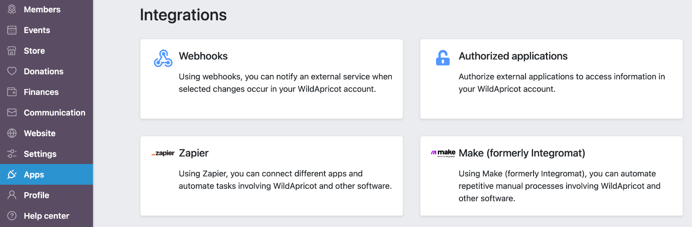
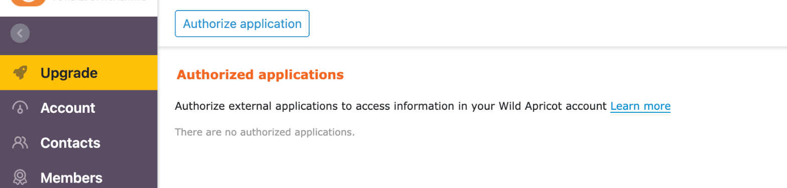
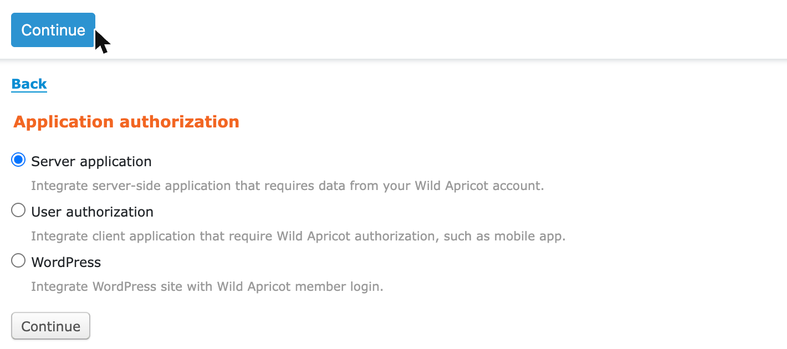
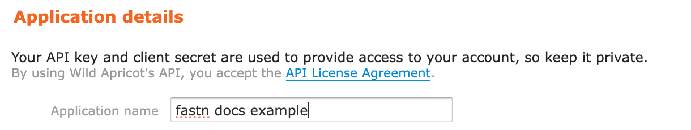
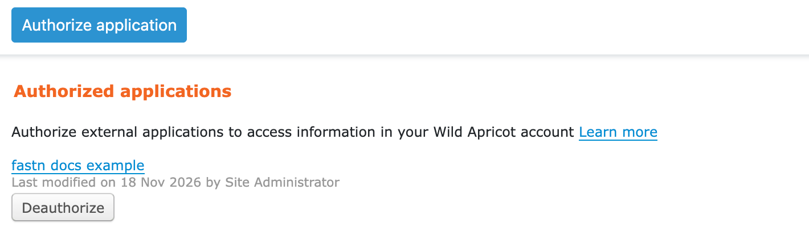
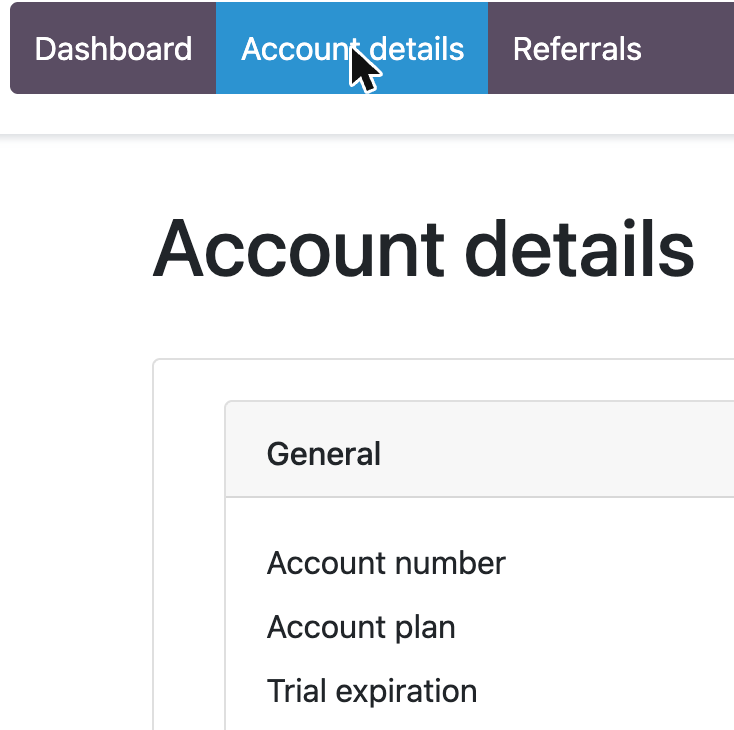

# WildApricot

| | |
| --- | --- |
| **Category** | [CRM and sales](README.md) |
| **Website** | [wildapricot.com](https://wildapricot.com) |
| **Authentication** | OAuth 2.0 |
| **Slug** | `wildApricot` |

## Setup guide
This guide shows you how to get the WildApricot account ID and API key that fastn uses to connect to a WildApricot account, and how to start workflows from WildApricot events.

### Before you start
- You need the Owner, Admin or Developer role in fastn.
- You need a WildApricot account. Only a full account administrator can authorize an external application in WildApricot.

### Get your WildApricot credentials
fastn connects to WildApricot with an API key from an authorized server application. When you connect, you enter three values: `accountId`, `clientId` and `clientSecret`.

1. Sign in to the WildApricot admin view as a full account administrator.
2. In the left menu, select **Apps**, scroll to **Integrations** and open **Authorized applications**.

<figure><figcaption>
The Integrations section of the Apps page, with Authorized applications
</figcaption></figure>

3. Click **Authorize application**.

<figure><figcaption>
The Authorized applications page with the Authorize application button
</figcaption></figure>

4. Choose **Server application**, then click **Continue**. This is the option for apps that read and write data without a person signing in.

<figure><figcaption>
Server application selected on the Application authorization page
</figcaption></figure>

5. In **Application name**, give the application a name.

<figure><figcaption>
The Application name field on the Application details page
</figcaption></figure>

6. Under the **API key**, change the access level from **Read only** (the default) to **Full access** if your workflows need to create or update records. With **Read only**, the app cannot add to or change your WildApricot data.

<figure><figcaption>
Full access selected for the API key
</figcaption></figure>

7. Copy the **API key** shown on the page, then click **Save**. The key works only after the authorization is saved, and the application then appears in the **Authorized applications** list.

<figure><figcaption>
The saved application in the Authorized applications list
</figcaption></figure>

8. Find your numeric account ID: select **Account** in the left menu, open the **Account details** tab, and copy the **Account number** under **General**.

<figure><figcaption>
The Account number in the General section of Account details
</figcaption></figure>

9. In fastn, enter the values as follows:
   - **accountId**: your numeric WildApricot account ID.
   - **clientId**: leave this as `APIKEY`. WildApricot uses this literal value as the client ID for API key integrations.
   - **clientSecret**: the API key you copied in step 7.

### Connect in fastn
Your customers enter these values when they connect WildApricot in your widget, or you enter them under **Build** > **Integrations** > **Connectors** > **WildApricot**. fastn exchanges the API key for an access token with WildApricot, so there is no redirect or sign-in screen.

### Events
fastn supports these WildApricot events: Contact, Membership, MembershipLevel, MembershipRenewed, Event, EventRegistration, Invoice, Payment, Refund and LoggedEmail. To start a workflow from one, add an App event trigger under **Build** > **Integrations** > **Triggers** > **Add trigger** > **App events**. See [App events](../../build/triggers/app-events.md).

WildApricot sends these notifications through webhooks that an administrator adds in the admin view under **Apps** > **Integrations** > **Webhooks**, with a target URL, the change types to send, and the **Enable** toggle turned on. Contact fastn support to set up events for WildApricot.

## Actions

<table><thead><tr><th width="240">Action</th><th width="260">Slug</th><th>What it does</th></tr></thead><tbody><tr><td>Accept Terms Of Use</td><td><code>acceptTermsOfUse</code></td><td>Accepts the WildApricot Terms of Use on behalf of the currently signed-in user. Does nothing if already accepted. Requires a token issued for a WildApricot user; API-key tokens receive 403.</td></tr><tr><td>Allocate Invoice To Payment</td><td><code>allocateInvoiceToPayment</code></td><td>Allocates a WildApricot invoice, in whole or in part, to a payment so that the invoice is settled by that payment.</td></tr><tr><td>Allocate Refund To Donation</td><td><code>allocateRefundToDonation</code></td><td>Allocates a WildApricot refund against a donation, recording that the refund returns money given as that donation. The path identifier is the donation's payment document ID (the Payment.Id on the donation), not the donation's own ID.</td></tr><tr><td>Allocate Refund To Payment</td><td><code>allocateRefundToPayment</code></td><td>Allocates a WildApricot refund to a payment, recording that the refund returns money taken by that payment.</td></tr><tr><td>Approve Pending Membership</td><td><code>approvePendingMembership</code></td><td>Approves a contact's pending membership application in WildApricot. Only allowed when the contact's extended membership info lists ApprovePendingMembership among its allowed actions; otherwise WildApricot</td></tr><tr><td>Check In Event Attendee</td><td><code>checkInEventAttendee</code></td><td>Checks a WildApricot event registrant in or out at the door. For registrations carrying anonymous guests, the number of guests checked in can also be recorded.</td></tr><tr><td>Clone Event</td><td><code>cloneEvent</code></td><td>Duplicates an existing WildApricot event, copying its settings and registration types into a new event whose title can be given a prefix.</td></tr><tr><td>Count Unique Email Draft Recipients</td><td><code>countUniqueEmailDraftRecipients</code></td><td>Returns how many unique email addresses a WildApricot email draft would reach, so the audience size can be checked before sending. The published OpenAPI document specifies a bare integer request body, but the live endpoint rejects a bare integer with HTTP 400 and only accepts a JSON object, so the connector sends the draft identifier as an object in the same shape the other email-draft operations use.</td></tr><tr><td>Count Unique Email Recipients</td><td><code>countUniqueEmailRecipients</code></td><td>Returns how many unique email addresses a given WildApricot recipient selection resolves to, so the audience size of an email can be checked before it is composed.</td></tr><tr><td>Create CEU Record</td><td><code>createCeuRecord</code></td><td>Creates a continuing education unit (CEU) record in WildApricot for a contact, recording the activity, the credits earned and the period the credits cover.</td></tr></tbody></table>

View 113 more actions

<table><thead><tr><th width="240">Action</th><th width="260">Slug</th><th>What it does</th></tr></thead><tbody><tr><td>Create Contact</td><td><code>createContact</code></td><td>Creates a new contact or member record in WildApricot. Provide first name, last name and email (must be unique in the account); optionally a membership level, membership status and field values. Note that WildApricot ignores the top-level Organization property on create - set organization, phone, notes and other fields through Field Values using their System Code (for example Organization, Phone, Notes).</td></tr><tr><td>Create Contact Field</td><td><code>createContactField</code></td><td>Creates a new custom contact or membership field in WildApricot and returns the new field ID. Field name must be unique; choice fields take their options from Allowed Values.</td></tr><tr><td>Create Donation</td><td><code>createDonation</code></td><td>Records a donation in WildApricot and returns the new donation ID. Link it to a contact, or supply the donor's name and email for an anonymous donation, and set values for any custom donation fields.</td></tr><tr><td>Create Donation Field</td><td><code>createDonationField</code></td><td>Creates a new custom donation field in WildApricot and returns the new field ID. Field name and field type are required; choice fields take their options from Allowed Values.</td></tr><tr><td>Create Event</td><td><code>createEvent</code></td><td>Creates a new event in WildApricot and returns the new event ID. Name, event type and start date are required; registration, location, tags, sessions and extended details are optional.</td></tr><tr><td>Create Event Registration</td><td><code>createEventRegistration</code></td><td>Registers a contact for a WildApricot event. The event, the contact and the registration type are required. Optionally create the entry on the waitlist, supply registration field values, or add a memo.</td></tr><tr><td>Create Event Registration Type</td><td><code>createEventRegistrationType</code></td><td>Creates a new registration type (ticket type) for a WildApricot event and returns its ID. The event ID is required; price, availability, membership level restrictions, guest policy and waitlist behaviour are optional.</td></tr><tr><td>Create Invoice</td><td><code>createInvoice</code></td><td>Creates a manual invoice in WildApricot for a contact and returns the new invoice ID. The contact is required; supply one or more order lines to give the invoice a value.</td></tr><tr><td>Create Payment</td><td><code>createPayment</code></td><td>Records a payment in WildApricot against a contact and returns the created payment. The contact is required; supply invoice identifiers to settle those invoices with this payment.</td></tr><tr><td>Create Refund</td><td><code>createRefund</code></td><td>Records a refund in WildApricot for a contact. The contact is required and the amount must be negative; WildApricot rejects a positive value with 'Value should be less than zero'.</td></tr><tr><td>Create Store Product</td><td><code>createStoreProduct</code></td><td>Creates a product in the WildApricot online store. A title and a regular price are required; inventory tracking, options, variants and digital or e-course delivery can all be configured.</td></tr><tr><td>Create Tender</td><td><code>createTender</code></td><td>Creates a custom payment type (tender) in WildApricot, for example Cash or Cheque, so that manual payments can be recorded against it. The name is required.</td></tr><tr><td>Delete CEU Record</td><td><code>deleteCeuRecord</code></td><td>Permanently deletes a WildApricot continuing education unit (CEU) record by ID.</td></tr><tr><td>Delete Contact</td><td><code>deleteContact</code></td><td>Permanently deletes a WildApricot contact. Only archived contacts can be deleted; archive the contact first with Update Contact (IsArchived = true).</td></tr><tr><td>Delete Contact Field</td><td><code>deleteContactField</code></td><td>Deletes a custom contact or membership field definition from WildApricot by ID. System fields cannot be deleted.</td></tr><tr><td>Delete Donation Field</td><td><code>deleteDonationField</code></td><td>Deletes a custom donation field definition from WildApricot by ID. System donation fields cannot be deleted.</td></tr><tr><td>Delete Email Draft</td><td><code>deleteEmailDraft</code></td><td>Deletes a WildApricot email draft by ID. A scheduled draft is cancelled as well as deleted.</td></tr><tr><td>Delete Event</td><td><code>deleteEvent</code></td><td>Permanently deletes a WildApricot event together with its registration types and registrations.</td></tr><tr><td>Delete Event Registration</td><td><code>deleteEventRegistration</code></td><td>Deletes a WildApricot event registration, removing the registrant from the event.</td></tr><tr><td>Delete Event Registration Type</td><td><code>deleteEventRegistrationType</code></td><td>Deletes a registration type (ticket type) from a WildApricot event. A registration type that already has registrations cannot be deleted.</td></tr><tr><td>Delete Invoice</td><td><code>deleteInvoice</code></td><td>Permanently deletes a WildApricot invoice. Use Void Invoice instead when the invoice must remain on the financial record.</td></tr><tr><td>Delete Payment</td><td><code>deletePayment</code></td><td>Permanently deletes a WildApricot payment record and releases any invoices it had settled.</td></tr><tr><td>Delete Refund</td><td><code>deleteRefund</code></td><td>Permanently deletes a WildApricot refund record and releases any allocations it had.</td></tr><tr><td>Delete Store Product</td><td><code>deleteStoreProduct</code></td><td>Deletes a product from the WildApricot online store by its product ID.</td></tr><tr><td>Delete Store Product By Source</td><td><code>deleteStoreProductBySource</code></td><td>Deletes a WildApricot online store product matched by its external source reference ID rather than by its WildApricot product ID.</td></tr><tr><td>Delete Tender</td><td><code>deleteTender</code></td><td>Deletes a custom WildApricot payment type (tender). Built-in gateway tenders and tenders already used by payments cannot be deleted.</td></tr><tr><td>Generate Invoice For Event Registration</td><td><code>generateInvoiceForEventRegistration</code></td><td>Generates the invoice for a WildApricot event registration, or updates the existing one when Update If Exists is set.</td></tr><tr><td>Generate Invoice For Pending Membership</td><td><code>generateInvoiceForPendingMembership</code></td><td>Generates, or optionally updates, the invoice for a contact's pending membership application in WildApricot. Only allowed when the contact's allowed membership actions include GenerateInvoiceForPendingMembership.</td></tr><tr><td>Get Account</td><td><code>getAccount</code></td><td>Retrieves the connected WildApricot account: its ID, name, primary domain, contact limit, currency, time zone, localization settings and the API resources available to it.</td></tr><tr><td>Get Attachment Content</td><td><code>getAttachmentContent</code></td><td>Downloads the content of a WildApricot file attachment. For image attachments a resized variant can be requested, and the content can be returned Base64 encoded.</td></tr><tr><td>Get Attachment Infos</td><td><code>getAttachmentInfos</code></td><td>Retrieves metadata for one or more WildApricot file attachments by their identifiers, including file name, size and content type.</td></tr><tr><td>Get Audit Log Item</td><td><code>getAuditLogItem</code></td><td>Retrieves a single WildApricot audit log entry by ID, including what changed, when, and which contact or administrator initiated it.</td></tr><tr><td>Get CEU Record</td><td><code>getCeuRecord</code></td><td>Retrieves a single WildApricot continuing education unit (CEU) record by ID, including the contact, activity, credits earned and validity dates.</td></tr><tr><td>Get Contact</td><td><code>getContact</code></td><td>Retrieves a single WildApricot contact or member by ID, including membership level and status and all field values. Optionally includes extended membership information such as allowed membership actions and pending invoice.</td></tr><tr><td>Get Current Contact</td><td><code>getCurrentContact</code></td><td>Retrieves the contact record of the user the access token was issued for. Only available when the token represents a signed-in WildApricot user; API-key tokens are not tied to a contact and receive 403.</td></tr><tr><td>Get Donation</td><td><code>getDonation</code></td><td>Retrieves a single WildApricot donation by ID, including the amount, date, donor details, related payment and any custom donation field values.</td></tr><tr><td>Get Email Draft</td><td><code>getEmailDraft</code></td><td>Retrieves a single WildApricot email draft by ID, including its subject, body, sender, recipient selection and delivery schedule.</td></tr><tr><td>Get Email Draft Preview</td><td><code>getEmailDraftPreview</code></td><td>Returns a rendered preview of a WildApricot email draft, with macros resolved, so the message can be checked before it is sent.</td></tr><tr><td>Get Event</td><td><code>getEvent</code></td><td>Retrieves full details of a single WildApricot event by ID, including schedule, location, registration settings, tags, sessions and registration counts.</td></tr><tr><td>Get Event Registration</td><td><code>getEventRegistration</code></td><td>Retrieves a single WildApricot event registration by ID, including the event, registrant, registration type, fee, payment status, check-in state and registration field values.</td></tr><tr><td>Get Event Registration Type</td><td><code>getEventRegistrationType</code></td><td>Retrieves a single WildApricot event registration type (ticket type) by ID, including its price, availability, restrictions and cancellation policy.</td></tr><tr><td>Get Feature Availability</td><td><code>getFeatureAvailability</code></td><td>Checks whether a specific WildApricot feature is available for the connected account. WildApricot reserves this for internal use and returns Allowed true for any unknown feature ID.</td></tr><tr><td>Get Invoice</td><td><code>getInvoice</code></td><td>Retrieves a single WildApricot invoice by ID, including its number, total, paid amount, order lines, taxes, memo and the contact it was raised for.</td></tr><tr><td>Get Member Group</td><td><code>getMemberGroup</code></td><td>Retrieves a WildApricot ad hoc member group by ID with its name, description and the IDs of contacts in the group.</td></tr><tr><td>Get Membership Bundle</td><td><code>getMembershipBundle</code></td><td>Retrieves a single WildApricot membership bundle by ID, including its administrator, membership level, participants and member limit.</td></tr><tr><td>Get Membership Level</td><td><code>getMembershipLevel</code></td><td>Retrieves a single WildApricot membership level by ID, including fee, level type, bundle size, renewal period and application review settings.</td></tr><tr><td>Get Payment</td><td><code>getPayment</code></td><td>Retrieves a single WildApricot payment by ID, including its amount, tender, payer, allocation and refund totals and payment progress.</td></tr><tr><td>Get Picture Content</td><td><code>getPictureContent</code></td><td>Downloads a picture stored in WildApricot by its picture ID. A full size version can be requested, and the image can be returned Base64 encoded.</td></tr><tr><td>Get Refund</td><td><code>getRefund</code></td><td>Retrieves a single WildApricot refund by ID, including its amount, settled amount, tender, recipient and comments.</td></tr><tr><td>Get Saved Search</td><td><code>getSavedSearch</code></td><td>Retrieves a WildApricot saved search and the IDs of the contacts it currently finds, optionally excluding archived contacts or narrowing the result with an additional filter.</td></tr><tr><td>Get Sent Email</td><td><code>getSentEmail</code></td><td>Retrieves a single entry from the WildApricot email log by ID, including the message subject, body, sender, type and delivery statistics.</td></tr><tr><td>Get Store Order</td><td><code>getStoreOrder</code></td><td>Retrieves a single WildApricot online store order by its order number, including the buyer, the ordered items, totals, shipping address and related invoice.</td></tr><tr><td>Get Store Product</td><td><code>getStoreProduct</code></td><td>Retrieves a single WildApricot online store product by ID, including its price, stock, options, variants and digital or e-course details.</td></tr><tr><td>Get Tender</td><td><code>getTender</code></td><td>Retrieves a single WildApricot payment type (tender) by ID, including its name, display position and whether it is a custom tender.</td></tr><tr><td>Get Unique Email Draft Recipient Addresses</td><td><code>getUniqueEmailDraftRecipientAddresses</code></td><td>Returns the list of unique email addresses a WildApricot email draft would reach, so the audience can be inspected before sending. The published OpenAPI document specifies a bare integer request body, but the live endpoint rejects a bare integer with HTTP 400 and only accepts a JSON object, so the connector sends the draft identifier as an object in the same shape the other email-draft operations use.</td></tr><tr><td>Get Unique Email Recipient Addresses</td><td><code>getUniqueEmailRecipientAddresses</code></td><td>Returns the distinct email addresses a given WildApricot recipient selection resolves to, so the audience of an email can be reviewed before it is composed.</td></tr><tr><td>List Accounts</td><td><code>listAccounts</code></td><td>Lists the WildApricot accounts available to the current access token. Typically this returns a single account with its ID, name, primary domain, currency, time zone and available API resources.</td></tr><tr><td>List API Resources</td><td><code>listApiResources</code></td><td>Lists the top-level WildApricot API resources that can be reached directly without an account ID, with their URLs and allowed HTTP operations.</td></tr><tr><td>List Audit Log Items</td><td><code>listAuditLogItems</code></td><td>Lists WildApricot audit log entries recording changes made to contacts, events, registrations and financial documents. Narrow the result to an object type, a specific object or a date range.</td></tr><tr><td>List CEU Records</td><td><code>listCeuRecords</code></td><td>Lists the continuing education unit (CEU) records held in WildApricot, optionally restricted to one contact or to specific record identifiers.</td></tr><tr><td>List Contact Fields</td><td><code>listContactFields</code></td><td>Lists all contact and membership field definitions in the WildApricot account, both system fields and administrator-defined custom fields, with their type, access level, allowed values and system code.</td></tr><tr><td>List Contacts</td><td><code>listContacts</code></td><td>Searches contacts and members in the WildApricot account. Set $async to false for an immediate list of contacts; with the default asynchronous mode WildApricot returns a ResultId that you pass back as resultId to fetch the finished result. Supports filtering, field selection, sorting, simple text search, paging, counting and IDs-only results.</td></tr><tr><td>List Donation Fields</td><td><code>listDonationFields</code></td><td>Lists the donation field definitions in the WildApricot account, both system fields and administrator-defined custom fields, with their type, display type, allowed values and system code.</td></tr><tr><td>List Donations</td><td><code>listDonations</code></td><td>Lists WildApricot donations. A start date and an end date are required to bound the search; paging, count-only and IDs-only results are supported.</td></tr><tr><td>List Email Drafts</td><td><code>listEmailDrafts</code></td><td>Lists the email drafts saved in the WildApricot account, including scheduled drafts, with their subject, sender, schedule and recipient selection.</td></tr><tr><td>List Event Registration Types</td><td><code>listEventRegistrationTypes</code></td><td>Lists the registration types (ticket types) defined for a WildApricot event, with their price, availability window, membership level restrictions, guest policy and waitlist settings.</td></tr><tr><td>List Event Registrations</td><td><code>listEventRegistrations</code></td><td>Lists WildApricot event registrations for a specific event or contact. At least one of Event ID or Contact ID must be supplied. Waitlist entries and cancelled registrations can be included, and registration field values can be returned with each record.</td></tr><tr><td>List Events</td><td><code>listEvents</code></td><td>Lists events in the WildApricot account. Supports filtering by name, tags, start and end date or upcoming status, sorting, paging, count-only and IDs-only results. Set $async to false to receive the events directly instead of a ResultId.</td></tr><tr><td>List Invoices</td><td><code>listInvoices</code></td><td>Lists WildApricot invoices, optionally narrowed to a contact, an event, an event registration or a date range, and filtered to unpaid or paid invoices only. Voided invoices are excluded unless explicitly included.</td></tr><tr><td>List Member Groups</td><td><code>listMemberGroups</code></td><td>Lists the ad hoc member groups in WildApricot with their name, description and contact count. Supports paging, count-only, IDs-only and filtering by group IDs.</td></tr><tr><td>List Membership Bundles</td><td><code>listMembershipBundles</code></td><td>Lists membership bundles (group memberships such as corporate or family memberships) for a given bundle membership level, with their administrator, members and size limit.</td></tr><tr><td>List Membership Levels</td><td><code>listMembershipLevels</code></td><td>Lists the membership levels configured in WildApricot, including fee, type (individual or bundle), renewal period and application review settings. Supports paging, count-only, IDs-only and filtering by level IDs.</td></tr><tr><td>List Payment Allocations</td><td><code>listPaymentAllocations</code></td><td>Lists how WildApricot payments are allocated among invoices and refunds. Supply an invoice, payment or refund identifier to scope the result; a single payment can settle several invoices and a single invoice can be settled by several payments.</td></tr><tr><td>List Payments</td><td><code>listPayments</code></td><td>Lists WildApricot payments, optionally narrowed to a contact, an event, a date range, specific payment identifiers, a payment type or unsettled payments only.</td></tr><tr><td>List Refunds</td><td><code>listRefunds</code></td><td>Lists WildApricot refunds, optionally narrowed to a contact, an event, a date range, specific refund identifiers or unsettled refunds only.</td></tr><tr><td>List Saved Searches</td><td><code>listSavedSearches</code></td><td>Lists the saved contact searches defined in the WildApricot admin view, with optional paging, count-only and IDs-only results.</td></tr><tr><td>List Sent Email Recipients</td><td><code>listSentEmailRecipients</code></td><td>Lists the recipients of a logged WildApricot email, optionally restricted to those who did or did not receive or open it, and optionally including the links each recipient clicked.</td></tr><tr><td>List Sent Emails</td><td><code>listSentEmails</code></td><td>Lists entries from the WildApricot email log, showing the emails the system has sent with their subject, sender, recipient counts and delivery statistics. Supports filtering by sent date and email type.</td></tr><tr><td>List Store Orders</td><td><code>listStoreOrders</code></td><td>Lists orders placed in the WildApricot online store, optionally filtered by fulfilment status, payment status or a date range.</td></tr><tr><td>List Store Products</td><td><code>listStoreProducts</code></td><td>Lists the products in the WildApricot online store, optionally filtered by specific identifiers or by the external source a product was imported from.</td></tr><tr><td>List Tenders</td><td><code>listTenders</code></td><td>Lists the payment types (tenders) configured in the WildApricot account, both the built-in gateway tenders and any custom ones added by an administrator.</td></tr><tr><td>Register From Waitlist</td><td><code>registerFromWaitlist</code></td><td>Promotes a WildApricot event waitlist entry into a confirmed registration, optionally generating the invoice for the newly confirmed registrant.</td></tr><tr><td>Reject Pending Membership</td><td><code>rejectPendingMembership</code></td><td>Rejects a contact's pending membership application in WildApricot. Only allowed when the contact's extended membership info lists RejectPendingMembership among its allowed actions; otherwise WildApricot</td></tr><tr><td>Send Email</td><td><code>sendEmail</code></td><td>Composes and sends a new email to WildApricot contacts, members, event attendees or a saved search, and returns the identifier of the resulting email log entry. The message is delivered immediately to real recipients.</td></tr><tr><td>Send Email Draft</td><td><code>sendEmailDraft</code></td><td>Sends a saved WildApricot email draft immediately to the recipients selected on the draft. The message is delivered to real recipients.</td></tr><tr><td>Send Invoice Email</td><td><code>sendInvoiceEmail</code></td><td>Emails a WildApricot invoice to a recipient using the supplied subject and body. The address, subject and body are all required by WildApricot; macros such as {Invoice_Number} and {Contact_FullName} are expanded. The message is delivered to a real recipient. Returns the identifier of the email log entry.</td></tr><tr><td>Send Payment Email</td><td><code>sendPaymentEmail</code></td><td>Emails a payment receipt for a WildApricot payment to a recipient using the supplied subject and body. The address, subject and body are all required by WildApricot; macros such as {Payment_Amount} and {Contact_FullName} are expanded. The message is delivered to a real recipient. Returns the identifier of the email log entry.</td></tr><tr><td>Send Refund Email</td><td><code>sendRefundEmail</code></td><td>Emails a refund notification for a WildApricot refund to a recipient using the supplied subject and body. The address, subject and body are all required by WildApricot; macros such as {Refund_Amount} and {Contact_FullName} are expanded. The message is delivered to a real recipient. Returns the identifier of the email log entry.</td></tr><tr><td>Send Two-Factor Code</td><td><code>sendTwoFactorCode</code></td><td>Sends a two-factor authentication code to the currently signed-in WildApricot user by email or SMS. Requires a token issued for a WildApricot user; API-key tokens receive 403.</td></tr><tr><td>Set Email Draft Schedule</td><td><code>setEmailDraftSchedule</code></td><td>Schedules a WildApricot email draft for delivery at a given date and time, or pauses a scheduled draft by clearing the scheduled flag.</td></tr><tr><td>Set Store Order Status</td><td><code>setStoreOrderStatus</code></td><td>Sets the fulfilment status of a WildApricot online store order, marking it fulfilled, unfulfilled or cancelled.</td></tr><tr><td>Unallocate Document From Donation</td><td><code>unallocateFromDonation</code></td><td>Removes a previously allocated finance document from a WildApricot donation, releasing the allocated amount. The path identifier is the donation's payment document ID (the Payment.Id on the donation), not the donation's own ID.</td></tr><tr><td>Unallocate Document From Payment</td><td><code>unallocateFromPayment</code></td><td>Removes a previously allocated invoice or refund from a WildApricot payment, releasing the allocated amount.</td></tr><tr><td>Update CEU Record</td><td><code>updateCeuRecord</code></td><td>Updates a WildApricot continuing education unit (CEU) record identified by its record ID.</td></tr><tr><td>Update CEU Record By External ID</td><td><code>updateCeuRecordByExternalId</code></td><td>Updates a WildApricot continuing education unit (CEU) record matched by its external source type and reference ID rather than by its WildApricot record ID. Useful when syncing CEU credits from a learning management system.</td></tr><tr><td>Update Contact</td><td><code>updateContact</code></td><td>Updates an existing WildApricot contact or member. Send only the fields you want to change. Organization, Phone and every custom field are set through Field Values by system code, not as top-level properties; to archive a contact set the IsArchived system field to true in Field Values.</td></tr><tr><td>Update Contact Field</td><td><code>updateContactField</code></td><td>Updates an existing custom contact or membership field definition in WildApricot. The field type cannot be changed, and a contact field cannot be converted into a membership field or vice versa.</td></tr><tr><td>Update Donation</td><td><code>updateDonation</code></td><td>Updates an existing WildApricot donation, for example to correct its amount, date, donor details, comments or custom field values.</td></tr><tr><td>Update Donation Field</td><td><code>updateDonationField</code></td><td>Updates an existing custom donation field definition in WildApricot. The field type cannot be changed after creation.</td></tr><tr><td>Update Event</td><td><code>updateEvent</code></td><td>Updates an existing WildApricot event. Send the event ID in the path and only the fields you want to change; WildApricot requires Id, Name, EventType and StartDate in the body.</td></tr><tr><td>Update Event Registration</td><td><code>updateEventRegistration</code></td><td>Updates an existing WildApricot event registration, for example to change the registration type, edit registration field values, toggle public visibility or amend the memo. WildApricot treats omitted booleans as false on this PUT (an update without IsCheckedIn clears an existing check-in), so resend the values you want to keep; use Check In Event Attendee for check-in changes.</td></tr><tr><td>Update Event Registration Type</td><td><code>updateEventRegistrationType</code></td><td>Updates an existing WildApricot event registration type (ticket type). WildApricot requires the registration type ID and the owning event ID in the body alongside the fields being changed.</td></tr><tr><td>Update Invoice</td><td><code>updateInvoice</code></td><td>Updates an existing WildApricot invoice, for example to amend its memo, date or order lines. Paid or settled invoices may be rejected by WildApricot.</td></tr><tr><td>Update Payment</td><td><code>updatePayment</code></td><td>Updates an existing WildApricot payment, for example to correct its amount, date, tender or comments.</td></tr><tr><td>Update Refund</td><td><code>updateRefund</code></td><td>Updates an existing WildApricot refund, for example to correct its amount, date, tender or comments.</td></tr><tr><td>Update Store Product</td><td><code>updateStoreProduct</code></td><td>Updates a WildApricot online store product identified by its product ID, for example to change its title, price, stock or visibility.</td></tr><tr><td>Update Store Product By Source</td><td><code>updateStoreProductBySource</code></td><td>Updates a WildApricot online store product matched by its external source reference ID rather than by its WildApricot product ID. Useful when syncing a catalogue from an external system.</td></tr><tr><td>Update Tender</td><td><code>updateTender</code></td><td>Updates a custom WildApricot payment type (tender), for example to rename it or change its position in the list. Built-in gateway tenders cannot be changed.</td></tr><tr><td>Upload Attachments</td><td><code>uploadAttachments</code></td><td>Uploads one or more files to WildApricot file attachment storage and returns their attachment identifiers, which can then be set as the value of a file attachment contact field. Pass the files as a JSON array string; each entry carries the file name, MIME type and Base64 encoded data.</td></tr><tr><td>Upload Picture</td><td><code>uploadPicture</code></td><td>Uploads a picture to WildApricot picture storage and returns its picture ID, which must be set as the value of a custom picture contact field within 30 minutes. WildApricot accepts this endpoint only as a multipart/form-data upload.</td></tr><tr><td>Upload Store Product Pictures</td><td><code>uploadStoreProductPictures</code></td><td>Uploads product images to the WildApricot online store and returns their identifiers, which can then be set in the Pictures list of a store product. Pass the images as a JSON array string; each entry carries the file name, MIME type and Base64 encoded data.</td></tr><tr><td>Verify Two-Factor Code</td><td><code>verifyTwoFactorCode</code></td><td>Verifies a two-factor authentication code that was sent to the currently signed-in WildApricot user, returning true when the code is valid. Requires a token issued for a WildApricot user; API-key tokens receive 403.</td></tr><tr><td>Void Invoice</td><td><code>voidInvoice</code></td><td>Voids a WildApricot invoice, cancelling it while keeping it on the financial record. Voided invoices are excluded from List Invoices unless Include Voided is set.</td></tr></tbody></table>

## Events

Start a workflow when one of these happens, with an [app event trigger](../../build/triggers/README.md).

<table><thead><tr><th width="240">Event</th><th width="260">Id</th><th>When it fires</th></tr></thead><tbody><tr><td>Contact Changed</td><td><code>Contact</code></td><td>Fires on any change to any tab of a contact's details, and on any change to contact field settings. SETUP (required, per WildApricot account): in the WildApricot admin view go to Apps &gt; Integrations &gt; Webhooks &gt; Add webhook, enter a name and paste the fastn webhook URL, set Authorization type to None, tick the Contact notification type, turn Enable webhook on and click Save.</td></tr><tr><td>Email Logged</td><td><code>LoggedEmail</code></td><td>Fires when an email is added to the WildApricot email log. Email.EmailType and Email.OriginType are numeric codes documented in the WildApricot webhooks article. SETUP (required, per WildApricot account): in the WildApricot admin view go to Apps &gt; Integrations &gt; Webhooks &gt; Add webhook, enter a name and paste the fastn webhook URL, set Authorization type to None, tick the Logged email letter notification type, turn Enable webhook on and click Save.</td></tr><tr><td>Event Changed</td><td><code>Event</code></td><td>Fires when an event is created, changed or deleted. Changes to registration forms, ticket types and event email settings do not trigger it. SETUP (required, per WildApricot account): in the WildApricot admin view go to Apps &gt; Integrations &gt; Webhooks &gt; Add webhook, enter a name and paste the fastn webhook URL, set Authorization type to None, tick the Event notification type, turn Enable webhook on and click Save.</td></tr><tr><td>Event Registration Changed</td><td><code>EventRegistration</code></td><td>Fires on any change to an event registration, including a new registration, a cancelled registration and an RSVP response. SETUP (required, per WildApricot account): in the WildApricot admin view go to Apps &gt; Integrations &gt; Webhooks &gt; Add webhook, enter a name and paste the fastn webhook URL, set Authorization type to None, tick the Event registration notification type, turn Enable webhook on and click Save.</td></tr><tr><td>Invoice Changed</td><td><code>Invoice</code></td><td>Fires when an invoice is created, modified, voided or deleted. SETUP (required, per WildApricot account): in the WildApricot admin view go to Apps &gt; Integrations &gt; Webhooks &gt; Add webhook, enter a name and paste the fastn webhook URL, set Authorization type to None, tick the Invoice notification type, turn Enable webhook on and click Save.</td></tr><tr><td>Membership Changed</td><td><code>Membership</code></td><td>Fires on any change to a member's membership settings or to membership field settings. Changes to membership level settings do not trigger it. SETUP (required, per WildApricot account): in the WildApricot admin view go to Apps &gt; Integrations &gt; Webhooks &gt; Add webhook, enter a name and paste the fastn webhook URL, set Authorization type to None, tick the Membership notification type, turn Enable webhook on and click Save.</td></tr><tr><td>Membership Level Changed</td><td><code>MembershipLevel</code></td><td>Fires when a membership level is created, deleted, renamed, repriced or has its renewal strategy changed. SETUP (required, per WildApricot account): in the WildApricot admin view go to Apps &gt; Integrations &gt; Webhooks &gt; Add webhook, enter a name and paste the fastn webhook URL, set Authorization type to None, tick the Membership level notification type, turn Enable webhook on and click Save.</td></tr><tr><td>Membership Renewed</td><td><code>MembershipRenewed</code></td><td>Fires when an existing membership is renewed. SETUP (required, per WildApricot account): in the WildApricot admin view go to Apps &gt; Integrations &gt; Webhooks &gt; Add webhook, enter a name and paste the fastn webhook URL, set Authorization type to None, tick the Renewal notification type, turn Enable webhook on and click Save.</td></tr><tr><td>Payment Changed</td><td><code>Payment</code></td><td>Fires when a payment is created, adjusted or cancelled. SETUP (required, per WildApricot account): in the WildApricot admin view go to Apps &gt; Integrations &gt; Webhooks &gt; Add webhook, enter a name and paste the fastn webhook URL, set Authorization type to None, tick the Payment notification type, turn Enable webhook on and click Save.</td></tr><tr><td>Refund Changed</td><td><code>Refund</code></td><td>Fires when a refund is created, adjusted or cancelled. SETUP (required, per WildApricot account): in the WildApricot admin view go to Apps &gt; Integrations &gt; Webhooks &gt; Add webhook, enter a name and paste the fastn webhook URL, set Authorization type to None, tick the Refund notification type, turn Enable webhook on and click Save.</td></tr></tbody></table>
