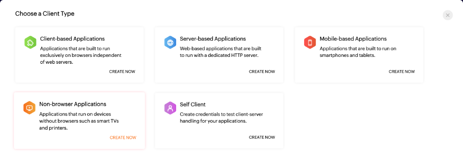
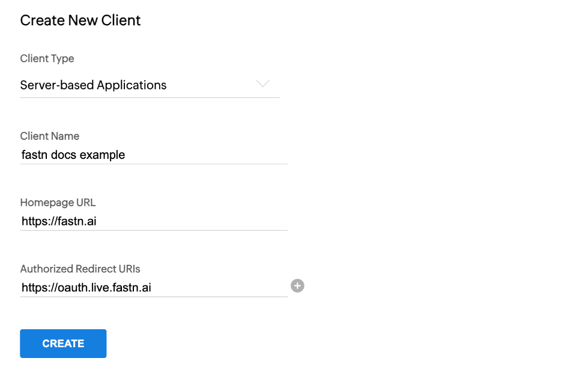
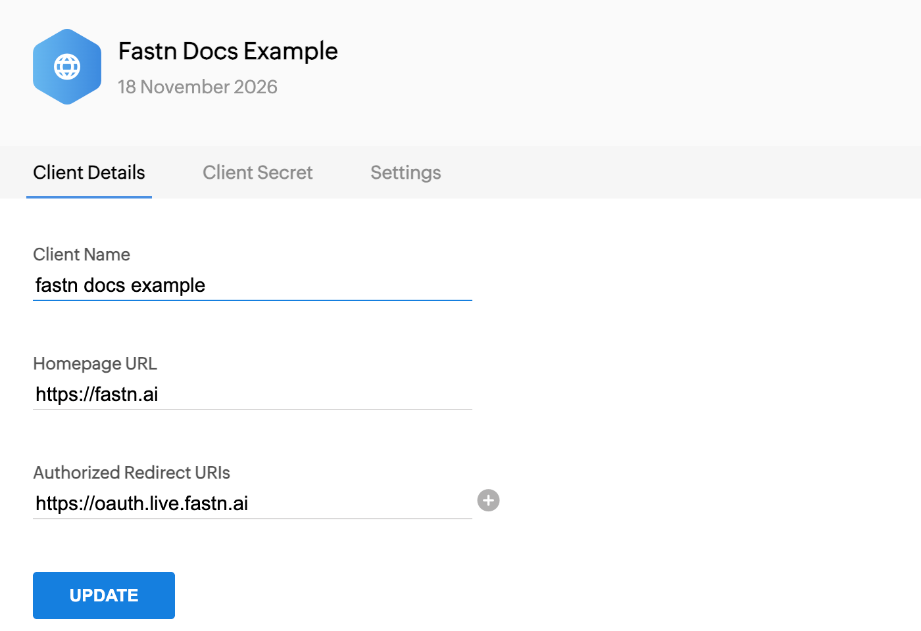
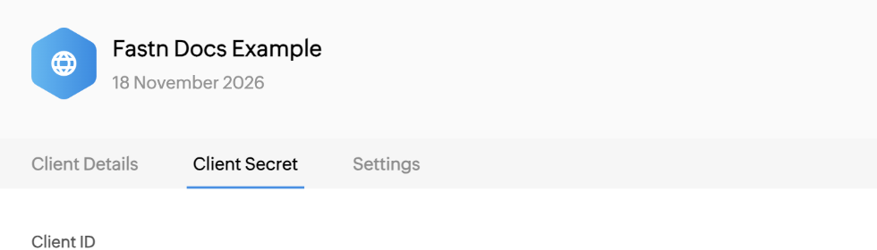

# Zoho CRM

| | |
| --- | --- |
| **Category** | [CRM and sales](README.md) |
| **Website** | [zoho.com](https://zoho.com) |
| **Authentication** | OAuth 2.0 |
| **Slug** | `zohoCrm` |

## Setup guide
This guide shows you how to register your own Zoho CRM OAuth client in the Zoho API Console and add it to fastn, so your customers sign in to Zoho CRM through your app.

### Before you start
- You need the Owner, Admin or Developer role in fastn.
- You need a Zoho account that can sign in to the Zoho API Console at https://api-console.zoho.com/.
- Have fastn's redirect URL ready: `https://oauth.live.fastn.ai`

### Create your Zoho CRM app
1. Go to the Zoho API Console at https://api-console.zoho.com/ and click **GET STARTED** (or **Add Client** if you already have clients).
2. Choose the **Server-based Applications** client type and click **CREATE NOW**.

<figure><figcaption>
Choose Server-based Applications as the client type
</figcaption></figure>

3. Fill in the client details:
   - **Client Name**: a name your customers will recognize, such as your product name.
   - **Homepage URL**: your product's website.
   - **Authorized Redirect URIs**: enter `https://oauth.live.fastn.ai` exactly, with no trailing slash.

<figure><figcaption>
The Create New Client form with the fastn redirect URI
</figcaption></figure>

4. Click **CREATE**. You can check or change the redirect URI later on the client's **Client Details** tab.

<figure><figcaption>
The client's Client Details tab with the authorized redirect URI
</figcaption></figure>

5. Open the **Client Secret** tab and copy the **Client ID** and **Client Secret**. Keep the secret private.

<figure><figcaption>
The Client Secret tab, where the Client ID and Client Secret are shown
</figcaption></figure>

6. Note the scopes fastn requests for Zoho CRM. Zoho takes scopes on the sign-in request, so you add them in fastn in the next section:
   - `ZohoCRM.modules.ALL`
   - `ZohoCRM.settings.ALL`
   - `ZohoCRM.users.ALL`
   - `ZohoCRM.org.ALL`

### Add your app to fastn
1. In fastn, go to **Build → Integrations → Connectors** and open **Zoho CRM**.
2. Open the **Auth** tab and click **Manage providers**.

<figure><figcaption>
Open the connector's Auth tab, then Manage providers.
</figcaption></figure>

3. Click **+ Create Provider**.
4. In the **New Auth Provider** form, enter a **Name** and an optional **Description**, then paste the **Client ID** and **Client Secret** you copied from Zoho.
5. In **Scopes**, add `ZohoCRM.modules.ALL`, `ZohoCRM.settings.ALL`, `ZohoCRM.users.ALL` and `ZohoCRM.org.ALL`.

<figure><figcaption>
The New Auth Provider form: paste your app's Client ID and Client Secret.
</figcaption></figure>

6. Save the provider, then choose **Use this app** so it becomes the Preferred app.
7. In your widget, set the Zoho CRM connector's **Auth provider** setting to your app instead of **Use platform default**.

Customers who connect without your own app sign in through fastn's shared Zoho CRM app.

## Actions

<table><thead><tr><th width="240">Action</th><th width="260">Slug</th><th>What it does</th></tr></thead><tbody><tr><td>Create Account</td><td><code>createAccount</code></td><td>Create an Account record. Account_Name is required; all other fields optional and omitted from the request when not supplied.</td></tr><tr><td>Create Contact</td><td><code>createContact</code></td><td>Create a Contact record. Last_Name is required; all other fields optional and omitted when not supplied.</td></tr><tr><td>Create Deal</td><td><code>createDeal</code></td><td>Create a Deal record. Deal_Name and Stage are required; all other fields optional and omitted when not supplied.</td></tr><tr><td>Create Lead</td><td><code>createLead</code></td><td>Create a Lead record. Last_Name and Company are required; all other fields optional and omitted when not supplied.</td></tr><tr><td>Create Note</td><td><code>createNote</code></td><td>Create a Note record. Pass a 'record' object (Note_Title, Note_Content, Parent_Id, se_module). To attach to a record set Parent_Id + se_module (Leads/Accounts/Contacts/Deals).</td></tr><tr><td>Create Task</td><td><code>createTask</code></td><td>Create a Task record. Subject is required; all other fields optional and omitted when not supplied.</td></tr><tr><td>Delete Account</td><td><code>deleteAccount</code></td><td>Delete an Account by ID.</td></tr><tr><td>Delete Contact</td><td><code>deleteContact</code></td><td>Delete a Contact by ID.</td></tr><tr><td>Delete Deal</td><td><code>deleteDeal</code></td><td>Delete a Deal by ID.</td></tr><tr><td>Delete Lead</td><td><code>deleteLead</code></td><td>Delete a Lead by ID.</td></tr></tbody></table>

View 18 more actions

<table><thead><tr><th width="240">Action</th><th width="260">Slug</th><th>What it does</th></tr></thead><tbody><tr><td>Delete Note</td><td><code>deleteNote</code></td><td>Delete a Note by ID.</td></tr><tr><td>Delete Task</td><td><code>deleteTask</code></td><td>Delete a Task by ID.</td></tr><tr><td>Get Record</td><td><code>getRecord</code></td><td>Retrieve a single record by id from any Zoho CRM module, such as Leads, Contacts, Accounts, Deals, Tasks or Notes.</td></tr><tr><td>Get Users</td><td><code>getUsers</code></td><td>List org users. Pass type = AllUsers, ActiveUsers, DeactiveUsers, etc.</td></tr><tr><td>List Accounts</td><td><code>listAccounts</code></td><td>List Account records with pagination.</td></tr><tr><td>List Contacts</td><td><code>listContacts</code></td><td>List Contact records with pagination.</td></tr><tr><td>List Deals</td><td><code>listDeals</code></td><td>List Deal records with pagination.</td></tr><tr><td>List Leads</td><td><code>listLeads</code></td><td>List Lead records. Returns a page of records with pagination info.</td></tr><tr><td>List Modules</td><td><code>listModules</code></td><td>List all modules available in the Zoho CRM org (metadata).</td></tr><tr><td>List Notes</td><td><code>listNotes</code></td><td>List Note records with pagination.</td></tr><tr><td>List Tasks</td><td><code>listTasks</code></td><td>List Task records with pagination.</td></tr><tr><td>Search Records</td><td><code>searchRecords</code></td><td>Search records in a Zoho CRM module by criteria, email address, phone number or a free-text word. Exactly one of criteria, email, phone or word must be supplied.</td></tr><tr><td>Update Account</td><td><code>updateAccount</code></td><td>Update an Account by ID. Only the fields you supply are sent, so this is a partial update.</td></tr><tr><td>Update Contact</td><td><code>updateContact</code></td><td>Update a Contact by ID. Only the fields you supply are sent, so this is a partial update.</td></tr><tr><td>Update Deal</td><td><code>updateDeal</code></td><td>Update a Deal by ID. Only the fields you supply are sent, so this is a partial update.</td></tr><tr><td>Update Lead</td><td><code>updateLead</code></td><td>Update a Lead by ID. Only the fields you supply are sent, so this is a partial update.</td></tr><tr><td>Update Note</td><td><code>updateNote</code></td><td>Update a Note by ID. Only the fields you supply are sent, so this is a partial update.</td></tr><tr><td>Update Task</td><td><code>updateTask</code></td><td>Update a Task by ID. Only the fields you supply are sent, so this is a partial update.</td></tr></tbody></table>

## Events

Zoho CRM has no events, so it can't start a workflow by itself. Use its actions in a workflow that another [trigger](../../build/triggers/README.md) starts, such as a schedule or a webhook.
