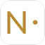

# Nobel Prize API

| | |
| --- | --- |
| **Category** | [Data and databases](README.md) |
| **Website** | [nobelprize.org](https://nobelprize.org) |
| **Authentication** | No sign-in needed |
| **Slug** | `nobelPrizeApi` |

## Setup

Nobel Prize API needs no sign-in, so there is nothing to set up. Add it and use its actions.

## Connect in Fastn

Your customers connect Nobel Prize API from your widget. To connect an account yourself:

1. Go to **Build → Integrations → Connectors** and search for **Nobel Prize API**.
2. Select **Connect** on the Nobel Prize API card.

   <figure><figcaption>
Search for the connector, then select Connect on its card. ServiceNow is shown here.
</figcaption></figure>

3. Nobel Prize API needs no credentials. Select **Connect** in the dialog that opens.

4. Check that the connection appears under **Operate → Connections** with the status `Active`. Your workflows can now use Nobel Prize API's actions.

For more detail, see [Connect an app](../../build/connectors/connect-an-app.md).

## Actions

<table><thead><tr><th width="240">Action</th><th width="260">Slug</th><th>What it does</th></tr></thead><tbody><tr><td>Get Laureate</td><td><code>getLaureate</code></td><td>Obtain information about an specific Nobel Prize Laureate. Used as unique identifier. Docs: https://www.nobelprize.org/about/developer-zone-2/ (OpenAPI https://app.swaggerhub.com/apis/NobelMedia/NobelMasterData/2.1)</td></tr><tr><td>Get Nobel Prize</td><td><code>getNobelPrize</code></td><td>Obtain information about one specific Nobel Prize. Used as unique identifier for links. Docs: https://www.nobelprize.org/about/developer-zone-2/ (OpenAPI https://app.swaggerhub.com/apis/NobelMedia/NobelMasterData/2.1)</td></tr><tr><td>List Laureates</td><td><code>listLaureates</code></td><td>Obtain information about Nobel Prize Laureates (persons and organizations) and their Nobel Prize(s), or search for a set of Laureates. Returns full information about the Laureates and Prizes. Docs: https://www.nobelprize.org/about/developer-zone-2/ (OpenAPI https://app.swaggerhub.com/apis/NobelMedia/NobelMasterData/2.1)</td></tr><tr><td>List Nobel Prizes</td><td><code>listNobelPrizes</code></td><td>Obtain information about all Nobel Prizes or search for a specific set of Nobel Prizes. Note that not all information about the Laureates are provided in the output, as a request of making this endpoints response lighter. Call the laureates endpoint for full information. Docs: https://www.nobelprize.org/about/developer-zone-2/ (OpenAPI https://app.swaggerhub.com/apis/NobelMedia/NobelMasterData/2.1)</td></tr></tbody></table>

