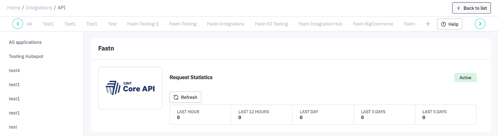
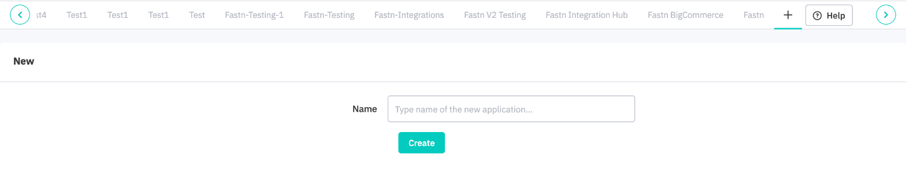
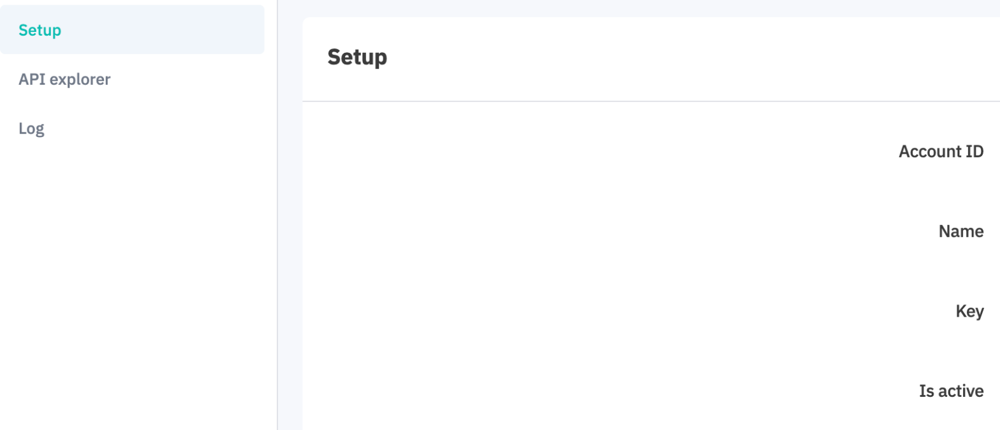

# Cin7 Core

| | |
| --- | --- |
| **Category** | [E-commerce](README.md) |
| **Website** | [dearsystems.com](https://dearsystems.com) |
| **Authentication** | Account ID and application key |
| **Slug** | `cin7core` |

## Setup guide
This guide shows where you and your customers find the Cin7 Core values fastn asks for, and how to connect Cin7 Core in fastn.

### Before you start
- You need the Owner, Admin or Developer role in fastn.
- Whoever connects needs a Cin7 Core account they can sign in to. Cin7 Core trial accounts can use the API too.
- Each Cin7 Core company has its own Account ID. If you work with more than one company, use the Account ID of the company you want to connect.

### Get your Cin7 Core credentials
1. Sign in to Cin7 Core at https://inventory.dearsystems.com.
2. Go to **Integrations** → **API**, the API setup page (https://inventory.dearsystems.com/ExternalAPI). It lists your API applications.

<figure><figcaption>
The Cin7 Core API page with its list of API applications
</figcaption></figure>

3. Click the **+** tab, type a **Name** for the new application, such as `fastn`, and click **Create**. You can have more than one API application on the same Cin7 Core account, and Cin7 Core applies API limits to each application separately, so a separate one for fastn keeps its usage apart from your other add-ons.

<figure><figcaption>
Creating a new API application in Cin7 Core
</figcaption></figure>

4. Open the application's **Setup** page. Copy the **Account ID**. This is the `accountId` value. It identifies your Cin7 Core company.
5. Copy the **Key** shown on the same page. This is the `applicationKey` value. Leave **Is active** turned on.

<figure><figcaption>
The application's Setup page, with the Account ID and Key fields
</figcaption></figure>

6. Leave `baseUrl` empty to connect to production. Fill it in only if you connect to another Cin7 Core API host, such as a test environment.

Treat the Account ID and Application Key like a username and password. If a key is exposed, remove that API application in Cin7 Core and create a new one.

### Connect in fastn
Your customers enter these values when they connect Cin7 Core in your widget, or you enter them yourself under **Build** → **Integrations** → **Connectors** → **Cin7 Core**. After connecting, you can call actions from workflow code, for example `fastn.connector.cin7core.<actionSlug>()`.

### Events
To run a workflow when something happens in Cin7 Core, such as a sale being created or a product being updated, add an App event trigger under **Build** → **Integrations** → **Triggers** → **Add trigger** → **App events** (see [App events](../../build/triggers/app-events.md)). Cin7 Core sends webhooks only when the Automation module is part of the Cin7 Core subscription; contact Cin7 support to add it. Contact fastn support to set up events for Cin7 Core.

## Actions

<table><thead><tr><th width="240">Action</th><th width="260">Slug</th><th>What it does</th></tr></thead><tbody><tr><td>Authorise Production Order</td><td><code>authoriseProductionOrder</code></td><td>Authorises a Production Order and recalculates capacity. Body (JSON string) requires productionOrderID.</td></tr><tr><td>Complete Production Run</td><td><code>completeProductionRun</code></td><td>Completes a Run. Body (JSON string) requires ProductionOrderID, ProductionRunID, EffectiveDate, and FinishedProducts[] (each: Quantity, WastageQuantity, Received, ReceivedDate, LocationID, ProductID, BatchSN, ExpiryDate).</td></tr><tr><td>Complete Run Operation</td><td><code>completeRunOperation</code></td><td>Completes a Run operation. Body (JSON string) requires ProductionOrderID, ProductionRunID, RunOperationID, and AutoGenerateBatchSerialNumbers (bool, REQUIRED by the API). Optional: WithAutoConsume, WithoutOutput, ManualEndDate, FinishedProducts[] (Quantity, WastageQuantity, BatchSN, ExpiryDate, ReceivedDate, LocationID, ProductID).</td></tr><tr><td>Create Account</td><td><code>createAccount</code></td><td>Create a chart-of-accounts account. Pass full JSON object as a string in body. Required: Code, Name, Type (BANK, CURRLIAB, LIABILITY, TERMLIA, PAYGLIABILITY, SUPERANNUATIONLIABILITY, WAGESPAYABLELIABILITY, CURRENT, EXPENSE etc), Status. Optional: Description, Class (ASSET, LIABILITY, EXPENSE, EQUITY, REVENUE), SystemAccount, SystemAccountCode, ForPayments, Bank/BankAccountNumber (required if Type=BANK).</td></tr><tr><td>Create Advanced Purchase</td><td><code>createAdvancedPurchase</code></td><td>Create an Advanced Purchase. Body (JSON string): (SupplierID or Supplier) required, Approach (INVOICE|STOCK) required, Location required, PurchaseType (Simple|Advanced), IsServiceOnly, Contact, Phone, BlindReceipt, TaxRule, TaxCalculation, Terms, RequiredBy, Note, CurrencyRate, BillingAddress, ShippingAddress, AdditionalAttributes.</td></tr><tr><td>Create Advanced Purchase Credit Note</td><td><code>createAdvancedPurchaseCreditNote</code></td><td>Create an Advanced Purchase Credit Note task. Body (JSON string): PurchaseID, TaskID (optional), CreditNoteNumber, CreditNoteDate, Status (DRAFT|AUTHORISED), Lines, AdditionalCharges, Unstock.</td></tr><tr><td>Create Advanced Purchase Invoice</td><td><code>createAdvancedPurchaseInvoice</code></td><td>Create an Advanced Purchase Invoice task. Body (JSON string): PurchaseID, TaskID (optional), Status (DRAFT|AUTHORISED), InvoiceDate, InvoiceDueDate, Lines [{ProductID,SKU,Name,Quantity,Price,Discount,Tax,TaxRule,Account,Comment,Total}], AdditionalCharges.</td></tr><tr><td>Create Advanced Purchase Manual Journal</td><td><code>createAdvancedPurchaseManualJournal</code></td><td>Create/update Advanced Purchase Manual Journal. Body (JSON string): TaskID, Status (DRAFT|AUTHORISED), Lines [{Reference,Amount,Date,Debit,Credit}]. IsSystem lines cannot be modified.</td></tr><tr><td>Create Advanced Purchase Payment</td><td><code>createAdvancedPurchasePayment</code></td><td>Create an Advanced Purchase Payment/Prepayment/Refund. Body (JSON string): TaskID, Type (PREPAYMENT|PAYMENT|REFUND), Amount, DatePaid, Account, CurrencyRate, Reference, DepositID.</td></tr><tr><td>Create Advanced Purchase Put Away</td><td><code>createAdvancedPurchasePutAway</code></td><td>Create an Advanced Purchase Put Away task. Body (JSON string): PurchaseID, TaskID, Status (DRAFT|AUTHORISED), Lines [{Date,Quantity,ProductID,SKU,Name,LocationID,Location,Received,BatchSN,SupplierSKU,ExpiryDate}].</td></tr></tbody></table>

View 296 more actions

<table><thead><tr><th width="240">Action</th><th width="260">Slug</th><th>What it does</th></tr></thead><tbody><tr><td>Create Advanced Purchase Stock Received</td><td><code>createAdvancedPurchaseStock</code></td><td>Create Advanced Purchase Stock Received task. Pass each field as its own input (the body is built from them). Required: PurchaseID, Status (DRAFT|AUTHORISED), Lines [{Date,Quantity,ProductID,SKU,Name,LocationID,Location,Received,BatchSN,SupplierSKU,ExpiryDate}]. Optional: TaskID (the stock receiving task to add to or update).</td></tr><tr><td>Create Attribute Set</td><td><code>createAttributeSet</code></td><td>Create an attribute set. Pass the full JSON object as a string in body. Fields: Name (string, required), Attribute1Name..Attribute10Name (string), Attribute1Type..Attribute10Type (string: List, Checkbox, Text, Not used), Attribute1Values..Attribute10Values (string, comma-separated for List type).</td></tr><tr><td>Create Bank Transfer</td><td><code>createBankTransfer</code></td><td>Create a Bank Transfer. Pass full JSON object as string in 'body'. Fields: Status(req DRAFT|COMPLETED), FromAccount(req), ToAccount(req), FromAmount(req), ToAmount(req), Date(req), CurrencyConversionRate, Reference, Note.</td></tr><tr><td>Create Brand</td><td><code>createBrand</code></td><td>Create a new product brand in Cin7 Core. Field: Name (string, required) — the brand name.</td></tr><tr><td>Create Carrier</td><td><code>createCarrier</code></td><td>Create a carrier. Pass Description as an input (the body is built from it). Required: Description (string).</td></tr><tr><td>Create CRM Task</td><td><code>createCrmTask</code></td><td>Create a CRM task. Body (JSON string) fields: Name (string, required), EntityType (required; one of Purchase, Sale, Customer, Supplier, Lead, Opportunity, Assembly, Disassembly, Job, Inventory write off, Expense Claim Receipt, Expense Claim, Journal, Production), EntityID (GUID, required), StartDate (DateTime, required), EndDate (DateTime, required), TaskStatus (required), Description, IsAllDay (bool), CompletedDate, Category, WorkflowName, AssignedTo, IsImportant (bool), AssignedBy, VoidDate.</td></tr><tr><td>Create Custom Price</td><td><code>createCustomPrice</code></td><td>Create customer-specific product prices. (NOTE: live path is /customPrices, not /custom-prices as the apib documents). Pass full JSON object as a string in body. Shape: {CustomPrices:[{CustomerID (Guid), ProductSKU, Price}]}.</td></tr><tr><td>Create Customer</td><td><code>createCustomer</code></td><td>Create a Customer in Cin7 Core. Pass the full JSON as a string in 'body'. Required: Name. Common fields: Currency, PaymentTerm (must exist), TaxRule (must exist), AccountReceivable (account code), RevenueAccount (account code), PriceTier, Status, Discount, Addresses[], Contacts[]. Returns the created customer in CustomerList.</td></tr><tr><td>Create Customer Full</td><td><code>createCustomerFull</code></td><td>Create a Cin7 Core customer with the FULL nested payload, including Contacts[] and Addresses[]. Pass the complete customer object as 'body'. The standard createCustomer action only forwards flat scalar fields and drops nested arrays; this passthrough action sends the whole body so nested contacts/addresses persist.</td></tr><tr><td>Create Customer Template</td><td><code>createCustomerTemplate</code></td><td>Assign default templates to customers. Pass full JSON object as a string in body. Shape: {"CustomerTemplates":[{"CustomerID":Guid,"TemplateID":Guid}]}.</td></tr><tr><td>Create Deal</td><td><code>createDeal</code></td><td>Create a product deal. Pass full JSON object as a string in body. Required: Name, CustomersGroup (All, B2B, POS, Specified, CustomerTags). Optional DealDiscounts array (each {DiscountName, DiscountType, DiscountID, Sequence, IsOrderLevel, DealDiscountBrands, DealDiscountCategories, DealDiscountTags, DealDiscountProducts}).</td></tr><tr><td>Create Disassembly</td><td><code>createDisassembly</code></td><td>Create a new Disassembly. Pass full JSON object as string in 'body'. Fields: Status(req — POST accepts only WORK IN PROGRESS or COMPLETED), ProductID or ProductCode(req), LocationID or Location(req), WIPAccount(req), Quantity(req). WORK IN PROGRESS auto-adds pick items; COMPLETED auto-adds pick+order items and completes. Product must be an assembled/BOM product with sufficient on-hand stock to disassemble.</td></tr><tr><td>Create Disassembly Order</td><td><code>createDisassemblyOrder</code></td><td>Create or update Disassembly Order. Pass full JSON object as string in 'body'. Fields: TaskID(req), Status(req WORK IN PROGRESS|COMPLETED), CompletionDate, OrderLines(array), OrderServiceLines(array).</td></tr><tr><td>Create Factory Calendar</td><td><code>createFactoryCalendar</code></td><td>Creates a Factory Calendar. Body (JSON string) requires Year (Short), WeekStart (DayOfWeek string), FactoryCalendarDays (array of 7 days each with DayOfWeek, IsWeekend, StartTime, EndTime in minutes 0-1440, optional BreakStartTime/BreakEndTime), optional FactoryCalendarSpecialDays (Date within year, IsHoliday, IsWeekend, StartTime, EndTime, Comment).</td></tr><tr><td>Create Family Production BOM</td><td><code>createFamilyProductionBOM</code></td><td>Creates new Production BOM(s) for a specified product family. Body (JSON string) requires ProductFamilyID and a ProductionBOMs array. NOTE: despite the blueprint marking them readonly, the live API REQUIRES Version (int) and IsDefault (bool) on each BOM in the array, plus OutputQuantity, BufferPercent and Operations[] (each Operation: Order, Name, CycleTime, UnitsPerCycle, WorkCenterID, OperationType, IsDropShip). Operations may include VariationComponents for family BOMs.</td></tr><tr><td>Create Finished Good</td><td><code>createFinishedGood</code></td><td>Create a new Finished Goods task. Pass full JSON object as string in 'body'. Fields: Status(req DRAFT|AUTHORISED|IN PROGRESS|COMPLETED), ProductID or ProductCode(req), LocationID or Location(req), WIPAccount(req), WIPDate(req if not DRAFT), Account(req), Quantity(req), CompletionDate(req if COMPLETED), BinID, Bin, BatchSN, ExpiryDate, Notes, CustomField1-10.</td></tr><tr><td>Create Finished Goods Order</td><td><code>createFinishedGoodsOrder</code></td><td>Create or update a Finished Goods Order. Pass full JSON object as string in 'body'. Fields: TaskID(req), Status(req DRAFT|AUTHORISED), OrderLines(array: ProductID/ProductCode, Name, ExpenseAccount, Quantity, Unit, WastagePercent).</td></tr><tr><td>Create Finished Goods Pick</td><td><code>createFinishedGoodsPick</code></td><td>Create or update a Finished Goods Pick. Pass full JSON object as string in 'body'. Fields: TaskID(req), Status(req AUTHORISED|IN PROGRESS|COMPLETED), WIPAccount, WIPDate, Account, CompletionDate(req), PickLines(array: ProductID/ProductCode, Name, Quantity, Unit, Cost).</td></tr><tr><td>Create Fixed Asset Type</td><td><code>createFixedAssetType</code></td><td>Create a fixed asset type. Pass full JSON object as a string in body. Required: Name, DepreciationMethod, AveragingMethod, AssetAccountCode, AccumulatedDepreciationAccountCode, DepreciationExpenseAccountCode. Optional: Rate, EffectiveLife.</td></tr><tr><td>Create Inventory Write-Off</td><td><code>createInventoryWriteOff</code></td><td>Create a new Inventory Write-Off. Pass full JSON object as string in 'body'. Fields: Status(req DRAFT|COMPLETED), LocationID or Location(req), Account(req), EffectiveDate(req if COMPLETED), Notes, Lines(array: ProductID/ProductCode, Name, BinID, Bin, BatchSN, ExpiryDate, ExpenseAccount, Quantity, Cost).</td></tr><tr><td>Create Journal</td><td><code>createJournal</code></td><td>Create a new Journal. Pass full JSON object as string in 'body'. Fields: Status(req DRAFT|COMPLETED), Currency(req), CurrencyConversionRate(req), EffectiveDate(req), Narration, Notes, Lines(array: Debit, Credit, Reference, Amount, BaseAmount).</td></tr><tr><td>Create Lead</td><td><code>createLead</code></td><td>Create a CRM lead. Body (JSON string) fields: Name (string, required), Currency (string 3-char code, required), LeadStatus (required; one of NEW, ATTEMPTING TO CONTACT, QUALIFIED, DISQUALIFIED), PaymentTerm (string, required), PriceTier (string, required), SalesRepresentative (string, required), TaxRule (string, required), CloseChance (int, required, e.g. 0,10,20...), CloseDate (DateTime, required), Amount (decimal), Comments (string), Addresses (array of address objects: Type, Line1, Line2, City, State, Postcode, Country, DefaultForType), Contacts (array of contact objects: Name, JobTitle, Phone, MobilePhone, Fax, Email, Website, Default, Comment, IncludeInEmail).</td></tr><tr><td>Create Location</td><td><code>createLocation</code></td><td>Create a location. Pass full JSON object as a string in body. Required: Name. Optional address fields (AddressLine1, AddressLine2, AddressCitySuburb, AddressStateProvince, AddressZipPostCode, AddressCountry), IsShopfloor, IsCoMan, IsStaging, Bins.</td></tr><tr><td>Create Me Address</td><td><code>createMeAddress</code></td><td>Create a Me address. Pass full JSON object as string in 'body'. Fields: Line1(req), Line2, CitySuburb(req), StateProvince(req), ZipPostCode(req), Country(req), Type(req Billing|Business|Shipping), DefaultForType(bool).</td></tr><tr><td>Create Me Contact</td><td><code>createMeContact</code></td><td>Create a Me contact. Pass full JSON object as string in 'body'. Fields: Name(req), Phone, Fax, Email, Website, Comment, Type(Billing|Business|Sale|Shipping|Employee), DefaultForType(bool).</td></tr><tr><td>Create Money Operation</td><td><code>createMoneyOperation</code></td><td>Create a Receive/Spend Money task. Pass full JSON object as string in 'body'. Fields: TaskType(req Spend Money|Receive Money), Status(req DRAFT|COMPLETED), BankAccount(req), Date(req), CurrencyConversionRate, SupplierID/CustomerID (mutually exclusive), Reference, TaxInclusive, Note, Lines(array: Name, Comment, Quantity, Price, Discount, Tax, TaxRuleName, AccountCode, Total).</td></tr><tr><td>Create Opportunity</td><td><code>createOpportunity</code></td><td>Create a CRM opportunity. Body (JSON string) required fields: CustomerName, BillingAddressLine1, Currency, CustomerCurrency, TaxRule, Terms, PriceTier, OpportunityLocation, TermMethod (int), TermDueNextMonth (int), SalesRepresentative (must exist in Company Contacts), ShipToOther (bool). Also: CustomerID or LeadID, Contact, Phone, DefaultAccount, TaxPercent, TaxInclusive, TermDays, TaxTotal, Total, OpportunityStatus (DRAFT/IN PROGRESS/WON/LOST), OpportunityComment, OpportunityMemo, CustomerReference, CurrencyConversionRate, ShipTo* fields, CustomField1-10, Lines (array: ProductID or ProductName or ProductSKU, Quantity, Price, Tax, Total, TaxRule, TaxPercent, Discount, Comment), AdditionalCharges (array: Description, Quantity, Amount, Tax, Total, TaxRule, TaxPercent, Discount, Comment).</td></tr><tr><td>Create Payment Term</td><td><code>createPaymentTerm</code></td><td>Create a payment term. Pass full JSON object as a string in body. Required: Name, Duration (int), Method (e.g. 'number of days','days since the end of the month','last day of next month'). Optional: IsActive (bool), IsDefault (bool).</td></tr><tr><td>Create Product</td><td><code>createProduct</code></td><td>Create a new product in Cin7 Core. Required: SKU, Name, Category, Type, CostingMethod, UOM, Status, and PriceTier1 (the API requires at least one non-empty price tier). PriceTier2–10 default to 0 if not provided — supply them to set tiered pricing at creation time.</td></tr><tr><td>Create Product Category</td><td><code>createProductCategory</code></td><td>Create a product category. Pass full JSON object as a string in body. Required: Name.</td></tr><tr><td>Create Product Discount</td><td><code>createProductDiscount</code></td><td>Create product discount rule(s). Pass full JSON object as a string in body. Shape: {DiscountRules:[{Name, IsActive, Type (Simple, QuantityBased, FreeShipping), DiscountLines:[{MinValue, MaxValue, DiscountType (DiscountAmount, DiscountPercent, MarkupAmount, MarkupPercent, PriceOverride, FlatAmount, FreeShipping), Amount, OrderExceeds}]}]}.</td></tr><tr><td>Create Product Family</td><td><code>createProductFamily</code></td><td>Create a Product Family in Cin7 Core. Pass the full JSON as a string in 'body'. Required: SKU (unique), Name, Category (must exist), CostingMethod, DefaultLocation (must exist), UOM (must exist), Option1Name. Optional: Brand, PriceTier1..10, accounts, tax rules, Products[], DropShipMode, HSCode, CountryOfOrigin.</td></tr><tr><td>Create Product Supplier</td><td><code>createProductSupplier</code></td><td>Create Product Supplier sourcing settings. Pass the full JSON as a string in 'body'. Body shape: {"ProductSuppliers":[{SupplierID, ProductID, Cost, FixedCost, Currency, PurchaseCost, DropShip, SupplierInventoryCode, SupplierProductName, SupplierProductURL, ProductSupplierOptions:[{LocationID, LocationName, ReorderQuantity, Lead, Safety, MinimumToReorder, SupplyIntervals:[]}]}]}. Returns {Success:true}.</td></tr><tr><td>Create Production BOM</td><td><code>createProductionBOM</code></td><td>Creates new Production BOM(s) for a specified product. Body (JSON string) requires ProductID and a ProductionBOMs array. Each BOM: OutputQuantity, BufferPercent, Version, Name, IsDefault, and Operations[] (each Operation: Order, Name, CycleTime seconds, UnitsPerCycle, WorkCenterID, OperationType, IsDropShip, plus Resources/Components/Attachments/Notes/OperationLinks).</td></tr><tr><td>Create Production Order</td><td><code>createProductionOrder</code></td><td>Creates a new Production Order. Body (JSON string) requires ProductID, LocationID, Quantity, and typically CapacityCalculationType (FromStartForward/FromRequiredBackward), StartDate or RequiredByDate, BOMVersion, FinishedGoodsAccountCode, WIPAccountCode. Optional query param RecalculateDates triggers capacity calculation.</td></tr><tr><td>Create Production Resource</td><td><code>createProductionResource</code></td><td>Creates production resource(s). Body (JSON string) requires a Resources array. Each resource: Name (required), ResourceType (Labor/Machine/Other), CycleDuration (1-7776000 seconds), optional Code, IsActive flags, Tags, ResourceCapacities, ResourceCosts, ResourceRemarks, ResourceAttachments.</td></tr><tr><td>Create Production Run</td><td><code>createProductionRun</code></td><td>Creates new Runs for a Production Order. Body (JSON string) requires ProductionOrderID and a Runs array (each Run: Quantity, optional WIPAccount); optional IncreaseOrderQuantity (bool).</td></tr><tr><td>Create Purchase</td><td><code>createPurchase</code></td><td>Create a Simple Purchase. Pass each field as its own input (the body is built from them). Required: Approach (INVOICE|STOCK), Location, and Supplier or SupplierID. Optional: Contact, Phone, BlindReceipt, TaxRule (overrides the supplier default), TaxCalculation (Inclusive|Exclusive), Terms, RequiredBy, Note, CurrencyRate, BillingAddress, ShippingAddress, AdditionalAttributes.</td></tr><tr><td>Create Purchase Credit Note</td><td><code>createPurchaseCreditNote</code></td><td>Create Simple Purchase Credit Note. Body (JSON string): TaskID, CreditNoteNumber, CreditNoteDate, Status (DRAFT|AUTHORISED), Lines, AdditionalCharges, Unstock [{CardID,Date,Quantity,ProductID,SKU,Name,Location,BatchSN,ExpiryDate}].</td></tr><tr><td>Create Purchase Invoice</td><td><code>createPurchaseInvoice</code></td><td>Create Simple Purchase Invoice. Body (JSON string): TaskID, Status (DRAFT|AUTHORISED), InvoiceDate, InvoiceDueDate, Lines [{ProductID,SKU,Name,Quantity,Price,Discount,Tax,TaxRule,Account,Comment,Total}], AdditionalCharges, CombineAdditionalCharges.</td></tr><tr><td>Create Purchase Manual Journal</td><td><code>createPurchaseManualJournal</code></td><td>Create/update Simple Purchase Manual Journal. Body (JSON string): TaskID, Status (DRAFT|AUTHORISED), Lines [{Reference,Amount,Date,Debit,Credit}]. IsSystem lines cannot be modified.</td></tr><tr><td>Create Purchase Order</td><td><code>createPurchaseOrder</code></td><td>Create/update a Simple Purchase Order. Pass each field as its own input (the body is built from them). Required: TaskID, Status (DRAFT|AUTHORISED), Memo, Lines [{ProductID,SKU,Name,Quantity,Price,Discount,Tax,TaxRule,SupplierSKU,Comment,Total}]. Optional: AdditionalCharges (e.g. freight), CombineAdditionalCharges.</td></tr><tr><td>Create Purchase Payment</td><td><code>createPurchasePayment</code></td><td>Create a Simple Purchase Payment/Prepayment/Refund. Body (JSON string): TaskID, Type (PREPAYMENT|PAYMENT|REFUND), Amount, DatePaid, Account, CurrencyRate, Reference, DepositID. Payments require authorised invoice; refunds require authorised credit note.</td></tr><tr><td>Create Purchase Stock Received</td><td><code>createPurchaseStock</code></td><td>Add/authorise Simple Purchase Stock Received. Body (JSON string): TaskID, Status (DRAFT|AUTHORISED), Lines [{Date,Quantity,ProductID,SKU,Name,Location,LocationID,Received,BatchSN,SupplierSKU,ExpiryDate,CardID}]. Empty Lines authorises.</td></tr><tr><td>Create Sale</td><td><code>createSale</code></td><td>Creates a sale in Cin7 Core for a customer given by Customer (name) or CustomerID, covering contact details, billing and shipping addresses, tax and payment terms, carrier and fulfilment mode, dates, references and the ten custom attribute slots. Required: Location, and Customer or CustomerID. Returns the created sale with its generated order and invoice numbers.</td></tr><tr><td>Create Sale Credit Note</td><td><code>createSaleCreditNote</code></td><td>Create or update a sale credit note task. Pass JSON as a STRING in 'body'. Required: SaleID, TaskID (empty GUID to create new), CreditNoteInvoiceNumber, Status, CreditNoteDate. Fails if credit note status not DRAFT/NOT AVAILABLE or invoice not AUTHORISED/PAID.</td></tr><tr><td>Create Sale Fulfilment</td><td><code>createSaleFulfilment</code></td><td>Create a new fulfilment task for a sale. Pass JSON as a STRING in 'body'. Required: SaleID. Fails if order status not AUTHORISED.</td></tr><tr><td>Create Sale Fulfilment Pack</td><td><code>createSaleFulfilmentPack</code></td><td>Create/add lines to the pack for a fulfilment task. Pass JSON as a STRING in 'body'. Required: TaskID, Status (DRAFT or AUTHORISED), Lines. Fails if Pick status is DRAFT/NOT AVAILABLE or Pack status not DRAFT/NOT AVAILABLE.</td></tr><tr><td>Create Sale Fulfilment Pick</td><td><code>createSaleFulfilmentPick</code></td><td>Create/set the pick for a fulfilment task. Pass JSON as a STRING in 'body'. Required: TaskID, Status (DRAFT or AUTHORISED), Lines. Optional AutoPickMode=AUTOPICK. Fails if Pick status not DRAFT/NOT AVAILABLE or order not AUTHORISED.</td></tr><tr><td>Create Sale Fulfilment Ship</td><td><code>createSaleFulfilmentShip</code></td><td>Create/add shipment lines for a fulfilment task. Pass JSON as a STRING in 'body'. Required: TaskID, Status (DRAFT/PARTIALLY AUTHORISED/AUTHORISED), Lines. Fails if Pack status not AUTHORISED or Ship already AUTHORISED.</td></tr><tr><td>Create Sale Invoice</td><td><code>createSaleInvoice</code></td><td>Create or update a sale invoice task. Pass each field as its own input (the body is built from them). Required: SaleID, TaskID (use the empty GUID 00000000-0000-0000-0000-000000000000 to create new), Status. Optional: InvoiceDate, InvoiceDueDate (Cin7 uses the customer terms when left out), CurrencyConversionRate, Memo, Lines, AdditionalCharges (e.g. freight), billing address lines. Fails if invoice status not DRAFT/NOT AVAILABLE or order not AUTHORISED.</td></tr><tr><td>Create Sale Manual Journal</td><td><code>createSaleManualJournal</code></td><td>Create or update manual journals for a sale. Pass JSON as a STRING in 'body'. Required: SaleID, Status (DRAFT or AUTHORISED), Lines.</td></tr><tr><td>Create Sale Order</td><td><code>createSaleOrder</code></td><td>Create or update the order for a sale. Pass each field as its own input (the body is built from them). Required: SaleID, Status (DRAFT or AUTHORISED), Memo, Lines. Optional: AutoPickPackShipMode (NOPICK/AUTOPICK/AUTOPICKPACK/AUTOPICKPACKSHIP), AdditionalCharges. POST fails if Order status not DRAFT/NOT AVAILABLE or Quote not AUTHORISED.</td></tr><tr><td>Create Sale Payment</td><td><code>createSalePayment</code></td><td>Create a payment/prepayment/refund for a sale task. Pass JSON as a STRING in 'body'. Required: TaskID, Type, Amount, DatePaid, Account, CurrencyRate.</td></tr><tr><td>Create Sale Quote</td><td><code>createSaleQuote</code></td><td>Create or update the quote for a sale. Pass the full JSON as a STRING in 'body'. Required: SaleID, Status (DRAFT or AUTHORISED), Lines. POST fails if Quote status is not DRAFT/NOT AVAILABLE or SkipQuote is true.</td></tr><tr><td>Create Ship Zone</td><td><code>createShipZone</code></td><td>Create a shipping zone. Pass full JSON object as a string in body. Required: Name, IsRestZone, PricesInclTax, Negative, TaxRuleID (Guid). Optional AppliesTo array ({Country2, StateID, StateName, PostCodeFrom, PostCodeTo, PostCodesList, ShippingRate}), Conditions array ({MinValue, MaxValue, ShippingCost, ConditionType (Price|Weight), ConditionDescription}).</td></tr><tr><td>Create Stock Adjustment</td><td><code>createStockAdjustment</code></td><td>Create a new Stock Adjustment. Documented fields: EffectiveDate (DateTime, required), Status (DRAFT or COMPLETED, required), Reference (required), Account (optional expense account code), Comment, UpdateOnHand (boolean; true sets on-hand to the line quantity), Lines (array of New Stock Line: ProductID/SKU, ProductName, Quantity, UnitCost, LocationID/Location, BatchSN, ExpiryDate, ReceivedDate, Comments; required).</td></tr><tr><td>Create Stock Take</td><td><code>createStockTake</code></td><td>Create a new Stock Take (status IN PROGRESS). Pass full JSON object as string in 'body'. Fields: EffectiveDate(req), Account(req), LocationID or Location (req), Tags(array), PickZones(array), StockLocators(array), Categories/Brands/Bins (array of {ID,Name}), Reference, UseRelativeQuantity(bool).</td></tr><tr><td>Create Stock Transfer</td><td><code>createStockTransfer</code></td><td>Create a new Stock Transfer. Pass full JSON object as string in 'body'. Fields: Status(req DRAFT|IN TRANSIT|COMPLETED), From or FromLocation(req), To or ToLocation(req), CompletionDate(req), CostDistributionType, InTransitAccount (req if IN TRANSIT), DepartureDate (req if IN TRANSIT), RequiredByDate, Reference, SkipOrder(bool), Lines(req array: ProductID/SKU, ProductName, TransferQuantity, BatchSN, ExpiryDate, Comments).</td></tr><tr><td>Create Stock Transfer Order</td><td><code>createStockTransferOrder</code></td><td>Create or update a Stock Transfer Order. Pass full JSON object as string in 'body'. Fields: TaskID(req), Status(req DRAFT|AUTHORISED|NOT AVAILABLE), Lines(req array: ProductID/SKU, ProductName, TransferQuantity, Comments).</td></tr><tr><td>Create Supplier</td><td><code>createSupplier</code></td><td>Create a Supplier in Cin7 Core. Pass the full JSON as a string in 'body'. Required: Name. Common fields: Currency, PaymentTerm (must exist), TaxRule (must exist), AccountPayable (account code), Status, Discount, AttributeSet, Addresses[], Contacts[]. Returns the created supplier in SupplierList.</td></tr><tr><td>Create Task Category</td><td><code>createTaskCategory</code></td><td>Create a CRM task category. Body (JSON string) fields: Name (string, required), Color (6-char RGB HEX, e.g. F7CAFE), BackgroundColor (6-char RGB HEX).</td></tr><tr><td>Create Tax</td><td><code>createTax</code></td><td>Create a tax rule. Pass full JSON object as a string in body. Required: Name, Account (must be one of the org's valid account codes), IsActive, TaxInclusive, TaxPercent, IsTaxForSale, IsTaxForPurchase, Components (array of {Name, Percent (string), AccountCode, Compound (BOOLEAN true/false), ComponentOrder}).</td></tr><tr><td>Create Unit Of Measure</td><td><code>createUnit</code></td><td>Create a unit of measure. Pass full JSON object as a string in body. Required: Name.</td></tr><tr><td>Create Webhook</td><td><code>createWebhook</code></td><td>Create (register) a webhook subscription. Body (JSON string) fields: Type (string, required; one of the supported event types e.g. Sale/Created, Sale/OrderAuthorised, Stock/AvailableStockLevelChanged, Lead/Updated, Opportunity/Voided, Task/Overdue, etc.), IsActive (bool, required), ExternalURL (string, required; callback URL), ExternalAuthorizationType (required; one of noauth, basicauth, bearerauth), ExternalUserName/ExternalPassword (required if basicauth), ExternalBearerToken (required if bearerauth), ExternalHeaders (array of {Key, Value}).</td></tr><tr><td>Create Work Center</td><td><code>createWorkCenter</code></td><td>Creates work center(s). Body (JSON string) requires a Workcenters array. Each: Code, Name, IsActive, IsCoMan, IsCoManPurchase; SupplierID and CoManProcurementType (Transfer/Buysell/Purchase) required for co-man; optional WorkCenterLocations[] (LocationID, Type Consumption/Output), WorkCenterSuppliers[].</td></tr><tr><td>Create Workflow</td><td><code>createWorkflow</code></td><td>Create a CRM workflow. Body (JSON string) fields: Name (string, required), EntityType (required; same types as Task), DueDaysType (required; COMPLETED_DATE or START_DATE), IsActive (bool), Steps (array of WorkflowStep: Name (required), Category, Days (int), StartTime (hh:mm:ss), EndTime (hh:mm:ss), UserName, SkipHoliday (required; one of move_next, move_previous, leave, ph_move_next, ph_move_previous)).</td></tr><tr><td>Delete Account</td><td><code>deleteAccount</code></td><td>Delete a chart-of-accounts account by Code. NOTE: live account deletes are blocked ('Old code is required') when the org has Xero/Quickbooks integration enabled.</td></tr><tr><td>Delete Advanced Purchase Credit Note</td><td><code>deleteAdvancedPurchaseCreditNote</code></td><td>Void/delete an Advanced Purchase Credit Note task.</td></tr><tr><td>Delete Advanced Purchase Invoice</td><td><code>deleteAdvancedPurchaseInvoice</code></td><td>Void/delete an Advanced Purchase Invoice task.</td></tr><tr><td>Delete Advanced Purchase Payment</td><td><code>deleteAdvancedPurchasePayment</code></td><td>Delete an Advanced Purchase Payment.</td></tr><tr><td>Delete Advanced Purchase Stock Received</td><td><code>deleteAdvancedPurchaseStock</code></td><td>Void/delete an Advanced Purchase Stock Received task.</td></tr><tr><td>Delete Attribute Set</td><td><code>deleteAttributeSet</code></td><td>Delete an attribute set by ID.</td></tr><tr><td>Delete Brand</td><td><code>deleteBrand</code></td><td>Delete a brand by ID.</td></tr><tr><td>Delete Carrier</td><td><code>deleteCarrier</code></td><td>Delete a carrier. Live API requires the CarrierID query param (the apib documents ?ID= but the API rejects ID).</td></tr><tr><td>Delete Custom Price</td><td><code>deleteCustomPrice</code></td><td>Delete a customer-specific product price. NOTE: POST/PUT use /customPrices, but DELETE is documented under /custom-prices. The /customPrices path</td></tr><tr><td>Delete Customer Template</td><td><code>deleteCustomerTemplate</code></td><td>Remove a default template assignment from a customer.</td></tr><tr><td>Delete Family Production BOM</td><td><code>deleteFamilyProductionBOM</code></td><td>Deletes a Production BOM of a product family. NOTE: The Cin7 Core API v2 production/productionBOM endpoint Action wiring (path/auth/params ProductFamilyID &amp; BOMID) is correct.</td></tr><tr><td>Delete Location</td><td><code>deleteLocation</code></td><td>Delete a location by ID.</td></tr><tr><td>Delete Me Address</td><td><code>deleteMeAddress</code></td><td>Delete a Me address by ID.</td></tr><tr><td>Delete Me Contact</td><td><code>deleteMeContact</code></td><td>Delete a Me contact by ID.</td></tr><tr><td>Delete Payment Term</td><td><code>deletePaymentTerm</code></td><td>Delete a payment term by ID.</td></tr><tr><td>Delete Product Attachment</td><td><code>deleteProductAttachment</code></td><td>Delete a Product attachment by its attachment ID. Pass ID as query parameter. Returns the remaining/deleted attachment list.</td></tr><tr><td>Delete Product Category</td><td><code>deleteProductCategory</code></td><td>Delete a product category by ID.</td></tr><tr><td>Delete Product Family Attachment</td><td><code>deleteProductFamilyAttachment</code></td><td>Delete a Product Family attachment by its attachment ID. Pass ID as a query parameter. Returns the remaining attachment list.</td></tr><tr><td>Delete Product Supplier</td><td><code>deleteProductSupplier</code></td><td>Delete the specified Product Supplier settings (with their Options and Intervals). Pass ProductID and SupplierID as required query parameters. Returns {Success:true}.</td></tr><tr><td>Delete Production BOM</td><td><code>deleteProductionBOM</code></td><td>Deletes a Production BOM of a product. NOTE: The Cin7 Core API v2 production/productionBOM endpoint Action wiring (path/auth/params ProductID &amp; BOMID) is correct.</td></tr><tr><td>Delete Production Order Attachment</td><td><code>deleteProductionOrderAttachment</code></td><td>Deletes a Production Order attachment by ProductionOrderAttachmentID.</td></tr><tr><td>Delete Production Resource</td><td><code>deleteProductionResource</code></td><td>Deletes a production resource by ResourceID. NOTE: The Cin7 Core API v2 production/resource endpoint To deactivate a resource, use Update Production Resource with IsActive=false. Action wiring (path/auth/param) is correct.</td></tr><tr><td>Delete Purchase Attachment</td><td><code>deletePurchaseAttachment</code></td><td>Delete a Simple Purchase Attachment.</td></tr><tr><td>Delete Purchase Payment</td><td><code>deletePurchasePayment</code></td><td>Delete a Simple Purchase Payment.</td></tr><tr><td>Delete Sale</td><td><code>deleteSale</code></td><td>Delete/void a Cin7 Core sale by ID. Maps to NOTE: this is Cin7's Void endpoint — Void=true voids an AUTHORISED sale; it does NOT delete or void an unauthorised draft (ORDERING/ESTIMATED/QUOTE), which Unauthorised drafts can only be removed from the Cin7 web UI.</td></tr><tr><td>Delete Sale Attachment</td><td><code>deleteSaleAttachment</code></td><td>Delete a sale attachment by ID.</td></tr><tr><td>Delete Sale Credit Note</td><td><code>deleteSaleCreditNote</code></td><td>Void or undo a sale credit note task by TaskID. Only for Advanced Sale. Void=true voids, false undoes.</td></tr><tr><td>Delete Sale Fulfilment</td><td><code>deleteSaleFulfilment</code></td><td>Void or undo a sale fulfilment task by TaskID. Only for Advanced Sale. Void=true voids, false undoes.</td></tr><tr><td>Delete Sale Invoice</td><td><code>deleteSaleInvoice</code></td><td>Void or undo a sale invoice task by TaskID. Only for Advanced Sale. Void=true voids, false undoes.</td></tr><tr><td>Delete Sale Payment</td><td><code>deleteSalePayment</code></td><td>Delete a sale payment by ID. Returns {Success:true}.</td></tr><tr><td>Delete Ship Zone</td><td><code>deleteShipZone</code></td><td>Delete a shipping zone. (singular path — the plural /reference/shipZones NOTE: this endpoint is currently returning a 502 gateway error server-side; the delete operation appears unavailable on this account.</td></tr><tr><td>Delete Unit Of Measure</td><td><code>deleteUnit</code></td><td>Delete a unit of measure by ID.</td></tr><tr><td>Delete Webhook</td><td><code>deleteWebhook</code></td><td>Delete a webhook subscription. Provide the webhook ID to delete.</td></tr><tr><td>Delete Work Center</td><td><code>deleteWorkCenter</code></td><td>Deletes a work center by WorkCenterId. NOTE: The Cin7 Core production work center endpoint (/production/workCenter) To deactivate a work center, use Update Work Center with IsActive=false instead. Action wiring (path/auth/param) is correct.</td></tr><tr><td>Get Account Info (Me)</td><td><code>getMe</code></td><td>Retrieve information about the current Cin7 Core account/organisation (company name, currency, base settings). Good first call to verify connectivity.</td></tr><tr><td>Get Advanced Purchase</td><td><code>getAdvancedPurchase</code></td><td>Get a single Advanced Purchase by ID.</td></tr><tr><td>Get Advanced Purchase Credit Note</td><td><code>getAdvancedPurchaseCreditNote</code></td><td>Get Advanced Purchase Credit Notes. Returns PurchaseID and CreditNotes array.</td></tr><tr><td>Get Advanced Purchase Invoice</td><td><code>getAdvancedPurchaseInvoice</code></td><td>Get Advanced Purchase Invoices. Returns PurchaseID and Invoices array.</td></tr><tr><td>Get Advanced Purchase Manual Journals</td><td><code>getAdvancedPurchaseManualJournals</code></td><td>Get Advanced Purchase Manual Journals.</td></tr><tr><td>Get Advanced Purchase Payments</td><td><code>getAdvancedPurchasePayments</code></td><td>Get Advanced Purchase Payments. Any one filter required.</td></tr><tr><td>Get Advanced Purchase Put Away</td><td><code>getAdvancedPurchasePutAway</code></td><td>Get Advanced Purchase Put Away. Returns PurchaseID and PutAway array of tasks.</td></tr><tr><td>Get Advanced Purchase Stock Received</td><td><code>getAdvancedPurchaseStock</code></td><td>Get Advanced Purchase Stock Received. Returns PurchaseID and StockReceiving array of receipt tasks.</td></tr><tr><td>Get Bank Transfer</td><td><code>getBankTransfer</code></td><td>Get detailed info of a particular Bank Transfer by TaskID.</td></tr><tr><td>Get Disassembly</td><td><code>getDisassembly</code></td><td>Get detailed info of a particular Disassembly by TaskID.</td></tr><tr><td>Get Disassembly Order</td><td><code>getDisassemblyOrder</code></td><td>Get Order info of a particular Disassembly by TaskID.</td></tr><tr><td>Get Factory Calendar</td><td><code>getFactoryCalendar</code></td><td>Returns the Factory Calendar for a given year, including working days and special days.</td></tr><tr><td>Get Family Production BOM</td><td><code>getFamilyProductionBOM</code></td><td>Returns all Production BOMs of a specified product family.</td></tr><tr><td>Get Finished Good</td><td><code>getFinishedGood</code></td><td>Get detailed info of a particular Finished Goods task by TaskID.</td></tr><tr><td>Get Finished Goods Order</td><td><code>getFinishedGoodsOrder</code></td><td>Get Order info of a particular Finished Goods task by TaskID.</td></tr><tr><td>Get Finished Goods Pick</td><td><code>getFinishedGoodsPick</code></td><td>Get Pick info of a particular Finished Goods task by TaskID.</td></tr><tr><td>Get Inventory Write-Off</td><td><code>getInventoryWriteOff</code></td><td>Get detailed info of a particular Inventory Write-Off by TaskID.</td></tr><tr><td>Get Markup Prices</td><td><code>getMarkupPrices</code></td><td>Get all markup price tiers for a product. If a markup does not exist for a tier, MarkupType is 'D'.</td></tr><tr><td>Get Money Operation</td><td><code>getMoneyOperation</code></td><td>Get detailed info of a particular Money Task (Receive/Spend Money) by TaskID.</td></tr><tr><td>Get Product Attachments</td><td><code>getProductAttachments</code></td><td>Returns the list of attachments for a particular Product. Pass ProductID as a query parameter.</td></tr><tr><td>Get Product Family</td><td><code>getProductFamily</code></td><td>Returns a single Product Family with full fields by ID (or filter by Name/Sku/ModifiedSince with pagination). Pass ID as a query parameter for single-fetch.</td></tr><tr><td>Get Product Family Attachments</td><td><code>getProductFamilyAttachments</code></td><td>Returns the list of attachments for a particular Product Family. Pass FamilyID as a query parameter.</td></tr><tr><td>Get Production BOM</td><td><code>getProductionBOM</code></td><td>Returns all Production BOMs of a specified product.</td></tr><tr><td>Get Production Order</td><td><code>getProductionOrder</code></td><td>Returns a Production Order and its nested items by ProductionOrderID.</td></tr><tr><td>Get Production Order Attachments</td><td><code>getProductionOrderAttachments</code></td><td>Returns all attachments of a Production Order: order attachments, operation attachments, and operation resource attachments.</td></tr><tr><td>Get Production Order Reference Data</td><td><code>getProductionOrderReferenceData</code></td><td>Returns accumulated reference data useful for creating and updating production orders: tags, chart of accounts, shop floor locations, logistics paths, work centers, price tiers, accounts, suspend reasons.</td></tr><tr><td>Get Production Resource</td><td><code>getProductionResource</code></td><td>Returns a single production resource by ResourceID, including capacities, costs, remarks and (optionally) attachments.</td></tr><tr><td>Get Production Run</td><td><code>getProductionRun</code></td><td>Returns all Runs for a Production Order.</td></tr><tr><td>Get Purchase</td><td><code>getPurchase</code></td><td>Get a single Simple Purchase by ID. Returns full purchase incl Order, StockReceived, Invoice, CreditNote, ManualJournals, Attachments.</td></tr><tr><td>Get Purchase Attachments</td><td><code>getPurchaseAttachments</code></td><td>Get Simple Purchase Attachments.</td></tr><tr><td>Get Purchase Credit Note</td><td><code>getPurchaseCreditNote</code></td><td>Get Simple Purchase Credit Note.</td></tr><tr><td>Get Purchase Invoice</td><td><code>getPurchaseInvoice</code></td><td>Get Simple Purchase Invoice.</td></tr><tr><td>Get Purchase Manual Journals</td><td><code>getPurchaseManualJournals</code></td><td>Get Simple Purchase Manual Journals.</td></tr><tr><td>Get Purchase Order</td><td><code>getPurchaseOrder</code></td><td>Get a Simple Purchase Order.</td></tr><tr><td>Get Purchase Payments</td><td><code>getPurchasePayments</code></td><td>Get Simple Purchase Payments. Returns array of payments/refunds/prepayments.</td></tr><tr><td>Get Purchase Stock Received</td><td><code>getPurchaseStock</code></td><td>Get Simple Purchase Stock Received.</td></tr><tr><td>Get Sale</td><td><code>getSale</code></td><td>Get detailed info of a particular sale by ID, including quote, order, fulfilments, invoices, credit notes, payments and optionally transactions.</td></tr><tr><td>Get Sale Attachments</td><td><code>getSaleAttachments</code></td><td>Get the attachments of a particular sale by SaleID.</td></tr><tr><td>Get Sale Credit Note</td><td><code>getSaleCreditNote</code></td><td>Get the credit notes of a particular sale by SaleID.</td></tr><tr><td>Get Sale Fulfilment</td><td><code>getSaleFulfilment</code></td><td>Get the fulfilments (pick/pack/ship) of a particular sale by SaleID.</td></tr><tr><td>Get Sale Fulfilment Pack</td><td><code>getSaleFulfilmentPack</code></td><td>Get the pack of a fulfilment task by TaskID.</td></tr><tr><td>Get Sale Fulfilment Pick</td><td><code>getSaleFulfilmentPick</code></td><td>Get the pick of a fulfilment task by TaskID.</td></tr><tr><td>Get Sale Fulfilment Ship</td><td><code>getSaleFulfilmentShip</code></td><td>Get the shipment of a fulfilment task by TaskID.</td></tr><tr><td>Get Sale Invoice</td><td><code>getSaleInvoice</code></td><td>Get the invoices of a particular sale by SaleID.</td></tr><tr><td>Get Sale Manual Journals</td><td><code>getSaleManualJournals</code></td><td>Get the manual journals of a particular sale by SaleID.</td></tr><tr><td>Get Sale Order</td><td><code>getSaleOrder</code></td><td>Get the order of a particular sale by SaleID.</td></tr><tr><td>Get Sale Payments</td><td><code>getSalePayments</code></td><td>Get the payments (prepayments/payments/refunds) of a particular sale by SaleID. Returns an array.</td></tr><tr><td>Get Sale Quote</td><td><code>getSaleQuote</code></td><td>Get the quote of a particular sale by SaleID.</td></tr><tr><td>Get Ship Zones Enabled</td><td><code>getShipZonesEnabled</code></td><td>Check whether shipping zones are enabled.</td></tr><tr><td>Get Stock Adjustment</td><td><code>getStockAdjustment</code></td><td>Get detailed info of a particular Stock Adjustment by TaskID.</td></tr><tr><td>Get Stock Take</td><td><code>getStockTake</code></td><td>Get detailed info of a particular Stock Take by TaskID.</td></tr><tr><td>Get Stock Transfer</td><td><code>getStockTransfer</code></td><td>Get detailed info of a particular Stock Transfer by TaskID.</td></tr><tr><td>Get Stock Transfer Order</td><td><code>getStockTransferOrder</code></td><td>Get detailed info of a particular Stock Transfer Order by TaskID.</td></tr><tr><td>List Account Receivable</td><td><code>listAccountReceivable</code></td><td>List accounts receivable (A/R) accounts from the Cin7 Core chart of accounts. Returns general ledger accounts with Type=CURRENT - every one carries SystemAccount 'Accounts receivable', including per-currency A/R accounts (AUD, CAD, EUR, GBP, INR, LKR, NZD, USD) and any custom-named A/R accounts. Optionally narrow by Code, Name or Status.</td></tr><tr><td>List Active Sale Taxes</td><td><code>listActiveSaleTaxes</code></td><td>List only ACTIVE Cin7 tax rules that apply to sales (IsActive=true &amp; IsTaxForSale=true). Used to populate the widget Tax Rule dropdowns so inactive/non-sale rules are not selectable. Same endpoint as listTaxes with server-side filters baked in.</td></tr><tr><td>List Attribute Sets</td><td><code>listAttributeSets</code></td><td>Retrieve attribute sets (custom attribute definitions) defined in Cin7 Core. Supports paging and filtering by ID or Name.</td></tr><tr><td>List Bank Accounts</td><td><code>listBankAccounts</code></td><td>Retrieve bank accounts from the chart of accounts in Cin7 Core.</td></tr><tr><td>List Brands</td><td><code>listBrands</code></td><td>Retrieve product brands defined in Cin7 Core.</td></tr><tr><td>List Carriers</td><td><code>listCarriers</code></td><td>Retrieve shipping carriers defined in Cin7 Core.</td></tr><tr><td>List Chart of Accounts</td><td><code>listChartOfAccounts</code></td><td>Retrieve the chart of accounts (general ledger accounts) from Cin7 Core. Filter by Code, Name, Type or Status.</td></tr><tr><td>List CRM Tasks</td><td><code>listCrmTasks</code></td><td>List CRM tasks with pagination and filters.</td></tr><tr><td>List Customer Credits</td><td><code>listCustomerCredits</code></td><td>Retrieve customer credit notes/credits available in Cin7 Core.</td></tr><tr><td>List Customer Templates</td><td><code>listCustomerTemplates</code></td><td>List customer default templates. Optional query params: Page, Limit, CustomerId (Guid).</td></tr><tr><td>List Customers</td><td><code>listCustomers</code></td><td>Retrieve customers from Cin7 Core. Supports filtering by ID, Name, ModifiedSince and inclusion flags.</td></tr><tr><td>List Deals</td><td><code>listDeals</code></td><td>List product deals. Optional query params: ID (Guid for detailed single deal), Page, Limit (default 25), Search.</td></tr><tr><td>List Disassemblies</td><td><code>listDisassemblies</code></td><td>Get a paginated list of Disassembly tasks. Optional filters: Page, Limit, Status, Search.</td></tr><tr><td>List Finished Goods</td><td><code>listFinishedGoods</code></td><td>Get a paginated list of Finished Goods tasks. Optional filters: Page, Limit, Status, Search, SaleID.</td></tr><tr><td>List Fixed Asset Types</td><td><code>listFixedAssetTypes</code></td><td>Retrieve fixed asset types defined in Cin7 Core.</td></tr><tr><td>List Inventory Write-Offs</td><td><code>listInventoryWriteOffs</code></td><td>Get a paginated list of Inventory Write-Off tasks. Optional filters: Page, Limit, Status, Search.</td></tr><tr><td>List Journals</td><td><code>listJournals</code></td><td>Get a paginated list of Journals, or a single Journal by TaskID. Optional filters: Page, Limit, TaskID, Status, Search.</td></tr><tr><td>List Leads</td><td><code>listLeads</code></td><td>List CRM leads with pagination and filters.</td></tr><tr><td>List Locations</td><td><code>listLocations</code></td><td>Retrieve inventory locations (warehouses) defined in Cin7 Core.</td></tr><tr><td>List Me Addresses</td><td><code>listMeAddresses</code></td><td>List the organisation's own (Me) addresses. Optional filters: Page, Limit, ID, Type, DefaultForType, Country, StateProvince, CitySuburb.</td></tr><tr><td>List Me Contacts</td><td><code>listMeContacts</code></td><td>List the organisation's own (Me) contacts. Optional filters: Page, Limit, ID, Name, Type, DefaultForType, Phone, Fax, Email.</td></tr><tr><td>List Money Tasks</td><td><code>listMoneyTasks</code></td><td>Get a paginated list of Money Tasks. Optional filters: Page, Limit, Status, Search, TaskType.</td></tr><tr><td>List Opportunities</td><td><code>listOpportunities</code></td><td>List CRM opportunities with pagination and filters.</td></tr><tr><td>List Payment Terms</td><td><code>listPaymentTerms</code></td><td>Retrieve payment terms defined in Cin7 Core.</td></tr><tr><td>List Price Tiers</td><td><code>listPriceTiers</code></td><td>Retrieve the sell price tiers configured in Cin7 Core.</td></tr><tr><td>List Product Availability</td><td><code>listProductAvailability</code></td><td>Retrieve current stock availability per product/location/batch in Cin7 Core (on hand, allocated, available, on order).</td></tr><tr><td>List Product Categories</td><td><code>listProductCategories</code></td><td>Retrieve product categories defined in Cin7 Core.</td></tr><tr><td>List Product Discounts</td><td><code>listProductDiscounts</code></td><td>List product discount rules. Optional query params: ID (Guid), Page, Limit (default 25), Search.</td></tr><tr><td>List Product Families</td><td><code>listProductFamilies</code></td><td>Retrieve product families (variant parents) defined in Cin7 Core.</td></tr><tr><td>List Product Suppliers</td><td><code>listProductSuppliers</code></td><td>Return the Product Suppliers (supplier sourcing settings, options and supply intervals) for a particular Product. Pass ProductID as a required query parameter.</td></tr><tr><td>List Production Orders</td><td><code>listProductionOrders</code></td><td>Returns Production Orders and Production Runs according to provided filters.</td></tr><tr><td>List Production Resources</td><td><code>listProductionResources</code></td><td>Returns all production resources with pagination and optional name/active filters.</td></tr><tr><td>List Products</td><td><code>listProducts</code></td><td>Retrieve products from Cin7 Core. Supports filtering by ID, Name, SKU, ModifiedSince and several inclusion flags (BOM, suppliers, movements, attachments, reorder levels, custom prices).</td></tr><tr><td>List Purchase Credit Notes</td><td><code>listPurchaseCreditNotes</code></td><td>Retrieve the list of purchase credit notes from Cin7 Core.</td></tr><tr><td>List Purchases</td><td><code>listPurchases</code></td><td>Retrieve the list of purchases from Cin7 Core with combined status fields. Supports extensive filtering and paging.</td></tr><tr><td>List Revenue Account</td><td><code>listRevenueAccount</code></td><td>List revenue accounts from the Cin7 Core chart of accounts. Returns general ledger accounts with Class=REVENUE (Type=INCOME) - the income accounts used to record sales revenue. Optionally narrow by Code, Name or Status.</td></tr><tr><td>List Sale Account</td><td><code>listSaleAccount</code></td><td>List sale accounts from the Cin7 Core chart of accounts. Returns revenue (Class=REVENUE) accounts whose name begins with 'Sales' - the sales GL accounts such as 'Sales Account' and 'Sales of Product Income'. Sales-tax liability accounts are excluded. Optionally narrow by Code or Status.</td></tr><tr><td>List Sale Credit Notes</td><td><code>listSaleCreditNotes</code></td><td>Retrieve the list of sale credit notes from Cin7 Core.</td></tr><tr><td>List Sales</td><td><code>listSales</code></td><td>Retrieve the list of sales (orders) from Cin7 Core with combined status fields. Supports extensive filtering and paging.</td></tr><tr><td>List Ship Zones</td><td><code>listShipZones</code></td><td>List shipping zones. Optional query params: ID (Guid for a single zone), Page, Limit (default 25), Search.</td></tr><tr><td>List Stock Adjustments</td><td><code>listStockAdjustments</code></td><td>Retrieve the list of stock adjustments from Cin7 Core.</td></tr><tr><td>List Stock Takes</td><td><code>listStockTakes</code></td><td>Retrieve the list of stocktakes (stock counts) from Cin7 Core.</td></tr><tr><td>List Stock Transfers</td><td><code>listStockTransfers</code></td><td>Retrieve the list of stock transfers from Cin7 Core.</td></tr><tr><td>List Supplier Deposits</td><td><code>listSupplierDeposits</code></td><td>Retrieve supplier deposits/prepayments recorded in Cin7 Core.</td></tr><tr><td>List Suppliers</td><td><code>listSuppliers</code></td><td>Retrieve suppliers from Cin7 Core. Supports filtering by ID, Name, ModifiedSince and deprecated inclusion.</td></tr><tr><td>List Suspend Reasons</td><td><code>listSuspendReasons</code></td><td>Returns all suspend reasons, optionally filtered by work center.</td></tr><tr><td>List Task Categories</td><td><code>listTaskCategories</code></td><td>List CRM task categories.</td></tr><tr><td>List Taxes</td><td><code>listTaxes</code></td><td>Retrieve tax rules/rates defined in Cin7 Core.</td></tr><tr><td>List Templates</td><td><code>listTemplates</code></td><td>Retrieve document/email templates defined in Cin7 Core.</td></tr><tr><td>List Transactions</td><td><code>listTransactions</code></td><td>Retrieve general-ledger transactions from Cin7 Core within a date range and optional account filter.</td></tr><tr><td>List Units of Measure</td><td><code>listUnits</code></td><td>Retrieve units of measure defined in Cin7 Core.</td></tr><tr><td>List Webhooks</td><td><code>listWebhooks</code></td><td>Retrieve all webhook subscriptions configured for this Cin7 Core API application.</td></tr><tr><td>List Work Centers</td><td><code>listWorkCenters</code></td><td>Returns all work centers with pagination and optional name filter.</td></tr><tr><td>List Workflows</td><td><code>listWorkflows</code></td><td>List CRM workflows.</td></tr><tr><td>Release Production Order</td><td><code>releaseProductionOrder</code></td><td>Releases a Production Order. May create Transfer/Purchase Orders (returned in Warning). Body (JSON string) requires productionOrderID.</td></tr><tr><td>Resume Run Operation</td><td><code>resumeRunOperation</code></td><td>Resumes a suspended Run operation. Body (JSON string) requires ProductionOrderID, ProductionRunID, RunOperationID.</td></tr><tr><td>Start Run Operation</td><td><code>startRunOperation</code></td><td>Starts a Run operation. Body (JSON string) requires ProductionOrderID, ProductionRunID, RunOperationID; optional WithAutoConsume, ManualStartDate, InputProducts[] (ProductID/ProductCode, BatchSN, Quantity).</td></tr><tr><td>Start Workflow</td><td><code>startWorkflow</code></td><td>Start a CRM workflow on an entity. with query params. Either Workflow ID or Name must be provided. StartDate, EnityType and EntityID are required.</td></tr><tr><td>Subscribe Webhook (register)</td><td><code>subscribeWebhook</code></td><td>Register a webhook subscription with explicit fields (used by the connector's webhook subscription engine). All four fields are required.</td></tr><tr><td>Suspend Run Operation</td><td><code>suspendRunOperation</code></td><td>Suspends a Run operation. Body (JSON string) requires ProductionOrderID, ProductionRunID, RunOperationID, SuspendReasonID.</td></tr><tr><td>Undo Production Order</td><td><code>undoProductionOrder</code></td><td>Undoes a Production Order. Body (JSON string) requires productionOrderID and optionally ApplyToTasks (bool).</td></tr><tr><td>Undo Production Run</td><td><code>undoProductionRun</code></td><td>Undoes a Run. Body (JSON string) requires ProductionOrderID, ProductionRunID, and optionally ApplyToRelatedTasks (bool).</td></tr><tr><td>Update Account</td><td><code>updateAccount</code></td><td>Update a chart-of-accounts account. Pass full JSON object as a string in body. Required: Code, Name, Type, Status. Optional Description, Class. Not allowed while Xero/Quickbooks integration enabled.</td></tr><tr><td>Update Advanced Purchase</td><td><code>updateAdvancedPurchase</code></td><td>Update an Advanced Purchase. Body (JSON string) must include ID plus the same fields as create.</td></tr><tr><td>Update Advanced Purchase Payment</td><td><code>updateAdvancedPurchasePayment</code></td><td>Update an Advanced Purchase Payment. Body (JSON string): TaskID, ID (required), Type, Amount, DatePaid, Account, CurrencyRate, Reference. Prepayments cannot be modified.</td></tr><tr><td>Update Advanced Purchase Stock Received</td><td><code>updateAdvancedPurchaseStock</code></td><td>Update an Advanced Purchase Stock Received task. Body (JSON string): PurchaseID, TaskID (required), Status, Lines.</td></tr><tr><td>Update Attribute Set</td><td><code>updateAttributeSet</code></td><td>Update an attribute set. Pass full JSON object as a string in body. Required: ID (Guid), Name. Plus AttributeNName/AttributeNType/AttributeNValues for N=1..10.</td></tr><tr><td>Update Bank Transfer</td><td><code>updateBankTransfer</code></td><td>Update an existing Bank Transfer. Pass full JSON object as string in 'body'. Requires TaskID. Same fields as create plus TaskID(required).</td></tr><tr><td>Update Brand</td><td><code>updateBrand</code></td><td>Update a brand. Pass full JSON object as a string in body. Required: ID (Guid), Name (string).</td></tr><tr><td>Update Carrier</td><td><code>updateCarrier</code></td><td>Update a carrier. Pass full JSON object as a string in body. Required: CarrierID (Guid), Description (string).</td></tr><tr><td>Update CRM Task</td><td><code>updateCrmTask</code></td><td>Update an existing CRM task. Body (JSON string) must include ID plus the task fields (same as Create CRM Task).</td></tr><tr><td>Update Custom Price</td><td><code>updateCustomPrice</code></td><td>Update customer-specific product prices. (NOTE: live path is /customPrices, not /custom-prices). Pass full JSON object as a string in body. Shape: {CustomPrices:[{CustomerID (Guid), ProductSKU, Price}]}.</td></tr><tr><td>Update Customer</td><td><code>updateCustomer</code></td><td>Update a Customer in Cin7 Core. Pass the full JSON as a string in 'body'. ID is REQUIRED. Same fields as Create Customer.</td></tr><tr><td>Update Customer Full</td><td><code>updateCustomerFull</code></td><td>Update a Cin7 Core customer with the FULL nested payload, including Contacts[] and Addresses[]. Pass the complete customer object (must include ID) as 'body'. Passthrough action so nested contacts/addresses persist on update.</td></tr><tr><td>Update Deal</td><td><code>updateDeal</code></td><td>Update a product deal. Pass full JSON object as a string in body. Required: ID (Guid), Name, CustomersGroup. Optional DealDiscounts array (include IDs to update existing lines).</td></tr><tr><td>Update Factory Calendar</td><td><code>updateFactoryCalendar</code></td><td>Updates a Factory Calendar. FactoryCalendarDays only overwritten when collection is not empty; FactoryCalendarSpecialDays overwritten even when empty. Body is the full Factory Calendar JSON as a string.</td></tr><tr><td>Update Family Production BOM</td><td><code>updateFamilyProductionBOM</code></td><td>Updates a Production BOM for a specified product family. Body (JSON string) requires BOMID, ProductFamilyID and the fields to update.</td></tr><tr><td>Update Finished Good</td><td><code>updateFinishedGood</code></td><td>Update an existing Finished Goods task. Pass full JSON object as string in 'body'. Requires ID. Fields can only be changed in certain statuses (see docs). Fields: ID(req), ProductID/ProductCode, LocationID/Location, BinID, Bin, WIPAccount, WIPDate, Account, Quantity, CompletionDate, BatchSN, ExpiryDate, Notes, CustomField1-10.</td></tr><tr><td>Update Fixed Asset Type</td><td><code>updateFixedAssetType</code></td><td>Update a fixed asset type. Pass full JSON object as a string in body. Required: FixedAssetTypeID (Guid), Name, DepreciationMethod, AveragingMethod, AssetAccountCode, AccumulatedDepreciationAccountCode, DepreciationExpenseAccountCode. Optional Rate, EffectiveLife.</td></tr><tr><td>Update Inventory Write-Off</td><td><code>updateInventoryWriteOff</code></td><td>Update an existing Inventory Write-Off. Pass full JSON object as string in 'body'. Requires TaskID. Same fields as create plus TaskID(required).</td></tr><tr><td>Update Journal</td><td><code>updateJournal</code></td><td>Update an existing Journal. Pass full JSON object as string in 'body'. Requires TaskID. Same fields as create plus TaskID(required).</td></tr><tr><td>Update Lead</td><td><code>updateLead</code></td><td>Update an existing CRM lead. Body (JSON string) must include ID plus the same fields as Create Lead (Name, Currency, LeadStatus, PaymentTerm, PriceTier, SalesRepresentative, TaxRule, CloseChance, CloseDate, Amount, Comments, Addresses, Contacts).</td></tr><tr><td>Update Location</td><td><code>updateLocation</code></td><td>Update a location. Pass full JSON object as a string in body. Required: ID (Guid), Name. Optional address fields, IsShopfloor, IsCoMan.</td></tr><tr><td>Update Markup Prices</td><td><code>updateMarkupPrices</code></td><td>Create/update/delete markup price tiers for a product. Pass full JSON object as a string in body. Shape: {ProductID, MarkupPrices:[{TierNumber, MarkupType ('A' to set, 'D' to delete), UsePriceType, MarkupValue}]}.</td></tr><tr><td>Update Me Address</td><td><code>updateMeAddress</code></td><td>Update a Me address. Pass full JSON object as string in 'body'. Requires AddressID. Fields: AddressID(req), Line1, Line2, CitySuburb, StateProvince, ZipPostCode, Country, Type, DefaultForType.</td></tr><tr><td>Update Me Contact</td><td><code>updateMeContact</code></td><td>Update a Me contact. Pass full JSON object as string in 'body'. Requires ContactID. Fields: ContactID(req), Name, Phone, Fax, Email, Website, Comment, Type, DefaultForType.</td></tr><tr><td>Update Money Operation</td><td><code>updateMoneyOperation</code></td><td>Update an existing Money Task. Pass full JSON object as string in 'body'. Requires TaskID. Same fields as create plus TaskID(required).</td></tr><tr><td>Update Opportunity</td><td><code>updateOpportunity</code></td><td>Update an existing CRM opportunity. Body (JSON string) must include ID plus the opportunity fields (same as Create Opportunity, including required TermDueNextMonth and a SalesRepresentative that exists in Company Contacts).</td></tr><tr><td>Update Payment Term</td><td><code>updatePaymentTerm</code></td><td>Update a payment term. Pass full JSON object as a string in body. Required: ID (Guid), Name, Duration, Method. Optional IsActive, IsDefault.</td></tr><tr><td>Update Product</td><td><code>updateProduct</code></td><td>Update an existing Product in Cin7 Core. Pass the full product JSON as a string in 'body'. ID is REQUIRED. Type is read-only on update. Other fields same as Create Product.</td></tr><tr><td>Update Product Category</td><td><code>updateProductCategory</code></td><td>Update a product category. Pass full JSON object as a string in body. Required: ID (Guid), Name.</td></tr><tr><td>Update Product Discount</td><td><code>updateProductDiscount</code></td><td>Update a product discount rule. Pass full JSON object as a string in body. Required: ID (Guid), Name, DiscountLines (include line IDs to update existing).</td></tr><tr><td>Update Product Family</td><td><code>updateProductFamily</code></td><td>Update a Product Family in Cin7 Core. Pass the full JSON as a string in 'body'. ID is REQUIRED. Products in the body will be added or updated (deletes are not allowed via PUT).</td></tr><tr><td>Update Product Supplier</td><td><code>updateProductSupplier</code></td><td>Update existing Product Supplier sourcing settings. Pass the full JSON as a string in 'body'. Each ProductSuppliers item should include ProductSupplierID (and option/interval IDs) for the records being updated. Returns {Success:true}.</td></tr><tr><td>Update Product With Description</td><td><code>updateProductWithDescription</code></td><td>Same as Update Product, plus Description. The shared updateProduct action omits Description from its body template, so description edits never reach Cin7 on update (create carries it). Description is sent on every call, so an empty value clears the existing description in Cin7.</td></tr><tr><td>Update Production BOM</td><td><code>updateProductionBOM</code></td><td>Updates a Production BOM for a specified product. Body (JSON string) requires BOMID, ProductID, Version and the fields to update.</td></tr><tr><td>Update Production Order</td><td><code>updateProductionOrder</code></td><td>Updates a Production Order (only some fields, and only while in Draft or Planned status). Body (JSON string) requires ProductionOrderID. Optional query params AllowRecalculateDates and AllowRecalculateCyclesAndQuantities.</td></tr><tr><td>Update Production Order Attachment</td><td><code>updateProductionOrderAttachment</code></td><td>Updates the IsProcessed field of a Production Order attachment. Body (JSON string) requires AttachmentID and IsProcessed.</td></tr><tr><td>Update Production Resource</td><td><code>updateProductionResource</code></td><td>Updates a production resource. NOTE: the PUT body must be a SINGLE resource object at the ROOT (NOT wrapped in a Resources array, unlike create). Required: ResourceID (or Code) plus fields to update: Name, ResourceType, CycleDuration, IsActive and other flags, Tags. Nested collections (ResourceCapacities/Costs/Remarks/Attachments) support creation/deletion only.</td></tr><tr><td>Update Production Run</td><td><code>updateProductionRun</code></td><td>Updates a Run. Query params ProductionOrderID (required) and IncreaseOrderQuantity (required bool). Body (JSON string) requires RunID and the fields to update (e.g. Quantity, Operations).</td></tr><tr><td>Update Production Run Manual Journals</td><td><code>updateProductionRunManualJournals</code></td><td>Creates or updates Manual Journals of a Run. Query param ProductionOrderID required. Body (JSON string) requires RunID and ManualJournals[] (each: Reference, Amount, Date, Debit, Credit account codes, optional OperationID, JournalID for update).</td></tr><tr><td>Update Purchase</td><td><code>updatePurchase</code></td><td>Update a Simple Purchase. Body (JSON string) must include ID and the same fields as create.</td></tr><tr><td>Update Purchase Payment</td><td><code>updatePurchasePayment</code></td><td>Update a Simple Purchase Payment. Body (JSON string): TaskID, ID (required), Type, Amount, DatePaid, Account, CurrencyRate, Reference. Prepayments cannot be modified.</td></tr><tr><td>Update Sale</td><td><code>updateSale</code></td><td>Update an existing sale. Pass the full JSON object as a STRING in 'body'. ID (GUID) is required. Same field set as createSale.</td></tr><tr><td>Update Sale Fulfilment Pack</td><td><code>updateSaleFulfilmentPack</code></td><td>Replace the pack for a fulfilment task (requires non-authorised packing). Pass JSON as a STRING in 'body'. Required: TaskID, Status, Lines.</td></tr><tr><td>Update Sale Fulfilment Pick</td><td><code>updateSaleFulfilmentPick</code></td><td>Replace the pick for a fulfilment task. Pass JSON as a STRING in 'body'. Required: TaskID, Status, Lines. Fails if Pick status not DRAFT/NOT AVAILABLE or order not AUTHORISED.</td></tr><tr><td>Update Sale Fulfilment Ship</td><td><code>updateSaleFulfilmentShip</code></td><td>Replace/update the shipment for a fulfilment task. Pass each field as its own input (the body is built from them). Required: TaskID, Status, Lines. Add AddTrackingNumbers=true to update tracking/carrier on an authorised shipment.</td></tr><tr><td>Update Sale Invoice</td><td><code>updateSaleInvoice</code></td><td>Update an existing sale invoice. Pass JSON as a STRING in 'body'. Required: SaleID, TaskID. Other fields optional; an empty Lines/AdditionalCharges collection deletes existing records.</td></tr><tr><td>Update Sale Payment</td><td><code>updateSalePayment</code></td><td>Update an existing sale payment by ID. Pass JSON as a STRING in 'body'. Required: ID. Prepayment type cannot be modified.</td></tr><tr><td>Update Ship Zone</td><td><code>updateShipZone</code></td><td>Update a shipping zone. Pass full JSON object as a string in body. Required: ZoneID (Guid), Name. Optional AppliesTo and Conditions arrays (include ZoneConditionID/ID to update existing).</td></tr><tr><td>Update Ship Zones Enabled</td><td><code>updateShipZonesEnabled</code></td><td>Enable or disable shipping zones. Pass full JSON object as a string in body. Shape: {IsEnabled: bool}.</td></tr><tr><td>Update Stock Adjustment</td><td><code>updateStockAdjustment</code></td><td>Update an existing Stock Adjustment. Pass full JSON object as string in 'body'. Requires TaskID. Same fields as create plus TaskID(required).</td></tr><tr><td>Update Stock Take</td><td><code>updateStockTake</code></td><td>Update an existing Stock Take. Pass full JSON object as string in 'body'. Requires TaskID and Status. Available statuses: DRAFT, IN PROGRESS, COMPLETED, VOIDED.</td></tr><tr><td>Update Stock Transfer</td><td><code>updateStockTransfer</code></td><td>Update an existing Stock Transfer. Pass each field as its own input; only the fields given are sent. Required: TaskID, Status (DRAFT|IN TRANSIT|COMPLETED). Optional: CompletionDate, From/FromLocation, To/ToLocation, CostDistributionType, InTransitAccount and DepartureDate (needed for IN TRANSIT), RequiredByDate, Reference, SkipOrder, Comment, Lines.</td></tr><tr><td>Update Supplier</td><td><code>updateSupplier</code></td><td>Update a Supplier in Cin7 Core. Pass the full JSON as a string in 'body'. ID is REQUIRED. Same fields as Create Supplier, plus Addresses[] and Contacts[].</td></tr><tr><td>Update Suspend Reason</td><td><code>updateSuspendReason</code></td><td>Creates or updates a Suspend Reason. Body (JSON string): omit SuspendReasonID to add a new reason (Reason required), or include SuspendReasonID to modify. Workcenters is a guid array (create/delete only, no modify).</td></tr><tr><td>Update Task Category</td><td><code>updateTaskCategory</code></td><td>Update a CRM task category. Body (JSON string) must include ID plus Name, Color, BackgroundColor.</td></tr><tr><td>Update Tax</td><td><code>updateTax</code></td><td>Update a tax rule. Pass full JSON object as a string in body. Required: ID (Guid), Name, Account, IsActive, TaxInclusive, TaxPercent, IsTaxForSale, IsTaxForPurchase, Components (Compound is a BOOLEAN). NOTE: updating tax is blocked while the org has Xero/QuickBooks integration enabled.</td></tr><tr><td>Update Unit Of Measure</td><td><code>updateUnit</code></td><td>Update a unit of measure. Pass full JSON object as a string in body. Required: ID (Guid), Name.</td></tr><tr><td>Update Webhook</td><td><code>updateWebhook</code></td><td>Update a webhook subscription. Body (JSON string) must include ID plus Type, IsActive, ExternalURL, ExternalAuthorizationType and any auth fields (same as Create Webhook).</td></tr><tr><td>Update Work Center</td><td><code>updateWorkCenter</code></td><td>Updates a work center. NOTE: the PUT body must be a SINGLE work center object at the ROOT (NOT wrapped in a Workcenters array, unlike create). Required: WorkCenterID plus the fields to update (Code, Name, IsActive, IsCoMan, IsCoManPurchase, WorkCenterLocations[], WorkCenterSuppliers[]). Work center locations are created if missing, updated if present.</td></tr><tr><td>Update Workflow</td><td><code>updateWorkflow</code></td><td>Update a CRM workflow. Body (JSON string) must include ID plus the workflow fields (same as Create Workflow).</td></tr><tr><td>Upload Product Attachment</td><td><code>uploadProductAttachment</code></td><td>Add an attachment to a Product. Pass the JSON body as a string in 'body'. Required: ProductID, FileName, and either Content (file content as base64 string) or FileDownloadUrl. Optional: IsDefault (bool, for images).</td></tr><tr><td>Upload Product Family Attachment</td><td><code>uploadProductFamilyAttachment</code></td><td>Add an attachment to a Product Family. Pass the JSON body as a string in 'body'. Required: FamilyID, FileName, and either Content (base64 string) or FileDownloadUrl. Optional: IsDefault (bool, for images).</td></tr><tr><td>Upload Production Order Attachment</td><td><code>uploadProductionOrderAttachment</code></td><td>Adds an attachment to a Production Order. Query param ProductionOrderID required. Body (JSON string) requires FileName, ContentType, Content (Base64), and optionally Date, IsProcessed.</td></tr><tr><td>Upload Purchase Attachment</td><td><code>uploadPurchaseAttachment</code></td><td>Upload a Simple Purchase Attachment. Body (JSON string): PurchaseID (required), FileName (required), FileDownloadUrl (optional), Content (base64 string, required if FileDownloadUrl empty).</td></tr><tr><td>Upload Sale Attachment</td><td><code>uploadSaleAttachment</code></td><td>Upload an attachment to a sale. Pass JSON as a STRING in 'body'. Required: SaleID, FileName, and either Content (base64) or FileDownloadUrl.</td></tr><tr><td>Void Advanced Purchase</td><td><code>voidAdvancedPurchase</code></td><td>Void or undo an Advanced Purchase. Required: ID. Void defaults to true (voids the record); pass Void=false to undo it back to DRAFT.</td></tr><tr><td>Void Bank Transfer</td><td><code>voidBankTransfer</code></td><td>Void or Undo a Bank Transfer by ID. Set Void=true to void, false to undo.</td></tr><tr><td>Void Disassembly</td><td><code>voidDisassembly</code></td><td>Void or Undo a Disassembly by ID. Set Void=true to void, false to undo.</td></tr><tr><td>Void Finished Good</td><td><code>voidFinishedGood</code></td><td>Void or Undo a Finished Goods task by ID. Set Void=true to void, false to undo.</td></tr><tr><td>Void Inventory Write-Off</td><td><code>voidInventoryWriteOff</code></td><td>Void or Undo an Inventory Write-Off by ID. Set Void=true to void, false to undo.</td></tr><tr><td>Void Journal</td><td><code>voidJournal</code></td><td>Void or Undo a Journal by ID. Set Void=true to void, false to undo.</td></tr><tr><td>Void Money Operation</td><td><code>voidMoneyOperation</code></td><td>Void or Undo a Money Task by ID. Set Void=true to void, false to undo.</td></tr><tr><td>Void Production Order</td><td><code>voidProductionOrder</code></td><td>Voids a Production Order. Body (JSON string) requires productionOrderID and optionally ApplyToTasks (bool).</td></tr><tr><td>Void Production Run</td><td><code>voidProductionRun</code></td><td>Voids a Run. Body (JSON string) requires ProductionOrderID, ProductionRunID, and optionally ApplyToRelatedTasks (bool).</td></tr><tr><td>Void Purchase</td><td><code>voidPurchase</code></td><td>Void or undo a Simple Purchase. Required: ID. Void defaults to true (voids the record); pass Void=false to undo it back to DRAFT.</td></tr><tr><td>Void Sale</td><td><code>voidSale</code></td><td>Void or undo a sale by ID. ID (GUID) required. Void=true voids the sale, false undoes the void.</td></tr><tr><td>Void Sale Query</td><td><code>voidSaleQuery</code></td><td>Void a Cin7 sale by sending Void as a QUERY parameter (the connector's default voidSale puts Void in the body, which Cin7 ignores → only un-authorises). actually transitions the sale to VOIDED. Input: ID (sale GUID), Void ("true" to void, "false" to undo).</td></tr><tr><td>Void Stock Adjustment</td><td><code>voidStockAdjustment</code></td><td>Void or Undo a Stock Adjustment by ID. Set Void=true to void, false to undo.</td></tr><tr><td>Void Stock Take</td><td><code>voidStockTake</code></td><td>Void or Undo a Stock Take by ID. Set Void=true to void, false to undo.</td></tr><tr><td>Void Stock Transfer</td><td><code>voidStockTransfer</code></td><td>Void or undo a Stock Transfer. Required: ID. Void defaults to true (voids the record); pass Void=false to undo it back to DRAFT.</td></tr></tbody></table>

## Events

Start a workflow when one of these happens, with an [app event trigger](../../build/triggers/README.md).

<table><thead><tr><th width="240">Event</th><th width="260">Id</th><th>When it fires</th></tr></thead><tbody><tr><td>Available Stock Level Changed</td><td><code>Stock/AvailableStockLevelChanged</code></td><td>Fires when a product's available stock level changes.</td></tr><tr><td>Customer Updated</td><td><code>Customer/Updated</code></td><td>Fires when a customer record is created or updated.</td></tr><tr><td>Lead Converted</td><td><code>Lead/Converted</code></td><td>Fires when a CRM lead is converted.</td></tr><tr><td>Lead Updated</td><td><code>Lead/Updated</code></td><td>Fires when a CRM lead is created or updated.</td></tr><tr><td>Opportunity Attachment Added</td><td><code>Opportunity/AttachmentAdded</code></td><td>Fires when an attachment is added to a CRM opportunity.</td></tr><tr><td>Opportunity Authorized</td><td><code>Opportunity/Authorized</code></td><td>Fires when a CRM opportunity is authorized.</td></tr><tr><td>Opportunity Converted</td><td><code>Opportunity/Converted</code></td><td>Fires when a CRM opportunity is converted.</td></tr><tr><td>Opportunity Voided</td><td><code>Opportunity/Voided</code></td><td>Fires when a CRM opportunity is voided.</td></tr><tr><td>Product Updated</td><td><code>Product/Updated</code></td><td>Fires when a product is created or updated.</td></tr><tr><td>Purchase Credit Note Authorised</td><td><code>Purchase/CreditNoteAuthorised</code></td><td>Fires when a purchase credit note is authorised.</td></tr></tbody></table>

View 22 more events

<table><thead><tr><th width="240">Event</th><th width="260">Id</th><th>When it fires</th></tr></thead><tbody><tr><td>Purchase Invoice Authorised</td><td><code>Purchase/InvoiceAuthorised</code></td><td>Fires when a purchase invoice is authorised.</td></tr><tr><td>Purchase Order Authorised</td><td><code>Purchase/OrderAuthorised</code></td><td>Fires when a purchase order is authorised.</td></tr><tr><td>Purchase Stock Received Authorised</td><td><code>Purchase/StockReceivedAuthorised</code></td><td>Fires when purchase stock receipt is authorised.</td></tr><tr><td>Purchase Updated</td><td><code>Purchase/Updated</code></td><td>Fires when a purchase is updated.</td></tr><tr><td>Sale Additional Attributes Changed</td><td><code>Sale/AdditionalAttributesChanged</code></td><td>Fires when a sale's additional attributes change.</td></tr><tr><td>Sale Attachment Added</td><td><code>Sale/AttachmentAdded</code></td><td>Fires when an attachment is added to a sale.</td></tr><tr><td>Sale Backordered</td><td><code>Sale/Backordered</code></td><td>Fires when a sale is placed on backorder.</td></tr><tr><td>Sale Created</td><td><code>Sale/Created</code></td><td>Fires when a new sale is created.</td></tr><tr><td>Sale Credit Note Authorised</td><td><code>Sale/CreditNoteAuthorised</code></td><td>Fires when a sale credit note is authorised.</td></tr><tr><td>Sale Full Payment Received</td><td><code>Sale/FullPaymentReceived</code></td><td>Fires when full payment is received against a sale.</td></tr><tr><td>Sale Invoice Authorised</td><td><code>Sale/InvoiceAuthorised</code></td><td>Fires when a sale invoice is authorised.</td></tr><tr><td>Sale Order Authorised</td><td><code>Sale/OrderAuthorised</code></td><td>Fires when a sale order is authorised.</td></tr><tr><td>Sale Pack Authorised</td><td><code>Sale/PackAuthorised</code></td><td>Fires when a sale pack is authorised.</td></tr><tr><td>Sale Partial Payment Received</td><td><code>Sale/PartialPaymentReceived</code></td><td>Fires when a partial payment is received against a sale.</td></tr><tr><td>Sale Pick Authorised</td><td><code>Sale/PickAuthorised</code></td><td>Fires when a sale pick is authorised.</td></tr><tr><td>Sale Quote Authorised</td><td><code>Sale/QuoteAuthorised</code></td><td>Fires when a sale quote is authorised.</td></tr><tr><td>Sale Shipment Authorised</td><td><code>Sale/ShipmentAuthorised</code></td><td>Fires when a sale shipment is authorised.</td></tr><tr><td>Sale Shipment Tracking Number Changed</td><td><code>Sale/ShipmentTrackingNumberChanged</code></td><td>Fires when a sale shipment tracking number changes.</td></tr><tr><td>Sale Undo</td><td><code>Sale/Undo</code></td><td>Fires when a sale status is undone/reverted.</td></tr><tr><td>Sale Voided</td><td><code>Sale/Voided</code></td><td>Fires when a sale is voided/cancelled.</td></tr><tr><td>Supplier Updated</td><td><code>Supplier/Updated</code></td><td>Fires when a supplier record is created or updated.</td></tr><tr><td>Task Overdue</td><td><code>Task/Overdue</code></td><td>Fires when a CRM task becomes overdue.</td></tr></tbody></table>

