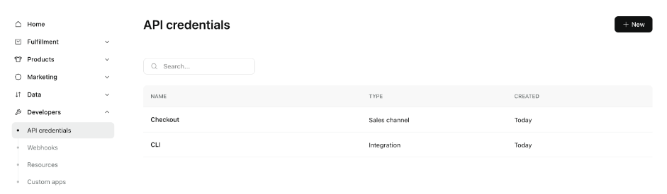
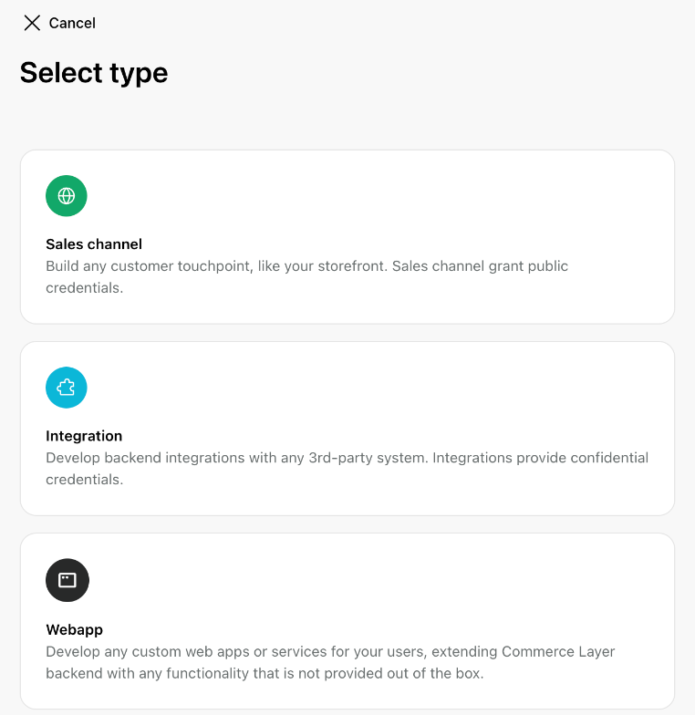
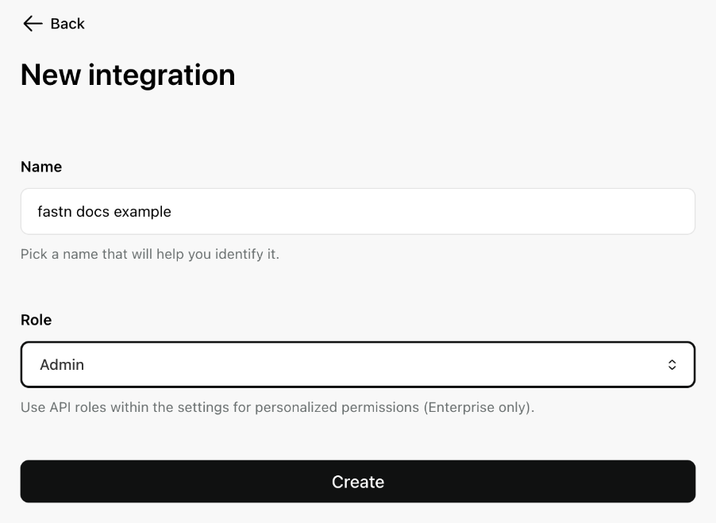
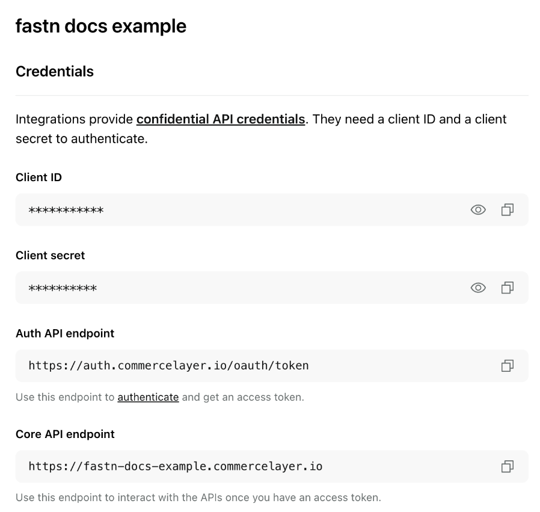

# Commerce Layer

| | |
| --- | --- |
| **Category** | [E-commerce](README.md) |
| **Website** | [commercelayer.io](https://commercelayer.io) |
| **Authentication** | OAuth 2.0 |
| **Slug** | `commerceLayer` |

## Setup guide
This guide shows you how to create a Commerce Layer integration credential and add it to Fastn. Fastn uses it to call the Commerce Layer Core API for your organization.

### Before you start
- You need the Owner, Admin or Developer role in Fastn.
- You need access to the Commerce Layer dashboard for the organization you want to connect, with permission to create API credentials.
- Fastn's actions create, update and delete data, so the credential needs the **Admin** role.

### Create your Commerce Layer app
Fastn connects to Commerce Layer with the OAuth 2.0 client credentials grant. This grant has no sign-in screen, so you do not need a redirect URL. In Commerce Layer, the app is called an integration.

1. Sign in to the Commerce Layer dashboard and select your organization.
2. In the left sidebar, open **Developers** and click **API credentials**.

<figure><figcaption>
The API credentials list under Developers
</figcaption></figure>

3. Click **+ New** at the top right of the list.
4. Under **Select type**, choose the **Integration** card. Integrations provide confidential credentials, with a client secret. Sales channel credentials are public.

<figure><figcaption>
Choose the Integration type
</figcaption></figure>

5. In **Name**, enter a name you will recognize later, such as `fastn`.
6. Pick a **Role**. **Admin** allows creating, reading, updating and deleting any resource; most actions, such as Create Order or Create Customer, need it. Custom API roles are an Enterprise-only setting.
7. Click **Create**.

<figure><figcaption>
The New integration form with a name and the Admin role
</figcaption></figure>

8. The integration's details panel opens. Copy the **Client ID** and **Client secret** with the copy buttons next to them. Also note the **Core API endpoint**, for example `https://acme-sandbox.commercelayer.io`. The part before `.commercelayer.io` is your organization slug.

<figure><figcaption>
The Credentials section, with the client ID and secret hidden
</figcaption></figure>

### Add your app to Fastn
1. In Fastn, go to **Build → Integrations → Connectors** and open **Commerce Layer**.
2. Open the **Auth** tab and click **Manage providers**.

<figure><figcaption>
Open the connector's Auth tab, then Manage providers.
</figcaption></figure>

3. Click **+ Create Provider**.
4. In the **New Auth Provider** form, enter a **Name** and an optional **Description**. Paste the **Client ID** and **Client Secret** you copied from Commerce Layer, and leave **Scopes** empty.

<figure><figcaption>
The New Auth Provider form: paste your app's Client ID and Client Secret.
</figcaption></figure>

5. Save the provider, then choose **Use this app** so it becomes the Preferred app.
6. In your widget, set the Commerce Layer connector's **Auth provider** setting to this app.

When you or your customers connect Commerce Layer, enter the **organization slug**. This is the subdomain of the Core API endpoint. For `https://acme-sandbox.commercelayer.io`, enter `acme-sandbox`.

### Events
To run a workflow when something happens in Commerce Layer, such as `orders.place`, `shipments.ship` or `returns.approve`, add an App event trigger. Go to **Build → Integrations → Triggers → Add trigger → App events** and choose Commerce Layer. See [App events](../../build/triggers/app-events.md). Contact Fastn support to set up events for Commerce Layer.

## Actions

<table><thead><tr><th width="240">Action</th><th width="260">Slug</th><th>What it does</th></tr></thead><tbody><tr><td>Create Address</td><td><code>createAddress</code></td><td>Create a new Address. Send a JSON:API resource object with type "addresses" plus its attributes and relationships.</td></tr><tr><td>Create Customer</td><td><code>createCustomer</code></td><td>Create a new Customer. Requires an email address.</td></tr><tr><td>Create Customer Address</td><td><code>createCustomerAddress</code></td><td>Add an existing address to a customer's address book. Requires customer and address relationships; Commerce Layer clones the address so the original stays unchanged.</td></tr><tr><td>Create Customer Group</td><td><code>createCustomerGroup</code></td><td>Create a new Customer Group. Requires a name.</td></tr><tr><td>Create Inventory Model</td><td><code>createInventoryModel</code></td><td>Create a new Inventory Model. Requires a name; the shipping strategy defaults to no_split.</td></tr><tr><td>Create Line Item</td><td><code>createLineItem</code></td><td>Add a line item to an order. Requires a quantity and an order relationship; identify the item with sku_code, bundle_code or the item relationship.</td></tr><tr><td>Create Market</td><td><code>createMarket</code></td><td>Create a new Market. Requires a name plus merchant, price_list and inventory_model relationships.</td></tr><tr><td>Create Merchant</td><td><code>createMerchant</code></td><td>Create a new Merchant. Requires a name and an existing address relationship.</td></tr><tr><td>Create Order</td><td><code>createOrder</code></td><td>Create a new Order (a draft cart). A market relationship is normally required; the order is created in draft status and no money moves until it is placed.</td></tr><tr><td>Create Package</td><td><code>createPackage</code></td><td>Create a new Package at a stock location. Requires a name, its three dimensions, a unit of length and a stock_location relationship.</td></tr></tbody></table>

View 111 more actions

<table><thead><tr><th width="240">Action</th><th width="260">Slug</th><th>What it does</th></tr></thead><tbody><tr><td>Create Parcel</td><td><code>createParcel</code></td><td>Create a Parcel for a shipment. Requires a weight, a unit of weight and shipment plus package relationships.</td></tr><tr><td>Create Price</td><td><code>createPrice</code></td><td>Create a new Price for a SKU in a price list. Do not send currency_code: it is inherited from the price list and Commerce Layer rejects it with 400 PARAM_NOT_ALLOWED.</td></tr><tr><td>Create Price List</td><td><code>createPriceList</code></td><td>Create a new Price List. Requires a name and an ISO 4217 currency code.</td></tr><tr><td>Create Shipment</td><td><code>createShipment</code></td><td>Create a Shipment for an order. Requires order and inventory_stock_location relationships (stock_location is rejected with 400 PARAM_NOT_ALLOWED), plus a shipping_address. In normal use shipments are generated automatically when line items are added to an order, so use this action only to add a manual split shipment during fulfilment.</td></tr><tr><td>Create Shipping Category</td><td><code>createShippingCategory</code></td><td>Create a new Shipping Category. Requires a name.</td></tr><tr><td>Create Shipping Method</td><td><code>createShippingMethod</code></td><td>Create a new Shipping Method. Requires a name and price_amount_cents; attach it to a market, shipping zone and shipping category to make it selectable.</td></tr><tr><td>Create Shipping Zone</td><td><code>createShippingZone</code></td><td>Create a new Shipping Zone. Requires a name; the regex attributes decide which shipping addresses the zone matches.</td></tr><tr><td>Create SKU</td><td><code>createSku</code></td><td>Create a new SKU. Requires a code, a name and a shipping_category relationship.</td></tr><tr><td>Create SKU List</td><td><code>createSkuList</code></td><td>Create a new SKU List. Requires a name; set manual true and add SKU list items, or supply a sku_code_regex.</td></tr><tr><td>Create SKU List Item</td><td><code>createSkuListItem</code></td><td>Add a SKU to a manual SKU list. Requires sku_list and sku relationships.</td></tr><tr><td>Create Stock Item</td><td><code>createStockItem</code></td><td>Create a new Stock Item, i.e. put a quantity of a SKU into a stock location. Requires a quantity and a stock_location relationship; identify the SKU with sku_code or the sku relationship.</td></tr><tr><td>Create Stock Location</td><td><code>createStockLocation</code></td><td>Create a new Stock Location. Requires a name and an existing address relationship.</td></tr><tr><td>Create Webhook</td><td><code>createWebhook</code></td><td>Register a Webhook subscription. Requires a topic (resource.event, e.g. orders.place) and a callback_url that Commerce Layer will POST to. The response includes the shared_secret used to sign deliveries.</td></tr><tr><td>Delete Address</td><td><code>deleteAddress</code></td><td>Permanently delete an Address by its Commerce Layer id.</td></tr><tr><td>Delete Customer</td><td><code>deleteCustomer</code></td><td>Permanently delete a Customer by its Commerce Layer id. Fails if the customer has orders; consider GDPR anonymization instead.</td></tr><tr><td>Delete Customer Address</td><td><code>deleteCustomerAddress</code></td><td>Remove an address from a customer's address book.</td></tr><tr><td>Delete Customer Group</td><td><code>deleteCustomerGroup</code></td><td>Permanently delete a Customer Group by its Commerce Layer id.</td></tr><tr><td>Delete Inventory Model</td><td><code>deleteInventoryModel</code></td><td>Permanently delete an Inventory Model by its Commerce Layer id.</td></tr><tr><td>Delete Line Item</td><td><code>deleteLineItem</code></td><td>Remove a line item from an order. Only line items on a draft or pending order can be deleted.</td></tr><tr><td>Delete Market</td><td><code>deleteMarket</code></td><td>Permanently delete a Market by its Commerce Layer id. Fails if the market still has orders or shipping methods.</td></tr><tr><td>Delete Merchant</td><td><code>deleteMerchant</code></td><td>Permanently delete a Merchant by its Commerce Layer id. Fails if the merchant is still referenced by a market.</td></tr><tr><td>Delete Order</td><td><code>deleteOrder</code></td><td>Permanently delete an Order by its Commerce Layer id. Only draft and pending orders can be deleted; placed orders must be cancelled instead.</td></tr><tr><td>Delete Package</td><td><code>deletePackage</code></td><td>Permanently delete a Package by its Commerce Layer id.</td></tr><tr><td>Delete Parcel</td><td><code>deleteParcel</code></td><td>Permanently delete a Parcel by its Commerce Layer id.</td></tr><tr><td>Delete Price</td><td><code>deletePrice</code></td><td>Permanently delete a Price by its Commerce Layer id.</td></tr><tr><td>Delete Price List</td><td><code>deletePriceList</code></td><td>Permanently delete a Price List by its Commerce Layer id.</td></tr><tr><td>Delete Shipment</td><td><code>deleteShipment</code></td><td>Permanently delete a Shipment by its Commerce Layer id. Only shipments on a draft or pending order can be deleted.</td></tr><tr><td>Delete Shipping Category</td><td><code>deleteShippingCategory</code></td><td>Permanently delete a Shipping Category by its Commerce Layer id.</td></tr><tr><td>Delete Shipping Method</td><td><code>deleteShippingMethod</code></td><td>Permanently delete a Shipping Method by its Commerce Layer id.</td></tr><tr><td>Delete Shipping Zone</td><td><code>deleteShippingZone</code></td><td>Permanently delete a Shipping Zone by its Commerce Layer id.</td></tr><tr><td>Delete SKU</td><td><code>deleteSku</code></td><td>Permanently delete a SKU by its Commerce Layer id. Fails if the SKU still has prices, stock items or line items.</td></tr><tr><td>Delete SKU List</td><td><code>deleteSkuList</code></td><td>Permanently delete a SKU List by its Commerce Layer id.</td></tr><tr><td>Delete SKU List Item</td><td><code>deleteSkuListItem</code></td><td>Remove a SKU from a manual SKU list by deleting its SKU List Item.</td></tr><tr><td>Delete Stock Item</td><td><code>deleteStockItem</code></td><td>Permanently delete a Stock Item by its Commerce Layer id.</td></tr><tr><td>Delete Stock Location</td><td><code>deleteStockLocation</code></td><td>Permanently delete a Stock Location by its Commerce Layer id.</td></tr><tr><td>Delete Webhook</td><td><code>deleteWebhook</code></td><td>Delete a Webhook subscription by its Commerce Layer id, stopping all future deliveries.</td></tr><tr><td>Get Address</td><td><code>getAddress</code></td><td>Retrieve a single Address by its Commerce Layer id.</td></tr><tr><td>Get Application</td><td><code>getApplication</code></td><td>Retrieve the Commerce Layer application the current access token was issued for, including its kind (integration, sales_channel, webapp) and role. Singleton endpoint at /api/application.</td></tr><tr><td>Get Customer</td><td><code>getCustomer</code></td><td>Retrieve a single Customer by its Commerce Layer id.</td></tr><tr><td>Get Customer Address</td><td><code>getCustomerAddress</code></td><td>Retrieve a single Customer Address by its Commerce Layer id.</td></tr><tr><td>Get Customer Group</td><td><code>getCustomerGroup</code></td><td>Retrieve a single Customer Group by its Commerce Layer id.</td></tr><tr><td>Get Event</td><td><code>getEvent</code></td><td>Retrieve a single recorded Event by its Commerce Layer id, with its payload and delivery callbacks.</td></tr><tr><td>Get Inventory Model</td><td><code>getInventoryModel</code></td><td>Retrieve a single Inventory Model by its Commerce Layer id.</td></tr><tr><td>Get Line Item</td><td><code>getLineItem</code></td><td>Retrieve a single Line Item by its Commerce Layer id.</td></tr><tr><td>Get Market</td><td><code>getMarket</code></td><td>Retrieve a single Market by its Commerce Layer id.</td></tr><tr><td>Get Merchant</td><td><code>getMerchant</code></td><td>Retrieve a single Merchant by its Commerce Layer id.</td></tr><tr><td>Get Order</td><td><code>getOrder</code></td><td>Retrieve a single Order by its Commerce Layer id, with its totals, status and payment state.</td></tr><tr><td>Get Organization</td><td><code>getOrganization</code></td><td>Retrieve the Commerce Layer organization this connection authenticates against, including its configuration, logo and subscription limits. This is a singleton endpoint at /api/organization with no id.</td></tr><tr><td>Get Package</td><td><code>getPackage</code></td><td>Retrieve a single Package by its Commerce Layer id.</td></tr><tr><td>Get Parcel</td><td><code>getParcel</code></td><td>Retrieve a single Parcel by its Commerce Layer id, including tracking status and label URL.</td></tr><tr><td>Get Price</td><td><code>getPrice</code></td><td>Retrieve a single Price by its Commerce Layer id.</td></tr><tr><td>Get Price List</td><td><code>getPriceList</code></td><td>Retrieve a single Price List by its Commerce Layer id.</td></tr><tr><td>Get Reserved Stock</td><td><code>getReservedStock</code></td><td>Retrieve a single Reserved Stock record by its Commerce Layer id.</td></tr><tr><td>Get Shipment</td><td><code>getShipment</code></td><td>Retrieve a single Shipment by its Commerce Layer id, with its status, rates and parcels.</td></tr><tr><td>Get Shipping Category</td><td><code>getShippingCategory</code></td><td>Retrieve a single Shipping Category by its Commerce Layer id.</td></tr><tr><td>Get Shipping Method</td><td><code>getShippingMethod</code></td><td>Retrieve a single Shipping Method by its Commerce Layer id.</td></tr><tr><td>Get Shipping Zone</td><td><code>getShippingZone</code></td><td>Retrieve a single Shipping Zone by its Commerce Layer id.</td></tr><tr><td>Get SKU</td><td><code>getSku</code></td><td>Retrieve a single SKU by its Commerce Layer id.</td></tr><tr><td>Get SKU List</td><td><code>getSkuList</code></td><td>Retrieve a single SKU List by its Commerce Layer id.</td></tr><tr><td>Get SKU List Item</td><td><code>getSkuListItem</code></td><td>Retrieve a single SKU List Item by its Commerce Layer id.</td></tr><tr><td>Get Stock Item</td><td><code>getStockItem</code></td><td>Retrieve a single Stock Item by its Commerce Layer id.</td></tr><tr><td>Get Stock Location</td><td><code>getStockLocation</code></td><td>Retrieve a single Stock Location by its Commerce Layer id.</td></tr><tr><td>Get Webhook</td><td><code>getWebhook</code></td><td>Retrieve a single Webhook by its Commerce Layer id. SECURITY: the response carries shared_secret, the HMAC signing secret used to verify deliveries.</td></tr><tr><td>List Addresses</td><td><code>listAddresses</code></td><td>List addresses in your Commerce Layer organization, with JSON:API pagination, sorting, sparse fieldsets and side-loaded relationships.</td></tr><tr><td>List Customer Addresses</td><td><code>listCustomerAddresses</code></td><td>List customer addresses, the entries of each customer's address book.</td></tr><tr><td>List Customer Groups</td><td><code>listCustomerGroups</code></td><td>List customer groups, used to segment customers and to scope private markets.</td></tr><tr><td>List Customers</td><td><code>listCustomers</code></td><td>List the customers of your Commerce Layer organization.</td></tr><tr><td>List Events</td><td><code>listEvents</code></td><td>List the events recorded by your organization. Each event records the resource type and the action that fired a webhook, and links to its delivery callbacks.</td></tr><tr><td>List Inventory Models</td><td><code>listInventoryModels</code></td><td>List inventory models. An inventory model defines the shipping strategy and the stock locations a market draws inventory from.</td></tr><tr><td>List Line Items</td><td><code>listLineItems</code></td><td>List order line items across your Commerce Layer organization.</td></tr><tr><td>List Markets</td><td><code>listMarkets</code></td><td>List the markets of your Commerce Layer organization. A market ties a merchant, a price list and an inventory model together.</td></tr><tr><td>List Merchants</td><td><code>listMerchants</code></td><td>List the merchants of your Commerce Layer organization. A merchant is the selling entity behind a market.</td></tr><tr><td>List Orders</td><td><code>listOrders</code></td><td>List orders (carts and placed orders) of your Commerce Layer organization.</td></tr><tr><td>List Packages</td><td><code>listPackages</code></td><td>List packages, the box formats available at a stock location for building parcels.</td></tr><tr><td>List Parcels</td><td><code>listParcels</code></td><td>List parcels, the physical boxes that make up a shipment, with their tracking numbers and label URLs.</td></tr><tr><td>List Price Lists</td><td><code>listPriceLists</code></td><td>List the price lists of your Commerce Layer organization. A price list groups SKU prices for one currency.</td></tr><tr><td>List Prices</td><td><code>listPrices</code></td><td>List SKU prices. Each price belongs to one price list and one SKU.</td></tr><tr><td>List Reserved Stocks</td><td><code>listReservedStocks</code></td><td>List the stock reservations currently held against your stock items by carts and orders.</td></tr><tr><td>List Shipments</td><td><code>listShipments</code></td><td>List shipments. Commerce Layer generates shipments automatically from an order's line items and inventory model.</td></tr><tr><td>List Shipping Categories</td><td><code>listShippingCategories</code></td><td>List shipping categories. Every SKU belongs to a shipping category, which shipping methods are matched against.</td></tr><tr><td>List Shipping Methods</td><td><code>listShippingMethods</code></td><td>List shipping methods, the delivery options offered to customers in a market.</td></tr><tr><td>List Shipping Zones</td><td><code>listShippingZones</code></td><td>List shipping zones, the regex-matched geographic areas a shipping method applies to.</td></tr><tr><td>List SKU List Items</td><td><code>listSkuListItems</code></td><td>List SKU list items, the individual SKU entries of a manual SKU list.</td></tr><tr><td>List SKU Lists</td><td><code>listSkuLists</code></td><td>List SKU lists. A SKU list groups SKUs manually or by regex, and backs wishlists and bundles.</td></tr><tr><td>List SKUs</td><td><code>listSkus</code></td><td>List the SKUs (stock keeping units) of your Commerce Layer catalogue.</td></tr><tr><td>List Stock Items</td><td><code>listStockItems</code></td><td>List stock items. A stock item is the quantity of one SKU held at one stock location.</td></tr><tr><td>List Stock Locations</td><td><code>listStockLocations</code></td><td>List stock locations (warehouses) of your Commerce Layer organization.</td></tr><tr><td>List Webhooks</td><td><code>listWebhooks</code></td><td>List the webhook subscriptions registered on your Commerce Layer organization.</td></tr><tr><td>Update Address</td><td><code>updateAddress</code></td><td>Update an existing Address. Only the attributes and relationships you send are changed.</td></tr><tr><td>Update Customer</td><td><code>updateCustomer</code></td><td>Update an existing Customer. _request_anonymization and _cancel_anonymization drive the GDPR anonymization flow and are irreversible once anonymization completes.</td></tr><tr><td>Update Customer Address</td><td><code>updateCustomerAddress</code></td><td>Update an existing Customer Address, e.g. to point it at a different address record.</td></tr><tr><td>Update Customer Group</td><td><code>updateCustomerGroup</code></td><td>Update an existing Customer Group. Only the attributes you send are changed.</td></tr><tr><td>Update Inventory Model</td><td><code>updateInventoryModel</code></td><td>Update an existing Inventory Model. Only the attributes you send are changed.</td></tr><tr><td>Update Line Item</td><td><code>updateLineItem</code></td><td>Update an existing Line Item, typically to change its quantity or reserve stock.</td></tr><tr><td>Update Market</td><td><code>updateMarket</code></td><td>Update an existing Market, including enabling or disabling it with the _enable and _disable trigger attributes.</td></tr><tr><td>Update Merchant</td><td><code>updateMerchant</code></td><td>Update an existing Merchant. Only the attributes and relationships you send are changed.</td></tr><tr><td>Update Order</td><td><code>updateOrder</code></td><td>Update an Order and drive its state machine. WARNING: the trigger attributes _place, _authorize, _capture, _approve_and_capture, _refund, _refund_invoice and _cancel move real money against the order's payment source. Send them only when you intend a real financial operation.</td></tr><tr><td>Update Package</td><td><code>updatePackage</code></td><td>Update an existing Package. Only the attributes and relationships you send are changed.</td></tr><tr><td>Update Parcel</td><td><code>updateParcel</code></td><td>Update an existing Parcel, e.g. its weight, customs information or tracking details.</td></tr><tr><td>Update Price</td><td><code>updatePrice</code></td><td>Update an existing Price. Only the attributes and relationships you send are changed.</td></tr><tr><td>Update Price List</td><td><code>updatePriceList</code></td><td>Update an existing Price List. Only the attributes you send are changed.</td></tr><tr><td>Update Shipment</td><td><code>updateShipment</code></td><td>Update a Shipment and drive its fulfilment state machine. WARNING: _purchase buys a real shipping label from the carrier account and charges it, and _decrement_stock permanently reduces inventory.</td></tr><tr><td>Update Shipping Category</td><td><code>updateShippingCategory</code></td><td>Update an existing Shipping Category. Only the attributes you send are changed.</td></tr><tr><td>Update Shipping Method</td><td><code>updateShippingMethod</code></td><td>Update an existing Shipping Method, including enabling or disabling it with _enable and _disable.</td></tr><tr><td>Update Shipping Zone</td><td><code>updateShippingZone</code></td><td>Update an existing Shipping Zone. Only the attributes you send are changed.</td></tr><tr><td>Update SKU</td><td><code>updateSku</code></td><td>Update an existing SKU. Use _add_tags and _remove_tags to change its tags without replacing the whole set.</td></tr><tr><td>Update SKU List</td><td><code>updateSkuList</code></td><td>Update an existing SKU List. Only the attributes and relationships you send are changed.</td></tr><tr><td>Update SKU List Item</td><td><code>updateSkuListItem</code></td><td>Update an existing SKU List Item, e.g. its quantity or position in the list.</td></tr><tr><td>Update Stock Item</td><td><code>updateStockItem</code></td><td>Update an existing Stock Item, typically to change its quantity. Send _validate true to validate the new quantity against reserved stock.</td></tr><tr><td>Update Stock Location</td><td><code>updateStockLocation</code></td><td>Update an existing Stock Location. Only the attributes and relationships you send are changed.</td></tr><tr><td>Update Webhook</td><td><code>updateWebhook</code></td><td>Update a Webhook subscription, including enabling or disabling it with _enable and _disable, and resetting its circuit breaker after repeated delivery failures.</td></tr></tbody></table>

## Events

Start a workflow when one of these happens, with an [app event trigger](../../build/triggers/README.md).

<table><thead><tr><th width="240">Event</th><th width="260">Id</th><th>When it fires</th></tr></thead><tbody><tr><td>Cleanup Completed</td><td><code>cleanups.complete</code></td><td>Fires when a bulk cleanup job finishes.</td></tr><tr><td>Customer Created</td><td><code>customers.create</code></td><td>Fires when a customer record is created, including the implicit customer Commerce Layer creates from an order's customer_email.</td></tr><tr><td>Export Completed</td><td><code>exports.complete</code></td><td>Fires when a bulk export job finishes; the payload carries the signed download URL.</td></tr><tr><td>Gift Card Activated</td><td><code>gift_cards.activate</code></td><td>Fires when a gift card is activated and can be redeemed.</td></tr><tr><td>Gift Card Deactivated</td><td><code>gift_cards.deactivate</code></td><td>Fires when a gift card is deactivated.</td></tr><tr><td>Gift Card Purchased</td><td><code>gift_cards.purchase</code></td><td>Fires when a gift card is purchased.</td></tr><tr><td>Gift Card Redeemed</td><td><code>gift_cards.redeem</code></td><td>Fires when a gift card is redeemed against an order.</td></tr><tr><td>Import Completed</td><td><code>imports.complete</code></td><td>Fires when a bulk import job finishes.</td></tr><tr><td>In-Stock Subscription Activated</td><td><code>in_stock_subscriptions.activate</code></td><td>Fires when a back-in-stock notification subscription is activated.</td></tr><tr><td>Order Approved</td><td><code>orders.approve</code></td><td>Fires when a placed order is approved for fulfilment.</td></tr></tbody></table>

View 33 more events

<table><thead><tr><th width="240">Event</th><th width="260">Id</th><th>When it fires</th></tr></thead><tbody><tr><td>Order Cancelled</td><td><code>orders.cancel</code></td><td>Fires when a placed order is cancelled and its payment authorization is voided.</td></tr><tr><td>Order Created</td><td><code>orders.create</code></td><td>Fires when a new order (cart) is created in any market. Payload is the JSON:API orders resource object.</td></tr><tr><td>Order Editing Started</td><td><code>orders.start_editing</code></td><td>Fires when a placed order is reopened for editing.</td></tr><tr><td>Order Editing Stopped</td><td><code>orders.stop_editing</code></td><td>Fires when editing of a placed order ends and it returns to placed status.</td></tr><tr><td>Order Fulfilled</td><td><code>orders.fulfill</code></td><td>Fires when every shipment on the order is delivered or cancelled and the order is marked fulfilled.</td></tr><tr><td>Order Moved To Pending</td><td><code>orders.pending</code></td><td>Fires when a draft order moves to pending, e.g. on refresh or at checkout. Observed live in this organization's /api/events feed.</td></tr><tr><td>Order Placed</td><td><code>orders.place</code></td><td>Fires when an order is placed by the customer; the orders resource arrives with status 'placed'.</td></tr><tr><td>Order Refunded</td><td><code>orders.refund</code></td><td>Fires when a captured order is refunded.</td></tr><tr><td>Order Subscription Activated</td><td><code>order_subscriptions.activate</code></td><td>Fires when an order subscription becomes active.</td></tr><tr><td>Order Subscription Cancelled</td><td><code>order_subscriptions.cancel</code></td><td>Fires when an order subscription is cancelled.</td></tr><tr><td>Order Subscription Created</td><td><code>order_subscriptions.create</code></td><td>Fires when a recurring order subscription is created.</td></tr><tr><td>Payment Authorized</td><td><code>authorizations.create</code></td><td>Fires when a payment authorization is created against an order.</td></tr><tr><td>Payment Captured</td><td><code>captures.create</code></td><td>Fires when an authorized payment is captured.</td></tr><tr><td>Payment Refunded</td><td><code>refunds.create</code></td><td>Fires when a refund transaction is created.</td></tr><tr><td>Payment Voided</td><td><code>voids.create</code></td><td>Fires when a payment authorization is voided.</td></tr><tr><td>Return Approved</td><td><code>returns.approve</code></td><td>Fires when a requested return is approved.</td></tr><tr><td>Return Cancelled</td><td><code>returns.cancel</code></td><td>Fires when a return is cancelled.</td></tr><tr><td>Return Received</td><td><code>returns.receive</code></td><td>Fires when a return is received at the stock location.</td></tr><tr><td>Return Rejected</td><td><code>returns.reject</code></td><td>Fires when a requested return is rejected.</td></tr><tr><td>Return Requested</td><td><code>returns.request</code></td><td>Fires when a customer requests a return.</td></tr><tr><td>Return Restocked</td><td><code>returns.restock</code></td><td>Fires when returned items are restocked.</td></tr><tr><td>Return Shipped</td><td><code>returns.ship</code></td><td>Fires when the customer ships the return back.</td></tr><tr><td>Shipment Cancelled</td><td><code>shipments.cancel</code></td><td>Fires when a shipment is cancelled.</td></tr><tr><td>Shipment Delivered</td><td><code>shipments.deliver</code></td><td>Fires when a shipment is marked delivered.</td></tr><tr><td>Shipment Marked Upcoming</td><td><code>shipments.upcoming</code></td><td>Fires when a shipment is marked upcoming, awaiting stock.</td></tr><tr><td>Shipment Packing Started</td><td><code>shipments.packing</code></td><td>Fires when packing starts for a shipment.</td></tr><tr><td>Shipment Picking Started</td><td><code>shipments.picking</code></td><td>Fires when picking starts for a shipment.</td></tr><tr><td>Shipment Put On Hold</td><td><code>shipments.on_hold</code></td><td>Fires when a shipment is put on hold.</td></tr><tr><td>Shipment Ready To Ship</td><td><code>shipments.ready_to_ship</code></td><td>Fires when a shipment is marked ready to ship.</td></tr><tr><td>Shipment Shipped</td><td><code>shipments.ship</code></td><td>Fires when a shipment is marked shipped.</td></tr><tr><td>Stock Transfer Cancelled</td><td><code>stock_transfers.cancel</code></td><td>Fires when a stock transfer is cancelled.</td></tr><tr><td>Stock Transfer Completed</td><td><code>stock_transfers.complete</code></td><td>Fires when a stock transfer between stock locations completes.</td></tr><tr><td>Transaction Created</td><td><code>transactions.create</code></td><td>Fires for every payment transaction recorded against an order: authorization, capture, void or refund.</td></tr></tbody></table>

