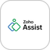

# Zoho Assist

| | |
| --- | --- |
| **Category** | [IT and service management](README.md) |
| **Website** | [assist.zoho.com](https://assist.zoho.com) |
| **Authentication** | OAuth 2.0 |
| **Slug** | `zohoAssist` |

## Setup

Your customers sign in to Zoho Assist through Fastn's own OAuth app, so nothing needs setting up first. To show your own app on the consent screen instead, add your OAuth app on the connector's **Auth** tab under **Manage providers**.

## Connect in Fastn

Your customers connect Zoho Assist from your widget. To connect an account yourself:

1. Go to **Build → Integrations → Connectors** and search for **Zoho Assist**.
2. Select **Connect** on the Zoho Assist card.

   <figure><figcaption>
Search for the connector, then select Connect on its card. ServiceNow is shown here.
</figcaption></figure>

3. Keep the **Default** auth provider, or choose your own OAuth app if you added one. Pick the **Scopes** you need, select **Authorize**, then sign in to Zoho Assist and approve access in the window that opens.

   <figure><figcaption>
A connect form for OAuth 2.0. Salesforce is shown here.
</figcaption></figure>

4. Check that the connection appears under **Operate → Connections** with the status `Active`. Your workflows can now use Zoho Assist's actions.

For more detail, see [Connect an app](../../build/connectors/connect-an-app.md).

## Actions

<table><thead><tr><th width="240">Action</th><th width="260">Slug</th><th>What it does</th></tr></thead><tbody><tr><td>Create Session</td><td><code>createSession</code></td><td>Creates a new on-demand Zoho Assist remote support or screen sharing session. Returns a customer URL to share with the end user and a technician URL the agent opens to start the session, along with the session ID and authentication key. Supplying a customer email sends the join invitation directly to that address.</td></tr><tr><td>Create Unattended Group</td><td><code>createUnattendedGroup</code></td><td>Creates a new unattended computer group in a Zoho Assist department, optionally seeding it with a list of devices. Returns the created group's ID, name, description and creation details.</td></tr><tr><td>Create Unattended Session</td><td><code>createUnattendedSession</code></td><td>Starts an unattended remote session with a specific Zoho Assist device, which connects without anyone present at the far end. Returns a technician URI to open in a browser, the session key and authentication details, and whether a user is currently present on the device.</td></tr><tr><td>Export Session Notes</td><td><code>exportSessionNotes</code></td><td>Exports the technician notes recorded during a Zoho Assist session. The note text is returned directly in the response body. Resolve the required system ID from a customer-facing session ID using the Get Session Details action.</td></tr><tr><td>Get Session Chat Download Link</td><td><code>getSessionChatDownloadLink</code></td><td>Returns a download link for the chat transcript of a Zoho Assist session. The link must be opened in a browser by a user signed in to the same Zoho account. Resolve the required system ID from a customer-facing session ID using the Get Session Details action.</td></tr><tr><td>Get Session Details</td><td><code>getSessionDetails</code></td><td>Resolves a customer-facing Zoho Assist session ID to its internal system ID. The session ID is the 9-10 digit number shown to the customer, while the system ID is required by the session notes and file download link actions.</td></tr><tr><td>Get Session Recording Download Link</td><td><code>getSessionRecordingDownloadLink</code></td><td>Returns a download link for the recording files of a Zoho Assist session. The link must be opened in a browser by a user signed in to the same Zoho account. Resolve the required system ID from a customer-facing session ID using the Get Session Details action.</td></tr><tr><td>Get Session Screenshot Download Link</td><td><code>getSessionScreenshotDownloadLink</code></td><td>Returns a download link for the screenshot files captured during a Zoho Assist session. The link must be opened in a browser by a user signed in to the same Zoho account. Resolve the required system ID from a customer-facing session ID using the Get Session Details action.</td></tr><tr><td>Get Unattended Device</td><td><code>getUnattendedDevice</code></td><td>Fetches the full detail of a single unattended Zoho Assist device, including its hardware and platform information, domain and network details, group memberships, department, stored credentials, logged-on users and when it was last accessed and by whom.</td></tr><tr><td>Get User Details</td><td><code>getUserDetails</code></td><td>Fetches the details of the currently authenticated Zoho Assist user, including their role, organization details, license information, department memberships and preferred department ID. Call this first to obtain the department IDs required by the unattended device and group actions.</td></tr></tbody></table>

View 6 more actions

<table><thead><tr><th width="240">Action</th><th width="260">Slug</th><th>What it does</th></tr></thead><tbody><tr><td>List Session Reports</td><td><code>listSessionReports</code></td><td>Fetches reports of previously conducted Zoho Assist sessions within a date range, optionally filtered to a single technician. Each report carries the session ID, session type, technician and customer details, start and end times, and the session duration in milliseconds.</td></tr><tr><td>List Unattended Devices</td><td><code>listUnattendedDevices</code></td><td>Lists the unattended devices enrolled in a Zoho Assist department, with extensive filtering by group, status, operating system, network address, domain and hardware attributes. Returns each device's display name, status, IP addresses, agent version and resource ID. The total device count is included only when the page index is 1.</td></tr><tr><td>List Unattended Groups</td><td><code>listUnattendedGroups</code></td><td>Lists the unattended computer groups defined in a Zoho Assist department, returning each group's ID, name, description, device count, creator and whether it is the preferred group. Supply a search query to filter groups by name.</td></tr><tr><td>Schedule Session</td><td><code>scheduleSession</code></td><td>Schedules a Zoho Assist remote support session for a future time and invites the customer by email. Returns the schedule ID along with the technician and customer join URLs. Retrieve the department ID from the Get User Details action before calling this.</td></tr><tr><td>Update Unattended Device Display Name</td><td><code>updateUnattendedDeviceDisplayName</code></td><td>Renames an unattended Zoho Assist device by setting a new display name. Only the display name can be changed through this endpoint; the underlying device name reported by the agent is unaffected.</td></tr><tr><td>Update Unattended Group</td><td><code>updateUnattendedGroup</code></td><td>Updates an existing unattended computer group in Zoho Assist. Renames the group, changes its description, and adds or removes devices from it in a single call.</td></tr></tbody></table>

