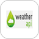

# WeatherAPI.com

| | |
| --- | --- |
| **Category** | [Maps and location](README.md) |
| **Website** | [weatherapi.com](https://weatherapi.com) |
| **Authentication** | API key |
| **Slug** | `weatherApiCom` |

## Setup

Your customers enter their API key for WeatherAPI.com when they connect. Nothing else needs setting up.

## Use it

Add WeatherAPI.com from **Build → Integrations → Connectors** and connect an account, as in [Connect a system](../../build/connectors/connect-a-system.md). In workflow code, call an action as `fastn.connector.weatherApiCom.<action>()`, with the action's slug from the table below. See [Workflow runtime API](../../reference/workflow-runtime.md).

## Actions

<table><thead><tr><th width="240">Action</th><th width="260">Slug</th><th>What it does</th></tr></thead><tbody><tr><td>Check API Connection</td><td><code>checkApiConnection</code></td><td>Fetches current weather for London to confirm the configured API key is valid and the connection is working. Used as the connector's connection-verification check.</td></tr><tr><td>Get Astronomy Data</td><td><code>getAstronomy</code></td><td>Retrieves sunrise, sunset, moonrise, moonset, moon phase, and moon illumination for a location on a given date.</td></tr><tr><td>Get Bulk Current Weather</td><td><code>getBulkCurrentWeather</code></td><td>Retrieves current weather for multiple locations in a single request, with each location counted as one API call. Requires a Business-tier plan or higher; on the Free plan this endpoint returns a plan-restriction error.</td></tr><tr><td>Get Current Weather</td><td><code>getCurrentWeather</code></td><td>Retrieves real-time weather conditions for a city, US/UK/Canada postcode, latitude/longitude pair, or IP address, optionally including current air quality data.</td></tr><tr><td>Get Future Weather</td><td><code>getFutureWeather</code></td><td>Retrieves a long-range weather forecast at 3-hour intervals for a date between 14 and 300 days from today, based on historical trend data rather than short-term modeling.</td></tr><tr><td>Get Historical Weather</td><td><code>getHistory</code></td><td>Retrieves past weather observations for a location on a specific date or date range, from 1st January 2010 onwards, optionally including hourly air quality and pollen data.</td></tr><tr><td>Get Marine Weather</td><td><code>getMarineWeather</code></td><td>Retrieves a marine and sailing weather forecast of up to 7 days for a coastal or open-water location, including wave height, swell, and tide information.</td></tr><tr><td>Get Sports Events</td><td><code>getSportsEvents</code></td><td>Lists upcoming football, cricket, and golf events scheduled near a given location.</td></tr><tr><td>Get Time Zone</td><td><code>getTimeZone</code></td><td>Retrieves the IANA time zone identifier and current local time for a location.</td></tr><tr><td>Get Weather Alerts</td><td><code>getWeatherAlerts</code></td><td>Retrieves active government-issued weather alerts and warnings for a location.</td></tr></tbody></table>

View 3 more actions

<table><thead><tr><th width="240">Action</th><th width="260">Slug</th><th>What it does</th></tr></thead><tbody><tr><td>Get Weather Forecast</td><td><code>getForecast</code></td><td>Retrieves a daily and hourly weather forecast of up to 14 days for a location, optionally including air quality, government weather alerts, and pollen data for a specific date.</td></tr><tr><td>Look Up IP Address</td><td><code>lookupIpAddress</code></td><td>Retrieves geolocation, time zone, and network details for a given IP address.</td></tr><tr><td>Search Locations</td><td><code>searchLocations</code></td><td>Searches for matching cities and towns for a partial location name, useful for building autocomplete or location-picker experiences.</td></tr></tbody></table>

## Events

WeatherAPI.com has no events, so it can't start a workflow by itself. Use its actions in a workflow that another [trigger](../../build/triggers/README.md) starts, such as a schedule or a webhook.
