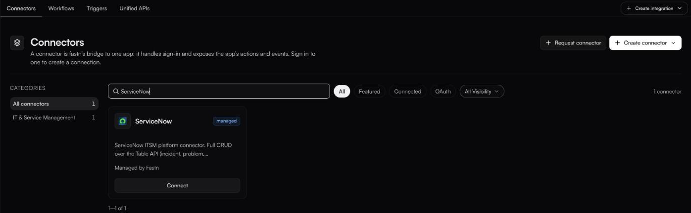

# OneDesk

| | |
| --- | --- |
| **Category** | [Project management](README.md) |
| **Website** | [onedesk.com](https://onedesk.com) |
| **Authentication** | API key |
| **Slug** | `onedesk` |

## Setup

Your customers enter their API key for OneDesk when they connect. Nothing else needs setting up.

## Connect in Fastn

Your customers connect OneDesk from your widget. To connect an account yourself:

1. Go to **Build → Integrations → Connectors** and search for **OneDesk**.
2. Select **Connect** on the OneDesk card.

   <figure><figcaption>
Search for the connector, then select Connect on its card. ServiceNow is shown here.
</figcaption></figure>

3. Fill in the fields the form asks for, using the values from [Setup](#setup) above. Then select **Connect**.

   <figure><figcaption>
A connect form that asks for credentials. Each connector asks for its own fields.
</figcaption></figure>

4. Check that the connection appears under **Operate → Connections** with the status `Active`. Your workflows can now use OneDesk's actions.

For more detail, see [Connect an app](../../build/connectors/connect-an-app.md).

## Actions

<table><thead><tr><th width="240">Action</th><th width="260">Slug</th><th>What it does</th></tr></thead><tbody><tr><td>Attach File to Customer Organization</td><td><code>addAttachmentToCustomerOrganization</code></td><td>Uploads a file and attaches it directly to a OneDesk customer organization in one call. externalId is the customer organization's external id. Send the file as UTF-8 text in fileContent with a fileName; binary formats are not supported by this transport.</td></tr><tr><td>Attach File to Portfolio</td><td><code>addAttachmentToPortfolio</code></td><td>Uploads a file and attaches it directly to a OneDesk portfolio in one call. externalId is the portfolio's external id. Send the file as UTF-8 text in fileContent with a fileName; binary formats are not supported by this transport.</td></tr><tr><td>Attach File to Project</td><td><code>addAttachmentToProject</code></td><td>Uploads a file and attaches it directly to a OneDesk project in one call. externalId is the project's external id. Send the file as UTF-8 text in fileContent with a fileName; binary formats are not supported by this transport.</td></tr><tr><td>Attach File to Work Item</td><td><code>addAttachmentToItem</code></td><td>Uploads a file and attaches it directly to a OneDesk work item in one call. externalId is the item's external id. Send the file as UTF-8 text in fileContent with a fileName; binary formats are not supported by this transport.</td></tr><tr><td>Cancel Work Timer</td><td><code>cancelWorkTimer</code></td><td>Cancels a OneDesk work timer identified by its timer external id, discarding the elapsed time without creating a timesheet. This is the only way to remove a timer - there is no delete endpoint.</td></tr><tr><td>Create Conversation</td><td><code>createConversation</code></td><td>Starts a new OneDesk conversation, optionally attached to a work item or a project and seeded with an initial message. IMPORTANT: publicConversation=true makes the thread customer-facing and notifies the customers on the item - leave it false for an internal discussion. NOTE: the OneDesk public API has no delete endpoint - created conversations are permanent.</td></tr><tr><td>Create Conversation Message</td><td><code>createConversationMessage</code></td><td>Posts a message into an existing OneDesk conversation. conversationExternalId is required. IMPORTANT: if the target conversation is a public/customer-facing thread this message is delivered to the customer by email and in the portal - check the conversation's visibility before posting. NOTE: the OneDesk public API has no delete endpoint - posted messages are permanent (content can be edited via Update Conversation Message).</td></tr><tr><td>Create Customer</td><td><code>createCustomer</code></td><td>Creates a OneDesk customer (an end user who can submit tickets). 'email' is required and must be unique. Optionally set first/last name, customer type and the customer organization to attach them to. NOTE: the OneDesk public API has no delete endpoint - created customers are permanent, though they can later be deactivated via Update Customer.</td></tr><tr><td>Create Customer Organization</td><td><code>createCustomerOrganization</code></td><td>Creates a OneDesk customer organization - the company record that groups customers. 'name' is required; 'domains' auto-assigns customers whose email matches, 'customers' seeds membership with customer external ids. NOTE: the OneDesk public API has no delete endpoint - created customer organizations are permanent.</td></tr><tr><td>Create Portfolio</td><td><code>createPortfolio</code></td><td>Creates a OneDesk portfolio - the folder used to group projects. 'name' is required; 'type' is a portfolio label from Get Organization Container Types. NOTE: the OneDesk public API has no delete endpoint - created portfolios are permanent.</td></tr></tbody></table>

View 83 more actions

<table><thead><tr><th width="240">Action</th><th width="260">Slug</th><th>What it does</th></tr></thead><tbody><tr><td>Create Project</td><td><code>createProject</code></td><td>Creates a OneDesk project. 'name' is required; 'type' is a non-portfolio label from Get Organization Container Types. Optionally nest it under portfolios, attach files, add user/customer followers, set the billing customer requester, invoice type, planned start and due date. NOTE: the OneDesk public API has no delete endpoint - created projects are permanent.</td></tr><tr><td>Create Timesheet</td><td><code>createTimesheet</code></td><td>Logs work against a OneDesk work item. userExternalId, taskExternalId, works (hours), percentCompleted and finish are required. Optionally mark it billable, add a note, set the lifecycle status it moves the item to, and a start timestamp. NOTE: the OneDesk public API has no delete endpoint - created timesheets are permanent.</td></tr><tr><td>Create User</td><td><code>createUser</code></td><td>Invites a new internal OneDesk user (agent). 'email' is required and OneDesk emails an invitation to it, so only pass a real colleague's address. Optionally set first/last name, user type, team membership and admin rights. WARNING: this consumes a paid OneDesk seat and the public API has no delete endpoint - created users are permanent.</td></tr><tr><td>Create User Team</td><td><code>createUserTeam</code></td><td>Creates a OneDesk user team. 'name' is required; 'users' optionally seeds the team with user external ids. NOTE: the OneDesk public API has no delete endpoint - created teams are permanent.</td></tr><tr><td>Create Work Item</td><td><code>createWorkItem</code></td><td>Creates a OneDesk work item (ticket, task, bug, feature,...). 'name' is required; 'type' is a label from Get Organization Work Item Types and defaults to the organization default when omitted. Optionally place it in a project, set priority (0/20/40/60/80/100), planned hours and dates, requesters, followers, attachments and custom fields. NOTE: the OneDesk public API has no delete endpoint - created items are permanent.</td></tr><tr><td>Filter Activities with Details</td><td><code>filterActivitiesWithDetails</code></td><td>Returns the OneDesk activity/audit feed - who changed what and when (item created, status changed, user added,...) with the item, project and author of each event. Supports property filters plus limit/offset paging and isAsc ordering.</td></tr><tr><td>Filter Attachments (External IDs Only)</td><td><code>filterAttachments</code></td><td>Searches OneDesk attachments and returns only their external ids plus a total count. Send an empty body to list every attachment.</td></tr><tr><td>Filter Attachments with Details</td><td><code>filterAttachmentsWithDetails</code></td><td>Searches OneDesk attachments and returns the full detail record for each match (file name, size, mime type, uploader, upload time) instead of just ids.</td></tr><tr><td>Filter Conversation Messages (External IDs Only)</td><td><code>filterConversationMessages</code></td><td>Searches OneDesk conversation messages and returns only their external ids plus a total count. Send an empty body to list every message.</td></tr><tr><td>Filter Conversation Messages with Details</td><td><code>filterConversationMessagesWithDetails</code></td><td>Searches OneDesk conversation messages and returns the full detail record for each match (content, author, timestamp, parent conversation, attachments) instead of just ids.</td></tr><tr><td>Filter Conversations (External IDs Only)</td><td><code>filterConversations</code></td><td>Searches OneDesk conversations (message threads on tickets, tasks and projects) and returns only their external ids plus a total count. Send an empty body to list every conversation.</td></tr><tr><td>Filter Conversations with Details</td><td><code>filterConversationsWithDetails</code></td><td>Searches OneDesk conversations and returns the full detail record for each match (participants, visibility, open/locked state, the item or project it hangs off) instead of just ids.</td></tr><tr><td>Filter Customer Organizations (External IDs Only)</td><td><code>filterCustomerOrganizations</code></td><td>Searches OneDesk customer organizations (companies that group customers) and returns only their external ids plus a total count. Send an empty body to list every customer organization.</td></tr><tr><td>Filter Customer Organizations with Details</td><td><code>filterCustomerOrganizationsWithDetails</code></td><td>Searches OneDesk customer organizations and returns the full detail record for each match (name, domains, members, address, invoice preferences, custom fields) instead of just ids.</td></tr><tr><td>Filter Customers (External IDs Only)</td><td><code>filterCustomers</code></td><td>Searches OneDesk customers (end users who submit tickets) and returns only their external ids plus a total count. Send an empty body to list every customer.</td></tr><tr><td>Filter Customers with Details</td><td><code>filterCustomersWithDetails</code></td><td>Searches OneDesk customers and returns the full detail record for each match (name, email, phone, customer organization, address, custom fields) instead of just ids.</td></tr><tr><td>Filter Invoices (External IDs Only)</td><td><code>filterInvoices</code></td><td>Searches OneDesk invoices and returns only their external ids plus a total count. Send an empty body to list every invoice. Invoices are created in the OneDesk billing UI - the public API can only read and update them.</td></tr><tr><td>Filter Invoices with Details</td><td><code>filterInvoicesWithDetails</code></td><td>Searches OneDesk invoices and returns the full detail record for each match (display number, status, due date, line items, totals, billed customer organization) instead of just ids.</td></tr><tr><td>Filter Items (External IDs Only)</td><td><code>filterItems</code></td><td>Searches OneDesk work items (tickets, tasks, bugs, features...) and returns only their external ids plus a total count. itemType is required - pass labels from Get Organization Work Item Types. Omit properties/customFields to return every item of those types. Supports paging with limit/offset and sorting direction with isAsc.</td></tr><tr><td>Filter Items with Details</td><td><code>filterItemsWithDetails</code></td><td>Searches OneDesk work items and returns the full detail record for each match (name, type, lifecycle status, project, assignees, requesters, planned/actual effort, custom fields) instead of just ids. itemType is required - pass labels from Get Organization Work Item Types.</td></tr><tr><td>Filter Portfolios (External IDs Only)</td><td><code>filterPortfolios</code></td><td>Searches OneDesk portfolios (the folders that group projects) and returns only their external ids plus a total count. Send an empty body to list every portfolio.</td></tr><tr><td>Filter Portfolios with Details</td><td><code>filterPortfoliosWithDetails</code></td><td>Searches OneDesk portfolios and returns the full detail record for each match (name, type, parent portfolios, attachments) instead of just ids.</td></tr><tr><td>Filter Projects (External IDs Only)</td><td><code>filterProjects</code></td><td>Searches OneDesk projects and returns only their external ids plus a total count. Send an empty body (or just limit/offset) to list every project; add property filters such as name CONTAINS or lifecycleStatus EQ to narrow the result.</td></tr><tr><td>Filter Projects with Details</td><td><code>filterProjectsWithDetails</code></td><td>Searches OneDesk projects and returns the full detail record for each match (name, type, lifecycle status, parent portfolios, followers, invoice type, planned dates, custom fields) instead of just ids.</td></tr><tr><td>Filter Quotes (External IDs Only)</td><td><code>filterQuotes</code></td><td>Searches OneDesk quotes and returns only their external ids plus a total count. Send an empty body to list every quote. Quotes are created in the OneDesk billing UI - the public API can only read and update them.</td></tr><tr><td>Filter Quotes with Details</td><td><code>filterQuotesWithDetails</code></td><td>Searches OneDesk quotes and returns the full detail record for each match (display number, status, expiration date, line items, totals) instead of just ids.</td></tr><tr><td>Filter Teams (External IDs Only)</td><td><code>filterTeams</code></td><td>Searches OneDesk user teams and returns only their external ids plus a total count. Send an empty body to list every team.</td></tr><tr><td>Filter Teams with Details</td><td><code>filterTeamsWithDetails</code></td><td>Searches OneDesk user teams and returns the full detail record for each match (name, external id, members) instead of just ids.</td></tr><tr><td>Filter Timers (External IDs Only)</td><td><code>filterTimers</code></td><td>Searches OneDesk work timers and returns only their external ids plus a total count. Send an empty body to list every timer.</td></tr><tr><td>Filter Timers with Details</td><td><code>filterTimersWithDetails</code></td><td>Searches OneDesk work timers and returns the full detail record for each match (the item being timed, the user, running/paused state and elapsed time) instead of just ids.</td></tr><tr><td>Filter Timesheets (External IDs Only)</td><td><code>filterTimesheets</code></td><td>Searches OneDesk timesheets (logged work) and returns only their external ids plus a total count. Send an empty body to list every timesheet.</td></tr><tr><td>Filter Timesheets with Details</td><td><code>filterTimesheetsWithDetails</code></td><td>Searches OneDesk timesheets and returns the full detail record for each match (hours worked, billable flag, note, approval status, start/finish, the item and user it belongs to) instead of just ids.</td></tr><tr><td>Filter Users (External IDs Only)</td><td><code>filterUsers</code></td><td>Searches OneDesk internal users (agents) and returns only their external ids plus a total count. Send an empty body to list every user.</td></tr><tr><td>Filter Users with Details</td><td><code>filterUsersWithDetails</code></td><td>Searches OneDesk internal users (agents) and returns the full detail record for each match (name, email, type, teams, role, custom fields) instead of just ids.</td></tr><tr><td>Get Attachment by External ID</td><td><code>getAttachmentByExternalId</code></td><td>Fetches the metadata of a single OneDesk attachment by its external id (UUID) - file name, size, type and where it is attached.</td></tr><tr><td>Get Conversation by External ID</td><td><code>getConversationByExternalId</code></td><td>Fetches the full detail record of a single OneDesk conversation by its external id. OneDesk conversation ids look like '&lt;uuid&gt;@conference.im.onedesk.com'.</td></tr><tr><td>Get Conversation Message by External ID</td><td><code>getConversationMessageByExternalId</code></td><td>Fetches a single OneDesk conversation message by its external id (UUID), including content, author and parent conversation.</td></tr><tr><td>Get Customer by External ID</td><td><code>getCustomerByExternalId</code></td><td>Fetches the full detail record of a single OneDesk customer by external id (UUID).</td></tr><tr><td>Get Customer by Organizational ID</td><td><code>getCustomerByOrganizationalId</code></td><td>Fetches the full detail record of a single OneDesk customer by the short organizational (friendly) id shown in the UI.</td></tr><tr><td>Get Customer Organization by External ID</td><td><code>getCustomerOrganizationByExternalId</code></td><td>Fetches the full detail record of a single OneDesk customer organization by external id (UUID).</td></tr><tr><td>Get Invoice by External ID</td><td><code>getInvoiceByExternalId</code></td><td>Fetches a single OneDesk invoice by its external id (UUID), including status, dates, line items and totals.</td></tr><tr><td>Get Invoice by Organizational ID</td><td><code>getInvoiceByOrganizationalId</code></td><td>Fetches a single OneDesk invoice by the short organizational (friendly) id shown in the OneDesk UI.</td></tr><tr><td>Get Item by External ID</td><td><code>getItemByExternalId</code></td><td>Fetches the full detail record of a single OneDesk work item by its external id (UUID).</td></tr><tr><td>Get Item by Organizational ID</td><td><code>getItemByOrganizationalId</code></td><td>Fetches the full detail record of a single OneDesk work item by its short organizational (friendly) id - the number shown in the OneDesk UI, e.g. 1234.</td></tr><tr><td>Get Organization Container Types</td><td><code>getOrganizationContainerTypes</code></td><td>Lists the container types configured in the OneDesk organization (Container, Portfolio, Release, Iteration, Sprint,...) with a flag saying whether each is a portfolio. The 'label' values are what the create/update project and portfolio actions accept as 'type'.</td></tr><tr><td>Get Organization Lifecycle Statuses</td><td><code>getOrganizationLifecycleStatus</code></td><td>Lists every lifecycle status configured in the OneDesk organization (name, externalId, icon, state such as 'not started' / 'in progress' / 'finished'). Use it to discover valid lifecycleStatus values for item, project and timesheet filters and updates.</td></tr><tr><td>Get Organization Profile and Policy</td><td><code>getOrganizationProfileAndPolicy</code></td><td>Returns the OneDesk organization's profile and policy: organization name, organization URI, date format and default conversation thread visibility.</td></tr><tr><td>Get Organization User Types</td><td><code>getOrganizationUserTypes</code></td><td>Lists the user types configured in the OneDesk organization (full-time, part-time, contractor,...). The 'label' values are what the create/update user actions accept as 'type'.</td></tr><tr><td>Get Organization Work Item Types</td><td><code>getOrganizationWorkItemTypes</code></td><td>Lists the work item types enabled in the OneDesk organization (Ticket, Task, Bug, Feature, Knowledge Base Article,...). The 'label' values returned here are what the item filter and create actions accept as itemType / type.</td></tr><tr><td>Get Portfolio by External ID</td><td><code>getPortfolioByExternalId</code></td><td>Fetches the full detail record of a single OneDesk portfolio by its external id (UUID).</td></tr><tr><td>Get Project by External ID</td><td><code>getProjectByExternalId</code></td><td>Fetches the full detail record of a single OneDesk project by its external id (UUID).</td></tr><tr><td>Get Project by Organizational ID</td><td><code>getProjectByOrganizationalId</code></td><td>Fetches the full detail record of a single OneDesk project by its short organizational (friendly) id as shown in the OneDesk UI.</td></tr><tr><td>Get Quote by External ID</td><td><code>getQuoteByExternalId</code></td><td>Fetches a single OneDesk quote by its external id (UUID), including status, expiration date, line items and totals.</td></tr><tr><td>Get Quote by Organizational ID</td><td><code>getQuoteByOrganizationalId</code></td><td>Fetches a single OneDesk quote by the short organizational (friendly) id shown in the OneDesk UI.</td></tr><tr><td>Get Team by External ID</td><td><code>getTeamByExternalId</code></td><td>Fetches the full detail record of a single OneDesk user team by its external id (UUID), including its members.</td></tr><tr><td>Get Timer by External ID</td><td><code>getTimerByExternalId</code></td><td>Fetches a single OneDesk work timer by its external id (UUID), including the item it is timing and its current elapsed time.</td></tr><tr><td>Get Timesheet by External ID</td><td><code>getTimesheetByExternalId</code></td><td>Fetches a single OneDesk timesheet by its external id (UUID).</td></tr><tr><td>Get Timesheet by Friendly ID</td><td><code>getTimesheetByFriendlyId</code></td><td>Fetches a single OneDesk timesheet by the short friendly id shown in the OneDesk UI.</td></tr><tr><td>Get User by External ID</td><td><code>getUserByExternalId</code></td><td>Fetches the full detail record of a single OneDesk internal user by external id (UUID).</td></tr><tr><td>Get User by Organizational ID</td><td><code>getUserByOrganizationalId</code></td><td>Fetches the full detail record of a single OneDesk internal user by the short organizational (friendly) id shown in the UI.</td></tr><tr><td>Pause Work Timer</td><td><code>pauseWorkTimer</code></td><td>Pauses a running OneDesk work timer identified by its timer external id. The elapsed time is retained and can be continued with Resume Work Timer.</td></tr><tr><td>Resume Work Timer</td><td><code>resumeWorkTimer</code></td><td>Resumes a paused OneDesk work timer identified by its timer external id, continuing from the elapsed time already accumulated.</td></tr><tr><td>Start Work Timer</td><td><code>startWorkTimer</code></td><td>Starts (or restarts) a OneDesk work timer against a work item. IMPORTANT: timerExternalId must be the external id of a timer that ALREADY EXISTS - the public API has no create-timer endpoint, so the timer must first be started from the OneDesk web or desktop app, then read back with Filter Timers. Any other value Use Pause / Resume / Cancel Work Timer with the same timerExternalId.</td></tr><tr><td>Update Conversation by External ID</td><td><code>updateConversationByExternalId</code></td><td>Opens/closes or locks/unlocks a OneDesk conversation addressed by its external id. 'open' controls whether the thread is open, 'lock' prevents further replies.</td></tr><tr><td>Update Conversation Message by External ID</td><td><code>updateConversationMessageByExternalId</code></td><td>Edits the content and/or attachments of an existing OneDesk conversation message addressed by external id. attachmentExternalIds takes an object with add / remove / newValue / replace.</td></tr><tr><td>Update Customer by External ID</td><td><code>updateCustomerByExternalId</code></td><td>Updates a OneDesk customer addressed by external id (UUID): name, email, phone, type, priority, address, job title, profile picture, customer organization and custom fields. Set deactivate=true to deactivate the customer (the public API has no hard delete).</td></tr><tr><td>Update Customer by Organizational ID</td><td><code>updateCustomerByOrganizationalId</code></td><td>Updates a OneDesk customer addressed by the short organizational (friendly) id shown in the UI. Same body as Update Customer by External ID.</td></tr><tr><td>Update Customer Organization by External ID</td><td><code>updateCustomerOrganizationByExternalId</code></td><td>Updates a OneDesk customer organization addressed by external id (UUID): name, phone, postal address, invoice preferences and custom fields. domains, customers and attachments take an object with add / remove / newValue / replace.</td></tr><tr><td>Update Invoice by External ID</td><td><code>updateInvoiceByExternalId</code></td><td>Updates a OneDesk invoice addressed by external id: display number, status (draft / open / sent / paid / not collectible / void), due date, and basic / service / prepaid-hours line items to add. WARNING: this changes a financial document - setting status to 'sent' may email the invoice to the billed customer organization.</td></tr><tr><td>Update Invoice by Organizational ID</td><td><code>updateInvoiceByOrganizationalId</code></td><td>Updates a OneDesk invoice addressed by the short organizational (friendly) id shown in the UI. Same body as Update Invoice by External ID. WARNING: this changes a financial document.</td></tr><tr><td>Update Item by External ID</td><td><code>updateItemByExternalId</code></td><td>Updates a OneDesk work item addressed by its external id (UUID). Any omitted field is left untouched. Collection fields (assignees, followers, related items, attachments, requesters) take an object with add / remove / newValue / replace.</td></tr><tr><td>Update Item by Organizational ID</td><td><code>updateItemByOrganizationalId</code></td><td>Updates a OneDesk work item addressed by its short organizational (friendly) id as shown in the UI. Same body as Update Item by External ID: omitted fields are left untouched and collection fields take add / remove / newValue / replace.</td></tr><tr><td>Update Portfolio by External ID</td><td><code>updatePortfolioByExternalId</code></td><td>Updates a OneDesk portfolio addressed by its external id (UUID). Omitted fields are left untouched. parentPortfolioExternalIds and attachmentExternalIds take an object with add / remove / newValue / replace.</td></tr><tr><td>Update Project by External ID</td><td><code>updateProjectByExternalId</code></td><td>Updates a OneDesk project addressed by its external id (UUID). Omitted fields are left untouched. portfolioExternalIds and attachmentExternalIds take an object with add / remove / newValue / replace.</td></tr><tr><td>Update Project by Organizational ID</td><td><code>updateProjectByOrganizationalId</code></td><td>Updates a OneDesk project addressed by its short organizational (friendly) id as shown in the UI. Same body as Update Project by External ID.</td></tr><tr><td>Update Quote by External ID</td><td><code>updateQuoteByExternalId</code></td><td>Updates a OneDesk quote addressed by external id: display number, status (draft / open / sent / accepted / cancelled / convert to invoice), expiration date, and basic / service / prepaid-hours line items to add. WARNING: setting status to 'sent' may email the quote to the customer, and 'convert to invoice' creates an invoice.</td></tr><tr><td>Update Quote by Organizational ID</td><td><code>updateQuoteByOrganizationalId</code></td><td>Updates a OneDesk quote addressed by the short organizational (friendly) id shown in the UI. Same body as Update Quote by External ID. WARNING: 'sent' may email the customer and 'convert to invoice' creates an invoice.</td></tr><tr><td>Update Timesheet by External ID</td><td><code>updateTimesheetByExternalId</code></td><td>Updates a OneDesk timesheet addressed by external id (UUID): hours worked, billable flag, note, approval status (approved / not approved yet / declined), completion percentage, start and finish, invoiceable hours, requesters and custom fields.</td></tr><tr><td>Update Timesheet by Friendly ID</td><td><code>updateTimesheetByFriendlyId</code></td><td>Updates a OneDesk timesheet addressed by the short friendly id shown in the UI. Same body as Update Timesheet by External ID.</td></tr><tr><td>Update User by External ID</td><td><code>updateUserByExternalId</code></td><td>Updates a OneDesk internal user addressed by external id (UUID): name, email, phone, type, priority, postal address, job title, profile picture attachment, team membership and custom fields. teamExternalIds takes an object with add / remove / newValue / replace.</td></tr><tr><td>Update User by Organizational ID</td><td><code>updateUserByOrganizationalId</code></td><td>Updates a OneDesk internal user addressed by the short organizational (friendly) id shown in the UI. Same body as Update User by External ID.</td></tr><tr><td>Update User Team by External ID</td><td><code>updateUserTeamByExternalId</code></td><td>Renames a OneDesk user team and/or changes its membership. 'users' takes an object with add / remove / newValue / replace holding user external ids.</td></tr><tr><td>Upload Attachment</td><td><code>createAttachment</code></td><td>Uploads a standalone file to OneDesk and returns its attachment external id, which can then be passed to Create Work Item, Create Project or any of the Attach File To... actions. Send the file as UTF-8 text in fileContent with a fileName; binary formats are not supported by this transport. NOTE: the OneDesk public API has no delete endpoint - uploaded attachments are permanent.</td></tr></tbody></table>

