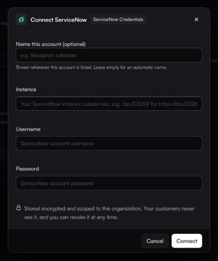

# ParseHub

| | |
| --- | --- |
| **Category** | [Search and web](README.md) |
| **Website** | [parsehub.com](https://parsehub.com) |
| **Authentication** | API key |
| **Slug** | `parsehub` |

## Setup

Your customers enter their API key for ParseHub when they connect. Nothing else needs setting up.

## Connect in Fastn

Your customers connect ParseHub from your widget. To connect an account yourself:

1. Go to **Build → Integrations → Connectors** and search for **ParseHub**.
2. Select **Connect** on the ParseHub card.

   <figure><figcaption>
Search for the connector, then select Connect on its card. ServiceNow is shown here.
</figcaption></figure>

3. Fill in the fields the form asks for, using the values from [Setup](#setup) above. Then select **Connect**.

   <figure><figcaption>
A connect form that asks for credentials. Each connector asks for its own fields.
</figcaption></figure>

4. Check that the connection appears under **Operate → Connections** with the status `Active`. Your workflows can now use ParseHub's actions.

For more detail, see [Connect an app](../../build/connectors/connect-an-app.md).

## Actions

<table><thead><tr><th width="240">Action</th><th width="260">Slug</th><th>What it does</th></tr></thead><tbody><tr><td>Cancel Run</td><td><code>cancelRun</code></td><td>Cancels a ParseHub run that is currently initialized, queued or running, and returns the updated run object with status cancelled. Data already extracted before cancellation may still be downloadable if the run's data_ready field is true.</td></tr><tr><td>Delete Run</td><td><code>deleteRun</code></td><td>Permanently deletes a ParseHub run and the data it extracted, and returns the token of the deleted run. This cannot be undone.</td></tr><tr><td>Get Last Ready Run Data</td><td><code>getLastReadyRunData</code></td><td>Downloads the data extracted by a project's most recent run whose data is ready, without needing to track individual run tokens. Returns JSON by default, or CSV when the format parameter is set to csv. ParseHub serves this response gzip-encoded.</td></tr><tr><td>Get Project</td><td><code>getProject</code></td><td>Retrieves a single ParseHub project by its project token, including its run list of the 20 most recent runs and its most recent and most recent ready run. Use the offset parameter to page further back through the run list.</td></tr><tr><td>Get Run</td><td><code>getRun</code></td><td>Retrieves the run object for a given run token, including its status, whether its data is ready, timings and page count. Poll this to detect when a run has finished. ParseHub rate-limits this endpoint per run to 25 calls during the first five minutes after the run started, and one call every three minutes thereafter; a project webhook configured in the ParseHub client is the recommended alternative.</td></tr><tr><td>Get Run Data</td><td><code>getRunData</code></td><td>Downloads the data extracted by a completed ParseHub run. Returns JSON by default, or CSV when the format parameter is set to csv. ParseHub serves this response gzip-encoded. The run's data_ready field must be true before the data is available.</td></tr><tr><td>List Projects</td><td><code>listProjects</code></td><td>Lists the scraping projects in your ParseHub account, most recently created first, together with the total number of projects. Projects are created in the ParseHub desktop client; the API cannot create them.</td></tr><tr><td>Run Project</td><td><code>runProject</code></td><td>Starts a new cloud run of a ParseHub project and returns the created run object immediately with status initialized, while the run continues in the background. Optionally override the start URL, the starting template and the starting global scope for this run, and request an email notification when the run finishes. Use Get Run to poll for completion, or configure a project webhook in the ParseHub client to be notified instead.</td></tr></tbody></table>

## Events

Start a workflow when one of these happens, with an [app event trigger](../../build/triggers/README.md).

<table><thead><tr><th width="240">Event</th><th width="260">Id</th><th>When it fires</th></tr></thead><tbody><tr><td>Run Cancelled</td><td><code>cancelled</code></td><td>Fires when a run of the project was cancelled, either through the Cancel Run action or in the ParseHub client. Data extracted before cancellation may still be available when data_ready is true. Setup is manual: ParseHub has no webhook registration API. In the ParseHub desktop client, open the project, go to its Settings tab, paste the Fastn webhook URL into the Webhook field and save. ParseHub then POSTs to that URL whenever any of the project's runs changes its status or data_ready field. Note that ParseHub sends valid JSON with a Content-Type of application/x-www-form-urlencoded, and retries a failed delivery once per hour up to three times or until it receives an HTTP 200.</td></tr><tr><td>Run Completed</td><td><code>complete</code></td><td>Fires when a run of the project has finished successfully and its extracted data is ready to download with Get Run Data or Get Last Ready Run Data. Setup is manual: ParseHub has no webhook registration API. In the ParseHub desktop client, open the project, go to its Settings tab, paste the Fastn webhook URL into the Webhook field and save. ParseHub then POSTs to that URL whenever any of the project's runs changes its status or data_ready field. Note that ParseHub sends valid JSON with a Content-Type of application/x-www-form-urlencoded, and retries a failed delivery once per hour up to three times or until it receives an HTTP 200.</td></tr><tr><td>Run Failed</td><td><code>error</code></td><td>Fires when a run of the project ended in an error. When ParseHub judges that a retry is likely to succeed it restarts the run automatically, and the payload then carries an additional new_run object holding the metadata of the restarted run. Setup is manual: ParseHub has no webhook registration API. In the ParseHub desktop client, open the project, go to its Settings tab, paste the Fastn webhook URL into the Webhook field and save. ParseHub then POSTs to that URL whenever any of the project's runs changes its status or data_ready field. Note that ParseHub sends valid JSON with a Content-Type of application/x-www-form-urlencoded, and retries a failed delivery once per hour up to three times or until it receives an HTTP 200.</td></tr><tr><td>Run Initialized</td><td><code>initialized</code></td><td>Fires when a run of the project has been created and is about to be queued. Setup is manual: ParseHub has no webhook registration API. In the ParseHub desktop client, open the project, go to its Settings tab, paste the Fastn webhook URL into the Webhook field and save. ParseHub then POSTs to that URL whenever any of the project's runs changes its status or data_ready field. Note that ParseHub sends valid JSON with a Content-Type of application/x-www-form-urlencoded, and retries a failed delivery once per hour up to three times or until it receives an HTTP 200.</td></tr><tr><td>Run Queued</td><td><code>queued</code></td><td>Fires when a run of the project has been queued for execution on the ParseHub cloud. Setup is manual: ParseHub has no webhook registration API. In the ParseHub desktop client, open the project, go to its Settings tab, paste the Fastn webhook URL into the Webhook field and save. ParseHub then POSTs to that URL whenever any of the project's runs changes its status or data_ready field. Note that ParseHub sends valid JSON with a Content-Type of application/x-www-form-urlencoded, and retries a failed delivery once per hour up to three times or until it receives an HTTP 200.</td></tr><tr><td>Run Started</td><td><code>running</code></td><td>Fires when a run of the project has begun traversing pages. Setup is manual: ParseHub has no webhook registration API. In the ParseHub desktop client, open the project, go to its Settings tab, paste the Fastn webhook URL into the Webhook field and save. ParseHub then POSTs to that URL whenever any of the project's runs changes its status or data_ready field. Note that ParseHub sends valid JSON with a Content-Type of application/x-www-form-urlencoded, and retries a failed delivery once per hour up to three times or until it receives an HTTP 200.</td></tr></tbody></table>
