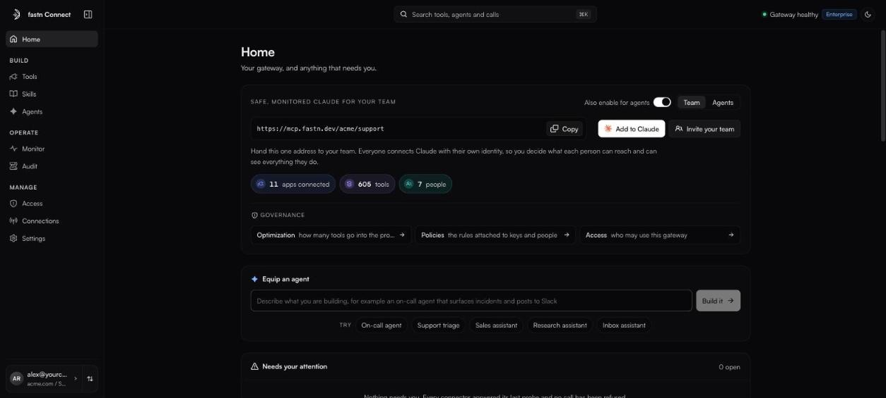

# Fastn Connect

Fastn Connect is a hosted **MCP gateway**. You connect the apps your team works in (Slack, GitHub, Google, Jira, your own MCP servers and thousands more) once, and you get back **one URL**. Any MCP client pointed at that URL sees every tool you turned on, and every call is checked, logged and run with the right person's account.

<figure><figcaption>Home: your gateway URL, what is connected, and anything that needs you.</figcaption></figure>


**Which URL do I use?** fastn has two MCP addresses, for two different jobs:

* `https://mcp.fastn.dev/<your-org>`: **Fastn Connect**, these pages. Your AI tool uses your team's connected apps (Slack, GitHub, Google and more). Copy the exact URL from Home in [connect.fastn.dev](https://connect.fastn.dev).
* `https://mcp.fastn.dev/fastn-workspace`: **the fastn platform**. Your AI tool builds fastn integrations for you from a chat. See [MCP gateway](../build/mcp-gateway/README.md).


### What it does for you

* **One endpoint for every tool.** Aggregate any number of MCP servers and catalog apps behind a single URL. Tools are namespaced per app, so calls always reach the right one.
* **Each person signs in as themselves.** With per-user sign-in, a teammate's call to GitHub runs with *their* GitHub account, not a shared one. Nobody holds anyone else's credentials.
* **You decide what each person and agent can reach.** Policies make a key or a person read-only, hide tools, and mask personal data, card numbers and secrets before a result reaches the model.
* **Every call is on the record.** Monitor shows each call, its latency and what was refused. Audit keeps a hash-chained log of every sign-in, access change and tool call.
* **Nothing to deploy.** It is hosted. You sign in with your work email and your gateway is live.

### Who it is for

| You want to… | Start here |
| --- | --- |
| Give your team Claude, ChatGPT or Cursor with your real tools | [Quickstart](quickstart.md) |
| Connect a headless agent or your own product | [Agents and access keys](agents/README.md) |
| Control what each person or agent can do | [Policies](access/policies.md) |
| Understand the moving parts first | [Core concepts](concepts.md) |

### The two addresses

Fastn Connect lives on two hosts. You only ever paste the second one into a client.

| Host | What it is |
| --- | --- |
| `https://connect.fastn.dev` | The app: sign in, add tools, manage people, policies, keys, Monitor and Audit. |
| `https://mcp.fastn.dev` | The MCP endpoint your clients and agents connect to. |

See [Gateway URLs](reference/gateway-urls.md) for every URL form.

### In this section

* [Quickstart](quickstart.md)
* [Core concepts](concepts.md)
* [A tour of the app](app-tour.md)
* [Tools](tools/README.md)
* [Connecting AI clients](clients/README.md)
* [Agents and access keys](agents/README.md)
* [People and roles](access/README.md)
* [Policies](access/policies.md)
* [Skills](skills.md)
* [Connections](connections.md)
* [Monitor](monitor.md)
* [Audit](audit.md)
* [Workspaces](workspaces.md)
* [Settings and your profile](settings.md)
* [Plans and limits](plans-and-limits.md)
* [Reference](reference/gateway-api.md)
* [Troubleshooting](troubleshooting.md)
